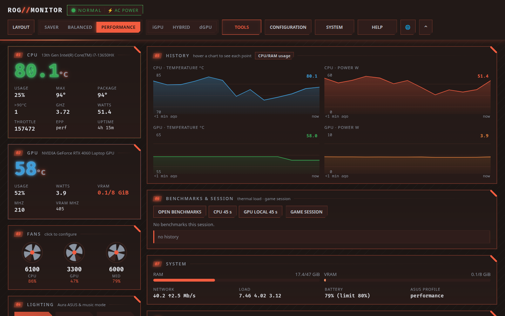
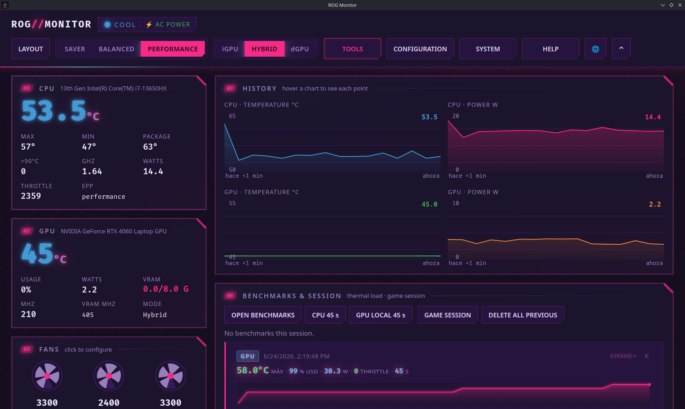
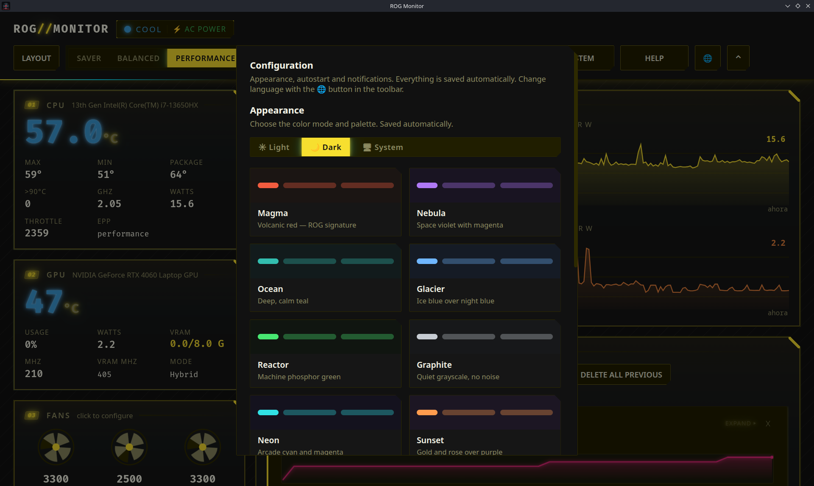
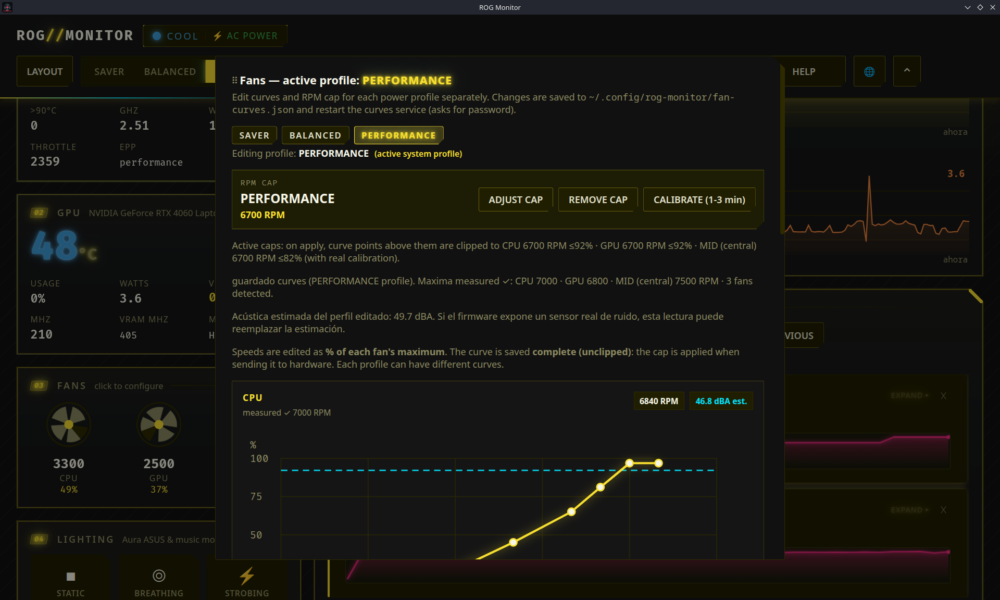
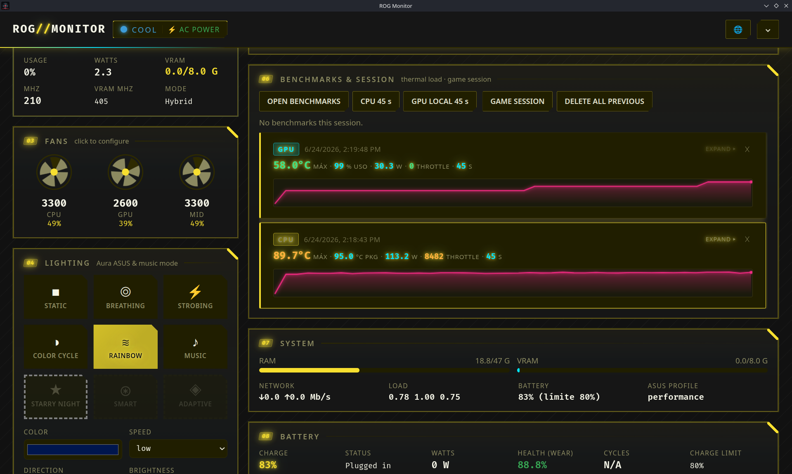
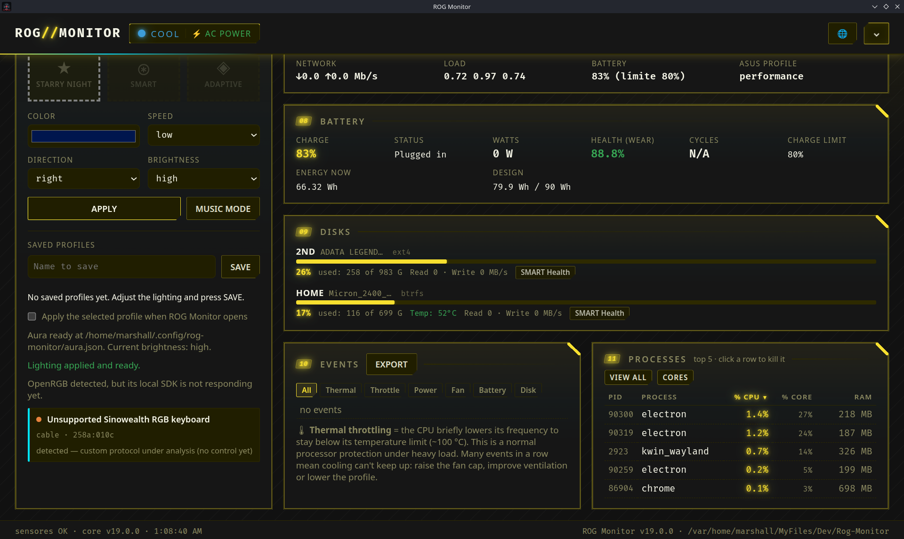
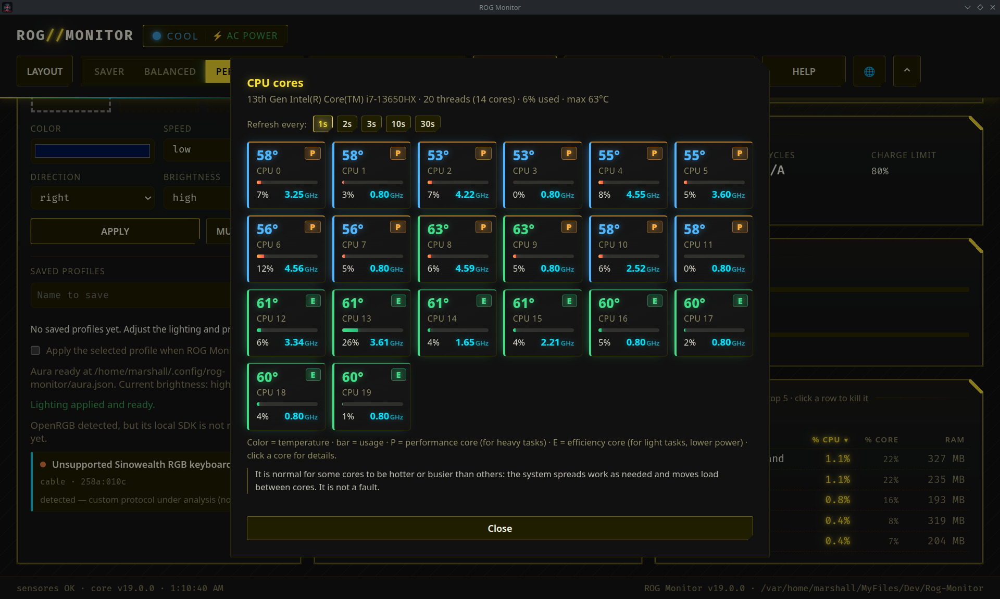
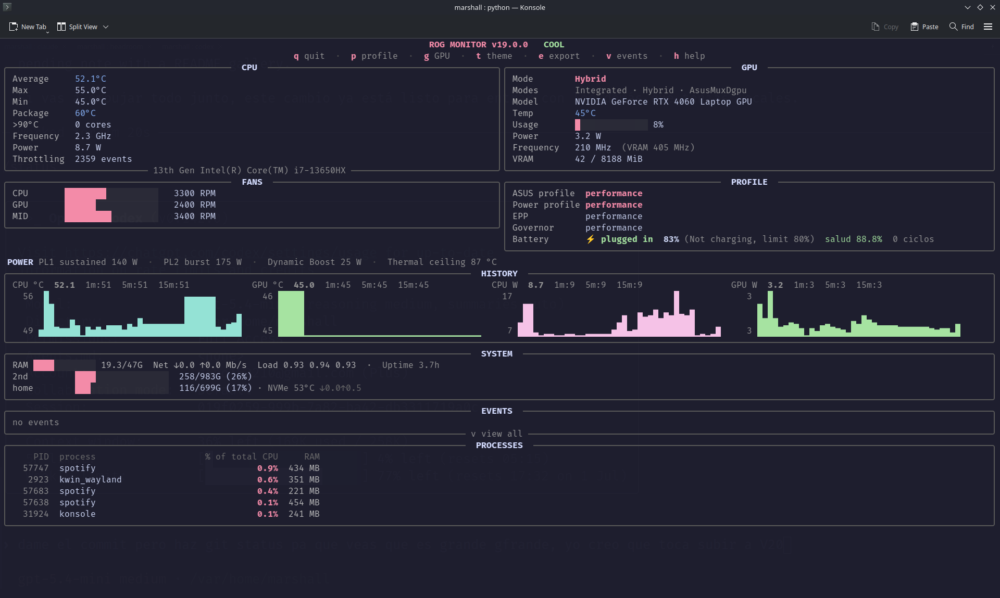

# ROG Monitor

Real-time hardware monitor and control center for ASUS ROG laptops on Linux,
available as a terminal UI and an Electron desktop app. No telemetry, no
background internet calls, and no root access for the main monitoring path.

> ⚠️ **Early release — actively improving.** ROG Monitor is used daily and works,
> but it is still evolving: expect bugs, rough edges, and fast-moving features.
> **Linux only for now**. A Windows companion app is listed in the
> [roadmap](docs/roadmap.md). The project is tested mostly on ASUS ROG hardware;
> unsupported machines degrade to read-only instead of guessing. Privileged
> actions for power, fans, and firmware are designed to be reversible, but use
> them with care. Bug reports and pull requests are welcome.

<p align="center">
  
</p>

## Highlights

| | |
| --- | --- |
| 🌡️ **Everything at a glance** | CPU usage % and temperature, GPU usage / power / VRAM, fans in RPM, RAM and swap in GiB, disks with IOPS and % busy, network, battery health. |
| 🌀 **Fans that behave** | Reactive curves in all three profiles (quiet, balanced, performance): 8-point curves that start at 50 °C and map to real RPM once you run the fan calibration. If the firmware leaves a fan stuck high after the machine cools down, a watchdog notices and re-applies the curves ([details](#fans-and-the-stuck-fan-watchdog)). |
| ⚡ **Power Center** | PL1 / PL2 / Dynamic Boost / thermal target per profile, clamped to firmware limits, with a one-click factory reset. Needs `asus-armoury` or a device profile. |
| 🛡️ **Safe by design** | No telemetry. Monitoring needs no root. Privileged actions go through an allowlist and root only runs root-owned copies. Every change can be undone ([RECOVERY.md](docs/RECOVERY.md)). |
| 🔔 **Useful alerts** | CPU/GPU heat, throttling, stopped fans, power spikes, RAM / swap pressure and nearly-full disks — with cooldown and hysteresis, no spam. |
| 📈 **Honest data** | Every panel has one of six states, and a `NO DATA` notice appears if the backend stops sending samples, so stale numbers are never shown as live ([details](#widget-states-and-no-data)). |
| 🖥️ **Desktop + terminal** | Electron 44 app with 12 themes in 8 languages, and a lightweight TUI (3 color themes) for SSH or a TTY. |

What changed recently: [CHANGELOG.md](CHANGELOG.md) · what is next: [roadmap](docs/roadmap.md).

## Demo

<p align="center">
  
</p>

## Screenshots

The top screenshot (`00-dashboard.png`) was refreshed on 2026-10-12. The
gallery below (`01`-`07`) and the demo GIF date from June 2026 (v20 era) and have not been
refreshed since, so some details (for example the history chart editor,
benchmark cards and the `NO DATA` notice) look different in the current app.

<table>
  <tr>
    <td align="center"><br>Dashboard</td>
    <td align="center"><br>Configuration</td>
    <td align="center"><br>Benchmarks & session</td>
  </tr>
  <tr>
    <td align="center"><br>Fans</td>
    <td align="center"><br>System & battery</td>
    <td align="center"><br>CPU cores</td>
  </tr>
  <tr>
    <td align="center" colspan="3"><br>TUI</td>
  </tr>
</table>

## Requirements

- **Linux.** Tested mostly on ASUS ROG laptops; other machines degrade to
  read-only sensors (see [Supported hardware](#supported-hardware)).
- **Python 3** with [`rich`](https://pypi.org/project/rich/) (`rich>=13`, see
  `requirements.txt`). CI runs Python 3.12; the installer does not enforce a
  minimum version. `install.sh` creates the virtual environment for you.
- **Desktop app (optional):** Node.js 22 and npm to install and run it from a
  clone (CI uses Node 22). The app uses Electron 44. The terminal UI does not
  need Node.
- **Optional extras**, each degrading quietly when missing: `asusctl` / `asusd`
  and `asus-armoury` sysfs (power limits, Aura), `supergfxctl` (GPU mode),
  `smartmontools` (SMART), NVIDIA driver / NVML (NVIDIA telemetry), PipeWire
  (Music Mode), MangoHud (FPS), OpenRGB (third-party RGB detection).
- **Root** is only needed for the optional system integration
  (`scripts/install-system.sh`); monitoring itself needs none.

## Security at a glance

- **No telemetry, no background internet traffic.** The only intended internet
  use is `git fetch` when you press **UPDATE** (the report button just opens
  GitHub in your browser). The one other socket is a loopback probe: the Aura
  code checks whether an OpenRGB server answers on `127.0.0.1:6742`, which
  never leaves your machine.
- **No root required for monitoring.** Sensors are read from sysfs/hwmon as a
  normal user.
- **Allowlisted privileged actions.** Power, fan, SMART, and service changes go
  through explicit `pkexec` prompts and bounded scripts. Polkit handles the
  password; ROG Monitor never sees or stores it. Root only runs root-owned
  copies of those scripts, never files from your clone
  ([details](SECURITY.md#privilege-boundary)).
- **Double clamp before firmware writes.** Power values are clamped by the UI and
  again by the privileged helper against firmware-reported `_min` / `_max`
  values.
- **Recovery path included.** **RESET TO FACTORY** restores firmware defaults and
  `scripts/rog-monitor-safe-mode.sh` can disable root integrations from a TTY.

Threat model and reporting process: [SECURITY.md](SECURITY.md).

## Main features

### Sensors (no root)

- **CPU**: total usage %, per-core usage and temperature (P and E cores on
  hybrid CPUs), average/max,
  package temperature, frequency, count of cores over 90 °C, and thermal-throttling counter.
- **GPU**: NVIDIA (NVML, with `nvidia-smi` as fallback) and AMD (`hwmon/amdgpu`) telemetry:
  temperature, utilization, power, VRAM, core clock, and memory clock. Detects
  Hybrid / Integrated / AsusMuxDgpu (MUX) through `supergfxctl` and handles the
  dGPU being powered down.
- **Fans**: RPM, proportional bars, PWM-to-RPM calibration (measured by the
  first-run wizard or on demand), and runtime RPM caps applied by the root
  service. Fan control is ASUS-specific (see
  [Fans and the stuck-fan watchdog](#fans-and-the-stuck-fan-watchdog)).
- **System**: RAM and swap (GiB and %), real disks with NVMe temperature, IOPS and
  % busy, network, load, uptime, and battery charge limit.
- **Processes**: as many top consumers as fit in the block (up to 25), with CPU %,
  cores used (for example `2.35` instead of `235 %`) and RAM, and confirmation
  before closing a process.
- **SMART health**: `smartctl` through one explicit `pkexec` prompt.
- **FPS overlay**: MangoHud log integration, opt-in.

### Desktop app (Electron + Python)

- Numbered blocks: CPU, GPU, Fans, Lighting, History, Benchmarks, System, Events,
  and Processes.
- **Power Center**: CPU/GPU power limit control with firmware clamps (ASUS
  hardware; see below).
- **12 palettes** x light/dark mode: Magma, Nebula, Ocean, Glacier, Reactor,
  Graphite, Neon, Sunset, Neon Nights, Cyberpunk, Aurora, and Dawn.
- **Interactive history charts**: temperature/power or usage mode (CPU % and GPU % on
  0–100, RAM and swap in GiB on 0..total); hover shows the exact value and how many
  seconds ago it was recorded.
- **Chart editor** (the **Charts** button in the History block): choose which charts
  are shown, reorder them with the arrow buttons, **Up/Down** or
  **Alt+Up/Down**, or drag a row by its handle, apply quick presets, and expand
  any chart into a large modal. The selection is saved by the app. Drag with a real mouse
  has so far been validated only with synthetic events (see the changelog).
- **Gaming overlay** (opt-in, **partial**): transparent, frameless, always-on-top,
  click-through window; pick the monitor, one of 7 positions and which metrics to
  show. It dims and shows `NO DATA` when samples stop for 6 s. Not yet verified
  over fullscreen games on KDE Wayland (see roadmap).
- **First-run wizard**: detects fans, calibrates with `pkexec`, runs CPU/GPU
  benchmarks, and tours the app.
- **Six widget states** per panel (below) and a `NO DATA` notice when the
  backend goes quiet.
- **Benchmarks** (**partial**, see roadmap): CPU/GPU runs with recorded
  conditions and p50/p95/p99. Deleting a result is no longer immediate: a 6 s
  toast offers **Undo** and puts it back where it was.
- Draggable modals, full JSON export/import, and configurable text size.

#### Widget states and NO DATA

Each dashboard panel resolves to one of six states, so a blank value has a
reason:

| State | Meaning |
| --- | --- |
| `loading` | No sample has arrived yet (skeleton shimmer). |
| `ok` | Data present and valid. `0` is a legitimate value. |
| `empty` | A sample arrived but this block has no useful data (reader failed, no sensor, empty list). The hardware is not blamed. |
| `unsupported` | The hardware or configuration explains it, for example dGPU off by mode or a machine without battery. |
| `error` | The backend is down (explicit red chip). |
| `stale` | The backend is alive but sent nothing for more than **6 s** while the window is visible. |

When data goes `stale`, panels dim and the top bar shows **`NO DATA · N s`**
(`SIN DATOS · N s` in Spanish) instead of old numbers pretending to be live.
The state model is `desktop/renderer/widget-states.js`; the `unsupported`
state is currently drawn like `empty`.

### Fans and the stuck-fan watchdog

On ASUS laptops that expose the `asus-wmi` custom fan curve interface, ROG
Monitor manages one 8-point curve per fan for each of the three profiles
(quiet, balanced, performance). The default curves start at 50 °C, and the
`rog-profile-sync` service follows the system power profile to pick the
matching fan profile. Curves are applied by the installed root service.

Some firmware keeps fans spinning fast after a heavy load, and only rewriting
the curve brings them down. The maintainer saw this on one ROG laptop and the
same symptom is reported for another model under Windows; it has not been
checked on other models. The watchdog in `scripts/rog-profile-sync.sh`
handles it:

- Every loop (at most 30 s) it checks each fan that spins at **3000 rpm or
  more** against what its own curve asks for at the **hottest** of the CPU
  package temperature and the dGPU temperature (read without waking the dGPU).
- The expected RPM comes from your fan calibration, or from a default maximum
  RPM if you have not calibrated.
- A fan counts as stuck when it is above that expectation by more than
  `max(900 rpm, 25 %)`.
- If that lasts **60 s**, it rewrites all the curves of the active profile.
  After a re-apply it waits at least **180 s** before it can act again, and it
  logs whether the fans came back (`journalctl -u rog-profile-sync`).

This needs the root service (`sudo bash scripts/install-system.sh`). The logic
is covered by tests with a fake sysfs; a real thermal test on hardware is still
pending (see the changelog).

### RGB lighting (Aura + peripherals)

- Aura grid with firmware-detected hardware modes when exposed by ASUS.
- **Music Mode**: captures system audio through PipeWire and drives Aura
  brightness/color in real time.
- Aura profiles stored in `~/.config/rog-monitor/aura.json`.
- Third-party USB RGB keyboard detection is present; write control is blocked
  until the protocol is verified.

### Power Center

ROG Monitor reads safe ranges from `asus-armoury` sysfs or from a device profile
at `~/.config/rog-monitor/device.json`. It never writes outside firmware-declared
minimum and maximum values.

| Control | Sysfs (`asus-armoury`) |
| --- | --- |
| CPU PL1 (sustained) | `ppt_pl1_spl` |
| CPU PL2 (burst) | `ppt_pl2_sppt` |
| GPU Dynamic Boost | `nv_dynamic_boost` |
| Thermal Target | `nv_temp_target` |

Safety guarantees:

1. Every write is clamped against firmware `_max` / `_min` values.
2. The Power Center shows current values before changing anything and requires
   explicit consent before applying.
3. **RESET TO FACTORY** restores firmware stock values.
4. Startup is read-only by default; ROG Monitor does not change power or GPU
   mode on its own. The exceptions are the per-profile limits you saved
   yourself (applied when the profile changes) and the opt-in thermal guardian
   below, which you must enable.

GPU Base Clock Offset and Memory Clock Offset use NVML when the driver supports
them. They require an extra confirmation because unstable offsets can crash the
session.

To add your own machine or tune ranges, see
[docs/supported-devices.md](docs/supported-devices.md).

### Thermal guardian (opt-in)

The thermal guardian is a root service that is installed but **not enabled**;
you turn it on from the app. In **Protection** mode it raises fan aggression
first and, if the excess is sustained, trims `nv_dynamic_boost` and, if needed,
`ppt_pl2_sppt` (PL2) in small steps, then restores them gradually. **Gaming**
mode only touches fans and never trims power. It never applies GPU clock
offsets or changes the GPU mode.

Design rule ([ADR-0005](docs/adr/0005-guardian-simulation-first.md)):
**simulation first**. Every write goes through one function; in simulation
mode (on by default the first time you enable it) the guardian logs
`[SIM] would write ...` and writes nothing, so you can read its
`decision=... reason=...` journal lines before letting it act. Further
"Guardian 2.0" work (one owner per fan/power attribute, a scheduled silent
mode, configurable response curves) and a single polkit-backed privileged
helper are future work, not part of this release.

### TUI (terminal)

- Rich charts without flicker, refreshed once per second.
- Semantic colors shared with the desktop app: blue = cold, green = normal,
  orange = near limit, red = critical.
- **Three color themes** (`rog`, `ice`, `matrix`; cycle with `t`). The 12
  palettes listed above belong to the desktop app only.
- No mouse capture, so terminal selection and scrolling work normally
  ([why](docs/adr/0003-tui-mouse-off.md)).

## Installation

```bash
git clone https://github.com/MarshallGomez1103/Rog-Monitor.git
cd Rog-Monitor
bash install.sh
```

`install.sh`:

1. Creates the Python environment and the `monitor` command without sudo.
2. Installs the desktop app and launchers when Node.js/npm are available.
3. At the end, asks for sudo once for optional system integration: fan service,
   thermal guardian setup, and CPU power read permissions. You can say no.

It does not install anything that automatically changes your GPU mode or power
profile.

System integration needs one `sudo bash scripts/install-system.sh`. Preview what
it will do first with `bash scripts/install-system.sh --dry-run` (no root, changes
nothing). Run it again after any update that changes `VERSION`: until you do,
privileged actions are refused, and the app offers **REINSTALL / REPAIR** under
**System -> Maintenance**. Why root only runs installed copies:
[docs/adr/0001-privilege-boundary.md](docs/adr/0001-privilege-boundary.md).

**Updating to v22:** several root-side scripts changed in v22 (for example
`rog-profile-sync.sh`, which holds the fan watchdog) without a `VERSION` bump,
so the app cannot tell that your installed copies are old. After updating, run
`sudo bash scripts/install-system.sh` once; otherwise the root service keeps the
previous behavior.

Run it with:

```bash
monitor            # terminal UI
monitor --desktop  # desktop app, or open it from the app launcher
```

### AppImage

Download the `.AppImage` from Releases, make it executable once, and open it:

```bash
chmod +x ROG-Monitor-*.AppImage
```

It needs `python3`, which ships with most Linux distributions. To build it
locally:

```bash
cd desktop
npm install
npm run dist
```

The output lands in `desktop/dist/`.

## Uninstall

```bash
bash uninstall.sh            # removes app, launchers, autostart and services;
                             # keeps ~/.config/rog-monitor
bash uninstall.sh --purge    # also removes configuration
```

You can also update, reinstall, or uninstall from
**System -> Maintenance** inside the app.

### TTY recovery

If a root integration causes trouble and you can only enter through a TTY
(`Ctrl+Alt+F3`):

```bash
sudo bash scripts/rog-monitor-safe-mode.sh disable
sudo bash scripts/rog-monitor-safe-mode.sh no-auto-profile
```

Troubleshooting (bad fan curve, power limit, guardian, battery limit, login
problems): [docs/RECOVERY.md](docs/RECOVERY.md).

## TUI keys

| Key | Action |
| --- | --- |
| `q` | Quit |
| `p` | Cycle power profile (`power-saver` -> `balanced` -> `performance`) |
| `g` | Change GPU mode (`Hybrid` <-> `Integrated`); press again while pending to cancel |
| `t` | Cycle color theme |
| `v` | View full event log |
| `f` | Cycle event severity filter (all -> warn and above -> critical only) |
| `e` | Export history as JSON + CSV |
| `h` | Help |

## CLI

```text
monitor [--once] [--json] [--json-stream] [--desktop] [--interval S]
        [--no-gpu] [--theme THEME] [--lang en|es] [--version]
```

`--json` and `--json-stream` emit NDJSON with all sensors. The desktop app uses
that stream, and external widgets/scripts can consume it too.

## Configuration

`~/.config/rog-monitor/config.json` is created on first save:

```json
{
  "lang": "en",
  "theme": "rog",
  "interval": 1.0,
  "history_seconds": 900,
  "notifications": true,
  "close_action": "quit",
  "appearance": { "theme": "magma", "mode": "dark", "zoom_level": 0 },
  "alerts": {
    "cpu_temp_warn": 92,
    "gpu_temp_warn": 85,
    "cpu_power_warn": 140,
    "fan_stopped_cpu_temp": 60,
    "cooldown_seconds": 60,
    "hysteresis_temp": 3,
    "hysteresis_pct": 5,
    "throttle_min_ms": 100,
    "ram_percent_warn": 90,
    "swap_percent_warn": 80,
    "disk_percent_warn": 95
  },
  "temp_colors": {
    "cpu": [70, 85, 92],
    "gpu": [60, 75, 83]
  }
}
```

These are the defaults. `lang` is `"en"` by default; `"auto"` (follow `$LANG`)
and `es`, `fr`, `it`, `pt`, `zh`, `ja`, `ko` are also accepted. `theme` is the
TUI theme (`rog`, `ice` or `matrix`); `appearance.theme` is the desktop palette
(one of the 12 above) and `appearance.mode` is `light`, `dark` or `system`.
`close_action` is `quit`, `tray` or `ask`. The alert `*_percent_warn` values are
percentages and `hysteresis_temp` is in °C.

`temp_colors` defines personal temperature bands: `[green_before,
yellow_before, orange_before]`. Above the last value, the UI turns red.

The file also holds state the desktop app maintains for itself (dashboard
layout, Aura draft, measured fan maximums); you normally do
not edit those by hand.

These values are editable from the desktop app's **ALERTS** modal.

## Supported hardware

### Device profiles

The repo includes community device profiles (`src/rog_monitor/device_profiles.json`)
and can also read live firmware ranges from sysfs. Which models are covered, and
how well each has been tested, is listed in
[docs/supported-devices.md](docs/supported-devices.md); do not assume your model
is covered. Public profiles must avoid personal data and use only the technical
identifiers needed to detect the device.

### Generic sensors (read-only, any Linux machine that exposes them)

The sensor layer enumerates hwmon directly, so a machine exposing standard chips
can show these without extra configuration. Not every machine exposes every
sensor, and this path has been tested mostly on ASUS ROG hardware:

- **CPU**: `coretemp` (Intel), `k10temp` / `zenpower` (AMD)
- **GPU**: NVIDIA through NVML (`nvidia-smi` as fallback); AMD through `amdgpu` hwmon
- **Fans (read)**: any chip exposing `fan*_input`
- **Power profile (read)**: `platform_profile` / power-profiles-daemon

Missing sensors degrade quietly to `N/A`.

### ASUS-only features

These need ASUS-specific interfaces and do nothing on other machines: fan curves
and the stuck-fan watchdog (`asus-wmi` custom fan curves), PL1 / PL2 / Dynamic
Boost / thermal target (`asus-armoury`, or a device profile), Aura lighting
(`asusctl`) and the thermal guardian. Several also need the optional root
integration.

### Add your machine

See [docs/supported-devices.md](docs/supported-devices.md) for:

- Reading safe ranges from `asus-armoury` sysfs or Armoury Crate on Windows.
- The schema for `src/rog_monitor/device_profiles.json`.
- Creating a local profile at `~/.config/rog-monitor/device.json`.
- Current public model support.

## No telemetry, no network

No data is sent to any server. The only allowed network actions are the update
button (`git fetch` on your own clone) and the report button, which opens GitHub
with system information pre-filled. ROG Monitor never runs `git push`. The only
other socket is the loopback probe to a local OpenRGB server
(`127.0.0.1:6742`) described under Security.

## Quality gates

CI (GitHub Actions) fails if Python line coverage drops below **80 %** (the
`unittest` suites run under `coverage`) or if Node line coverage drops below
**90 %** (`node --test` with coverage). It also runs the i18n validator and an
Electron end-to-end smoke test. Run the same checks locally:

```bash
python -m coverage run --source=src/rog_monitor -m unittest discover -s tests
python -m coverage report --fail-under=80
node --test --experimental-test-coverage --test-coverage-lines=90 desktop/test/*.test.js
node scripts/validate-i18n.mjs
node scripts/check-docs.mjs   # README / CHANGELOG still say what the code does
```

## Documentation

- [Architecture](docs/ARCHITECTURE.md): components, data flow, privilege
  boundary, and the [decision records](docs/adr/0001-privilege-boundary.md).
- [Security](SECURITY.md): threat model, privilege boundary, reporting.
- [Recovery](docs/RECOVERY.md): fixing fans, power limits, guardian or login
  problems from a TTY.
- [Benchmarks](docs/BENCHMARKS.md): how results are measured and compared.
- [Supported devices](docs/supported-devices.md): compatibility matrix and how
  to add your machine.
- [Translating](docs/TRANSLATING.md), [Contributing](CONTRIBUTING.md),
  [Roadmap](docs/roadmap.md).

## License

MIT
