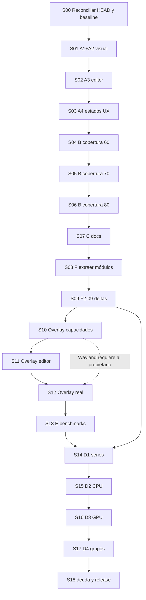

# ROG Monitor v22 — Plan siguiente de ejecución por etapas (A–F)

> **Estado:** PROPUESTA PARA REVISIÓN Y EJECUCIÓN CONTROLADA · **Versión del plan:** 1.0 · **Fecha:** 2026-10-14  
> **Ruta canónica/versionada:** `docs/agent-work/v22/PLAN-SIGUIENTE.md` · **Rama de ejecución:** `feat/v22`  
> **Naturaleza:** SOLO PLAN. Ningún código, servicio, privilegio, instalación ni hardware fue modificado por quien elaboró este documento.  
> **Documentos de entrada:** `INSUMO-PROPIETARIO-2026-10-14.md` (copia de `ROG-Monitor-Siguiente-Plan.md`, secciones 0–10), `PLAN_MAESTRO_ROG_MONITOR.md` (secciones 2, 5 y 7), `docs/agent-work/v22/STATUS.md`, `docs/agent-work/v22/HANDOFF.md`, `docs/adr/0006-host-safety-v22.md`, ADR-0005.  
> **Verificación de fuentes:** el documento del propietario se recibió completo. Los otros cuatro se consultaron en la rama `feat/v22` publicada en GitHub; **no hubo acceso al checkout local**, ejecución de comandos, ni inspección del árbol a un SHA congelado. Al comenzar S00, Opus debe verificar que las versiones locales coinciden y corregir referencias desactualizadas antes de ejecutar este plan.
>
> **Aviso sobre Git:** el insumo del 14/10 afirma `master=45cb9dc` actualizado, `feat/v22` limpia/pusheada y 234 commits. Algunos fragmentos publicados de STATUS/HANDOFF todavía describen master en v21 o resultados antiguos; prevalece la comprobación actual del repositorio, no estos textos. El primer checkpoint documenta la reconciliación.

---

## 1. Decisiones de producto y orden vinculante

Este plan **no reinicia los 90 checkpoints históricos ni los 100 del plan maestro**. Reutiliza los `F*-**` **solamente para trabajo pendiente o ampliaciones verificables**; el nuevo trabajo se identifica `N-...`. Un checkpoint anterior marcado `TESTED/ACCEPTED` no se vuelve a ejecutar salvo como regresión. Si el código contradice el estado documental, se abre una incidencia nueva, nunca se altera el pasado silenciosamente.

**Orden de las prioridades del propietario:** **A** (bugs visuales + estados UX), **B** (Python 52 % → ≥80 %), **C** (README, roadmap, changelog), **E** (overlay y benchmarks serios), **D** (paridad con el Administrador de tareas). **F** (arquitectura) es una restricción transversal desde S01, con una etapa propia de extracción antes de funciones grandes. El transporte **F2-09/F2-10** se coloca antes de nuevas series D1 porque enviar todo el historial en cada tick escala mal. F4-04/05/06 y otros `TESTED` se **extienden** sin declararlos falsamente pendientes.

### Límites de alcance

- No reescribir la aplicación. Mantener Python stdlib+`rich`, Electron, `node:test`, 12 temas y la estética cuadrada/Carbon-ROG; ningún framework nuevo sin ADR y autorización.
- Ninguna nueva lógica significativa en `desktop/renderer/app.js` (referencia: 4128 líneas) o `desktop/main.js` (1846). Cada función nueva reside en módulo independiente con API documentada y test de unidad primero; esos dos archivos solo componen y conectan.
- No despertar la dGPU suspendida (`D3cold`). No leer GPU mediante procesos costosos por tick. Ningún motor gráfico o benchmark asume RTX.
- El propietario exige «frío → bajan todos; caliente → suben todos»; **no modificar** controlador, curvas ni vigilante de ventiladores sin una nueva prueba térmica real y permiso explícito.
- Guardián 2.0 y helper único **quedan para futuro**. La fase F7 no se implementa en modo real; se permiten inventario y tests con fakes si evitan conflicto de propietarios.
- Separar trabajos que el agente puede terminar con mocks/CDP de validaciones **BLOCKED_OWNER** (Wayland/juego, VM, sudo). Jamás pintar como *PASS* una prueba no ejecutada.
- La autorización previa permite commits y push normal a `feat/v22`, siempre después de validar y revisar; **no** permite `--force`, merge a `master` sin PR/CI verde, ni acciones de root. Para operaciones de publicación seguir también ADR-0006 y confirmar permiso vigente del propietario ante contradicciones.

### Definición de estado

`TODO` → `RED` (test nuevo que falla por la razón correcta) → `GREEN` → `REFACTOR` → `TESTED` → `ACCEPTED`; `BLOCKED_OWNER`, `BLOCKED_ENV`, `PARTIAL` si falta validación. No se marca `ACCEPTED` una función que exige Wayland real, VM o permiso y no ha recibido esa prueba. La ficha y STATUS registran **estado real por gate**.

---

## 2. Protocolo de ejecución obligatorio por tanda

1. **Opus (único integrador):** lectura del plan + AGENTS.md y ADR, `git status`, SHA, comprobación de rama/remoto, ownership, matriz de riesgos, aprobación de la tanda; asignación de worktrees y cierre. No hacer trabajo de edición concurrente sobre archivos calientes.
2. **Haiku (auditor):** inventario y hallazgos `archivo:línea`, fixtures, estado de funciones, trazabilidad y comparaciones visuales, riesgos, estimación de tests; en principio **solo lectura**. No declara algo probado por ver `TESTED` en STATUS.
3. **Sonnet (implementador):** **un worktree aislado por tarea**, tests rojos primero, código mínimo, refactor, pruebas, commit español por checkpoint. Un dueño único por archivo caliente **en toda la tanda**; si dos funcionalidades requieren editarlo, las integraciones son secuenciales.
4. **Opus:** cherry-pick/merge autorizado del worktree ya testeado, revisión de diff, ejecutar pruebas integradas + CDP, exigir ficha, actualizar `STATUS.md`, `HANDOFF.md`, `DECISIONS.md` y `RISKS.md` si corresponde **después de cada tanda**, commit y push normal a `feat/v22` según permiso vigente y CI remoto. Nunca reescribir historial sin bundle y permiso.
5. **Regla de archivos calientes**: `desktop/renderer/app.js`, `desktop/main.js`, `desktop/renderer/style.css`, `desktop/renderer/i18n.js`, `src/rog_monitor/app.py`. **Solo el dueño de integración designado los edita por etapa**. Ni siquiera Opus hace «pequeños retoques» en paralelo: los incorpora secuencialmente cuando termina el dueño. Otro Sonnet puede implementar módulos nuevos/tests/docs en paralelo sin tocar esos archivos. `desktop/renderer/styles/extras.css` y `.github/workflows/ci.yml` también se serializan cuando comparten cambios.
6. **TDD no negociable:** antes de escribir código, test de unidad/contrato o captura CDP que demuestra el fallo, registrar comando y resultado esperado/real. `RED` auténtico, luego `GREEN`, luego regresión. En documentación, test primero = comprobador de enlaces/consistencia o captura del roadmap actual y checklist que muestra la omisión.
7. **i18n:** `es`, `en`, `fr`, `it`, `pt`, `zh`, `ja`, `ko`. Toda cadena visible usa keys de `i18n.js`; validación de 8 idiomas y, para acciones, accesibilidad de `aria-label`.
8. **Seguridad:** ni `sudo`, `pkexec`, `systemctl` con cambios de estado, `/sys` real, instalador/desinstalador, reboot, cambios de potencia/firmware, ni Guardian real. Los scripts **solo** se analizan o se prueban con fakes (`ROG_SYSFS_ROOT`, `ROG_FW_ATTRS_DIR`, runner inyectado, `ROG_PREFIX` simulado). Sudo lo ejecuta el propietario por separado con permiso por acción; una VM también se coordina y registra.
9. **Evidencias:** logs y capturas saneadas (sin usuarios, hostname, seriales, UUID, tokens, rutas privadas sensibles); herramientas privadas `.ai/private/rog-v22/` no se publican. Guardar en ficha rutas reproducibles y opcional evidencia sanitizada versionada, nunca secretos.
10. **Commits:** español, pequeños, idealmente uno por checkpoint; trailer `Co-Authored-By` del modelo correspondiente; no agrupar etapas heterogéneas. Una revisión de `git diff --check` y `git status --short` antecede cada commit. Tras la tanda: actualizar los dos documentos de persistencia antes de terminar la sesión.
11. **Fichas por CP:** `docs/agent-work/v22/checkpoints/<ID>.md`, con ID, base HEAD, objetivo, dueño/archivos, test RED (comando/salida), GREEN (comando/salida), cambios, líneas, CAPTURA CDP o log, cobertura previa/posterior, regresión, riesgos, rollback por `git revert` si procede, SHA(s), aprobación y siguiente CP. Se versionan.
12. **Handoff mínimo de cada tanda:** último SHA, rama/remoto/CI, IDs cerrados y abiertos, cobertura exacta (sin redondear gate), tests/CDP ejecutados, cambios de schema, propietarios de archivos calientes liberados, ruta de evidencia, bloqueos humanos, próximo primer test. **No hacer `push` si CI local rojo**.

### Comandos base (ejecutar solo en el checkout real y entorno preparado)

```bash
cd ~/MyFiles/Dev/Rog-Monitor
git status --short --branch
git log -1 --oneline
git branch -vv
git diff --check

# Python + cobertura (venv privado del insumo; comprobar existencia)
HOME="$PWD/.ai/private/rog-v22/logs/home" PYTHONPATH=src \
  .ai/private/rog-v22/venv-clean/bin/python -s -m coverage run \
  --source=src/rog_monitor -m unittest discover -s tests
.ai/private/rog-v22/venv-clean/bin/python -m coverage report --sort=cover

# Node: usar glob, no la ruta del directorio
node --test --experimental-test-coverage desktop/test/*.test.js
node scripts/validate-i18n.mjs
for f in install.sh uninstall.sh scripts/*.sh; do bash -n "$f"; done

# Electron aislado: tras verificar que no activa acciones privilegiadas
node scripts/e2e-smoke.mjs --out /tmp/e2e

# CDP: consultar la ayuda/interfaz real antes de invocar el runner privado.
# El insumo refiere .ai/private/rog-v22/tools/cdp.mjs y check-*.mjs.
# No inventar opciones ni dar por existente un check-XXX.mjs.
```

**Base reportada por el insumo (no repetida aquí):** Python 206 tests, cobertura total ≈52 % (CI `--fail-under=50`); Node 50 tests, cobertura de módulos instrumentados ≈99 % (piso 90); e2e 31/31; i18n 1026 claves ×8; 12 temas. Si S00 observa otro número, anotar delta y recalcular los gates sin reducir objetivos ni ocultar regresiones.

### Trinquete de cobertura Python

El objetivo es cobertura **de sentencias** de `src/rog_monitor`, medida con la misma opción `coverage run --source=src/rog_monitor ...` y configuración estable en CI. Un incremento solo se acepta después de que el informe real lo supere. **Nunca bajar `--fail-under`, ni excluir rutas o líneas para inflarlo**.

| Momento | Cobertura que debe demostrar | Piso CI después de validar | Regla |
|---|---:|---:|---|
| S00–S03 | ≈52 % de base | **50** actual | Mantener; registrar informe exacto |
| S04 | **≥60 %** | **60** | Refactor de tests fake `/proc` y CLI |
| S05 | **≥70 %** | **70** | Hardware/games sin root |
| S06 | **≥80 %** | **80** | App y orquestación; mantener en TODAS las etapas siguientes |
| S07–S17 | **≥80 %** | **80**, irreversible | Código nuevo lleva tests suficientes antes del merge |

**Matemática orientativa:** 4032 statements × 0.80 ≈ 3226 cubiertos; si el 52 % fuera exacto serían ~2097, faltan ~1129; el insumo redondea «unas 1200». No confundir añadir ~1200 tests con cubrir ~1200 líneas. No usar import-only, mocks inertes ni coberturas triviales para cumplir el porcentaje.

**Plan de contingencia:** si una etapa no llega al porcentaje, queda `PARTIAL` y se divide en más CP de tests `N-B-...` sin modificar el piso a la baja. En adelante los tests que se ejecutan en CI deben ser los mismos que generan la cobertura local, con la misma inclusión/exclusión. La cobertura Node no debe retroceder bajo su piso vigente.

---

## 3. Etapas ejecutables: prioridad A (primero)

### S00 — Reconciliación de v22, baseline y corte de seguridad (sin código)
**Objetivo:** evitar que un plan basado en información de otro HEAD provoque regresiones o repita CP cerrados. **Cobertura:** medir ~52 %, CI mínimo 50 sin bajarlo. **Dependencias:** ninguna; gate de inicio para todas las demás.

| Checkpoint | Primera comprobación / test (antes de cambiar nada) | Evidencia de aceptación |
|---|---|---|
| **N-BASE-01** | `git status --short --branch && git log -1 --format='%h %s' && git branch -vv && git remote -v`; comparar master, `feat/v22` y estado registrado | Tabla SHA local/remoto, cambios no comiteados, estado exacto CI; resolver discrepancias de STATUS/HANDOFF |
| **N-BASE-02** | `git ls-files docs/agent-work/v22` y lectura real de `STATUS/HANDOFF/DECISIONS/RISKS`, ADR-0005/0006 y `AGENTS.md` aplicable | Matriz `F*-**`: accepted/tested/partial/blocked; no CP duplicados; confirmar permiso de push |
| **N-BASE-03 / F9-01 (baseline)** | Ejecutar suite estándar con `coverage report` y guardar baseline; `node --test` y e2e aislado; establecer test de consistencia para 8 idiomas | Logs con rc, Python/Node/e2e/i18n, porcentaje exacto y entorno; toda falla triada |
| **F2-01** | Construir comprobador documental de fuentes/unidades: `/proc`, NVML, SMART, series, capacidades; cotejar fixtures y schema vigente | Inventario `campo → fuente → unidad → frecuencia → disponibilidad → consumidores` y excepciones visibles |

**Archivos:** `docs/agent-work/v22/{STATUS,HANDOFF,DECISIONS,RISKS}.md`, fichas, `docs/ARCHITECTURE.md` (solo si se encuentra error demostrado), documentos de trabajo; **ningún archivo caliente**.  
**Paralelo:** Haiku-Git, Haiku-Contrato, Haiku-CI inspeccionan sin editar; Opus integra y escribe estado; no Sonnet hasta validar baseline.  
**Bloqueos/propietario:** resolver si existen cambios locales y permiso vigente de red/push; **no** solicita sudo.  
**Salida/gate:** baseline firmado con SHA y defectos priorizados; si hubo regresión inicial, abrir `N-REG-*` antes de S01.

### S01 — A1 + A2: tarjetas de benchmarks y tipografía/orden de procesos
**Objetivo:** eliminar recortes y unificar numéricos entre las 3 tablas. **Cobertura Python:** mantener base ≥52 % observada, piso CI 50. **Duración lógica:** dos tandas seriales sobre CSS.

| Checkpoint | **Test RED primero** | Implementación mínima / aceptación |
|---|---|---|
| **N-A1-01** | Fixture CDP con ≥5 tarjetas; `getBoundingClientRect` y `scrollHeight/clientHeight`: inicialmente detectar recortes; capturas de neón, oscuro y claro | `desktop/renderer/styles/extras.css`: `.bench-card {flex-shrink:0}`, scroll y padding; ninguna tarjeta recortada, scroll operativo |
| **N-A1-02** | CDP de contraste `EXPAND`, botón borrar y foco; inspección de `getComputedStyle` en 3 temas | En `extras.css` opacidad ≥0.8, tamaño ≥0.72rem y contraste AA; hit target ≥28px, `aria-label` y confirmación/undo en 8 idiomas |
| **N-A2-01** | Test puro de `getProcessSortState()`/decoración en `desktop/test/procs-table.test.js` + CDP ordenando CPU, cores, RAM en `#procs`, `#allprocs`, `#ram-procs`; comparar `color/font-size/font-weight/text-shadow` | Crear `desktop/renderer/procs-table.js` con modelo de estado sin DOM acoplado; `.proc-table[data-sort-col]`: numéricos no ordenados idénticos (mono 13.5px, `--ink`), PID `--dim`; columna activa con mismo acento; cores sin reducción |
| **N-A2-02** | CDP de estilos tras seleccionar cada orden, con modal y sin modal; comprobar equivalencia por columna y tema | Eliminar las 3 reglas duplicadas (`style.css`, `extras.css`) y usar clase compartida; 3 tablas coherentes, sin click destructivo accidental |

**Archivos calientes (dueño único):** `style.css` → **Sonnet-Visual**; `app.js` → **Sonnet-Wiring** (solo conexión mínima después de módulo probado); `i18n.js` → **Sonnet-I18N**, tanda secuencial; `main.js`, `app.py` → sin cambios. `extras.css` → **Sonnet-Visual**, incluso si A1/A2 trabajan en paralelo.  
**Paralelo:** Haiku-A1 identifica DOM/estilos; Haiku-A2 mapea las 3 tablas; Sonnet-Visual realiza A1/A2 CSS **secuencial**; Sonnet-Logic crea `procs-table.js` + tests en su worktree; Sonnet-Wiring integra JS **solo después** de la API de Sonnet-Logic; Sonnet-I18N aplica 8 traducciones sin solapar archivos. Opus revisa integración.  
**Gate:** `node --test desktop/test/*.test.js`, `node scripts/validate-i18n.mjs`, 31+ e2e sin regresiones y CDP de 5 tarjetas + 3 tablas × 3 órdenes; capturas sanitizadas.  
**Riesgos/propietario:** cambios de apariencia entre 12 temas; propietario valida contraste y affordance en captura, **sin sudo**.

### S02 — A3: editor de gráficas útil, accesible y persistente
**Objetivo:** controles visibles, reordenamiento con mouse/teclado, miniaturas y expansión de la visualización existente (sin añadir series aún). **Cobertura:** conservar base, piso 50.

| Checkpoint | Test RED primero | Implementación / criterio |
|---|---|---|
| **N-A3-01 / F4-06 (ampliación)** | CDP `check-editor` si existe: click en fila, flechas, `aria-disabled`, foco, scroll; test de orden puro contra datos inválidos | Crear `desktop/renderer/chart-editor-model.js` y `desktop/test/chart-editor-model.test.js`; flechas SVG/asa, hit targets ≥28px, checkbox temático y controles agrupados |
| **N-A3-02** | E2E recarga después de reorder (mouse y teclado) y tema alternativo; capturar estado antes/después | Editor completo con drag cuando sea estable **más alternativa de teclado obligatoria**, orden persistente sin duplicados ni desapariciones |
| **N-A3-03 / N-D1-EXP-01** | Test de estado `{chartId, expanded}` y CDP de abrir/cerrar gráfico; Escape/foco y resize | Expandir/contraer una gráfica en grande o modal; no añadir nuevas series todavía; chart visible en 1280×720 y 1920×1080 |
| **F4-09 (corte editor)** | Test de teclado Tab/Shift+Tab/Escape/focus restore, labels anunciables | Accesibilidad del editor con traducciones de 8 idiomas; no afirmar F4-09 completo para los demás modales |

**Archivos calientes:** `app.js` → **Sonnet-ChartWiring** (solo composición); `style.css` → **Sonnet-ChartStyle**; `i18n.js` → **Sonnet-I18N**; `main.js`, `app.py` → ninguno. `extras.css` → **Sonnet-ChartStyle**.  
**Paralelo:** Haiku analiza editor y CDP, Sonnet-Model crea modelos/tests sin archivos calientes; Sonnet-ChartStyle CSS; Sonnet-ChartWiring cablea en worktree después de que el modelo estabilice API. **i18n se integra después**, por dueño separado. Opus fusiona por tandas.  
**Gate:** `node --test desktop/test/*.test.js`, i18n, e2e, CDP `reordenar → recargar → expandir → Escape` en al menos neón/claro/oscuro.  
**Riesgos:** drag/drop accesible en pantallas táctiles; sin introducir dependencia DnD; propietario puede elegir tamaño mínimo antes de la etapa.

### S03 — A4: un sistema consistente de estados vacío/carga/error/no compatible
**Objetivo:** que ningún panel muestre silencio o `0` engañoso por falta de sensor. **Cobertura:** base, piso 50.

| Checkpoint | Test RED primero | Implementación / criterio |
|---|---|---|
| **N-A4-01** | Haiku crea inventario y CDP de estados para CPU, GPU, fans, history, benchmarks, processes, system, disks/SMART, battery, events, overlay, Aura y modales | Matriz de cada estado actual (sin dato, carga, error, no soportado, **stale** del F2-08 ya hecho) y acción esperada; lista de excepciones |
| **N-A4-02** | `desktop/test/widget-states.test.js`: entradas `null`, 0 legítimo, sensor ausente, error, loading, stale 6s; test RED del render semántico | Ampliar `widget-states.js` con modelo `empty/loading/error/unsupported/stale/ok`, procedencia/acción recuperable (`reintentar`, `por qué`, `instalar...` si procede); sin consumir acciones privilegiadas |
| **N-A4-03** | CDP por panel: inyectar fixture de backend desconectado, sin sensor, sensor 0, timeout; comparar texto/role/aria-live | Presenter/UI reutilizable pequeño `widget-status-view.js` con i18n, copy claro, acciones accesibles; implantación gradual con app.js solo cableando |
| **N-A4-04 / F4-09 (ampliación)** | CDP foco/teclado en modal de error + transición stale→ok tras reconectar | Estados no parpadean ni atribuyen error a hardware ausente; 8 idiomas, 12 temas respetados |

**Hot:** `app.js` → Sonnet-StateWire (único); `style.css` → Sonnet-StateStyle; `i18n.js` → Sonnet-I18N; `main.js`, `app.py` sin edición salvo defecto reproducido (separar CP si aparece).  
**Paralelo:** Haiku-UX inventario, Haiku-fixtures, Sonnet-States módulo+tests, Sonnet-StateStyle CSS; cableado serializado por Sonnet-StateWire, i18n en tanda propia.  
**Gate:** test de cada estado por panel (no solo de helper), 8 traducciones, CDP con fallos simulados, e2e local verde.  
**Propietario/riesgo:** aprobar wording de instalación o permisos (solo explicación, ningún comando automático).

---

## 4. Etapas de prioridad B: subir cobertura real a 80 % antes de nuevas funciones

### S04 — B1: CLI, procesos, FPS y configuración → ≥60 %
**Objetivo:** cubrir casos útiles fáciles de inyectar; no hacer tests que importen funciones sin comprobar resultado. **Gate coverage:** **≥60 %, subir `--fail-under` 50→60**.

| Checkpoint | Test RED primero | Aceptación |
|---|---|---|
| **N-B-01 / F9-01** | `tests/test_cli_modes.py`: parser `--json`, `--json-stream`, interval inválido, sin TTY, salida/exit codes con streams falsos | `cli.py` y `__main__.py`: rutas antes 0 %, ninguna invocación privilegiada, JSON válido |
| **N-B-02** | `tests/test_procs_fixtures.py`: árbol `/proc` falso, PID desaparecido, top CPU/RSS, core count y ausencia de permisos | `procs.py` 21 % baseline con selección/deltas estables y sin leer `/proc` real en tests |
| **N-B-03** | `tests/test_fps_parsing.py`: log MangoHud faltante, truncado, líneas basura, formato válido y timestamps | `fps.py` antes 20 %: degradación N/A, nunca FPS inventado |
| **N-B-04** | `tests/test_settings_validation.py`: JSON inválido, límites, migración, rollback por fallo atómico | `settings.py` antes 30 % sin escribir config del usuario real |
| **N-B-05** | Test de CI: ejecución coverage con piso 60 **primero falla si la cobertura <60** | `.github/workflows/ci.yml` deja piso 60 **solo después** del reporte real ≥60 y suite verde |

**Archivos calientes:** ninguno requerido de partida; `app.py` solo si un test descubre defecto y entonces propietario **Sonnet-Python-App** único de la tanda; `app.js/main.js/style.css/i18n.js` sin cambios. CI → Sonnet-CI único.  
**Paralelo:** Haiku-fixtures (read-only), Sonnet-CLI, Sonnet-Procs, Sonnet-FPS/Settings en worktrees con tests y módulos disjuntos. Opus revisa fake paths y cobertura combinada; CI cambio serial final.  
**Comando:** `coverage run ... -m unittest discover -s tests && coverage report --fail-under=60 --sort=cover`.  
**Riesgos:** subprocess reales, HOME y `/proc` real; test solo con inyección/fakes. Sin sudo, sin propietario requerido salvo revisión del gate.

### S05 — B2: hardware y sesiones sin privilegios → ≥70 %
**Objetivo:** alcanzar el siguiente piso con tests de comportamiento, sin activar hardware ni cargar la GPU real. **Gate:** **≥70 %, CI 60→70**.

| Checkpoint | Test RED primero | Aceptación |
|---|---|---|
| **N-B-06** | `tests/test_power_fake_sysfs.py`: RAPL sin archivos, límite inválido, permiso denegado; `ROG_SYSFS_ROOT` a `tmpdir` | `power.py` antes 27 %, cero `/sys` real |
| **N-B-07** | `tests/test_gpu_sleep.py`: NVML simulado/no NVML, D3cold, timeout, fallback a `nvidia-smi` con runner falso | `gpu.py/gpu_clocks.py` antes 43–45 %, ausencia de wake-up |
| **N-B-08** | `tests/test_fans_capabilities.py`: 0/1/3 ventiladores, stale, `guardian_status`, CLI con fakes; jamás importar servicio real | `fans.py` antes 52 %, warnings útiles |
| **N-B-09** | `tests/test_game_session_state.py`: procesos desaparecen, start/stop, JSON export, estados inválidos, rollback de persistencia temporal | `game_session.py` antes 36 %, estados reproducibles |
| **N-B-10** | Revisar cobertura agregada y añadir tests de ruta real/falsos positivos; prueba CI umbral 70 | Piso CI 70, consola muestra exactamente el mismo total que local |

**Hot:** `app.py` → **Sonnet-AppPython** solo si es necesario orquestar fakes; resto de calientes sin cambios. `power_control.py`, `fans.py` propietarios distintos, pruebas de cada módulo separadas. `ci.yml` → Sonnet-CI, serial tras integración.  
**Paralelo:** Haiku-audit sysfs/NVML y validación, Sonnet-Power, Sonnet-GPU, Sonnet-Fans/Sessions en módulos disjuntos (separar si se solapan fixtures). Opus integra y ejecuta suites.  
**Riesgos/owner:** los comandos de GPU incluso de lectura podrían despertar dGPU; todos los tests usan mocks y fakes. No pide sesión real ni sudo.

### S06 — B3: app, Aura, power_control y benchmarks → ≥80 %
**Objetivo:** cerrar prioridad B; a partir de aquí **toda rama/PR mantiene piso 80**. **Gate:** **≥80 %, CI 70→80**.

| Checkpoint | Test RED primero | Aceptación |
|---|---|---|
| **N-B-11** | `tests/test_app_orchestration.py`: reloj falso, `sample()`, `snapshot_json()`, `handle_key()`, warmup, broken pipe, backend ausente y tick | `app.py` antes 25 %, sin sleeping real; preservar `schema:1` hasta S09 |
| **N-B-12** | `tests/test_aura_payloads.py`: comandos inválidos, campos faltantes, payloads peligrosos y runner capturador **sin ejecutarlo** | `aura.py` antes 24 %, validación explícita, 0 ejecuciones reales |
| **N-B-13** | `tests/test_power_control_flows.py`: apply/reject, baseline/reset, rollback intermedio, CLI con fake FS/runner | `power_control.py` antes 45 %, ninguna modificación de potencia real |
| **N-B-14** | `tests/test_benchmark_simulation.py`: `_run_repetitions` y `_summarize`, tiempo falso, métricas inválidas, thermal-abort simulado | `benchmarks.py` antes 57 %, no estrés real |
| **N-B-15** | Test de integración del piso 80 (debe fallar antes de cobertura suficiente) y auditoría de exclusiones | CI `--fail-under=80`, reporte por módulo anexado; sin `# pragma: no cover` masivo ni borrado de módulos para inflar |

**Hot:** `src/rog_monitor/app.py` → **Sonnet-AppPython**, **nadie más durante S06**. `desktop/renderer/app.js`, `desktop/main.js`, `style.css`, `i18n.js` sin tocar. `ci.yml` → Sonnet-CI después.  
**Paralelo:** Haiku detecta líneas/ramas faltantes y riesgos de pruebas falsas; Sonnet-Aura, Sonnet-PowerControl, Sonnet-BenchSim trabajan archivos disjuntos; Sonnet-AppPython exclusivamente `app.py`. Opus integra y vuelve a medir total.  
**Riesgos/gate:** si 80 no es alcanzable en un solo corte, dividir S06 en S06a/S06b con checkpoints nuevos sin hacer trampas; C y posteriores se bloquean hasta que la suite verde pruebe ≥80, salvo decisión formal del propietario documentada en ADR. No sudo.

---

## 5. Etapa de prioridad C: documentación antes de grandes expansiones

### S07 — C: README, roadmap doble y CHANGELOG honestos
**Objetivo:** cerrar el pedido del 12 de octubre y mostrar exactamente qué funciona y qué está parcial. **Cobertura:** **≥80 %, CI piso 80**.

| Checkpoint | Test/baseline RED primero | Aceptación |
|---|---|---|
| **N-C-01 / F9-07** | Comprobador de términos/versiones presentes y lista de secciones faltantes (ventiladores en tres perfiles, curvas desde 50 °C, watchdog firmware, editor, SIN DATOS, coverage y Electron 44) | `README.md` actualizado con instrucciones y capturas que reflejan v22, sin atribuir sensores a todos los equipos |
| **N-C-02** | Comparador de estados/capacidades entre `docs/roadmap.md` y `desktop/renderer/roadmap.js` previo a cambios | Los dos roadmaps coinciden semánticamente y mencionan v22, overlay/benchmarks **PARCIALES**, Guardian real/helper único **FUTURO** |
| **N-C-03** | Captura CDP del modal actual + test de ocho traducciones de roadmap | Roadmap visible con textos correctos en 8 idiomas (no confiar solo en número de claves) y navegación correcta |
| **N-C-04** | Diff documentado entre commits desde 12/10 y `CHANGELOG.md` previo | Entrada `Unreleased (v22)` con hechos verificables, límites y pruebas pendientes; no anuncio prematuro de Path Tracing |

**Hot:** `i18n.js` → **Sonnet-DocI18N** solo si cambian keys; `app.js/main.js/style.css/app.py` sin cambios. `desktop/renderer/roadmap.js` → Sonnet-Roadmap exclusivo.  
**Paralelo:** Haiku-docs busca divergencias, Haiku-UI compara capturas; Sonnet-README y Sonnet-Roadmap editan archivos distintos; Sonnet-I18N serial al cerrar. Opus verifica honestidad de releases, CDP y cobertura.  
**Gate:** i18n 8 idiomas, e2e, CDP roadmap, links y correspondencia roadmap/docs/README/CHANGELOG.  
**Riesgos/owner:** validar capturas y marca del producto; sin acciones privilegiadas.


---

## 6. Refactor F transversal y contrato de telemetría (prerrequisito de overlay/D)

### S08 — F: límites modulares y extracción de `app.js`/`main.js` sin big bang
**Objetivo:** preparar caminos pequeños para nuevas funciones y eliminar reglas CSS duplicadas; contratos actuales intactos. **Cobertura:** ≥80 %, piso CI 80.

| Checkpoint | Test RED primero | Implementación y criterio |
|---|---|---|
| **F3-01** | Test documental de importaciones/dependencias y diagrama del flujo real (Python → NDJSON → main/IPC → UI/overlay/TUI) | ADR de límites y dirección de dependencias. Un módulo conoce capacidades, no manipula directamente systemd |
| **F3-02 (corte 1)** | `desktop/test/charts-catalog.test.js`: registro de las 8 series actuales, IDs estables, unidades, rangos, fallback y persistencia | Extraer `desktop/renderer/charts-catalog.js` y lógica pura de `app.js`; **comportamiento visual idéntico**, tests de snapshot/CDP pasan |
| **F3-02 (corte 2)** | Tests puros de `process-table` (orden, agrupación futura, estado activo) y CDP de tabla existente | Centralizar `procs-table.js` de S01 sin reescribir renderer; `app.js` solo wiring |
| **F3-03 (corte 1)** | `desktop/test/backend-bridge.test.js`: spawn simulado, línea NDJSON rota, stop/restart y timeout | Extraer `desktop/backend-bridge.js` de `main.js`, y más adelante `desktop/overlay-window.js`; mantener IPC sin alteraciones de privilegios |
| **F3-04** | Test de clock y runner inyectado para el código extraído | DI mínima, no arquitectura de puertos artificial. No exponer módulos que no tengan consumidor real |
| **F3-10 (parcial)** | Lint documental: imports/APIs declarados vs exportados, e2e actual antes de extraer | Actualizar mapa de responsabilidades, dueño de cada módulo, estrategia de compatibilidad |

**Hot:** `app.js` → **Sonnet-RendererExtraction (exclusivo)**; `main.js` → **Sonnet-MainExtraction (exclusivo)**; `style.css` → **Sonnet-StyleExtraction** (si se tocan reglas existentes), `i18n.js` sin cambios, `app.py` sin cambios. **Dos worktrees distintos para `app.js` y `main.js`; Opus integra primero uno y valida e2e antes del otro.**  
**Paralelo:** Haiku-coupling y Haiku-IPC auditan; Sonnet-RendererModules crea tests/módulos, Sonnet-MainModules crea tests/módulos; las ediciones a calientes se realizan por sus dueños exclusivos, merge serializado por Opus.  
**Gate:** `node --test desktop/test/*.test.js`, e2e 31+, CDP de CPU/GPU/history/procs antes-después, cobertura ≥80, sin aumento neto relevante de LOC de app.js y sin añadir lógica compleja a main.js.  
**Riesgos:** listener duplicado, circular imports, `require`/ESM y lifecycle Electron; resolver de forma incremental con reversibilidad `git revert`. Sin owner necesario.

### S09 — F2-08 verificado + F2-09/F2-10: snapshot inicial y deltas compatibles
**Objetivo:** evitar coste O(historia total) por tick **antes de añadir series**. **Cobertura:** ≥80 %, piso 80.

| Checkpoint | Test RED primero | Implementación / criterio |
|---|---|---|
| **F2-08 (gate)** | `tests/test_contract.py`: edad, stale, tick sin fuente, cero legítimo; consumer Node con reloj simulado | Confirmar `ts`, validez y stale ya entregados; no duplicar CP; abrir solo incidencia nueva si falta ruta |
| **N-F2-SCHEMA-01 / F2-09** | Primero tests de `schema:1` que deben seguir pasando, luego fixtures `schema:2` con snapshot + delta + ids de series/timestamps; consumidores que ignoran mensajes desconocidos | Añadir encoder nuevo en módulo Python pequeño (`telemetry_protocol.py`/equivalente), dejar `src/rog_monitor/app.py` solo emitiendo/seleccionando; activación negociada/opt-in y compatibilidad schema 1 |
| **N-F2-SCHEMA-02 / F2-09** | `desktop/test/telemetry-protocol.test.js`: reconciliación de secuencias, delta faltante, reinicio backend, orden fuera de secuencia, resync | Crear `desktop/telemetry-protocol.js` o módulo renderer apropiado; transporte Python/JS/overlay/TUI representa los mismos valores después de 100+ ticks |
| **F2-10** | Test `10000` mensajes con payload corrupto, reconexión, backpressure/overflow y límite definido; e2e kill controlado de proceso **de prueba** | Buffers acotados, reconexión y recuperación por snapshot, UI indica stale; ninguna pérdida silenciosa de sync |
| **N-F2-PERF-01** | Benchmark reproducible de bytes/tick, CPU y PSS con 8 series bajo schema1 vs schema2 (sin carga de GPU) | Reducción medida de bytes transportados o decisión ADR si no compensa; resultados guardados y comparables |

**Hot:** `app.py` → **Sonnet-ProtocolPython** (único); `main.js` → **Sonnet-BridgeWiring** (único); `app.js` → **Sonnet-RendererWiring** (único); `style.css`, `i18n.js` → sin cambios, salvo texto nuevo claramente registrado (separar). Propietarios trabajan en worktrees por interfaz; **unifican contrato/fixtures antes de integraciones calientes**.  
**Paralelo:** Haiku-Contract audita todos los consumidores y TUI; Haiku-Perf documenta baseline; Sonnet-Python y Sonnet-JS hacen tests de contrato en paralelo con fixture/schema acordado **antes** de código; Opus orquesta integración Python→main→renderer, regresa a schema1 si falla.  
**Gate:** suites contractuales Python+Node + TUI + overlay y e2e; snapshot-deltas indistinguibles semánticamente del modo anterior, backpressure acotado, evidencia de coste antes/después. No activar solo un lado del contrato.  
**Riesgos/owner:** clientes instalados antiguos, malformed JSON, consumo CPU, reconexión; si no se puede garantizar compatibilidad, detenerse y redactar ADR de migración, **no romper v21/v22 silenciosamente**.

---

## 7. Prioridad E: overlay personalizado y benchmarks medibles

### S10 — E/F6: capacidad de compositor y ADR antes de prometer posicionamiento
**Objetivo:** separar lo que Electron puede hacer de lo que KDE Wayland permite, sin bloquear trabajo independiente de UI. **Cobertura:** ≥80 %, piso 80.

| Checkpoint | Test RED primero | Implementación / criterio |
|---|---|---|
| **F6-01 (matriz preparatoria)** | `desktop/test/overlay-capabilities.test.js`: monitor desaparecido, display bounds desconocidos, composición no disponible, sesión x11/Wayland simulada | Matriz esperada X11, KDE Wayland, XWayland; **Wayland/juego real queda BLOCKED_OWNER** hasta captura del propietario |
| **F6-02** | Comparación técnica con pruebas de capacidades de `BrowserWindow`, overlay Electron y MangoHud; no asumir layer-shell si no se instaló | ADR de estrategia: Electron con anclajes seguros / alternativa documentada si compositor restringe mover; sin dependencia nueva por defecto |
| **N-OVL-BASE-01** | `desktop/test/overlay-preferences.test.js`: defaults, métricas actuales, monitor inválido, tamaño mínimo, cambio de sesión | Modelo de capacidades y preferencias de overlay (`overlay-model.js`) independiente del DOM |
| **F6-09 (degradación básica)** | Test overlay deshabilitado al inicio, falta FPS, datos stale y click-through simulado | UI nunca obliga a activar overlay ni captura mouse accidentalmente; mensajes claros de limitación |

**Hot:** `main.js` → **Sonnet-OverlayMain** (único si hace falta); `app.js` → sin edición; `style.css` → sin edición; `i18n.js` → Sonnet-I18N al final si ADR produce texto; `app.py` → no.  
**Paralelo:** Haiku-Wayland y Haiku-IPC exploran; Sonnet-Model implementa fakes/tests; Sonnet-OverlayMain integra solo después. Opus redacta/valida ADR con estados **verificado/simulado/no comprobado**.  
**Gate:** tests de display/fallback, e2e opt-in/off, ADR; Wayland fullscreen pendiente explícito si dueño no puede probar.  
**Requiere propietario:** acceso a sesión Wayland/X11 y prueba controlada sobre juego a pantalla completa; **sin acceso remoto ni permisos privilegiados**. No anunciar compatibilidad verificada sin esa prueba.

### S11 — E/F6: editor único, métricas, orden y vista previa
**Objetivo:** overlay configurable desde la aplicación, sin JSON manual y sin engordar `app.js`. **Cobertura:** ≥80 %, piso 80.

| Checkpoint | Test RED primero | Implementación / criterio |
|---|---|---|
| **F6-03** | Test UI/CDP abre y cierra un editor único, navega todo con teclado y restauración de foco | `desktop/renderer/overlay-editor.js` y HTML/CSS de overlay; sin duplicación de controles en Settings/Tools |
| **F6-04** | Tests de capacidades para CPU usage/temp, GPU usage/temp, RAM, swap, VRAM, disco, batería, fans y FPS opcional; casos no disponibles | Selector de métricas disponibles, unidades correctas, N/A honesto; no prometer FPS si no hay MangoHud |
| **F6-05** | Test modelo `{metrics, order, layout, density}` y CDP mover teclado/mouse, recargar | Orden editable, filas/columnas, compacta, densidad y skins dentro de 12 temas existentes |
| **F6-06** | Test de anclajes/márgenes/monitor, posición libre condicionada, pantalla desconectada y geometría fuera de límites | 7 anclajes heredados + márgenes/monitor; arrastre libre **solo donde esté soportado**, fallback visible en Wayland; overlay recuperable |
| **F6-07** | CDP `configurar → previsualizar sin juego → aplicar/cancelar → reset`; comparar preferencia con vista | Preview real y fácil, sin autorización root, preview no interfiere con otros programas |
| **F6-08** | Test JSON corrupto, preferencias antiguas, versiones desconocidas y migración con fixtures | Preferencias versionadas, import/export validado sin ejecutar comandos ni escribir rutas arbitrarias, defaults seguros |
| **N-OVL-COST-01 / F6-10 (unit)** | Test de frecuencia/duplicación: overlay observa stream de backend sin nuevo collector, detener overlay cancela listeners | Consumo incremental medido con overlay ON/OFF; cap de refresco, cero fuga de listeners |

**Hot:** `app.js` → **Sonnet-OverlayWiring** (solo inicializar editor); `main.js` → **Sonnet-OverlayWindow** (único para ventana y geometría); `style.css` → **Sonnet-OverlayStyles**; `i18n.js` → **Sonnet-I18N**; `app.py` → **sin cambios salvo si F2 ya exige extender campos en protocolo**, en ese caso nuevo CP/propietario único Sonnet-ProtocolPython. `desktop/renderer/overlay.js/html`, `overlay-editor.js`, `overlay-model.js` tienen dueño exclusivo Sonnet-OverlayUI.  
**Paralelo:** Haiku UX/Wayland/performance; Sonnet-Model y Sonnet-OverlayUI editan módulos separados; Sonnet-OverlayWindow trabaja IPC con mocks; CSS+i18n se serializan; Opus integra primero modelo, luego ventana, luego editor, CDP y perf.  
**Gate:** Node/e2e/8 idiomas/CDP de configurar-preview-persistir-reset y casos corruptos, sin activación automática; **no marcar Wayland fullscreen PASS si falta el propietario**.  
**Riesgos:** pérdida de overlay fuera de pantalla, click-through cuando se edita, alto FPS y consumo, cambios de monitor; revertir a anclajes establecidos.

### S12 — E/F6: validación real Wayland/X11, juego y resiliencia (gate humano)
**Objetivo:** transformar pruebas simuladas en evidencia de compatibilidad real; si faltan recursos, cerrar como `PARTIAL/BLOCKED_OWNER` sin degradar seguridad. **Cobertura:** ≥80 %, piso 80.

| Checkpoint | Test RED primero | Aceptación |
|---|---|---|
| **F6-01 (ejecución manual)** | Matriz reproducible de X11/Wayland, 1/2 monitores, fullscreen/windowed, sobre un juego real; captura con escritorio sin información privada | Posición, stacking, click-through, fullscreen y hotplug documentados por compositor; comportamiento no soportado explicado |
| **F6-09** | E2E matar **backend de prueba**, volver a conectar, ausencia de FPS, monitor desconectado, stale >6s | Overlay no desaparece irrecuperablemente, no muestra «0» falso, no retiene el foco, recupera preferencias |
| **F6-10 (e2e y manual)** | Test de ventana + IPC y CDP sobre preview; suite con indicadores de overlay aislado | Capturas, tasa de refresco/CPU/PSS, evidencia de límites y resultado manual en juego |
| **N-OVL-ADR-02** | Probar alternativa de fallback cuando el compositor rechaza posición | Si alguna funcionalidad es imposible, mantener opción soportada y explicar limitación, no declarar feature completada |

**Hot:** `main.js` → Sonnet-OverlayFix (único, si hay correcciones tras pruebas); `app.js` → Sonnet-OverlayWiring (único, trabajo serial); `style.css` → Sonnet-OverlayStyle (único); `i18n.js` → Sonnet-I18N (serial); `app.py` → no.  
**Paralelo:** Haiku prepara checklist; Sonnet hace casos de test con mocks; Opus integra, valida snapshots y recoge **evidencia del propietario** para Wayland/juego.  
**Gate:** cierre F6-01/F6-10 **solo** con pruebas de las matrices aplicables; los escenarios imposibles o sin dispositivo se marcan con limitación/reason y aprobación humana documentada.  
**Propietario:** probar Wayland/KDE y juego real. **No se hacen benchmarks de juego sin autorización**. Ningún sudo.

### S13 — E: benchmarks serios reproducibles y veredicto inteligible
**Objetivo:** mejorar sustancia, no solo el diseño; distinguir CPU, GPU y veredicto. **Cobertura:** ≥80 %, piso 80.

| Checkpoint | Test RED primero | Implementación / criterio |
|---|---|---|
| **N-BENCH-01 / F9-03** | Fixture de perfil de equipo y sesión con tiempo falso, warmup/repeticiones/cap/hot-start, resultados repetibles | Diseño de protocolo, unidades, CSV/JSON, semilla, duración, CPU temp, power, clocks, throttle, carga real y límites; sesiones comparables |
| **N-BENCH-02** | `tests/test_benchmark_verdict.py`: score con límites alcanzados/no alcanzados, temperatura alta, throttle, intervalos inválidos, dispositivos no soportados | Veredicto explícito: estable/degradado/inconcluso, con umbrales declarados y no rankings ficticios; UI `bench-detail.js` legible |
| **N-BENCH-03** | Tests con fake CPU capabilities/affinity para entero, float y AVX soportado/no soportado; P-core/E-core presentes/ausentes | Desglose CPU opcional de entero/FP/vector: detectar flags reales antes de usarlos, distinguir topología verificada de aproximada; sin carga destructiva predeterminada |
| **N-BENCH-04** | Unit tests matemáticos BVH, escena, ray intersections y shader/capability fallback con datos pequeños, **sin ejecutar carga GPU real** | Spike técnico para path tracing Vulkan, no asumir RT cores, adaptador opcional sujeto a ADR, tests de feature detection y degradación; **sin añadir dependencia** salvo decisión justificada |
| **N-BENCH-05** | Mock timeout/error/abort térmico y salida cancelada; pruebas de invalidación de resultados si se aborta | Implementación GPU opcional y gradual **solo tras aprobar el spike**; presupuesto de carga, cancelación, comprobación de sensores y descarte de medición insegura |
| **F9-03 / F9-04 / F9-05 (medición)** | Medición 3×120s o metodología equivalente acordada con temperaturas controladas, perfil/Baseline documentados, sin juego por defecto | CSV + p50/p95/p99, CV, CPU/PSS, renderer FPS/frame p95 y consumo overlay comparado; no declarar regresión/mejora si condiciones incomparables |
| **N-BENCH-06** | CDP de tabla/historial con N/A, abortado y 5+ resultados; export/import | Panel muestra unidades y veredicto entendible, gráficos y tarjetas sin recortes de S01 |

**Hot:** `app.py` → **Sonnet-BenchPythonApp** (solo wiring); `app.js` → **Sonnet-BenchUIWiring** (solo wiring); `main.js` → **Sonnet-BenchMain** si se requiere worker/lifecycle; `style.css` → **Sonnet-BenchStyles**; `i18n.js` → **Sonnet-I18N**. Implementación real en `src/rog_monitor/benchmarks.py` y nuevos módulos de benchmarks; los benchmarks GPU jamás ejecutan herramientas descargadas sin permiso.  
**Paralelo:** Haiku investiga capacidades runtime y presupuesto térmico; Sonnet-BenchMath / Sonnet-BenchCPU / Sonnet-BenchVerdict en fakes y archivos distintos; Sonnet-RendererUI implementa presenter y tests Node; Opus revisa ADR y autoriza integración paso a paso. **Las pruebas de estrés reales NO son tarea automática de Sonnet**.  
**Riesgos/propietario:** un benchmark de CPU/GPU puede calentar equipo, disparar fan, consumo/clock o estabilidad. Requiere permiso concreto antes de carga real y control para abortar; si no hay permiso se entrega implementación/test simulado y estado `BLOCKED_OWNER`, **no** números inventados. No activar Guardian.  
**Gate:** suites Python/Node/CDP, informe benchmark reproducible y regresión térmica verificada en entorno permitido. Si Vulkan path tracing necesita nuevo runtime/dep, preparar ADR con alternativa CPU/fallback y **esperar decisión**; no instalar nada por iniciativa del agente.

---

## 8. Prioridad D: paridad funcional con Administrador de tareas (después de A/B/C/E)

### S14 — D1: historial expandible y series adicionales
**Objetivo:** añadir información histórica rica solo **después de S09** (deltas), sin duplicar collectors ni aumentar frames innecesarios. **Cobertura:** ≥80 %, CI piso 80.

| Checkpoint | Test RED primero | Implementación / criterio |
|---|---|---|
| **N-D1-01 / F4-04 (ampliación)** | `desktop/test/charts-catalog.test.js`: IDs estables, escala+unidad, disponibilidad y 8 series anteriores con fixtures schema 1/2 | Catálogo modular ampliado sin romper series existentes; expansión/modal se conserva de S02 |
| **N-D1-02** | Python `tests/test_history_extended.py`: VRAM usada GiB, GPU usage, CPU freq GHz, load 1/5/15, red in/out Mb/s; entradas ausentes/NaN | Series con timestamps/units definidos, sin falsa interpolación ni VRAM si la dGPU duerme |
| **N-D1-03** | Fixtures de disco throughput read/write MB/s, ocupado %, sin disco elegible/counter wrap; test de serialización delta | Historial de disco y dos líneas de red diferenciadas con leyendas y escalas correctas |
| **N-D1-04** | Tests fan RPM/curva objetivo con 0/1/3 ventiladores, sin curva, stale y permisos ausentes | Mostrar velocidad vs objetivo solo si disponible, **lectura solamente**; no alterar control de ventiladores |
| **N-D1-05** | Test renderer 10000 deltas y carga de gráfico, sin pérdidas/dups tras reorder/removal, benchmark bytes/tick | Frecuencia CPU, VRAM, red, load, disco y fans configurables con presupuesto por tick; degradación por capacidad |
| **F4-07** | CDP GiB/% RAM/swap, ejes 0→capacidad; ordenar/exportar/reabrir gráfico en 12 temas con capturas al menos de neón/oscuro/claro | Modos disponibles y persistentes; porcentaje es 0–100, GiB 0–total y autoescala solo para métricas sin dominio fijo |

**Hot:** `app.py` → **Sonnet-HistoryPython** (solo wiring del historial); `app.js` → **Sonnet-HistoryWire** (solo catálogo/render); `main.js` → sin cambios salvo bridge ya validado; `style.css` → **Sonnet-HistoryStyle**; `i18n.js` → **Sonnet-I18N**. Catálogo/series tienen propietarios exclusivos separados.  
**Paralelo:** Haiku-sensors verifica fuentes/cadencias/coste, Haiku-UX comprueba unidades; Sonnet-PyHistory y Sonnet-ChartCatalog trabajan en worktrees separados con fixture schema2 acordado; Sonnet-ChartStyle trabaja solo CSS; Opus integra backend→contract→UI.  
**Gate:** Python+Node contract tests, e2e y CDP para cada serie, consumer schema1 compatible, throughput y PSS medidos con escenario de 10000 deltas.  
**Riesgo/propietario:** series por fan pueden fallar en equipos no ASUS. Para probar visualmente un ventilador real se requiere observación no privilegiada del propietario; jamás cambiar curva.

### S15 — D2: detalle de CPU dentro del modal actual de núcleos
**Objetivo:** acercarse al panel CPU de Windows sin afirmar datos de hardware no verificables. **Cobertura:** ≥80 %, piso 80.

| Checkpoint | Test RED primero | Implementación / criterio |
|---|---|---|
| **N-D2-01** | `tests/test_cpu_info.py` con `/proc/cpuinfo` + sysfs cache/cpufreq falsos: P/E, sockets, núcleos lógicos, microcódigo, cache shared_cpu_list | `src/rog_monitor/cpu_info.py` colecta topología, caches L1/L2/L3 **sin doble conteo**, velocidades base/máx en GHz y origen/validez |
| **N-D2-02** | Tests de flags vmx/svm + `/sys/module/kvm_intel/parameters/nested` presente/ausente | Distinguir «CPU soporta virtualización» de «virtualización habilitada en firmware» y «nested KVM»; **no deducir uno del otro sin fuente fiable** |
| **N-D2-03** | Test de snapshot/capability y serialización con fixture sin cpufreq ni Intel hybrid | Informar desconocido/no disponible, no CPU ficticia; frecuencia por core si existe, máximo y microcódigo con origen |
| **N-D2-04** | Node test del view-model CPU y CDP click de tarjeta→modal de `cores.js`→pestaña Info→Escape | Reutilizar modal existente, pestaña «Información» con modelo, sockets, P/E, threads, cache, uptime, microcódigo, turbo/frec; 8 idiomas |

**Hot:** `app.py` → **Sonnet-CPUInfoPythonWire**; `app.js` → **Sonnet-CPUInfoWiring** (solo abrir modal); `main.js` → ninguno; `style.css` → **Sonnet-CPUInfoStyle** si se necesita; `i18n.js` → **Sonnet-I18N**. Módulos nuevos `src/rog_monitor/cpu_info.py` y `desktop/renderer/cpu-info.js` con tests.  
**Paralelo:** Haiku-CPU comprueba nomenclatura y soporte; Sonnet-CPUCollector y Sonnet-CPUViewModel separados por contrato/fixture, dueños de hot serial.  
**Gate:** suite CPU info con fixtures Intel/AMD/no cpufreq, Node, CDP de Info y 8 idiomas.  
**Riesgos/owner:** topologías ARM/AMD/híbridas pueden no tener P/E identificable; presentar «no disponible» en vez de inventar. Solo lectura, sin sudo.

### S16 — D3: GPU detallada y uso por motores reales (no «3D» ficticio)
**Objetivo:** mostrar drivers, uso, video encode/decode, PCIe, VRAM y APIs gráficas mediante capacidades reales. **Cobertura:** ≥80 %, piso 80.

| Checkpoint | Test RED primero | Implementación / criterio |
|---|---|---|
| **N-D3-01** | `tests/test_gpu_info.py` con NVML falso: driver, CUDA cuando exista, encoder/decoder, bus PCIe, power limit, VRAM, D3cold | `gpu_info.py`/adaptador de `gpu_clocks.py` devuelve estructura tipada `{supported,value,unit,source,ts,stale}`; sensor no disponible sin despertar la dGPU |
| **N-D3-02** | Fake `vulkaninfo --summary` y `glxinfo -B`: tool ausente, timeout, salida localizada/corrupta, GPUs múltiples | Vulkan/OpenGL consultados bajo demanda con caché/timeout; **no** por tick; no invocar instaladores |
| **N-D3-03** | Test de capacidad «GPU utilization overall» vs encoding/decoding/copy/3D: si una API no expone motor específico, `unsupported` | No etiquetar `nvmlDeviceGetUtilizationRates` como «3D exacto» sin evidencia: es utilización agregada; copy/3D solo si existe fuente real |
| **N-D3-04** | Node view-model + CDP click tarjeta GPU → panel/modo detalle, ausencia de NVML, sleeping dGPU | Mostrar gráficos por motores disponibles, versión driver/CUDA, Vulkan/OpenGL, PCIe actual/máx, potencia, VRAM; 8 idiomas; UI explica N/A |

**Hot:** `app.py` → **Sonnet-GPUInfoPythonWire**; `app.js` → **Sonnet-GPUInfoWiring**; `main.js` → **Sonnet-GPUBridge** solo si se incorpora operación bajo demanda; `style.css` → **Sonnet-GPUStyle**; `i18n.js` → **Sonnet-I18N**. Todos cambios a hot se serializan en orden Python/bridge/UI.  
**Paralelo:** Haiku-NVML y Haiku-GPUAPI auditan funciones disponibles; Sonnet-NVMLCollector con fakes y Sonnet-GPUViewModel separados. Opus rechaza etiquetas no sustentadas.  
**Gate:** tests de no wake D3cold + NVML ausente y herramientas gráficas ausentes, suites Node/Python, e2e CDP, captura GPU Intel/no NVIDIA cuando sea posible.  
**Riesgos/owner:** algunas queries NVML o Vulkan podrían despertar la dGPU; evitar consultar si suspendida, ocultar consulta avanzada salvo acción expresa y modo seguro. Cualquier verificación física que requiera dGPU activa se pide al propietario; nunca cambiar perfiles/encender GPU automáticamente.

### S17 — D4: procesos agrupados expandibles con sumas y terminación segura
**Objetivo:** filas como «Aplicación (N)» basadas en relaciones reales; no terminar accidentalmente árboles de procesos. **Cobertura:** ≥80 %, piso 80.

| Checkpoint | Test RED primero | Implementación / criterio |
|---|---|---|
| **N-D4-01** | `tests/test_procs_tree.py`: árbol `/proc/<pid>/stat` falso con PPID, PID reciclado, zombie, líder desaparecido, hijo huérfano y distinto UID | `procs.py` expone `ppid`, `uid` cuando seguro y ts; no cambia el significado del top 25 actual; nuevo endpoint/listado paginado bajo demanda si es necesario |
| **N-D4-02** | `desktop/test/procs-grouping.test.js`: ciclos/missing parent, subárbol, agregación CPU%, RSS bytes y cores con hilos; comparar suma exacta | `desktop/renderer/procs-groups.js` con `groupByTree()`, agrupación estable, **sin doble conteo** RAM/CPU; si «cores» es atributo distinto de contador, documentarlo antes de sumarlo |
| **N-D4-03** | CDP modal `Ver todos`: expandir/cerrar, ordenar por suma vs filas hijas, 613 procesos fixture con scroll y sin freeze | Vista agrupada virtualizada/paginada si se justifica por medición; nombre útil y fallback `comm`/`exe`, contador y ▸; tarjeta compacta opcional |
| **N-D4-04** | `desktop/test/process-actions.test.js`: click en grupo **no** invoca terminación; botón explícito y diálogo con lista de PID, cancelación, grupos sin permisos | Confirmación obligatoria de terminación de grupo; ***no*** envío de señales reales durante test; propiedad de los procesos y cambios de PID revalidados justo antes de acción |
| **N-D4-05** | E2E de 3 tablas con modo agrupado/no agrupado y estilos S01, stale y ausencia de procesos | Mantener filtros/orden y coherencia visual; 8 idiomas, tecla Escape, foco, sin falsos «Chrome (24)» si árbol no permite identificar grupo |

**Hot:** `app.py` → **Sonnet-ProcsPythonWire**; `app.js` → **Sonnet-ProcsWiring**; `main.js` → **Sonnet-ProcsIPC** si se requiere acción/batch, solo con pruebas y revisión; `style.css` → **Sonnet-ProcsStyle**; `i18n.js` → **Sonnet-I18N**. `procs.py` → Sonnet-ProcsCollector; `procs-groups.js` → Sonnet-ProcsGroupModel.  
**Paralelo:** Haiku-procfs identifica semántica actual de `cores`, `procs.top=25` y permisos; Sonnet-Python proc tree y Sonnet-JS group model desarrollan con contrato pactado y fixtures; Opus integra primero lectura y UI, deja terminación para tanda aislada después de revisar permiso y seguridad.  
**Gate:** tests unitarios de árbol/ciclos/agregación, fixture CDP ≥600 procesos y 3 tablas, acción de grupo solo con botón/confirmación, e2e sin matar procesos reales.  
**Riesgos/propietario:** matar grupo impacta otras apps, PID reuse, pertenencia de sesión, zombie/orphan y árboles incompletos. **La funcionalidad destructiva se limita a UI/runner simulado hasta autorización específica** para pruebas manuales; no se solicita `sudo`.

---

## 9. Deuda residual, gates de seguridad y cierre de v22

### S18 — Conciliar el resto de F1/F3/F4/F5/F7/F8/F9 sin expandir alcance silenciosamente
**Objetivo:** separar deuda abierta, restricciones de seguridad y release. **Cobertura:** ≥80 %, CI piso 80. **La etapa puede dividirse en subetapas**; una nota `BLOCKED_OWNER` no paraliza fixes seguros no relacionados.

| Checkpoint | Primer test/revisión y alcance | Criterio de cierre |
|---|---|---|
| **F1-01, F1-10 (read-only)** | Haiku/Opus auditan shell helper root y ownership, PATH/env/argv/symlinks; tests de entradas inválidas con runner fake | Sin ruta root inesperada; revisión humana de diff si hubo cambios |
| **F1-08, F1-09 (BLOCKED_OWNER)** | Runbook de VM snapshot, boot/reboot/uninstall, recuperación TTY (no ejecutar en host) | Evidencia VM + autorización; hasta entonces **no declarar instalación verificada para release** |
| **F3-06, F3-08, F3-09** | Tests fake timeout NVML, TTL/concurrencia y errores/logs; benchmarks sin datos privados | Tick sigue bajo presupuesto y no hay hilos/fugas; `app.py` dueño exclusivo si se toca |
| **F4-01/02/03/08/10 (cierres parciales)** | Capturas CDP de CPU/GPU/system, topbar 1280/1920, 12 temas; contrast AA, teclado | Jerarquía clara, duplicaciones justificadas o resueltas; estilo neón/Carbon preservado |
| **F5-01/05/06/07/08/09/10** | Fixtures de alertas por fuente, filtros y SMART/no SMART, cooldown, TUI/Desktop; no smartctl recurrente | Eventos consistentes, formatos/eventos sin spam y sensores no compatibles explicados |
| **F7-01 y F7-07 — ÚNICO trabajo Guardian permitido** | Tabla de escritores reales asusd/profile-sync/Guardian por atributo + conflicto read-only; fake de competencia | ADR de ownership, logs/alerta de conflicto; **no** Guardian modo real, no modificar vigilante ni curvas |
| **F8-01/03–10 (solo pendientes comprobados)** | PTY y casos teclado, busctl bloqueado, CSV, terminales, sensores ausentes, no TTY; comandos fake | Sin regresión TUI y paridad donde aplique; F8-02 ya hecho, no repetir |
| **F9-04/05/06/08** | Bench overhead con condiciones iguales, soak 30min si permitido, inventario de dependencias (npm audit solo con autorización de red) | Logs reproducibles, diferencias documentadas, CPU/latencia sin claims sin medición, secretos sanitizados |
| **F9-09/10** | Checklist PR/release: cobertura 80, Node ≥90, e2e, i18n, rollback, QA, VM y Wayland, `git diff --check` | PR desde `feat/v22`, **CI remoto verde**, revisión humana y aprobación para merge/tag/release; nunca force push |

**Hot de S18:** cada subetapa se serializa con dueño declarado **antes** de abrir worktree: `app.js` → Sonnet-S18-Renderer, `main.js` → Sonnet-S18-Main, `style.css` → Sonnet-S18-Styles, `i18n.js` → Sonnet-S18-I18N, `app.py` → Sonnet-S18-Python; Opus **no acepta dos cambios paralelos a cualquiera de ellos**. Guardian/scripts root se mantienen en auditoría read-only hasta autorización explícita separada.  
**Paralelo:** Haiku por área F1/F5/F8/F9; Sonnet solo para subetapas seguras con archivos no solapados; Opus controla gates y no abre release con BLOCKED_OWNER crítico sin waiver humano documentado.  
**Riesgos/owner:** VM de instalación/TTY, juego Wayland, prueba térmica si algún día se toca vigilante, validación visual/estética y aprobación del PR a master. `F7-10` **no está en alcance de implementación**.  
**Regla de publicación:** el permiso de push del insumo cubre trabajo terminado a `feat/v22`, pero ADR-0006 demanda aprobación expresa; confirmar permiso vigente y dejarlo registrado. Merge a `master`, tag y release son decisiones independientes del propietario.

---

## 10. Matriz de dependencia y paralelismo



Esta es la **secuencia de gates**, no una prohibición de paralelismo dentro de cada etapa. Un Sonnet puede preparar tests/fixtures de una etapa futura **en worktree separado**, pero ningún código futuro se integra antes de que pase su dependencia. Por ejemplo, Haiku puede estudiar D3 durante S11 sin ejecutar queries de dGPU, y Sonnet puede construir fixtures de D1 durante S09 sin consumir aún schema2.

| Etapa | Resultado que debe quedar | Piso de Python en CI | Bloqueo externo |
|---|---|---:|---|
| S00 | HEAD, versiones y baseline reproducible | 50 | permiso git si necesario |
| S01 | benchmark cards y 3 tablas correctos | 50 | capturas del propietario opcionales |
| S02 | editor legible, reorder y expandir | 50 | diseño validado por propietario |
| S03 | 4 estados + stale coherentes | 50 | textos/acciones aprobados |
| S04 | suite Python +60 % | **60** | no |
| S05 | suite Python +70 % | **70** | no |
| S06 | suite Python +80 % | **80** | no |
| S07 | README, 2 roadmaps y changelog | 80 | capturas públicas aptas |
| S08 | módulos testeables extraídos | 80 | no |
| S09 | schema2 con compatibilidad, backpressure | 80 | decisión si requiere breaking change |
| S10 | ADR Wayland, capacidades overlay | 80 | sesión real para matriz |
| S11 | editor overlay funcional | 80 | no (preview local) |
| S12 | validación overlay real | 80 | **juego Wayland + monitor(es)** |
| S13 | benchmarks y veredicto seguro | 80 | **permiso para carga térmica, Vulkan/dep si hace falta** |
| S14 | nuevas series con deltas | 80 | sensores disponibles |
| S15 | detalles CPU verídicos | 80 | topologías no compatibles |
| S16 | detalles GPU y motores disponibles | 80 | dGPU activa solo si autoriza |
| S17 | grupos procesos expandibles | 80 | terminación real requiere autorización |
| S18 | cierres remanentes, gates release | 80 | **VM/TTY, QA, CI, aprobación de PR** |

### Regla anti-espagueti

- `app.js` tiene que **reducirse o mantener aproximadamente su tamaño**, nunca crecer para alojar lógica de negocio, parsing o agregación. Los componentes nuevos se prueban en Node sin Electron cuando sea posible.
- `main.js` gestiona ventanas/IPC/lifecycle, no semántica de métricas. `app.py` compone collector + protocolo, no conoce estilos.
- Definir función pura + contrato + fixture + test **antes** de introducir un nuevo módulo. Evitar fragmentación artificial en clases vacías; preferir módulos orientados a responsabilidad.
- Deducción de capacidades es parte del dominio: `0` verdadero ≠ `unknown` ≠ `unsupported` ≠ `stale` ≠ `permission denied` ≠ `error`.
- Toda evolución del `schema` documenta compatibilidad (`schema:1`/`schema:2`), versión del consumidor y tests de contrato.
- `style.css` y `styles/extras.css`: una sola regla de tabla de procesos; a futuro design tokens en `styles/tokens.css`, sin convertir el producto en framework genérico.
- Si una etapa modifica >1 responsabilidad central o excede la revisión razonable de Opus, dividirla en dos tandas con commits/checkpoints y repetir e2e; ningún merge masivo.

---

## 11. Definición de terminado por checkpoint, por etapa y para un PR

### Por checkpoint

- [ ] Se comprobó HEAD y ausencia de cambios ajenos.
- [ ] La ficha `checkpoints/<ID>.md` cita bug, archivos y línea, responsabilidad y evidencia previa.
- [ ] Existe test RED que demuestra fallo/capacidad ausente y prueba después GREEN; si documentación, comprobación previa objetiva.
- [ ] Implementación pequeña sin añadir lógica compleja a `app.js/main.js`; un único dueño por archivo caliente.
- [ ] No hubo acciones privilegiadas ni carga térmica no autorizada.
- [ ] Se ejecutaron unitarios/contratos pertinentes, i18n si cambió UI, e2e/CDP si cambió UI.
- [ ] Registro de coverage Python/Node antes/después y piso vigente sin descenso.
- [ ] Registro de test de casos negativos/borde (sin sensor, reloj, reconexión, fallo).
- [ ] Cambio documentado, rollback por revert, commit en español con trailer modelo.
- [ ] `STATUS.md` y `HANDOFF.md` actualizados tras la tanda, con SHA y próximo test.

### Por etapa

- [ ] Todos los checkpoints de la etapa `ACCEPTED`, o `BLOCKED_OWNER/PARTIAL` explícitos con responsable y gate; no ocultar limitaciones.
- [ ] Cumple meta de cobertura del tramo y regresión E2E/integración.
- [ ] CDP/capturas para todas las pantallas tocadas; cambios visuales observados en 12 temas o matriz mínima declarada y validación completa al cerrar.
- [ ] No cambió comportamiento de seguridad/fans/Guardian sin permiso.
- [ ] El informe de etapa contiene condiciones de entorno, command log y evidencias sanitizadas.
- [ ] Opus aprobó diff, commit(s) versionados, push normal permitido y CI remoto registrado.

### Release/PR a master

**No** abrir release como verificado si faltan bloqueos críticos con impacto host. Para publicar cambios de UI seguros puede existir PR separado aunque VM/Wayland no estén completos, **si** se etiqueta la función parcial y el propietario aprueba alcance. Un release que anuncie overlay fullscreen o instalación recuperable necesita evidencia de la validación específica.

---

## 12. Registro de decisiones y solicitudes del propietario

| ID | Decisión pendiente | Estado/gate |
|---|---|---|
| OWNER-01 | Confirmar estado actual `feat/v22`, `master`, permiso de push a rama y creación/merge de PR | S00 / S18 |
| OWNER-02 | Preferencia visual de iconos y tamaño de expand/ordenar, temas de referencia | S01–S02; capturas |
| OWNER-03 | Probar overlay KDE Wayland/X11 sobre juego (windowed/fullscreen), monitor único/múltiple | S10/S12, no simular como real |
| OWNER-04 | Autorizar explícitamente cargas CPU/GPU de benchmarks y límites térmicos/duración | S13 |
| OWNER-05 | Autorizar cualquier nueva dependencia Vulkan o ruta de GPU (si necesaria) tras ADR | S13 |
| OWNER-06 | Comprobar si lectores NVML/vulkaninfo afectan dGPU dormida; no activarla automáticamente | S16 |
| OWNER-07 | Autorizar pruebas destructivas de terminar grupos de procesos en entorno descartable | S17 |
| OWNER-08 | Si se modifica root/installer: propietario instala con sudo por acción; VM snapshot para recovery/TTY | S18/F1 |
| OWNER-09 | Validar ventiladores tras sesión de juego (logs de `rog-profile-sync`) **sin modificar vigilante** | Gate humano, fuera de automatización |
| OWNER-10 | Aprobar PR, CI, merge a `master`, tag/release en fechas acordadas | S18 |

---

## 13. Fuente y trazabilidad de la propuesta

- **Requisitos del propietario**: `ROG-Monitor-Siguiente-Plan.md` del 2026-10-14 (secciones 1–10, A–F); causa raíz de A1/A2/A3 y matriz de 7 capturas.
- **Estado de v22**: `docs/agent-work/v22/STATUS.md`, `HANDOFF.md` consultados en GitHub el 2026-10-14. Ambos contienen datos históricos parciales; el documento nuevo del propietario reporta 206 tests, 50 Node, 31 E2E y ~52 % coverage. **S00 confirma**.
- **Checkpoints y dependencias**: `PLAN_MAESTRO_ROG_MONITOR.md`, secciones 2 (seguridad), 5 (IDs F0–F9) y 7 (arquitectura incremental), confirmado con copia del plan anterior.
- **Seguridad y publicación**: `docs/adr/0006-host-safety-v22.md` (accepted) y ADR-0005 Guardian simulación; respetar criterio más estricto en permisos si aparece conflicto documental.
- **No afirmaciones hechas**: NO se ejecutaron `coverage`, tests, CDP, benchmark, instalaciones, push o commits; NO se editó el checkout del usuario; la ubicación y los resultados reportados necesitan la validación S00.

---

## 14. Prompt de arranque corto para próxima sesión

> Eres Opus integrador de ROG Monitor. En `~/MyFiles/Dev/Rog-Monitor`, rama `feat/v22`, **lee completamente** `docs/agent-work/v22/PLAN-SIGUIENTE.md`, `STATUS.md`, `HANDOFF.md`, `DECISIONS.md`, `RISKS.md`, ADR-0005/0006, `AGENTS.md` y plan maestro. **Solo inicia S00.** Verifica SHA, rama, CI, permisos vigentes, inventario de CP y baseline real de cobertura. Delega auditorías Haiku read-only y no permitas que Sonnet modifique código antes de cerrar S00. Para cada checkpoint futuro: TDD RED→GREEN, worktree aislado con dueño único por archivo caliente, 8 idiomas, suites/CDP, ficha y commit pequeño en español con `Co-Authored-By`, y STATUS/HANDOFF tras cada tanda. Cobertura Python con trinquete CI 50→60→70→80; jamás bajar. Nada privilegiado, Guardian nunca real, no tocar vigilante/curvas sin prueba térmica y permiso; Wayland/juego/VM/carga térmica son gates del propietario. Push normal a `feat/v22` solo según permiso vigente, master por PR con CI verde. Si una condición falla, marca `BLOCKED` con evidencia y detente sin improvisar. Entrega reporte S00 y espera aprobación para S01.
