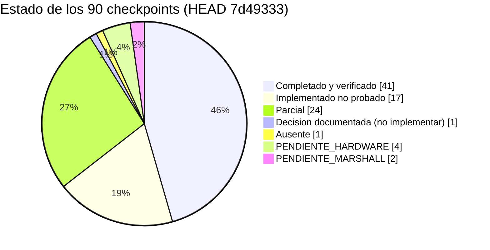
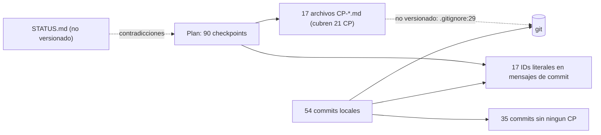

# 02 — Trazabilidad de los 90 checkpoints del plan maestro

> **Nota del orquestador (Opus, revisión cruzada):** El e2e de Electron que este informe marca como "no verificado" SÍ se ejecutó en la auditoría: 29/29 PASS (ver 11 y evidencia/test-e2e.log). CP-06 (Guardián con DRY=0 por defecto) se rebaja a P3, porque la app marca "Simulación" por defecto al primer encendido (desktop/renderer/power.js:1039, ADR-0005). CP-4.06 se considera **parcial**, no ausente (ver 13). Las severidades finales están en 12-TECHNICAL-DEBT.md.

- Repo: `~/MyFiles/Dev/Rog-Monitor` (rama master)
- HEAD auditado: `7d49333` · base del plan: `fbfee52` (v20.0.0) · commits locales: **54** (34 sin merge, 20 merges)
- Plan: `ROG_MONITOR_PLAN_MAESTRO_IA.md` (raíz, ignorado por git; ver hallazgo CP-01)
- Modo: solo lectura. No se editó el repo, no hubo commits ni checkouts, no se ejecutó sudo, systemctl escritor, instaladores, benchmarks ni scripts que tocan hardware.
- Etiquetas usadas: **OBSERVADO** (leí el código), **PROBADO** (ejecuté y vi resultado), **NO PROBADO**, **HIPÓTESIS**.
- Regla aplicada: `docs/agent-work/STATUS.md` no es evidencia. Cada estado se contrastó con código (grep/lectura) y con tests ejecutados.

**Nota explícita: hay 54 commits locales, no 90. La correspondencia commit↔checkpoint no es 1:1.** Solo 17 de los 90 IDs aparecen literalmente en algún mensaje de commit; 19 commits mencionan algún CP y 35 no mencionan ninguno. Varios checkpoints se trazan por rango o por archivo, y algunos no tienen commit.

---

## 1. Resumen por estado

| Estado | Nº | Checkpoints |
|---|---:|---|
| completado y verificado | 41 | 0.08; 1.04–1.07; 2.06–2.09; 3.01, 3.02, 3.04–3.07, 3.09, 3.10; 4.01–4.04, 4.07–4.09; 5.03, 5.06; 6.02, 6.03, 6.05–6.08; 7.05–7.07, 7.10; 8.01, 8.03, 8.07–8.09 |
| implementado no probado | 17 | 0.01, 0.02, 0.03, 0.04, 0.07, 0.09; 1.01, 1.08; 2.01, 2.10; 5.01, 5.05, 5.07, 5.09; 6.01; 7.02, 7.08 |
| parcial | 24 | 0.05, 0.06, 0.10; 1.02, 1.03, 1.10; 2.02–2.04; 3.03, 3.08; 4.05, 4.10; 5.02, 5.04, 5.08, 5.10; 6.04, 6.09; 7.03, 7.09; 8.02, 8.04, 8.06 |
| decisión documentada (no implementar) | 1 | 2.05 (solo documentada en STATUS.md, sin ADR propio) |
| ausente | 1 | 4.06 |
| PENDIENTE_HARDWARE | 4 | 1.09, 7.01, 7.04, 8.05 |
| PENDIENTE_MARSHALL | 2 | 6.10, 8.10 |
| **Total** | **90** | |

Nota sobre "verificado": solo cuenta lo que ejecuté en esta auditoría (sección 3) o lo que comprobé directamente (existencia y contenido de archivos concretos). No cuenta nada que solo dice STATUS.md.

Conteo de evidencia por checkpoint:

| Medida | Valor |
|---|---:|
| Checkpoints en el plan | 90 |
| Archivos `docs/agent-work/checkpoints/CP-*.md` existentes | 17 |
| CP con archivo de evidencia (nombre exacto 11 + variantes a/b 2 + rangos 4.01-04 y 7.01-04 con 8) | 21 |
| CP sin archivo de evidencia | 69 |
| Commits locales | 54 (34 sin merge + 20 merges) |
| Commits con algún "CP-" en mensaje o cuerpo | 19 |
| Commits sin ningún CP | 35 |
| IDs CP que aparecen literalmente en algún mensaje (`git log --grep`) | 17 de 90 |

---

## 2. Cadena de trazabilidad y puntos de corte

---

## 3. Método y comandos ejecutados

| Comando | Resultado | Etiqueta |
|---|---|---|
| `.venv/bin/python -m unittest discover -s tests -t .` (con `HOME` temporal, `PYTHONDONTWRITEBYTECODE=1`) | 162 tests, OK | PROBADO |
| `PYTHONPATH=src python3 -m unittest discover -s tests` (python del sistema) | 11 fallos/errores por `ModuleNotFoundError: rich` | PROBADO (entorno, no código; ver CP-13) |
| `node --test desktop/test/*.test.js` (mismo glob que CI, `HOME` temporal) | 46 tests, 46 OK | PROBADO |
| `node scripts/contrast-check.mjs` | 384/384 pasan, 0 fallan | PROBADO (script no está en CI) |
| `node scripts/validate-i18n.mjs` | OK, 1009 claves x 8 idiomas, 262 refs, 11 comandos | PROBADO |
| `bash -n install.sh uninstall.sh scripts/*.sh desktop/start.sh` | sin errores | PROBADO |
| `git ls-files`, `git check-ignore -v`, `git log --grep`, `git log --name-only` | ver secciones 5 y 6 | PROBADO |
| `grep`/lectura de código fuente, tests, systemd, CI, docs | ver tabla maestra | OBSERVADO |

No ejecutado (fuera de alcance por las reglas o sin entorno): instaladores y uninstall, `systemctl` escritor, `scripts/measure.py` y benchmarks, `scripts/e2e-smoke.mjs` (Electron), overlay real, pruebas visuales, VM de instalación.

Incidente menor de auditoría: ejecuté por error `node scripts/measure.py` (un script Python). Node falló al parsearlo y no se ejecutó ninguna medición. No hubo efectos.

---

## 4. Tabla maestra (90 filas)

Columnas: Checkpoint · Commit(s) · Archivos (evidencia y código) · Intención (plan, resumida) · Implementación encontrada (ruta:línea) · Tests · Estado · Evidencia · Riesgos.

### Fase 0 — Auditoría y línea base

| Checkpoint | Commit(s) | Archivos | Intención | Implementación encontrada (ruta:línea) | Tests | Estado | Evidencia | Riesgos |
|---|---|---|---|---|---|---|---|---|
| CP-0.01 | — | docs/agent-work/checkpoints/CP-0.01.md | Congelar SHA, árbol e inventario | N/A (auditoría documental) | — | implementado no probado | CP-0.01.md:1-2 declara SHA base fbfee52 | Evidencia fuera de git |
| CP-0.02 | 32b3cbb, 2701aaa (solo citan CP-0.02a/b como origen de hallazgos); 0439655 | CP-0.02a.md (118 l.), CP-0.02b.md (190 l.), docs/ARCHITECTURE.md | Mapa módulo→responsabilidad→dependencias→riesgo con ruta:línea | docs/ARCHITECTURE.md:77 (Python core), :96 (contrato), :107 (Electron main), :122 (helpers privilegiados) | — | implementado no probado | Dos archivos en lugar de CP-0.02.md | Nombre no conforme al plan; mapa no recontrastado |
| CP-0.03 | 531ec9e | CP-0.03.md (125 l.), scripts/install-system.sh | Auditar install/uninstall/safe-mode, unidades, polkit | install-system.sh:18, :24, :140, :152, :178 (efectos y opt-in); 531ec9e corrige que root ejecute archivos del usuario | tests/test_install_dryrun.py:54-74 | implementado no probado | CP-0.03.md:1-3 | Auditoría documental; el fix de 531ec9e no tiene test propio |
| CP-0.04 | — (ninguno con CP-0.04) | CP-0.04a.md (168 l.), CP-0.04b.md (143 l.); c229e56 contrato | Inspeccionar canal Python NDJSON→Electron y TUI | src/rog_monitor/app.py:156-160 (envelope schema=1); desktop/main.js:151 (spawn --json-stream --interval 1) | tests/test_contract.py:146-173 | implementado no probado | Dos archivos a/b | Documental |
| CP-0.05 | 4a65b87, 6f0200a, 32b3cbb, 2701aaa | CP-0.05.md (50 l.) | Reproducir incidencias: arranque, scroll/clic TUI, SMART, filtros, Guardian | Solo se reproduce el bug TUI de clic/teclas (CP-0.05.md:1-20, harness pty en scratchpad de sesión anterior); src/rog_monitor/keys.py:73 (comentario mouse) | tests/test_tui_input.py:99, :144 | parcial | CP-0.05.md cita keys.py:28 (hoy :73) | SMART, filtros y Guardian no reproducidos; harness fuera del repo, no reproducible |
| CP-0.06 | 446fcf1 | scripts/measure.py; CP-0.06.md (18 l.) | Medir CPU, RSS, wakeups, latencia y FPS | scripts/measure.py (añadido en 446fcf1; no ejecutado aquí) | — | parcial | CP-0.06.md:1 "FPS/CDP no medidos" | FPS sin medir |
| CP-0.07 | 4791866 | CP-0.07.md (30 l.); .github/workflows/ci.yml; .github/dependabot.yml; LICENSE; SECURITY.md | Revisar suites, CI, dependencias, licencias y amenazas | ci.yml:23-26 (unittest), :60-61 (node:test), :64 (i18n), :73-74 (dry-run) | tests/ (162 OK), desktop/test (46 OK) | implementado no probado | CP-0.07.md:1-2 | Auditoría documental |
| CP-0.08 | 0439655 | docs/ARCHITECTURE.md; docs/adr/0001-0005 | Mapa C4 y ADR inicial | docs/ARCHITECTURE.md:7 (nivel 1), :31 (nivel 2); ADR 0001-0005 presentes | — | completado y verificado | Comprobación directa de secciones y ADR (OBSERVADO) | Hechos/hipótesis del CP no recontrastados |
| CP-0.09 | — | docs/agent-work/BACKLOG.md (no versionado); CP-0.09.md (21 l.) | Priorizar riesgos y proponer umbrales | N/A | — | implementado no probado | CP-0.09.md:1-2 | Fuente solo en docs ignorados (D5) |
| CP-0.10 | — | CP-0.10.md (4 l.); DECISIONS.md:3 (D1) | Informe auditado y gate humano antes de tocar privilegios | N/A | — | parcial | CP-0.10.md:3 "gate autónomo según D1" | Gate humano del plan sustituido por D1; sin aprobación registrada en el repo (ver CP-05) |

### Fase 1 — Seguridad de sistema e instalación

| Checkpoint | Commit(s) | Archivos | Intención | Implementación encontrada (ruta:línea) | Tests | Estado | Evidencia | Riesgos |
|---|---|---|---|---|---|---|---|---|
| CP-1.01 | — | CP-1.01.md (100 l.) | Registrar efectos de instalación y persistencia | Registro en CP-1.01.md (H3); efectos reales en scripts/install-system.sh:134-156 | — | implementado no probado | CP-1.01.md:1-6 | Documental |
| CP-1.02 | 858023a, 531ec9e | scripts/install-system.sh; systemd/rog-power-source.service | Desactivar por defecto automatismos privilegiados no indispensables | install-system.sh:140 `systemctl enable rog-profile-sync` (ON); :152 `enable-cpu-power.sh` (ON); :178 auto-perfil por fuente de poder NO instalado (opt-in) | tests/test_install_dryrun.py:54 | parcial | OBSERVADO | Ventiladores y lectura RAPL quedan ON por defecto ("como antes"); STATUS dice "DONE (verificado)" sin cubrir esto |
| CP-1.03 | 858023a (units) | systemd/rog-*.service | Dependencias de targets y orden de arranque | thermal-guardian.service:4-5,58; battery-limit.service:3-4,23; profile-sync.service:3-4,25; power-source.service:3-4,23; power-notify.service:3,13 | — | parcial | Leí After/Wants/WantedBy; no probé arranque | STATUS afirma "ninguna unit bloquea boot/DM (H3)" sin archivo CP-1.03.md ni test |
| CP-1.04 | 531ec9e, e9740da | desktop/priv.js | Permisos y propiedad de archivos root | desktop/priv.js:60 `st.uid === 0 && (st.mode & 0o022) === 0` | desktop/test/priv.test.js:7, :17 (fs falso con uid/mode) | completado y verificado | node --test 46/46 (PROBADO) | Solo fs falso, no permisos reales |
| CP-1.05 | e9740da, 858023a | desktop/priv.js | Auditar polkit/pkexec y comandos permitidos | priv.js:14 PKEXEC=/usr/bin/pkexec; :17 lista cerrada de ayudantes; :98 pkexecArgv | desktop/test/priv.test.js:33-36 (helperPath, traversal), :82-83 (pkexecArgv) | completado y verificado | 46/46 (PROBADO) | Gate humano sobre privilegios no registrado (CP-05) |
| CP-1.06 | 858023a | src/rog_monitor/power_control.py:187-191, :264-297; scripts/apply-power-control.sh | Verificar clamps y rutas de escritura sysfs | power_control.py:187 `_safe_clamp`; :297 `out[key] = _safe_clamp(...)`; validación que rechaza (no clampa) en tests/test_power_validation.py:60 | tests/test_power_validation.py:34-101 (ValidateChanges, ApplyRefusesBeforeAnyWrite) | completado y verificado | 162/162 (PROBADO) | Dos caminos (rechazar en validación, clamp en perfil); documentar |
| CP-1.07 | e9740da (S3 según STATUS) | scripts/install-system.sh:38, :64-66 | Instalación dry-run y logs legibles | install-system.sh:38 `--dry-run`; :64-66 `act()` imprime `[dry-run]` | tests/test_install_dryrun.py:53-74 | completado y verificado | 162/162 (PROBADO) | Legibilidad de logs no evaluada |
| CP-1.08 | 824be80 | scripts/uninstall.sh | Desinstalación idempotente y preservación de config | uninstall.sh:4-5 (conserva configs; `--purge` borra), :14, :20-21, :56 | — | implementado no probado | OBSERVADO | Idempotencia no probada; --purge sin test |
| CP-1.09 | — | — | Probar recuperación TTY en VM/sandbox | — | — | PENDIENTE_HARDWARE | STATUS F1 1.09; PENDIENTE-MARSHALL.md | No ejecutado |
| CP-1.10 | 824be80 | docs/RECOVERY.md | Runbook de recuperación y test de reversibilidad | docs/RECOVERY.md presente | Ninguna referencia a RECOVERY en tests/ ni desktop/test | parcial | Grep sin resultados | Runbook sin test de reversibilidad |

### Fase 2 — Contratos y refactor modular

| Checkpoint | Commit(s) | Archivos | Intención | Implementación encontrada (ruta:línea) | Tests | Estado | Evidencia | Riesgos |
|---|---|---|---|---|---|---|---|---|
| CP-2.01 | 0439655 | docs/ARCHITECTURE.md | Mapear acoplamiento real | docs/ARCHITECTURE.md:77, :96, :107, :122 | — | implementado no probado | Documento presente; no recontrastado | Mapa documental |
| CP-2.02 | c229e56 | src/rog_monitor/app.py:156-160 | Modelos tipados y versión de schema | app.py:160 `payload["schema"] = 1`; no hay dataclass/TypedDict/Protocol en src/rog_monitor | tests/test_contract.py:146-173; desktop/test/contract.test.js | parcial | Versión sí; modelos tipados no | Sin tipado formal del contrato |
| CP-2.03 | 0765fd5, c229e56 | src/rog_monitor/alerts.py:78-80; sysinfo.py:245-252 | Distinguir metric sample, event, capability, health | alerts.py:80 `etype` telemetry/alert/action; sysinfo.py:245-252 ok/stale | tests/test_alerts.py:135; tests/test_smart_cache.py:20-50 | parcial | Eventos y SMART sí; capability/health no como tipos | Sin separación explícita de capability/health |
| CP-2.04 | c229e56, 303b145 | src/rog_monitor/sysinfo.py:233-252; cpu.py:178-179 | Normalizar unidad, origen, timestamp, validez y error | sysinfo.py:245 age_s, :246 stale, :252 media_errors; cpu.py:179 usage_ok | tests/test_smart_cache.py:36-50 (basura a None) | parcial | Solo SMART y CPU | No es normalización global |
| CP-2.05 | — | docs/agent-work/STATUS.md (F2 2.05, no versionado) | Introducir puertos de sensor y adaptadores | No implementado | — | decisión documentada (no implementar) | STATUS.md:46 cita "ADR-0002", pero docs/adr/0002 es "No new dependencies" | Decisión sin ADR propio y con cita errónea (CP-10) |
| CP-2.06 | 89d4719 | src/rog_monitor/cached.py:7, :16, :51; src/rog_monitor/gpu.py:57, :122; src/rog_monitor/gpu_clocks.py:60-63 | Scheduling y cachés con TTL por métrica | cached.py:7 `class Cached` (TTL en hilo daemon); gpu.py:122 respaldo nvidia-smi; gpu_clocks.py:60-63 carga NVML por ctypes | tests/test_gpu_perf.py:89-130 (CachedTtl) | completado y verificado | 162/162 (PROBADO) | — |
| CP-2.07 | 0765fd5, 2a764a3 | src/rog_monitor/alerts.py:78-80; src/rog_monitor/actions.py; desktop/renderer/event-detail.js:10-13 | Unificar eventos, filtros y severidad | alerts.py:78-80; src/rog_monitor/app.py:33 EVENT_FILTERS | tests/test_alerts.py:48; tests/test_ui_events.py:14 | completado y verificado | 162/162 (PROBADO) | Filtros por categoría solo en desktop (ver CP-6.04) |
| CP-2.08 | 89d4719 | src/rog_monitor/gpu.py:57, :122; cached.py:51; gpu_clocks.py:60-63 | Evitar subprocesses redundantes y bloqueo UI | cached.py:51 `get()` no bloquea tras primer valor; gpu.py:122 fallback a nvidia-smi | tests/test_gpu_perf.py:38-58 (NVML vs SMI), :102 (never blocks) | completado y verificado | 162/162 (PROBADO) | Fallback a nvidia-smi sigue existiendo |
| CP-2.09 | c229e56, 39d26f3 | tests/test_contract.py:146-173; desktop/test/contract.test.js | Contract tests Python, Electron y TUI | Contrato v1 en app.py:156-160 | tests/test_contract.py (4), desktop/test/contract.test.js (4), tests/test_tui_render.py:22 | completado y verificado | 162/162 y 46/46 (PROBADO) | Con python del sistema falla test_live_producer_matches_spec (entorno, CP-13) |
| CP-2.10 | — | — | Migrar por slices preservando compatibilidad | Afirmado en STATUS ("todo cambio aditivo, schema 1 intacto") | tests/test_contract.py (fixture v1) | implementado no probado | Sin commit ni CP-2.10.md | Sin evidencia propia |

### Fase 3 — CPU, RAM y discos

| Checkpoint | Commit(s) | Archivos | Intención | Implementación encontrada (ruta:línea) | Tests | Estado | Evidencia | Riesgos |
|---|---|---|---|---|---|---|---|---|
| CP-3.01 | 44f1706 | src/rog_monitor/cpu.py:20, :64, :178-179 | CPU global y por núcleo con delta de /proc/stat y warm-up | cpu.py:20 `read_stat`; :64 usage; :178-179 None sin delta fiable | tests/test_metrics.py:32-89 | completado y verificado | 162/162 (PROBADO) | — |
| CP-3.02 | 44f1706 | src/rog_monitor/cpu.py:16, :102-105 | Validar unidades y frecuencia CPU | cpu.py:16 kHz→GHz; :102-105 freq por CPU | tests/test_metrics.py:94-99 (khz_to_ghz) | completado y verificado | 162/162 (PROBADO) | Rango de frecuencia no validado |
| CP-3.03 | acaa388, 09342a2 | src/rog_monitor/history.py:10, :20; src/rog_monitor/app.py:67-69 | Historial acotado de CPU y por núcleo | history.py:20 poda por tiempo (900 s); app.py:67 `cpu_usage` | tests/test_series.py:36-43 | parcial | Global sí; por núcleo no (STATUS: "per-core omitido: sin consumidor") | Desviación del plan no registrada en CP-3.03 (sin archivo) |
| CP-3.04 | 44f1706 | src/rog_monitor/sysinfo.py:425-426, :462, :469 | Semántica RAM used/available/cache/swap | sysinfo.py:425-426 MemAvailable con estimación; :462 ram_percent; :469 swap_percent | tests/test_metrics.py:101-135 | completado y verificado | 162/162 (PROBADO) | — |
| CP-3.05 | acaa388 | src/rog_monitor/app.py:68-69, :109-110 | Series temporales RAM y swap | app.py:68 ram_used; :69 swap_used; :109-110 push | tests/test_series.py:19-44 | completado y verificado | 162/162 (PROBADO) | ram_used es porcentaje, no bytes |
| CP-3.06 | 44f1706 | src/rog_monitor/sysinfo.py:60, :69, :116, :314 | Discos: inventario sin doble conteo | sysinfo.py:116 `_whole_disks`; :314 `_removable` | tests/test_metrics.py:231 (sin doble conteo), :243 (USB removible) | completado y verificado | 162/162 (PROBADO) | — |
| CP-3.07 | 44f1706 | src/rog_monitor/sysinfo.py:274, :277, :292, :430 | Bytes/s y ops/s con monotonic time | sysinfo.py:292 `now = time.monotonic()`; :193 usa perf_counter con comentario engañoso | tests/test_metrics.py:141-160 (rates, reset de contador) | completado y verificado | 162/162 (PROBADO) | Comentario sysinfo.py:193 dice "no monotonic" pero usa perf_counter (CP-19) |
| CP-3.08 | 44f1706 | src/rog_monitor/sysinfo.py:92-94 | Distinguir actividad I/O, capacidad y latencia si disponible | sysinfo.py:92-94 busy_pct = actividad, no capacidad; iops; latencia no encontrada | tests/test_metrics.py:250-262 | parcial | Actividad sí; latencia no | "si disponible" sin decisión registrada |
| CP-3.09 | c4bb0d6, f172f18 | desktop/smart.js:1-23; src/rog_monitor/sysinfo.py:174, :179, :245-252 | SMART/NVMe: capability, timestamp, TTL, errores y permiso explícito | sysinfo.py:174 lectura fresca exige pkexec, acción explícita; :179 SMART_STALE_S=24 h; :245-252 entrada normalizada | tests/test_smart_cache.py:20-120; desktop/test/smart.test.js (8) | completado y verificado | 162/162 y 46/46 (PROBADO) | No verificado que smartctl vaya por un ayudante de la lista cerrada (priv.js:17); ver CP-17 |
| CP-3.10 | 44f1706 | tests/fixtures/proc/noswap/meminfo; tests/fixtures/proc/t0/diskstats | Fixtures sin temperatura/SMART y discos removibles | Fixtures en tests/fixtures/proc | tests/test_metrics.py:243 (removible), :269 (NVMe sin temperatura); tests/test_smart_cache.py:95-106 (sin tool) | completado y verificado | 162/162 (PROBADO) | — |

### Fase 4 — TUI robusta

| Checkpoint | Commit(s) | Archivos | Intención | Implementación encontrada (ruta:línea) | Tests | Estado | Evidencia | Riesgos |
|---|---|---|---|---|---|---|---|---|
| CP-4.01 | 4a65b87, 6f0200a | src/rog_monitor/keys.py:17, :64-81 | Reproducir click/scroll/drag y secuencias ANSI | keys.py:17 `_parse` descarta CSI/SGR/X10/SS3 (cuerpo de 4a65b87) | tests/test_tui_input.py:60, :81, :99 | completado y verificado | PTY tests OK en .venv (PROBADO) | Prueba visual en terminal real pendiente (PENDIENTE_MARSHALL en CP-4.01-04.md) |
| CP-4.02 | 4a65b87 | src/rog_monitor/keys.py:73 (comentario, no escribe ?1000h); docs/adr/0003-tui-mouse-off.md | Mouse deshabilitado por defecto | keys.py:73 documenta que el mouse no se activa | tests/test_tui_input.py:141 `assertNotIn(b"?1000h")` | completado y verificado | PROBADO | Si se añade mouse, ADR-0003 lo bloquea solo por convención |
| CP-4.03 | 4a65b87 | src/rog_monitor/keys.py:64, :79-81; src/rog_monitor/app.py:273-282 | Restaurar modos de terminal al salir, incluso con excepciones o señales | keys.py:79-81 `tcsetattr` en `__exit__`; app.py:280-282 SIGTERM/SIGHUP | tests/test_tui_input.py:144 (sigterm restores terminal) | completado y verificado | PROBADO | SIGKILL no restaura (limitación no documentada) |
| CP-4.04 | 4a65b87 | src/rog_monitor/app.py:163-177 | Mapa de teclas y bloqueo de acciones no declaradas | app.py:163 `handle_key`; cuerpo de 4a65b87: teclas no ligadas se ignoran | tests/test_tui_render.py:131 (ayuda = teclas ligadas); tests/test_tui_input.py:60 | completado y verificado | PROBADO | — |
| CP-4.05 | a34df01 | src/rog_monitor/app.py:168 | Navegación por foco consistente | app.py:168 Esc cierra ayuda/eventos | tests/test_tui_input.py:219 (escape closes help) | parcial | Solo Esc; no hay modelo de foco | Sin modelo de foco |
| CP-4.06 | — | src/rog_monitor/app.py:285-288 (`Live(screen=True)`) | Evitar redibujados completos y flicker | Sin control de redibujado parcial encontrado | — | ausente | No se encontró evidencia suficiente | Flicker no medido |
| CP-4.07 | a34df01 | src/rog_monitor/ui.py:492-499 (MIN_COLS=60, MIN_ROWS=20) | Resize, terminales pequeños y Unicode | ui.py:492-499 aviso de terminal pequeña | tests/test_tui_render.py:56 (small terminal), :68 (CJK); tests/test_tui_input.py:197 (SIGWINCH) | completado y verificado | PROBADO | — |
| CP-4.08 | a34df01 | src/rog_monitor/ui.py:73-74, :126 | Mostrar N/A con motivo para sensores ausentes | ui.py:74 `N/A (motivo)` | tests/test_tui_render.py:102-123 | completado y verificado | PROBADO | — |
| CP-4.09 | c4bb0d6, f172f18 | src/rog_monitor/ui.py:297-300 | Edad y origen de SMART/temperatura en TUI | ui.py:297-300 edad SMART (min/h/d) | tests/test_smart_cache.py:120-146 (TuiLine) | completado y verificado | PROBADO | Origen de temperatura no revisado a fondo |
| CP-4.10 | a34df01 | tests/test_tui_input.py; tests/test_tui_render.py | Pruebas pty y manuales con matriz de emuladores | PTY sí | PTY OK (PROBADO) | parcial | No se encontró matriz de emuladores (grep kitty/alacritty/konsole/gnome-terminal en docs y README: sin resultados) | Prueba manual pendiente |

### Fase 5 — Sistema de diseño y desktop

| Checkpoint | Commit(s) | Archivos | Intención | Implementación encontrada (ruta:línea) | Tests | Estado | Evidencia | Riesgos |
|---|---|---|---|---|---|---|---|---|
| CP-5.01 | bdb2a6a | desktop/renderer/styles/tokens.css:1-10 | Inventariar estilos existentes y 12 paletas | Inventario en cabecera de tokens.css:10 ("INVENTARIO (CP-5.01)") | — | implementado no probado | Sin CP-5.01.md; "12 paletas" no recontrastado | Evidencia dentro de un CSS |
| CP-5.02 | bdb2a6a | desktop/renderer/styles/tokens.css | Base: Fluent 2 como referencia, tokens propios | tokens.css propio; "Fluent" no aparece en docs ni en renderer | — | parcial | STATUS.md:55 cita "ADR-002" inexistente | Decisión sin registro verificable (CP-10) |
| CP-5.03 | bdb2a6a | desktop/renderer/styles/tokens.css:1-10, :75 | Tokens de color, espaciado, tipografía, estados y densidad | tokens.css: 35 propiedades `--`; :75 anillo de foco | scripts/contrast-check.mjs (384/384, PROBADO) | completado y verificado | PROBADO | contrast-check no está en CI ni en tests |
| CP-5.04 | bdb2a6a, ed7151f | desktop/renderer/widget-states.js:2-8, :31-33; desktop/renderer/index.html:104, :113 | Biblioteca mínima y estados loading/empty/error/stale | widget-states.js: loading/ok/empty/error | — | parcial | Estado stale de widget no encontrado (solo "OBSOLETO" de SMART en disks.js:47) | Falta un estado del plan |
| CP-5.05 | bdb2a6a | desktop/renderer/index.html:23, :34, :40 | Barra superior por prioridades y navegación | index.html:23 `header#topbar` | — | implementado no probado | OBSERVADO | Sin prueba visual |
| CP-5.06 | ed7151f | desktop/renderer/app.js:667-670, :673 | Gráficas con buffers acotados | app.js:667 `CHART_MAX_POINTS = 1200`; :669 chartTail | desktop/test/charts.test.js:47-53 | completado y verificado | 46/46 (PROBADO) | — |
| CP-5.07 | ed7151f | desktop/renderer/app.js:673, :703 | RAM/CPU/disco con escalas y unidades claras | app.js:673 chartRange; :703 clampPct | desktop/test/charts.test.js:28-38, :54-62 | implementado no probado | Escalas y unidades no probadas en pantalla | Sin prueba visual |
| CP-5.08 | bdb2a6a, 1e89ecb | desktop/renderer/styles/a11y.css:4-7, :30; desktop/renderer/style.css:570; tokens.css:75; scripts/contrast-check.mjs | Accesibilidad: teclado, contraste y reduced motion | a11y.css:30 reduced-motion; style.css:570 reduced-motion; a11y.css:7 focus-visible | contrast-check 384/384 (PROBADO, fuera de CI) | parcial | Contraste verificado; teclado no probado | Script fuera de CI |
| CP-5.09 | ed7151f | desktop/renderer/app.js:92-95; desktop/renderer/diagnostics.js:323 | Evitar rerender masivo y fugas de listeners | app.js:92-95 removeEventListener; diagnostics.js:323 | — | implementado no probado | Sin medición de fugas | Sin test de listeners |
| CP-5.10 | — | — | Pruebas visuales, accesibilidad y medición de FPS | Capturas CDP en scratchpad (fuera del repo); scripts/e2e-smoke.mjs no ejecutado | — | parcial | STATUS F5 5.10: FPS no medido; minimizar PENDIENTE_MARSHALL | Evidencia fuera del repo |

### Fase 6 — Eventos, alertas y Guardian 2.0

| Checkpoint | Commit(s) | Archivos | Intención | Implementación encontrada (ruta:línea) | Tests | Estado | Evidencia | Riesgos |
|---|---|---|---|---|---|---|---|---|
| CP-6.01 | — (base CP-6.01.md: 96e99d8) | docs/agent-work/checkpoints/CP-6.01.md (285 l.); scripts/rog-thermal-guardian.sh | Auditar Guardian actual antes de habilitar | CP-6.01.md:278 hipótesis H3 (throttle=2); el script actual no escribe throttle (grep sin resultados) | — | implementado no probado | Documento extenso | Corrección del throttle sin test |
| CP-6.02 | 0765fd5, 2a764a3 | src/rog_monitor/alerts.py:78-80 | Modelo único de eventos: source/type/severity/time/context | alerts.py:78-80 `source`, `etype`, `value`, ctx | tests/test_alerts.py:48-66; tests/test_contract.py:153 (ctx) | completado y verificado | 162/162 (PROBADO) | — |
| CP-6.03 | 0765fd5 | src/rog_monitor/alerts.py:80; src/rog_monitor/actions.py | Separar telemetría de alertas y acciones | alerts.py:80 etype telemetry/alert/action | tests/test_alerts.py:121-127 (throttle sin notificación), :135 | completado y verificado | 162/162 (PROBADO) | — |
| CP-6.04 | 0765fd5 | src/rog_monitor/app.py:33, :176-177; desktop/renderer/event-detail.js:10-13 | Filtros combinables por CPU, core, RAM, disco y GPU | app.py:33 EVENT_FILTERS (all/warn/crit); event-detail.js:10-13 chips por categoría (thermal/throttle) | tests/test_ui_events.py:14-20 (severidad) | parcial | No hay filtros por core, RAM, disco ni GPU; el commit habla de "filtros combinables" | Desviación del plan |
| CP-6.05 | 0765fd5 | src/rog_monitor/alerts.py:24, :47-49, :88-89 | Deduplicación, cooldown e histéresis | alerts.py:24 dedup `_open`; :47-49 cooldown; :88-89 histéresis | tests/test_alerts.py:67, :74, :87, :95, :107 | completado y verificado | 162/162 (PROBADO) | — |
| CP-6.06 | 74fc4ff, 2f6a09f | scripts/rog-thermal-guardian.sh:355 | Definir máquina de estados del Guardian | script:355 GUARDIAN_STATE normal / fans-up / boost-down / pl-down | tests/test_guardian_sim.py:208-309 (test_full_scenario) | completado y verificado | 162/162 (PROBADO) | Máquina implícita en bash, sin diagrama |
| CP-6.07 | 74fc4ff | scripts/rog-thermal-guardian.sh:14, :65, :106, :196; systemd/rog-thermal-guardian.service:11; docs/adr/0005-guardian-simulation-first.md | Guardian primero read-only/simulación sin escribir firmware | script:196 `hw_write()` central; :106 `DRY="${ROG_THERMAL_DRY:-0}"` (default REAL); service:11 ExecStart sin --dry | tests/test_guardian_sim.py:329-349 (dry_run_changes_nothing) | completado y verificado | 162/162 (PROBADO) | Default real (ver CP-06) |
| CP-6.08 | 74fc4ff | scripts/rog-thermal-guardian.sh:20-23, :406; src/rog_monitor/fans.py:343-344 | Trazabilidad y explicabilidad de cada decisión | script:21 `decision=<cut/restore/hold/boost/unboost> reason=...`; fans.py:344 last_decision | tests/test_guardian_sim.py:259-260 (history <= 20), :347 (last_decision) | completado y verificado | 162/162 (PROBADO) | — |
| CP-6.09 | 74fc4ff | tests/test_guardian_sim.py:294-301 | Pruebas de estrés, fallos y falsos positivos | test:294-301 SIGKILL a mitad de recorte, arranque restaura | tests/test_alerts.py:128 (ventilador parado exige CPU caliente) | parcial | No hay test de estrés ni de falsos positivos del Guardian | Cobertura incompleta |
| CP-6.10 | — | docs/agent-work/PENDIENTE-MARSHALL.md | Habilitación gradual con aprobación y rollback | N/A | — | PENDIENTE_MARSHALL | STATUS F6 6.10 | Requiere sesión de juego real |

### Fase 7 — Overlay y benchmarks

| Checkpoint | Commit(s) | Archivos | Intención | Implementación encontrada (ruta:línea) | Tests | Estado | Evidencia | Riesgos |
|---|---|---|---|---|---|---|---|---|
| CP-7.01 | — | desktop/main.js:85, :1396, :1405-1437; CP-7.01-04.md (23 l.) | Validar overlay anunciado y su funcionamiento real | main.js:1405-1437 createOverlay (frameless, transparent, alwaysOnTop) | ninguno (desktop/test sin overlay) | PENDIENTE_HARDWARE | CP-7.01-04.md:1-23; README.md:107 lo anuncia | Función principal anunciada sin verificar (CP-07) |
| CP-7.02 | — | desktop/main.js:85, :1431 | Política opt-in y click-through | main.js:85 `enabled: false`; :1431 `setIgnoreMouseEvents(true)` | ninguno | implementado no probado | Lectura de código (OBSERVADO) | Click-through real no probado |
| CP-7.03 | — | desktop/main.js:151, :171-172 | Controlar tasa de refresco y consumo | Sin loop propio en overlay.js; backend a 1 Hz (main.js:151 `--interval 1`) | ninguno | parcial | Sin medición de consumo ni FPS | Consumo no medido |
| CP-7.04 | — | desktop/main.js:1396 (setPosition); sin flag --ozone-platform | Compatibilidad Wayland/X11 y multimonitor | HIPÓTESIS: setPosition ignorado en Wayland (CP-7.01-04.md:17-23) | ninguno | PENDIENTE_HARDWARE | CP-7.01-04.md (HIPÓTESIS + PENDIENTE_MARSHALL) | Riesgo P1 (CP-07) |
| CP-7.05 | 4262a1d, d81da73 | src/rog_monitor/benchmarks.py:31, :276-283 | Benchmark reproducible con perfil de hardware | benchmarks.py:31 SCHEMA_VERSION=2; :276 `_conditions`; :283 app_version | tests/test_benchmarks.py:132-190 | completado y verificado | 162/162 (PROBADO) | Reproducibilidad entre equipos no probada |
| CP-7.06 | 4262a1d, d2b78f0 | src/rog_monitor/benchmarks.py:301-304 | Calibrar warm-up, repeticiones y condiciones térmicas | benchmarks.py:301-304 warm-up y repeticiones; umbral 65 °C (d2b78f0) | tests/test_benchmarks.py:165-189 (warm-up excluido, condiciones registradas, hot-start avisa) | completado y verificado | 162/162 (PROBADO) | Umbral ajustado a un equipo |
| CP-7.07 | 4262a1d | src/rog_monitor/benchmarks.py:73, :85, :102 | Registrar p50/p95/p99 y varianza | benchmarks.py:73 percentile; :85 describe; :102 cv_percent | tests/test_benchmarks.py:12-56 | completado y verificado | 162/162 (PROBADO) | — |
| CP-7.08 | 4262a1d | docs/BENCHMARKS.md:81, :90 | Comparar overhead monitor activo/inactivo | Cifra documentada: -0.44 % (docs/BENCHMARKS.md:90) | ninguno | implementado no probado | No reproducido (benchmarks prohibidos en esta auditoría) | Cifra no verificada (CP-16) |
| CP-7.09 | 4262a1d | src/rog_monitor/benchmarks.py:31, :276, :283 | Exportar resultados con versión y condiciones | benchmarks.py:276 conditions; :283 app_version | tests/test_benchmarks.py:165-189 (condiciones); app_version no asertada | parcial | Versión no verificada por test | Export sin test de versión |
| CP-7.10 | d2b78f0, 4262a1d | docs/BENCHMARKS.md:98 | Documentar limitaciones y publicar informe | docs/BENCHMARKS.md:98 "## Limitaciones" | — | completado y verificado | Comprobación directa de la sección | — |

### Fase 8 — Calidad, entrega y comunidad

| Checkpoint | Commit(s) | Archivos | Intención | Implementación encontrada (ruta:línea) | Tests | Estado | Evidencia | Riesgos |
|---|---|---|---|---|---|---|---|---|
| CP-8.01 | 44f1706, 4262a1d (y otros) | tests/*.py | Unit tests de parsers y deltas | tests/test_metrics.py:32-160 (parsers y deltas) | 162 tests (PROBADO) | completado y verificado | 162/162 OK | Requiere .venv (CP-13) |
| CP-8.02 | 89d4719 | tests/test_gpu_perf.py:38-58, :73-83; tests/test_guardian_sim.py:4; tests/test_power_validation.py:3 | Integración con fixtures hwmon/sysfs/NVML simulados | sysfs falso (ROG_SYSFS_ROOT, ROG_FW_ATTRS_DIR); NVML y hwmon mockeados | — | parcial | No hay árbol de fixtures hwmon | Integración parcial |
| CP-8.03 | c229e56 | tests/test_contract.py:146-173; desktop/test/contract.test.js | Contract tests NDJSON | — | test_contract.py (4), contract.test.js (4) | completado y verificado | 162/162 y 46/46 (PROBADO) | — |
| CP-8.04 | 602c280 | scripts/e2e-smoke.mjs; .github/workflows/ci.yml:84-87 | Pruebas E2E desktop y pseudo-TTY | ci.yml:84-87 paso xvfb; e2e-smoke.mjs | PTY: tests/test_tui_input.py (PROBADO); Electron: no ejecutado | parcial | STATUS: "no probado en runner" | E2E Electron sin evidencia en esta auditoría |
| CP-8.05 | — | scripts/install-system.sh (--dry-run); tests/test_install_dryrun.py | Pruebas de instalador y rollback en VM | Solo dry-run | tests/test_install_dryrun.py | PENDIENTE_HARDWARE | STATUS F8 8.05 | Sin VM |
| CP-8.06 | 4791866 | .github/workflows/ci.yml:20-74 | CI Linux con lint, typing, tests y análisis estático | ci.yml: py_compile, unittest, node --check, node:test, i18n, electron-builder, bash -n, dry-run. Sin ruff/flake8/mypy/CodeQL | — | parcial | OBSERVADO | STATUS.md:57 marca DONE (CP-11) |
| CP-8.07 | 4791866 | .github/dependabot.yml:1-12 | Dependabot o equivalente y auditoría | dependabot.yml: npm, pip, github-actions | — | completado y verificado | Comprobación directa del archivo | Sin paso `npm audit` en CI |
| CP-8.08 | 0439655 | README.md; SECURITY.md; CONTRIBUTING.md; LICENSE; docs/supported-devices.md | Revisar README, SECURITY, CONTRIBUTING, licencia y soporte | Archivos presentes | — | completado y verificado | Comprobación directa de existencia | Contenido no revisado en detalle |
| CP-8.09 | 0439655 | docs/adr/0001-0005; docs/ARCHITECTURE.md:7, :31; docs/supported-devices.md | Publicar ADR/C4 y matriz de compatibilidad | ADR y C4 presentes | — | completado y verificado | Comprobación directa | — |
| CP-8.10 | 500c7d9 | VERSION (21.0.0); CHANGELOG.md; docs/agent-work/checkpoints/CP-8.10.md (no versionado) | Release candidata, checklist y aprobación humana | VERSION = 21.0.0 | — | PENDIENTE_MARSHALL | CP-8.10.md:1-3 y checklist manual sin marcar (11 ítems) | Cifras del checklist desactualizadas (CP-12) |

---

## 5. Hallazgos

Formato del brief. Prefijo CP-. Severidad: P0 puede romper arranque/datos/seguridad; P1 función principal rota o engañosa; P2 deuda o UX importante; P3 menor.

| ID | Severidad | Estado | Componente | Archivo:línea | Commit(s) | Evidencia/comando | Resultado | Impacto | Recomendación | Prueba de aceptación |
|---|---|---|---|---|---|---|---|---|---|---|
| CP-01 | P1 | verificado | Trazabilidad: evidencia no versionada | .gitignore:29-30 (`docs/agent-work/` y `ROG_MONITOR_PLAN_MAESTRO_IA.md`) | 7348ece (añade la regla) | `git ls-files docs/agent-work \| wc -l` = 0; `git check-ignore -v` apunta a .gitignore:29 y :30 | Los 17 CP-*.md, STATUS, DECISIONS, BACKLOG y el propio plan no están en git. D5 lo decide así (DECISIONS.md:7) | La auditoría no es reproducible desde git ni llega a otra máquina ni a un push | Versionar la evidencia en una carpeta fuera de la regla, o exportar un bundle firmado al cerrar cada tanda | `git ls-files` lista los CP-*.md y el plan |
| CP-02 | P1 | verificado | Evidencia por checkpoint | docs/agent-work/checkpoints/ (17 archivos) | — | Conteo: 11 nombres exactos + 2 pares a/b (0.02, 0.04) + 2 archivos de rango (4.01-04, 7.01-04) = 21 CP con evidencia | 69 de 90 CP no tienen archivo CP-X.YY.md, que el plan exige (plan:261-275) | Sin evidencia no hay DoD ni aprobación posible | Crear un CP-X.YY.md por checkpoint o un índice que mapee los 90 | `ls docs/agent-work/checkpoints/CP-*.md \| wc -l` = 90, o índice con 90 filas |
| CP-03 | P1 | verificado | STATUS.md contradictorio | docs/agent-work/STATUS.md:50-51, :53 (TODO) vs :69-70 (DONE) | c4bb0d6, acaa388, 09342a2, f172f18 | Lectura de la tabla | 3.03/3.05, 3.09 y 4.09 aparecen como TODO y como DONE a la vez. 1.02 dice "DONE (verificado)" con profile-sync ON (CP-1.02). 8.06 DONE sin lint ni typing (CP-11). 8.04 DONE "no probado en runner". 2.05 y 5.02 citan ADR que no existen (CP-10) | Estado no fiable para retomar sesiones; un agente puede repetir o saltarse trabajo | Una fila por CP con un único estado y commit | Para cada CP, `grep -c "^\| F. X.YY"` = 1 y el estado pertenece al conjunto permitido |
| CP-04 | P1 | verificado | Trazabilidad commit↔CP | git log fbfee52..HEAD (54 commits) | Ver sección 6 | `git log --grep` por ID: 17 de 90 con match literal. 19 commits con "CP-" y 35 sin ninguno | Relación no 1:1. Ejemplo del brief "CP-3.01-3.08" no aparece en ningún mensaje (en S10 solo "phase 3", c2090f2). Commits grandes como 44f1706 tocan ~9 CP sin nombrarlos | No se puede saber qué commit implementa un CP sin leer el diff | Trailer `CP:` obligatorio por commit, o tabla de esta auditoría como índice | `git log --format=%B fbfee52..HEAD` contiene un `CP:` por commit de código |
| CP-05 | P1 | verificado | Gate humano en privilegios | ROG_MONITOR_PLAN_MAESTRO_IA.md:47 (CP-0.10 "gate humano antes de tocar privilegios"); docs/agent-work/DECISIONS.md:3 (D1); CP-0.10.md:3 | 858023a, e9740da, 531ec9e | `grep -n "gate" ROG...md`; lectura de D1 y CP-0.10.md | Cambios en root (priv.js, scripts/*.sh, unidades systemd) llegaron a master con D1 como única autorización. D1 está en un archivo ignorado | Riesgo de seguridad y trazabilidad: el plan pide "no privilegios nuevos sin aprobación" | Registrar la aprobación de D1 en CHANGELOG o CP-0.10; revisar 858023a y e9740da con Marshall antes de push | Existe nota de aprobación versionada que cubre esos commits |
| CP-06 | P1 | verificado | Guardian: modo por defecto real | scripts/rog-thermal-guardian.sh:106 `DRY=${ROG_THERMAL_DRY:-0}`; systemd/rog-thermal-guardian.service:11 (sin --dry); scripts/install-system.sh:18 (no habilita) | 74fc4ff | Lectura de código | La simulación es opt-in. Si se habilita la unidad sin `ROG_THERMAL_DRY=1`, el Guardian escribe firmware y PL reales | Daño potencial de hardware en el componente de temperatura y potencia | Dejar DRY=1 por defecto en la unidad; el paso a real debe ser explícito (CP-6.10) | `systemctl cat rog-thermal-guardian` (solo lectura) muestra DRY=1 por defecto |
| CP-07 | P1 | no verificado | Overlay en Wayland | desktop/main.js:1396 (setPosition), :1405-1437 (createOverlay); README.md:107 (anuncia overlay); CP-7.01-04.md:17-23 | — | Lectura de código; CP-7.01-04.md marca HIPÓTESIS | El overlay está anunciado pero no hay prueba visual. Según la hipótesis, en Wayland setPosition puede ser ignorado y alwaysOnTop no se garantiza sobre juegos a pantalla completa. No hay test | Función principal anunciada podría no funcionar en la sesión KDE/Wayland del usuario | Prueba visual (PENDIENTE_MARSHALL) y, si falla, documentar la limitación en README o forzar XWayland | Captura con juego a pantalla completa mostrando el overlay en la esquina elegida |
| CP-08 | P2 | verificado | Commits que tocan varios CP | 6f0200a (4.01-4.04); 0765fd5 (6.02-6.05); 74fc4ff (6.07-6.09); 4262a1d y d81da73 (7.05-7.10); 4a65b87 (4.02, 4.03); 531ec9e (0.02b, 0.03 y seguridad); 44f1706 (3.01-3.04, 3.06-3.08, 3.10, sin CP en el mensaje) | Los indicados | `git log --name-only` y lectura de mensajes | Un commit cubre 4 a 9 CP sin desglose de archivos | Revisar un CP obliga a leer todo el diff | Un commit por CP o trailer `CP:` múltiple con archivos | Por cada CP, `git log --grep` devuelve commits con archivos asociados |
| CP-09 | P2 | verificado | Automatismos privilegiados ON por defecto | scripts/install-system.sh:140 (`enable rog-profile-sync`), :152 (`enable-cpu-power.sh`) | 858023a | Lectura del script | Contrario a CP-1.02 ("desactivar por defecto no indispensables"). No hay CP-1.02.md que lo justifique ("como antes") | Servicio root activo tras instalar, sin decisión registrada | Documentar como excepción en CP-1.02 o pasar a opt-in con flag | `--dry-run` muestra el enable solo con el flag |
| CP-10 | P2 | verificado | Decisiones sin ADR válido | docs/agent-work/STATUS.md:46 (2.05 cita ADR-0002), :55 (5.02 cita ADR-002); docs/adr/0002-no-new-dependencies.md:1 | — | `ls docs/adr`: solo 0001-0005; 0002 trata de dependencias | Decisiones "no implementar" (2.05) y de diseño (5.02) no son auditables | No se puede justificar por qué no hay puertos ni por qué tokens propios | Crear ADR-0006 (puertos de sensor) y ADR-0007 (base de diseño) o registrar en DECISIONS.md | Ambos ADR existen y están enlazados desde CP-2.05 y CP-5.02 |
| CP-11 | P2 | verificado | CI sin lint, typing ni análisis estático | .github/workflows/ci.yml:20-74 | 4791866 | Lectura de pasos de CI | CP-8.06 exige lint, typing y análisis estático; CI no los tiene. STATUS.md:57 lo marca DONE | Falso sentido de calidad | Añadir ruff, mypy (o pyright) y CodeQL | Pasos de CI con ruff/mypy/CodeQL en verde |
| CP-12 | P2 | verificado | Cifras y referencias obsoletas | docs/agent-work/checkpoints/CP-8.10.md (node 36/36; 991 claves; 130+ tests); CP-0.05.md (keys.py:28); CP-7.01-04.md (main.js:84, :1380-1421) | 500c7d9, 602c280 | Ejecuté: node 46/46; i18n 1009 claves; py 162 OK. keys.py:73 hoy; main.js:85, :1396, :1405-1437 hoy | Las cifras de release no coinciden con lo que hoy pasa y varias referencias están desplazadas | Notas de release basadas en cifras falsas | Actualizar CP-8.10.md y las referencias antes de cualquier release | Las cifras del checklist coinciden con la salida de los comandos |
| CP-13 | P2 | verificado | Entorno de pruebas | requirements.txt:1 (rich>=13.0) | — | `PYTHONPATH=src python3 -m unittest discover -s tests` con python del sistema: 5 fallos y 6 errores por `No module named 'rich'`. Con .venv: 162 OK | Un auditor o usuario con python del sistema ve la suite en rojo | Diagnóstico falso de regresión | Documentar `.venv` en CONTRIBUTING o añadir un script de test | Suite verde en un entorno limpio con `pip install -r requirements.txt` |
| CP-14 | P2 | verificado | Tests ausentes para checkpoints marcados DONE | tests/ y desktop/test/ (grep) | — | Sin test de: overlay (CP-7.02); idempotencia de uninstall (CP-1.08); reversibilidad de RECOVERY (CP-1.10); estrés y falsos positivos del Guardian (CP-6.09); contrast-check fuera de CI (CP-5.08) | Checkpoints dados por hechos sin prueba que los ejerza | Regresiones silenciosas | Añadir tests mínimos o marcar el CP como parcial | Cada CP "completado" tiene un test que falla si se rompe |
| CP-15 | P2 | verificado | Desviaciones del plan sin registro | history.py:20; sysinfo.py:92-94; app.py:33 y :176; widget-states.js:2-8; app.py:285-288 | — | Lectura de código | Sin per-core history (3.03), sin latencia I/O (3.08), sin filtros combinables (6.04), sin estado stale (5.04), sin control de redibujado (4.06) | Plan sobreestimado en STATUS | Registrar cada desviación en su CP o implementarla | Cada desviación tiene CP-X.YY.md con decisión |
| CP-16 | P2 | no verificado | Cifras de rendimiento no reproducidas | docs/BENCHMARKS.md:81, :90 (-0.44 %); CP-0.06.md:1 (FPS no medido) | 4262a1d, d2b78f0, 446fcf1 | Benchmarks prohibidos en esta auditoría | Overhead y consumo documentados no reproducidos aquí; FPS nunca medido | Decisiones de rendimiento basadas en cifras no reproducidas | Repetir la medición en el equipo de Marshall con el perfil de CP-7.05 | `scripts/measure.py --bench-overhead` reproduce la cifra dentro de la varianza documentada |
| CP-17 | P2 | no verificado | Lectura fresca de SMART con privilegio | src/rog_monitor/sysinfo.py:174 (pkexec explícito); desktop/smart.js:5-10; desktop/priv.js:17 (lista cerrada) | c4bb0d6, f172f18 | Lectura de código | No verifiqué que smartctl se invoque solo mediante un ayudante de la lista cerrada de priv.js | Posible privilegio nuevo fuera de la lista cerrada (ADR-0001) | Confirmar que smartctl pasa por un ayudante listado en priv.js:17 | `grep -n smartctl desktop/priv.js scripts/*.sh` muestra el ayudante permitido |
| CP-18 | P3 | verificado | Commits sin checkpoint | 35 commits (lista en sección 6), p. ej. 303b145, 77bf246, 39d26f3, 96e99d8, 616cf00 | — | `git log --format=%B` sin "CP-" | Trabajo real sin trazar a ningún checkpoint | Auditoría del plan incompleta | Asignar CP o marcar "fuera de plan" | Cada commit de código tiene CP o etiqueta "fuera de plan" |
| CP-19 | P3 | verificado | SHA base inconsistente y comentario engañoso | CP-6.01.md y CP-7.01-04.md (SHA base 96e99d8); src/rog_monitor/sysinfo.py:193 (perf_counter con comentario "no monotonic") | — | `grep -n "SHA base"` en checkpoints; lectura de sysinfo.py:193 | El campo "SHA base" no es siempre fbfee52 y el comentario contradice el código | Confusión al reproducir | Usar siempre el SHA base del plan y un campo aparte para el SHA de trabajo; corregir el comentario | Grep de "SHA base" devuelve fbfee52 o un campo "SHA trabajo" separado |

---

## 6. Commits

### 6.1 Commits que mencionan CP (19)

| Commit | Asunto (resumido) | CP mencionados | Nota |
|---|---|---|---|
| f172f18 | Merge SMART capability/cache/TTL (S19) | 3.09, 4.09 | — |
| 09342a2 | Merge CPU/RAM/swap history (S20) | 3.03, 3.05 | Per-core no incluido |
| acaa388 | feat(history) series cpu/ram/swap | 3.03, 3.05 | — |
| 602c280 | test(e2e) Electron+CDP smoke | 8.04 | Electron no ejecutado aquí |
| 2f6a09f | Merge Guardian 2.0 (S15) | 6.06 a 6.09 | Rango |
| 74fc4ff | feat(guardian) simulación, trazabilidad | 6.07 a 6.09 | Varios CP en un commit |
| d81da73 | Merge serious benchmarks (S14) | 7.05 a 7.10 | Rango |
| 4262a1d | feat(bench) benchmarks reproducibles | 7.05 a 7.10 | Varios CP en un commit |
| 2a764a3 | Merge unified events model (S16) | 6.02 a 6.05 | Rango |
| 0765fd5 | feat(events) ctx, tipos, filtros, dedup | 6.02 a 6.05 | Varios CP en un commit |
| 858023a | fix(security) validate power/fan inputs | 1.06 | Toca privilegios (CP-05) |
| 89d4719 | perf(gpu) NVML ctypes + caché TTL | 2.06, 2.08 | — |
| 531ec9e | fix(security) root no ejecuta archivos del usuario | 0.02b, 0.03 | — |
| 446fcf1 | chore: script de autocosto | 0.06 | — |
| 6f0200a | Merge TUI input hotfix | 4.01 a 4.04 | Rango |
| 4a65b87 | fix(tui) drop mouse/escape input | 4.02, 4.03 (y 0.02 como origen de auditoría) | — |
| 32b3cbb | fix(tui) render 4-field events | Cita CP-0.02a como origen (no implementa CP-0.02) | Solo referencia |
| 2701aaa | fix(desktop) resume backend after minimize | Cita CP-0.02b como origen (no implementa CP-0.02) | Solo referencia |
| bdb2a6a | feat(ui) design-system phase 5 | 5.01 (inventario en tokens.css) | — |

### 6.2 Commits sin ningún CP en el mensaje (35)

Estos commits no mencionan ningún CP. Algunos cubren CP según su contenido (por ejemplo 44f1706 para 3.01-3.10, e9740da para 1.04/1.05/1.07), pero eso solo es inferencia por archivos.

7d49333, ab9b9aa, 217b69a, c4bb0d6, 6712b55, 6110015, 500c7d9, 1b0bff9, 8f53335, e7cdf05, 0439655, d2b78f0, 96e99d8, dfadbb8, 824be80, 616cf00, 4f097d8, 4791866, ed7151f, 1e89ecb, 40341ab, c2090f2, 44f1706, c342ab3, a34df01, c6b15a6, e9740da, 39d26f3, c229e56, 39e7074, 77bf246, 303b145, f70e013, 60910be, 7348ece.

Notas: 7348ece añade la regla de .gitignore (CP-01). 500c7d9 es el release (CP-8.10). 0439655 cubre 8.08 y 8.09 por archivo. 4791866 cubre 8.06 y 8.07 por archivo.

---

## 7. Límites de esta auditoría

- No se reprodujo ninguna medición de rendimiento (CP-7.08, FPS, overhead).
- No se probó ningún flujo real de instalación, desinstalación ni systemd escritor.
- No se probó el overlay en pantalla ni Wayland (CP-7.04 sigue en hipótesis).
- No se ejecutó E2E de Electron (`scripts/e2e-smoke.mjs`).
- No se revisó el contenido completo de los CP-*.md (solo existencia, estado declarado y referencias).
- Las referencias ruta:línea se verificaron con grep en el HEAD 7d49333; algunas de los CP-*.md están desplazadas (CP-12).
