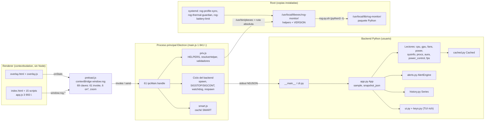
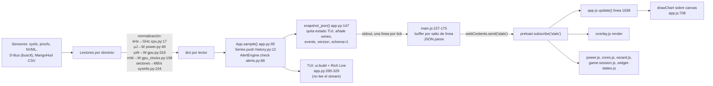
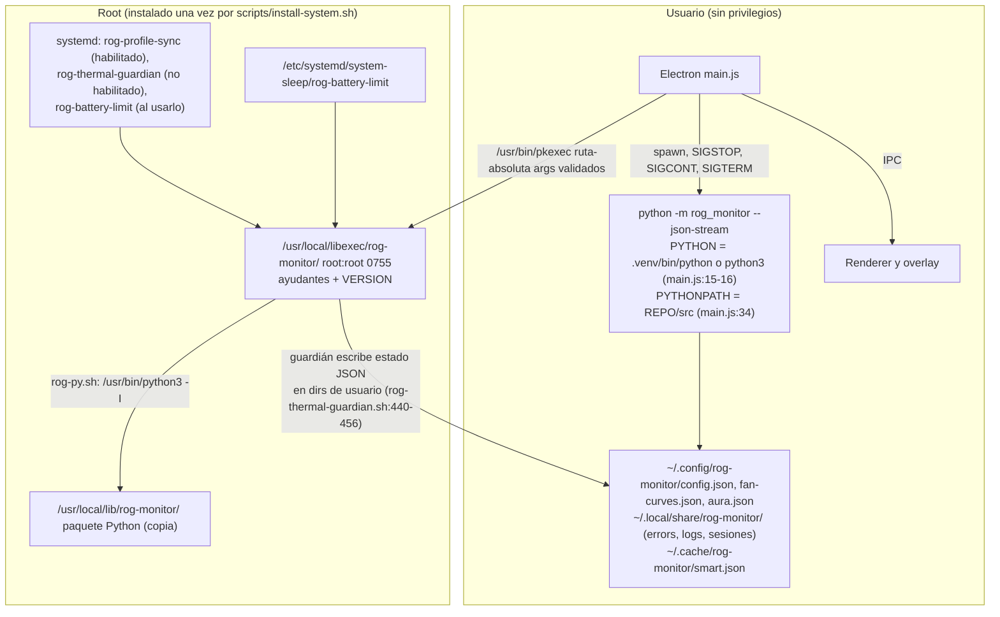
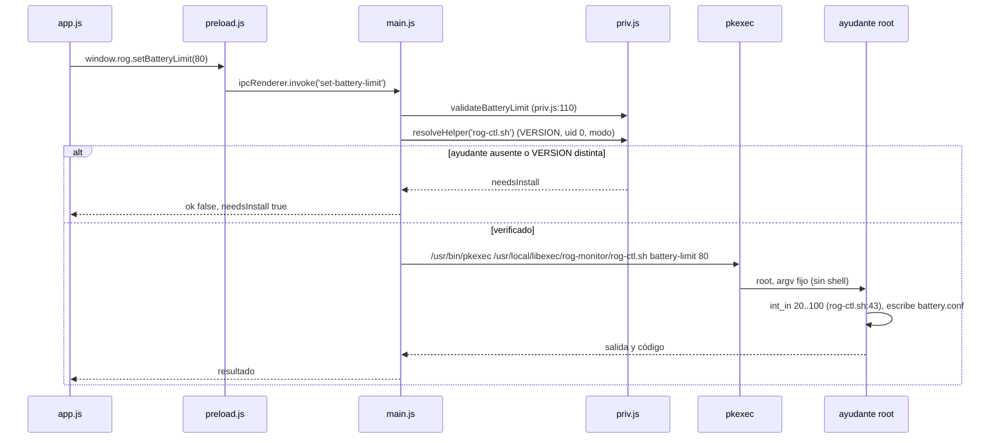
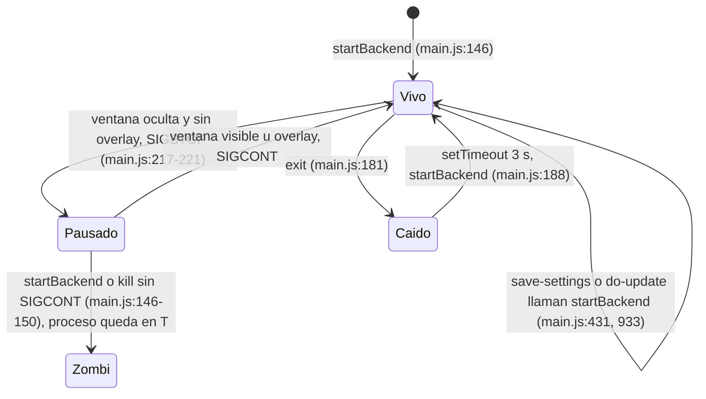

# 04 · Arquitectura real de ROG Monitor (reconstruida desde el código)

> **Nota del orquestador (Opus, revisión cruzada):** ARC-01 (AppImage sin `rich`) es **preexistente**, no una regresión del plan: `fbfee52:src/rog_monitor/app.py:11` ya importaba rich y `main.js` ya relanzaba el backend cada 3 s. Sigue siendo P1 para quien use el AppImage sin rich instalado.

Rama master, HEAD `7d49333` (v21.0.0, 54 commits locales sobre `fbfee52`). Solo lectura. Auditor ARC (Haiku 5.5).
Todo diagrama y cifra sale de leer el código o de ejecutar pruebas puras. Etiquetas: **OBSERVADO** (leí el código), **PROBADO** (ejecuté y vi el resultado), **NO PROBADO**, **HIPÓTESIS**.
Documentos comparados: `docs/ARCHITECTURE.md` (248 líneas) y `docs/adr/0001…0005`.
Inventario de archivos y tests: ver `03-REPOSITORY-INVENTORY.md`.

---

## 0. Resumen ejecutivo

- La arquitectura declarada **coincide en lo esencial**: proceso Python por NDJSON, Electron que lo supervisa, frontera de privilegios con ayudantes root copiados a `/usr/local`, IPC con `contextBridge`, esquema 1 versionado con pruebas de contrato. Los cinco ADR se cumplen salvo ADR-0001 (dos caminos hacia `pkexec` con validación distinta).
- Diferencias relevantes entre documento y código: el documento dice "no network sockets" (hay una sonda loopback), que el tick "nunca bloquea" (la lista de VRAM sí bloquea hasta ~6,5 s), y que `rog-power-notify` es una unidad activa (no la instala nadie).
- Riesgos de mayor peso (detalle en §9):
  - **ARC-01 (P1)**: la app AppImage no empaqueta `rich`, `app.py` lo importa al arrancar y el README dice que solo hace falta `python3`. Sin `rich` en el sistema, el backend muere al arrancar y Electron lo relanza cada 3 s sin límite. Probado en el import, no en el AppImage.
  - **ARC-03 (P2)**: reiniciar el backend mientras está congelado con SIGSTOP deja el proceso anterior en estado `T` para siempre. Probado con un replicado de la secuencia en Node.
  - **ARC-04 / ARC-05 (P2)**: el camino Python hacia `pkexec` y el paquete `/usr/local/lib/rog-monitor` no tienen la verificación de VERSION y propietario que sí tiene `priv.js`.
- Cuellos de botella y forma de datos: el stream manda el historial completo (~38 KB extra por tick con 900 muestras, calculado) y hay llamadas síncronas en el hilo principal de Electron sin timeout (`main.js:488`).

---

## 1. Diagramas

### 1.1 Componentes

### 1.2 Flujo de datos (sensor → UI)

### 1.3 Despliegue: usuario frente a root

### 1.4 Llamada privilegiada (secuencia)

### 1.5 Ciclo de vida del backend (estados)

---

## 2. Cohesión, acoplamiento y SRP

### 2.1 Tamaño de los archivos grandes (OBSERVADO, medido con `wc -l` y con un recuento de declaraciones)

| Archivo | Líneas | Declaraciones de nivel superior | Mutables globales | Funciones más largas (aprox., de una declaración a la siguiente) |
|---|---|---|---|---|
| `desktop/main.js` | 1 841 | 57 funciones, 61 `ipcMain.handle` | 14 `let` de nivel superior (`main.js:79-203, 1012`) | `fpsLoggingEnabled` ~207 (incluye handlers vecinos), `runBenchmarkModule` ~190, `realQuit` ~136 |
| `desktop/renderer/app.js` | 3 993 | 147 funciones, 61 `const`/`let` globales | estado en el ámbito global de script clásico | `runBenchmark` ~278, `openAlertsModal` ~240, `confirmT` ~205, `update` ~202 (`app.js:1838`), `loadFanProfile` ~183 |
| `src/rog_monitor/app.py` | 346 | 11 métodos y funciones | `Config` y `Series` como atributos de instancia | `run` 85 (`app.py:263`), `sample` 52 (`app.py:95`) |
| `src/rog_monitor/power_control.py` | 818 | 29 | constantes de ruta (`:51-60`), `_CACHE_TTL` | `apply` 119 (`:467`), `_build_snapshot` 88 |
| `src/rog_monitor/i18n.py` | 999 | solo `STRINGS` grande | diccionario de módulo | — (datos) |

Medición: PROBADO el recuento (`grep`/script); las longitudes de función son aproximadas porque cuentan hasta la siguiente declaración de nivel superior.

### 2.2 Mapa de responsabilidades en `main.js` (OBSERVADO)

`main.js` mezcla al menos 15 dominios en un único archivo. Los límites de sección aparecen como separadores `/* ---------- ... ---------- */`:

| Dominio | Líneas | Handlers IPC incluidos |
|---|---|---|
| Entorno, rutas, versión, log de errores | 14–101 | — |
| Ciclo del backend, congelado, watchdog | 146–270 | — (usa `stats`, `backend-down`) |
| Frontera de privilegios | 280–317 | (helper `runPriv`, instalador) |
| Módulos Python (`runPythonModule`) | 323–345 | `list-all-procs` |
| Perfiles PPD y modo GPU | 350–416 | `set-profile`, `set-gpu-mode` |
| Actualizaciones (git) | 418–433 | `check-update`, `do-update` |
| Ventiladores y curvas | 435–707 | `set-battery-limit`, `get/set-fan-config(-multi)`, `get/set-gaming-cap`, `fan-benchmark` |
| FPS (MangoHud) | 708–754 | `get/set-fps-logging` |
| Exportar e importar configuración | 755–823 | `export-config`, `import-config` |
| Reporte de incidencias | 824–868 | `report-issue` |
| Errores, SMART | 869–917 | `record-error`, `get-error-log`, `disk-health`, `readSmart` |
| Ajustes | 919–935 | `get-settings`, `save-settings` |
| Aura y música | 937–1167 | `get-aura-state`, `enable-aura-service`, `apply-aura`, `*-aura-*`, `set-music-mode` |
| Benchmarks | 1168–1185 | `cpu-benchmark`, `gpu-benchmark` |
| Sesión de juego | 1186–1278 | `set-recording`, `game-session-*`, `export-benchmark`, `kill-process`, `export-events`, `app-info` |
| Autoarranque y mantenimiento | 1279–1354 | `get/set-autostart`, `reinstall-app`, `uninstall-app` |
| Overlay | 1355–1490 | `list-displays`, `set-overlay` |
| Ventana, bandeja, salida | 1491–1613 | `app-quit`, `close-choice` |
| Control de potencia | 1615–1716 | `get-power-control`, `get-device-docs`, `open-external`, `set-power-control`, `reset-power-control` |
| Guardián térmico | 1718–1805 | `get/set-thermal-guardian` |
| Arranque de Aura | 1806–1841 | — |

### 2.3 Acoplamiento Python ↔ JS

- JS invoca seis módulos Python distintos con `python -m` (`main.js:151` para el stream; `runJsonModule`/`runPythonModule` para `rog_monitor` (`--procs-all`), `.aura` (8 llamadas), `.benchmarks`, `.game_session` (9), `.power_control` (4) y `.settings`). Cada llamada es un proceso nuevo. No hay protocolo común más allá de `stdout` JSON (OBSERVADO, recuento con `grep`).
- El contrato entre ellos vive en dos tests (`tests/test_contract.py`, `desktop/test/contract.test.js`) y en un fixture (`tests/fixtures/snapshot-v1.json`). PROBADO: los 4 + 4 casos pasan.

---

## 3. Estado global y threading

### 3.1 Python (backend)

| Mecanismo | Dónde | Observación |
|---|---|---|
| Hilo daemon por refresco de `Cached` | `cached.py:60` | Un hilo nuevo por refresco, sin pool. `get()` devuelve el valor anterior mientras tanto. |
| Lock | `cached.py:25` (`_lock`) | Solo protege la bandera `_busy`. `_started` (`cached.py:52-53`) y `value`/`_due` (`cached.py:39-42`) se leen y escriben sin lock. Inocuo con el GIL, pero no está garantizado por diseño (ARC-17). |
| Hilo de trabajo para cambio de modo GPU | `app.py:205-210` | Escribe en `queue.Queue` (`app.py:207`). Correcto. |
| Señales en modo TUI | `app.py:272-282` | `SIGWINCH` activa una bandera; `SIGTERM`/`SIGHUP` lanzan `KeyboardInterrupt` desde el manejador (ARC-19). |
| `signal.alarm` como tope de escaneo | `procs.py:24-33` | Process-global; solo funciona en el hilo principal (ARC-18). Hoy se usa solo desde el hilo principal. |
| Estado mutable de módulo | `power.py:78` `_PPD = Cached(...)` | Compartido por todas las instancias; hoy hay una sola `App`. |
| Estado de la app | `App.__init__` (`app.py:37-79`) | `config.data` se muta desde teclas (`app.py:182`) y se guarda con `Config.save`. |

### 3.2 Electron (proceso principal)

- Un solo hilo de eventos. `execFile` y `spawn` son asíncronos. Hay llamadas **síncronas** en el hilo principal:
  - `main.js:488` `spawnSync('bash', [SYNC_SCRIPT, '--defaults', profile])`, **sin timeout**, dentro de `get-fan-config` (`main.js:506-509`). Si el script se cuelga, toda la UI se congela (ARC-10).
  - `main.js:1070` `spawnSync('pactl', …)` y `main.js:1079` `spawnSync('which', …)`, **sin timeout**, al arrancar el modo música (`main.js:1104-1107`).
  - `main.js:1016` `spawnSync('busctl', …)` con `timeout: 3000`.
- Lecturas `readFileSync`/`writeFileSync` en handlers: correctas para archivos pequeños; ver ARC-11 sobre escritura no atómica.
- Estado global del proceso principal: 14 variables `let` de nivel superior (lista en §2.1). Las más sensibles son `backend`, `backendPaused`, `mainVisible` y `lastStatsAt` (`main.js:199-203`), que el ciclo del backend y el watchdog modifican desde varios sitios.

---

## 4. Ciclo de vida del backend en Electron

Secuencia medida en el código (`main.js`):

1. `startBackend()` (`:146`) mata el proceso previo con `removeAllListeners()` + `kill()` (`:147-150`), luego hace `spawn` de `python -m rog_monitor --json-stream --interval 1` (`:151`).
2. `stdout` se trocea por `\n` y cada línea se parsea; si `limits` viene, se guarda (`:170`); se reenvía a `win` y `overlay` por `stats` (`:171-172`). Las líneas no parseables se descartan en silencio (`:173`).
3. `stderr` se añade a `errors.jsonl` en cada trozo (`:176-180`).
4. En `exit`: se marca `backendPaused = false`, se avisa a la UI (`backend-down`, `backend-reconnecting`) y se programa `startBackend` a los 3 s (`:181-190`). El temporizador no se guarda ni se cancela.
5. Ahorro de energía: `setBackendPaused` envía `SIGSTOP` cuando la ventana está oculta y no hay overlay (`:217-221`, `:228-230`).
6. Watchdog cada 5 s (`:204,241`): si la ventana debería correr y no llegan stats en 5 s, envía `SIGCONT`; a los 3 s, si siguen sin llegar, llama a `startBackend()` (`:253-268`).
7. Salida: `realQuit` (`:1591-1601`) y `window-all-closed` (`:1833-1841`) reanudan con `SIGCONT` antes de `kill()`. **Este cuidado falta en `startBackend`** (`:146-150`), que es la causa de ARC-03.

Probado en `scratchpad` (replicado mínimo de los pasos 1 y 5): tras `SIGSTOP` y `kill()` sin `SIGCONT`, el proceso queda en estado `T` (PROBADO); tras `SIGCONT` muere.

---

## 5. IPC, preload y serialización

### 5.1 IPC (PROBADO por cruce de nombres)

- `ipcMain.handle`: 61. `ipcMain.on`: 0. Sin IPC síncrono.
- `ipcRenderer.invoke` en `preload.js`: 61. Cruce 61/61: ningún canal huérfano en ningún sentido.
- Suscripciones: 6 `on*` (`stats`, `overlay-config`, `backend-down`, `backend-reconnecting`, `music-stopped`, `close-request`), cada una con `webContents.send` correspondiente en `main.js`.
- Patrón de suscripción: `preload.js:6-10` devuelve función de baja. Los módulos que se suscriben al abrir modal deben darse de baja (comentario `preload.js:3-5`). `wizard.js:229-238` se suscribe una vez (`:299`), correcto.
- 3 canales sin consumidor en la UI: `get-error-log`, `disk-health`, `set-fan-config` (INV-06).

### 5.2 Serialización (schema 1)

- Envelope: `schema` entero (`app.py:160`), `version` de la app (`app.py:155`). Regla de ADR-0004 respetada en el código revisado.
- Claves por línea: 22 (PROBADO con una línea real).
- Tamaño real de línea: 13 388 a 14 774 bytes con 53 muestras de historial (PROBADO, `--json-stream` durante ~53 s).
- Desglose de la última línea (PROBADO): `aura` 3 060 B (19 %), `series` 2 263 B (14 %), `power_control` 2 068 B (13 %), `sys` 2 047 B (13 %), `procs_by_core` 2 016 B (12,5 %).
- **Crecimiento del historial**: `series` manda los 7 vectores completos en cada tick. Con el valor por defecto de `history_seconds` (900, `config.py:18`) y 7 series de 900 valores, el cálculo da ~37,9 KB extra por línea y por segundo (calculado a partir de 53 muestras reales; no medido en vivo). Esto cuesta JSON y CPU en el backend, en el pipe y en `JSON.parse` de Electron (ARC-08).
- `aura.snapshot()` hace `copy.deepcopy` en cada tick (`aura.py:486`), lo que explica el 19 % de `aura`.

---

## 6. Errores, logs, configuración y tolerancia a fallos

### 6.1 Errores y logs

| Log | Ruta | Escritor | Rotación |
|---|---|---|---|
| TUI/stream (traceback) | `~/.local/share/rog-monitor/error.log` (`app.py:31,85-93`) | `_log_error` | ninguna |
| Electron (eventos, stderr del backend) | `~/.local/share/rog-monitor/errors.jsonl` (`main.js:38,53-66`) | `appendErrorLog` | ninguna |

- Estado local observado (solo tamaños, sin leer contenido): `error.log` 564 KB, 10 380 líneas; `errors.jsonl` 48 KB, 257 líneas (PROBADO por `wc`/`du`). Confirma que no hay rotación en uso real (ARC-20).
- Dos logs con nombre y formato distintos en el mismo directorio (ARC-21).

### 6.2 Configuración

| Fuente | Quién la lee | Quién la escribe | Atómica |
|---|---|---|---|
| `~/.config/rog-monitor/config.json` | Python (`config.py:101-110`), Electron (`main.js:123-141`) | Python `Config.save` (`config.py:118-121`, atómica), Electron `writeAppConfig` (`main.js:131-137`, **no atómica**) | mixta (ARC-10/11) |
| `~/.config/rog-monitor/fan-curves.json` (schema 2) | Electron, `fans.py`, root `rog-profile-sync.sh` | Electron (`main.js:576,622,647,701`, **no atómica**) | no |
| `~/.config/MangoHud/MangoHud.conf` | Electron, `fps.py` | Electron (`main.js:748`, **no atómica**) | no |
| `~/.cache/rog-monitor/smart.json` | Python `sysinfo.py:186-187`, Electron `smart.js` | Electron `writeAtomic` (`smart.js:55-65`, atómica) | sí |
| `/etc/rog-monitor/battery.conf` | root | `rog-ctl.sh` (escribe en `:47`) | — |

Variables de entorno que alteran el comportamiento (OBSERVADO):

| Variable | Efecto | Dónde |
|---|---|---|
| `ROG_MONITOR_VERSION` | Sustituye la versión que comparan los ayudantes root (`priv.js` vía `APP_VERSION`) | `main.js:42`, `__init__.py:10` |
| `ROG_SCRIPTS_DIR` | Ruta de `rog-profile-sync.sh` para `--defaults` sin root | `main.js:442` |
| `ROG_FW_ATTRS_DIR` | Modo de prueba: escribe en un sysfs falso y ejecuta el script del repo sin root | `power_control.py:94` y `test_mode` en `power_control.py` (~495) |
| `ROG_THERMAL_DRY`, `ROG_THERMAL_STATE_DIR` | Simulación del guardián y directorio de estado | `rog-thermal-guardian.sh` |
| `XDG_CONFIG_HOME`, `XDG_DATA_HOME`, `XDG_CACHE_HOME` | Rutas de datos | `config.py:10-12`, `smart.js:17`, `sysinfo.py:186` |

### 6.3 Tolerancia a fallos

Positivo (OBSERVADO y en parte PROBADO):

- Un fallo en un tick no mata el stream: `run_json` captura, registra y sigue (`app.py:251-256`).
- Respawn del backend tras `exit` a los 3 s (`main.js:188`) y watchdog de congelado (`main.js:263-268`).
- `Cached` conserva el último valor bueno (stale-while-error) con backoff `ttl·2^fallos` acotado (`cached.py:27-43`).
- `Config` mueve el archivo corrupto a `.corrupt-<fecha>.bak` (`config.py:85`).
- Escritura atómica en Python (`config.py:64-80`) y en `smart.js` (`smart.js:55-65`).
- Clasificación de fallos de `pkexec` (`smart.js:86-93`).

Negativo:

- Sin backoff en el respawn: siempre 3 s (`main.js:188`). Un backend que no arranca genera ~1 200 ciclos por hora. Con `rich` ausente (ARC-01) cada ciclo deja un evento `backend-exit` y sus líneas de `stderr` en `errors.jsonl` (calculado).
- Temporizadores de respawn sin guardar ni cancelar (`main.js:188`, `:263-268`) y `save-settings` llama `startBackend` directamente (`main.js:933`). Dos respawns pueden matarse entre sí (ARC-02).
- Reinicio con proceso congelado (ARC-03).

---

## 7. Seguridad

| Control | Estado | Evidencia |
|---|---|---|
| `contextIsolation` | **Activo** en ambas ventanas | `main.js:1424`, `:1506` |
| `nodeIntegration` | **Desactivado** en ambas | `main.js:1425`, `:1507` |
| `sandbox` | **No declarado** (depende del valor por defecto de Electron 42) | `main.js:1422-1425`, `:1504-1507`. NO PROBADO en runtime (ARC-12) |
| CSP ventana principal | `default-src 'self'; style-src 'self' 'unsafe-inline'; script-src 'self'` | `index.html:5` |
| CSP overlay | `default-src 'self'; style-src 'unsafe-inline'` | `overlay.html:5`. Sin `object-src`/`base-uri` (ARC-12) |
| Scripts inline, `on*=`, `eval`, `new Function` | **Ninguno** | `grep` sobre `desktop/` |
| Navegación y `window.open` | Sin manejador (`setWindowOpenHandler`, `will-navigate` ausentes) | `grep` (ARC-12) |
| Abrir URL externa | `open-external` valida `^https?://` (`main.js:1642`); `report-issue` no valida (`main.js:825-829`, `:865`) (ARC-13) | — |
| Procesos hijos | `execFile`/`spawn` con arrays, sin shell; ningún `pkexec sh -c` | `grep` (PROBADO: 0 coincidencias) |
| Escritura desde root a dirs de usuario | Guardián: `set -C` + `mv`, rechaza symlinks (`rog-thermal-guardian.sh:440-456`) | leído |
| Validación de argumentos que cruzan a root | Batería, ventiladores, potencia, dispositivo, guardián: sí (`priv.js:104-192`). `set-profile` y `profile` de `set-fan-config`: no (ARC-15) | — |

---

## 8. Documento declarado frente a código

### 8.1 `docs/ARCHITECTURE.md`

| Afirmación del documento | Líneas | Código | Veredicto |
|---|---|---|---|
| "ROG Monitor opens no network sockets" | 27 | `aura.py:473-478` abre un TCP a `127.0.0.1:6742` (sonda OpenRGB) | **Diverge** (loopback, pero es un socket) |
| "The only network-capable actions are UPDATE (`git fetch`) and the report button" | 27-29 | `do-update` hace `git pull` y `pip install -r requirements.txt` (`main.js:427-430`); `open-external` abre enlaces de documentación (`main.js:1640-1643`) | **Diverge** (incompleta) |
| El backend lo lanza Electron con `--json-stream --interval 1` | 109, 174-175 | `main.js:151` | Coincide |
| Reinicio a 3 s tras salir; watchdog cada 5 s; SIGCONT; respawn tras 3 s | 110-114 | `main.js:188`, `:204-205`, `:263-268` | Coincide |
| SIGSTOP cuando la ventana está oculta y no hay overlay | 115-117 | `main.js:228-230` | Coincide (con el caso de ARC-03) |
| 61 handlers `ipcMain.handle` | 118 | 61 (PROBADO) | Coincide |
| El renderer no tiene acceso directo a Node ni Electron | 119-120 | `contextIsolation`, `nodeIntegration: false` | Coincide (`sandbox` sin declarar) |
| Helpers root solo por `runPriv` con cuatro comprobaciones | 124-137 | `priv.js:18-25, 65-95, 98-100, 104-192` | Coincide para el camino de la UI. El camino Python (`power_control.py`) no comprueba VERSION ni propietario (ARC-04) |
| `rog-py.sh` impide importar del repo o del home | 139-141 | `rog-py.sh:11-16` | Coincide |
| Única excepción: el instalador | 141-142 | `main.js:316` | Coincide |
| `rog-profile-sync` habilitado; `rog-thermal-guardian` instalado sin habilitar; `rog-battery-limit` habilitado al usarlo; `rog-power-source` no instalado | 153-156 | `install-system.sh:120-127,140-141`; `rog-ctl.sh:51` | Coincide |
| Todas las unidades root: `NoNewPrivileges`, `ProtectSystem=full`, `PrivateTmp` | 158-159 | `systemd/*.service` | Coincide |
| `rog-power-notify.service` es una unidad de usuario que corre como usuario | 159-160 | Ningún instalador la instala; `ExecStart` con placeholder sin sustituir (`systemd/rog-power-notify.service:8`) | **Diverge** (INV-04) |
| Tick de 1 s; primera línea tras 0,5 s | 174-178 | `app.py:234,248`; `main.js:151` | Coincide |
| Un tick fallido no mata el stream | 179-180 | `app.py:251-256` | Coincide |
| Fuentes lentas envueltas en `Cached`, "never blocks the tick" | 182-188 | `Cached` para supergfx, PPD y Aura; **la lista de VRAM no**: si NVML falla o no existe, cada 5 s se ejecutan llamadas síncronas a `nvidia-smi` (`gpu.py:252-270`, `:200` ×2 con timeout 2 s y `:225` con 2,5 s) | **Diverge** (ARC-09) |
| supergfx TTL 10 s con backoff hasta 120 s; PPD 3 s; Aura 15 s | 190-194 | `gpu.py:72`, `power.py:78`, `aura.py:321` | Coincide |
| Lista de VRAM cacheada 5 s | 196 | `gpu.py:268` | Coincide |
| Guardia de dGPU suspendida y backoff de 15 s | 198-207 | `gpu.py:107-113,116,126,138` | Coincide |
| Eventos: `deque` de 60; histéresis 3 °C y 5 %; cooldown 60 s; `throttle_min_ms`; `notify-send` | 209-232 | `alerts.py:21,150,25,63`; `config.py:36,39-40,43` | Coincide |
| El guardián nunca aplica offsets de GPU ni llama `supergfxctl` | 234-243 | Sin coincidencias de `supergfx` ni de `apply-gpu` en `rog-thermal-guardian.sh` (`grep`) | Coincide |
| El guardián publica su estado en JSON del usuario | 241-243 | `rog-thermal-guardian.sh:440-456` | Coincide |
| `snapshot_json()` quita estado de TUI y añade `series`, `events`, `version`, `schema` | 96-104, 147-161 | `app.py:147-161` | Coincide |

### 8.2 Decisiones (ADR)

| ADR | Cumplimiento | Evidencia y excepciones |
|---|---|---|
| 0001 Frontera de privilegios | **Parcial** | Cumple: `/usr/bin/pkexec` absoluto (`priv.js:14,98-100`), lista cerrada (`priv.js:18-25`), sin `pkexec sh -c` (PROBADO: 0), `rog-py.sh` con `-I` (`rog-py.sh:11`). Incumple en dos puntos: el camino Python no comprueba VERSION ni propietario (`power_control.py:55-58,511-512`, ARC-04); `/usr/local/lib/rog-monitor` no se comprueba nunca (`priv.js:80-93` solo mira el ayudante y su directorio; ARC-05). |
| 0002 Sin dependencias nuevas | **Cumple** (con matiz) | `rich` es la única dependencia de runtime; NVML por `ctypes`; tests con `unittest` y `node:test`. Matiz: el AppImage no incluye `rich` (ARC-01). |
| 0003 Ratón desactivado en TUI | **Cumple** | `keys.py` solo activa cbreak; los códigos de ratón aparecen solo en un comentario (`keys.py:73`). |
| 0004 Esquema NDJSON versionado | **Cumple** | `schema` = 1 (`app.py:160`); contrato PROBADO (4 + 4 casos). |
| 0005 Guardián con escritura única y simulación | **Cumple** | `hw_write` es la única escritura a sysfs (`rog-thermal-guardian.sh:196-210`; `grep` de `> /sys` sin resultados fuera de ella); `ROG_THERMAL_DRY` y 5 casos de simulación PROBADOS. |

---

## 9. Hallazgos

Formato obligatorio. Severidad: P0 rompe arranque, datos o seguridad · P1 función principal rota o engañosa · P2 deuda o UX importante · P3 menor.

| ID | Severidad | Estado | Componente | Archivo:línea | Commit(s) | Evidencia/comando | Resultado | Impacto | Recomendación | Prueba de aceptación |
|---|---|---|---|---|---|---|---|---|---|---|
| ARC-01 | P1 | parcial | Backend · Empaquetado (AppImage) | `src/rog_monitor/app.py:11-12`, `src/rog_monitor/cli.py:62`, `desktop/main.js:14-16,34,151`, `desktop/package.json` (`extraResources`), `README.md:200-201` | 1d2e7d7 (app.py:11), 228218c9 (main.js:151), 4f7651c (README:200) | Ejecutado con `PYTHONPATH=src` sin `rich` en el sitio: `ModuleNotFoundError: No module named 'rich'` en `cli.py:62` → `app.py:11` (PROBADO) | El stream de `--json-stream` necesita `rich` al importar. El AppImage copia `src` pero no `rich` y usa `python3` del sistema. README dice que solo hace falta `python3`. Sin `rich`, el backend muere y Electron lo relanza cada 3 s sin límite (`main.js:181-190`) | Dashboard sin datos para usuarios de AppImage sin `rich`; ~1 200 ciclos/hora con entradas en `errors.jsonl` (calculado) | Empaquetar `rich` en `extraResources` (venv o wheel) o importar `rich` de forma diferida y mostrar un error claro; corregir README | En un sistema sin `rich`, el AppImage muestra stats en <5 s; el README lo indica |
| ARC-02 | P2 | verificado | Electron · Temporizadores | `desktop/main.js:188`, `:263-268`, `:933`, `:431` | 228218c9 (:188), 1fb7d74a (:263) | Lectura del código: 3 caminos llaman `startBackend` (exit, watchdog, `save-settings`, `do-update`) sin cancelar temporizadores | Un respawn programado puede matar un backend recién arrancado; churn de procesos | Pérdida de stats durante 1–3 s tras guardar ajustes (HIPÓTESIS de frecuencia) | Un solo punto de reinicio con `clearTimeout` y bandera de "reinicio en curso" | Test: dos llamadas a `restart()` en 100 ms dejan exactamente un proceso vivo |
| ARC-03 | P2 | verificado | Electron · Ciclo de vida | `desktop/main.js:146-150` (falta `SIGCONT`), `:217-221`, `:199`; comparar con `:1595-1596`, `:1835-1836` | 228218c9 (146-150), 7ca0497b y 2701aaa3 (217-221) | Replicado en Node: `SIGSTOP`, luego `removeAllListeners` + `kill()` → estado `T` a ~1 s; tras `SIGCONT` muere (PROBADO) | Un proceso Python congelado sobrevive a `startBackend()` (`save-settings` o `do-update` con la ventana oculta). Además `backendPaused` queda en `true` con un backend nuevo en marcha | Fuga de procesos y RAM; el backend nuevo no se congela hasta el siguiente show/hide (ahorro de energía roto) | En `startBackend`, si `backendPaused`, enviar `SIGCONT` antes de `kill()` y poner `backendPaused = false` | Tras ocultar la ventana y llamar `save-settings`, `ps -o stat` del backend anterior no muestra `T` |
| ARC-04 | P2 | verificado | Privilegios · Dos caminos | `src/rog_monitor/power_control.py:55-58, 511-512`; `scripts/rog-profile-sync.sh:116`; comparar con `desktop/priv.js:65-93` | 531ec9e (55-58), c392ebaa (507-513) | Lectura: `_SCRIPT.is_file()` como única comprobación; no hay VERSION ni propietario. `main.js:1679-1685` valida solo en la ruta de la UI | El servicio root llama a `power_control` y ejecuta el ayudante sin la verificación de `priv.js`. Si `libexec` fuera escribible, el camino Python no lo detecta | Defensa en profundidad incompleta; regresión silenciosa si VERSION no coincide (el ayudante antiguo sigue ejecutándose) | Mover la comprobación de `priv.js` a Python (o a `rog-py.sh`) y usarla en los dos caminos | Test: con VERSION distinta, `power_control apply` como root devuelve `needsInstall` |
| ARC-05 | P2 | verificado | Privilegios · Paquete Python | `desktop/priv.js:80-93`; `scripts/rog-py.sh:13`; `scripts/install-system.sh:97-99,179` | 531ec9e | `rootOwned` solo comprueba el ayudante y `libexec`. `rog-py.sh` importa de `/usr/local/lib/rog-monitor`. El instalador usa `install -d -m 0755` (no fuerza propietario) y deja la verificación al usuario (`:179`) | El paquete que ejecutan los ayudantes root no tiene comprobación de propietario en tiempo de ejecución | Un paquete de usuario en `/usr/local/lib` (por error de instalación) se ejecutaría como root | Comprobar `rootOwned` también de `PYLIB` (y sus padres) en `resolveHelper` | Test con `fsImpl` simulado: `PYLIB` con uid 1000 → `needsInstall` |
| ARC-06 | P2 | verificado | Electron · SRP | `desktop/main.js` (1 841 l., 57 funciones, 14 `let` globales); mapa en §2.2 | 228218c9 (base), 112d2c08, ed3d883 | Medición en §2.1 | Un solo archivo con 15 dominios y 61 handlers; cambios en uno arriesgan los demás; no testeable sin Electron | Mantenimiento lento; regresiones en lifecycle | Extracción incremental: `backend.js` (ciclo y watchdog), `ipc/fans.js`, `ipc/aura.js`, `ipc/music.js`, `ipc/power.js`, `ipc/guardian.js`, `overlay.js`; `main.js` queda como composición. Empezar por `backend.js` (ARC-02/03) | `node --test` cubre `backend.js` con un proceso falso; `main.js` < 400 líneas |
| ARC-07 | P2 | verificado | Renderer · Acoplamiento | `desktop/renderer/app.js` (3 993 l., 147 funciones, 61 globales); `game-session.js:665-668` sin guard; `power.js:1186` y `bench-detail.js:205` con `typeof` | a034a77 (game-session), 6c4a92f (events), 1d2e7d7 | Lectura y `grep escapeHtml` | `escapeHtml` y otras funciones de `app.js` son globales usadas por 5 módulos; `game-session.js` depende del orden de carga (`index.html:849` antes de `:855`) | Romper el orden de scripts rompe la sesión de juego sin error claro | Mover utilidades (`escapeHtml`, formato) a `util.js` cargado primero; eliminar globales de `app.js` por módulo | Test `vm` que carga `util.js` y `game-session.js` sin `app.js` |
| ARC-08 | P2 | verificado | Serialización · Payload | `src/rog_monitor/app.py:153`, `src/rog_monitor/history.py:12-19`, `src/rog_monitor/config.py:18` | acaa388 (series), 303b145 (NDJSON) | PROBADO: 2 263 B de `series` con 53 muestras; calculado ~37,9 KB por tick con 900 | El historial completo viaja a 1 Hz; JSON y CPU crecen con el historial | ~38 KB/s extra en pipe y `JSON.parse`; más CPU en el backend (HIPÓTESIS: significativo en portátiles) | Enviar solo el último punto por tick (`series_delta`) y el historial bajo demanda | Medir bytes/tick con `history_seconds=900`: <2 KB para `series` |
| ARC-09 | P2 | verificado | Backend · Bloqueo del tick | `src/rog_monitor/gpu.py:252-270` (caché 5 s), `:196-200` (consulta por campos, `timeout=2.0`, dos intentos), `:225` (tabla, `timeout=2.5`); llamada desde `app.py:133` | 112d2c08 (VRAM), 89d4719 (caché) | Lectura del código. Si NVML falla o no existe (`gpu.py:272-287`), `_read_nvidia_vram_query` y `_read_nvidia_vram_table` se ejecutan en cada refresco: peor caso 2 + 2 + 2,5 = 6,5 s | El tick se bloquea hasta 6,5 s cada 5 s con un driver NVIDIA colgado. Contradice el principio de `Cached` que documenta `ARCHITECTURE.md:182-188` | Stats congeladas y watchdog de Electron activo sin causa visible (NO PROBADO en vivo) | Envolver la lista de VRAM en `Cached` (hilo de fondo), igual que Aura | Simular `nvidia-smi` que duerme 5 s: el tick sigue por debajo de 1,2 s |
| ARC-10 | P2 | verificado | Electron · Hilo principal | `desktop/main.js:486-490` (`spawnSync` sin timeout), `:1070` (`pactl`, sin timeout), `:1079` (`which`, sin timeout) | ed3d883 | Lectura: ningún `timeout` en las tres llamadas; `:488` se ejecuta dentro de `get-fan-config` | Un script o `pactl` colgado congela toda la UI de Electron | UI bloqueada sin recuperación hasta que termine el proceso | Cambiar a `execFile` asíncrono con `timeout` (la cadena de `scriptDefaults` ya tiene `|| {}`) | Test: `scriptDefaults` con `sleep 30` devuelve en <3 s |
| ARC-11 | P2 | verificado | Config · Escritura no atómica | `desktop/main.js:135` (config.json), `:576, 622, 647, 701` (fan-curves.json), `:748` (MangoHud.conf), `:782, 813, 843` | 112d2c08 (135), 03dda5a8 (576-701), ed3d883 (748) | Lectura. Python usa `write_atomic` (`config.py:64-80`); `smart.js` ya es atómico | Un corte de energía o un crash a mitad de escritura deja JSON truncado. `config.py:85` lo mueve a `.corrupt`, pero `fan-curves.json` se pierde para el root service | Pérdida de curvas de ventilador y ajustes | Reutilizar un `writeAtomic` (tmp + rename) de `smart.js` para todos | Test: `writeAtomic` interrumpido deja el archivo previo intacto |
| ARC-12 | P2 | NO PROBADO | Seguridad · Hardening Electron | `desktop/main.js:1422-1425, 1504-1507` (sin `sandbox`), `:1403-1441` (sin `setWindowOpenHandler`), `index.html:5`, `overlay.html:5` | 03dda5a8 (1422), 228218c9 (1504), 228218c9 (index.html) | `grep -n "sandbox\|setWindowOpenHandler\|will-navigate"` → sin resultados | El sandbox depende del valor por defecto de Electron 42. Sin guardas de navegación ni de `window.open`. CSP sin `object-src 'none'` ni `base-uri 'none'` | Si en el futuro entra contenido no confiable, la contención es menor de la deseable | Declarar `sandbox: true`; añadir `setWindowOpenHandler(() => ({ action: 'deny' }))` y `will-navigate` con lista blanca; añadir `object-src 'none'; base-uri 'none'` a la CSP | `webPreferences` explícito en ambas ventanas; test de E2E que intenta `window.open` y no abre ventana |
| ARC-13 | P2 | verificado | Electron · Abrir URL | `desktop/main.js:825-829` (origen de git, sin validar), `:852-866` (prefill con log), `:865` (`shell.openExternal`) | 82aa423 | Lectura. `open-external` valida `^https?://` (`:1642`); `report-issue` no | Una URL de `origin` con credenciales o con otro esquema se abre tal cual. El prefill incluye las últimas líneas de `errors.jsonl` (host, plataforma, rutas) | Exposición de datos o credenciales si el remoto tiene token (HIPÓTESIS) | Validar `https://github.com/` (o `git@github.com:`) antes de abrir; quitar credenciales de la URL; revisar qué se incluye del log | Test: remoto `https://tok@evil.example/x` → `{ok:false}` sin `openExternal` |
| ARC-14 | P3 | verificado | Renderer · Escape | `desktop/renderer/app.js:1998-2003` (`${ts}`, `${msg}`, `${k}` sin `escapeHtml`) | 6c4a92f | Lectura; `index.html:5` CSP impide scripts inline | Inyección de marcado en la lista de eventos si un mensaje trae HTML. Mitigado porque los mensajes son internos | Bajo, pero inconsistente con el resto (`app.js:887,1004,1823,2016` sí escapan) | Escapar los tres campos | `grep` de `events` sin `${msg}` directo |
| ARC-15 | P2 | verificado | IPC · Validación | `desktop/main.js:358-367` (`set-profile`, sin lista), `:543-584` (`set-fan-config`: `profile` sin validar y escrito como clave en `fan-curves.json`), comparar con `:369` (`GPU_MODES`) | ed3d883 (358), cafbffda (543) | Lectura | Entrada sin validar cruza a un archivo que lee el servicio root (`rog-profile-sync.sh:153-166`) | Claves inesperadas en el JSON leído por root; el ayudante lo trata como datos (HIPÓTESIS de impacto) | Lista cerrada `['quiet','balanced','performance']` (y alias) antes de escribir o llamar a PPD | Test: `set-fan-config` con `profile: '../x'` → rechazo |
| ARC-16 | P2 | verificado | Duplicación de reglas | `desktop/priv.js:141-190` (curvas) vs `scripts/rog-profile-sync.sh:196-…` ("si cambias una, cambia la otra"); `main.js:553-562`, `:593-598` (normalización de caps repetida); `main.js:712` vs `src/rog_monitor/fps.py:16` (ruta MangoHud) | 858023a2 (priv, rog-profile-sync) | Lectura de los comentarios y del código | Dos copias de la validación de curvas que deben sincronizarse a mano | Deriva silenciosa entre validación de UI y de root | Una sola fuente (JSON de reglas o generación) y tests de paridad | Test: los mismos 20 casos pasan en `priv.test.js` y en `test_power_validation.py` |
| ARC-17 | P3 | verificado | Python · Concurrencia | `src/rog_monitor/cached.py:52-53, 39-42, 47-49, 62-64` | 89d4719 | Lectura | `_started`, `value`, `_due` sin lock; correcto con el GIL, sin garantía formal | Bajo | Documentar la invariante o usar `threading.Lock` en `refresh_now` | Test con 8 hilos concurrentes sobre `get()` sin errores |
| ARC-18 | P3 | verificado | Python · Señales | `src/rog_monitor/procs.py:24-33` | 89592f7 | Lectura: `signal.signal` y `signal.alarm` a nivel de proceso | Solo funciona en el hilo principal; choca con cualquier otro uso de `SIGALRM` | Bajo hoy; trampa si se llama desde un hilo | Usar `select`/tiempo límite por lectura de `/proc` o documentar la restricción | Test que llama `ProcReader.read()` desde un hilo y no lanza `ValueError` |
| ARC-19 | P3 | verificado | Python · Señales TUI | `src/rog_monitor/app.py:277-282` | 4a65b870 (app.py), 4a65b870 (manejador) | Lectura | `SIGTERM`/`SIGHUP` lanzan `KeyboardInterrupt` desde el manejador, en cualquier punto del código | Puede interrumpir una escritura; `write_atomic` limpia el temporal (`config.py:76-80`), así que el daño está acotado | Bajo | Bandera de salida comprobada en el bucle, en lugar de excepción asíncrona | Test pty: `SIGTERM` durante `Config.save` deja `config.json` válido |
| ARC-20 | P2 | verificado | Logs · Crecimiento | `desktop/main.js:53-66`, `:176-180` (stderr por trozo), `src/rog_monitor/app.py:85-93` | f5a18155 (appendErrorLog), f5a1815 (stderr), 228218c9 (app.py:85-93) | `wc -l` y `du` locales: `error.log` 564 KB, 10 380 líneas (PROBADO) | Sin rotación en ningún log; un backend roto (ARC-01) lo llena | Disco y ruido; diagnóstico difícil con 10 000 líneas | Rotación por tamaño (renombrar a `.1` al superar 1 MB) en ambos escritores | Test: escribir 3 MB y comprobar que el archivo activo queda < 1 MB |
| ARC-21 | P3 | verificado | Logs · Consistencia | `src/rog_monitor/app.py:31` (`error.log`), `desktop/main.js:38` (`errors.jsonl`) | 228218c9 (app.py), f5a18155 (main.js) | Lectura | Dos logs de error con formato y nombre distintos en el mismo directorio | Confusión al reportar incidencias | Un único `errors.jsonl` con campo `source` | `ls ~/.local/share/rog-monitor` muestra un solo log de errores |
| ARC-22 | P3 | verificado | Documentación · Deriva | `docs/ARCHITECTURE.md:27-29, 159-160`; `README.md:200-201` | 0439655 (ARCHITECTURE), 4f7651c (README) | Comparación de §8.1 | El documento niega sockets (hay una sonda loopback), omite `pip install` en la actualización y presenta una unidad muerta como activa; el README omite `rich` | Expectativas erróneas sobre red y sobre instalación | Corregir las tres frases | Revisión manual; `docs/ARCHITECTURE.md` cita `aura.py:478` |
| ARC-23 | P3 | verificado | Electron · Arranque | `desktop/start.sh:8-10` (`npm install`), `src/rog_monitor/cli.py:57-59` (salida a `DEVNULL`) | 228218c9 | Lectura | Primer arranque con `npm install` (no `npm ci`) y salida silenciada desde `monitor --desktop` | Fallos invisibles; lock posiblemente modificado (véase INV-08) | Ver INV-08 | Ver INV-08 |
| ARC-24 | P3 | verificado | Python · Importaciones | `src/rog_monitor/sysinfo.py` (`import rog_monitor.sysinfo as _self`), `src/rog_monitor/fans.py` (`copy` tres veces), `src/rog_monitor/alerts.py` (`deque` dos veces), `src/rog_monitor/power_control.py:~51-58` (importación absoluta `rog_monitor.gpu_clocks`), `src/rog_monitor/app.py:155` (`__import__`) | 1d2e7d7, 89592f7 | Lectura de los `import` | Ruido y patrones inconsistentes | Bajo | Limpiar en el mismo PR que ARC-06 | `ruff --select F811` (no se añade dependencia; hacerlo a mano) |
| ARC-25 | P3 | verificado | Renderer · Comentarios obsoletos | `desktop/renderer/game-session.js:1-13` (dice que los puentes "no existen todavía"; existen en `preload.js:56-64`), `desktop/renderer/overlay.js:3` (`onOverlayLang` no existe) | a034a77 (game-session), 3167e38 (overlay) | Lectura y `grep` | Comentarios que describen un estado anterior | Confusión para quien mantiene | Actualizar | — |
| ARC-26 | P3 | verificado | Electron · Entorno de `pkexec` | `desktop/main.js:286` (`PRIV_ENV = { ...process.env, PATH }`) | 531ec9e | Lectura | Todo el entorno del usuario llega a `pkexec` (que lo sanea), salvo `PATH` | Bajo (HIPÓTESIS: `pkexec` filtra el entorno) | Pasar un entorno mínimo explícito | NO PROBADO |

Aclaración de cumplimiento con respecto a la frontera de privilegios: no encontré ningún camino en que el usuario pueda ejecutar código como root sin confirmación, salvo el instalador previsto y aceptado en ADR-0001 (`main.js:316`). Ese instalador se lee del repo, que es escribible por el usuario. Es un riesgo aceptado por diseño (riesgo residual: si el repo está comprometido, la siguiente reinstalación confirmada ejecuta código comprometido como root). Lo dejo como nota, no como hallazgo.

---

## 10. Refactor incremental propuesto (sin reescritura)

Orden por riesgo y coste. Cada paso se puede enviar por separado y deja la suite en verde.

1. **Correcciones de ciclo de vida (pequeñas, sin mover código)**: ARC-03 (`SIGCONT` antes de `kill` en `startBackend`), ARC-02 (un solo temporizador de reinicio), ARC-10 (`timeout` o `execFile` asíncrono para `main.js:488`, `:1070`, `:1079`).
2. **Extraer `backend.js`** de `main.js:146-270` (spawn, stdout, respawn, SIGSTOP, watchdog) con inyección de `spawn`, `kill` y temporizadores. Así se puede probar con un proceso falso en `node:test` (cierra INV-01 en lo que toca al ciclo).
3. **Privilegios en un solo punto**: mover la comprobación de `priv.js` (VERSION, propietario, `PYLIB`) a un módulo que usen tanto `main.js` como `power_control.py` (ARC-04, ARC-05). En Python puede ser una función de `rog_monitor` que `rog-py.sh` verifique antes de importar.
4. **Escritura atómica común** en JS (ARC-11) y rotación de logs (ARC-20).
5. **Stream**: enviar `series` como delta (ARC-08) y mover la lista de VRAM a `Cached` (ARC-09). Ambos cambian el schema solo de forma aditiva (ADR-0004).
6. **Renderer**: extraer `util.js` con `escapeHtml` y utilidades compartidas (ARC-07, ARC-14).
7. **Dividir `main.js` por dominio** (ARC-06): `ipc/fans.js`, `ipc/aura.js`, `ipc/music.js`, `ipc/power.js`, `ipc/guardian.js`, `overlay.js`. `main.js` queda como composición (<400 líneas).
8. **Hardening de Electron** (ARC-12) y validación de URL de reporte (ARC-13): cambios de una línea en `webPreferences` y en `report-issue`.

---

## 11. Lo que no verifiqué

- Electron en ejecución: no lancé la GUI. Sandbox y guardas de navegación (ARC-12) y el comportamiento de `startBackend` con ventana real (ARC-02/03) se derivan del código; ARC-03 se probó con un replicado mínimo en Node.
- AppImage: no se construyó ni ejecutó. ARC-01 y ARC-20 se prueban por el import de `rich` y por el tamaño real de los logs de esta máquina.
- Latencia real del tick con un driver NVIDIA colgado (ARC-09) y coste de CPU del stream (ARC-08): calculados, no medidos.
- Python 3.12 de la CI: no instalado. Todas las pruebas corrieron en Python 3.14.7 con `PYTHONUSERBASE` apuntando al `site` del usuario (ver INV-14).
- Ningún comando escribió en el sistema ni en el repo. Único efecto colateral: `py_compile` creó `__pycache__` en `src/rog_monitor/`, que eliminé (detalle en `03-REPOSITORY-INVENTORY.md` §0).
