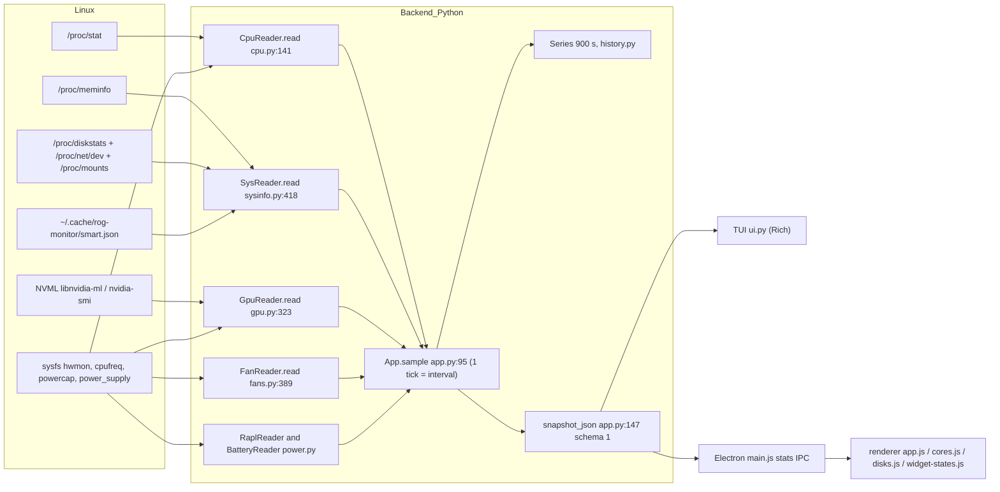

# 05 - Pipeline de métricas (Rog-Monitor)

- Repo: `~/MyFiles/Dev/Rog-Monitor`, HEAD `7d49333` (rama master, sin push).
- Fecha de auditoría: 2026-10-10. Auditor: agente Haiku 5.5, solo lectura sobre el repo.
- Etiquetas: **OBSERVADO** (leí el código), **PROBADO** (ejecuté y vi resultado), **NO PROBADO**, **HIPÓTESIS**.
- Intérprete usado para pruebas: `.venv/bin/python` del repo (Python 3.14.7). El `python3` del sistema no tiene `rich` (ver MET-19).
- Ejecuciones: tests unitarios de métricas, una ejecución one-shot `--json` (HOME temporal, sin escrituras en el repo), comprobaciones en el mismo proceso con mocks (sin escribir sysfs/procfs). No se tocó GPU, ventiladores, energía ni systemctl.
- Redacción: no se imprimen hostname, usuarios, procesos, DMI ni rutas de montaje reales (los mounts aparecen como `/var/home` por ser ruta del sistema, no dato personal).

---

## 0. Resumen (respuestas directas)

1. **RAM usada = MemTotal - MemAvailable.** OBSERVADO `sysinfo.py:426,461`. PROBADO: en el mismo proceso, `(MemTotal-MemAvailable)` = 14.599 GiB y `ram_used_gb` = 14.599 GiB. Buffers no se separan de "usada" (ya cuentan como disponibles); caché = `Cached + SReclaimable` (`sysinfo.py:423`), igual que `free` buff/cache (PROBADO: 36811550720 B = (Buffers+Cached+SReclaimable)·1024).
2. **Cifra mostrada:** en el desktop la etiqueta es `usada/total GiB` (`app.js:1951`, "14.6/47 GiB") y la barra usa `ram_percent` entero (`app.js:1952`). En la TUI, `x.x/yG` + barra % (`ui.py:340-341`).
3. **La historia de RAM y swap se guarda en %, no en GiB** (`app.py:109-110`, enteros `round()` de `sysinfo.py:462,469`). Commit `acaa388` (series `cpu_usage/ram_used/swap_used`, ver `app.py:65-69`).
4. **El usuario NO puede ver RAM en GiB reales con eje 0..total en la historia.** La gráfica usa `fromZero` con unidad `%` (`app.js:636-637`) y el eje se calcula como `[0, ceil(max/5)*5]` con rango mínimo 10 (`app.js:673-688`). No hay eje ligado a `ram_total_gb`. Además, por defecto el modo es "temperatura" (`app.js:646`), así que RAM/swap sólo aparecen tras pulsar el botón "Uso CPU/RAM" (`index.html:256`, `app.js:2231`).
5. **La tarjeta CPU del desktop NO muestra USAGE %.** OBSERVADO `index.html:121-132` (grande = temperatura media; Máx, Mín, Package, >90 °C, GHz, Watts, Throttle, EPP, Uptime) y `app.js:1861-1877`. El uso aparece sólo como (a) media en el subtítulo de la vista de núcleos (`cores.js:433,441`, "uso N%") y (b) en la gráfica "CPU · Uso %" del modo oculto (`app.js:635`).
6. **Red: tasa negativa posible.** PROBADO con mock: contador que baja de 10 MB a 4 MB produce `rx_mbps = -48.0`, `tx_mbps = -32.0` (`sysinfo.py:431-434`, sin `max(0,…)`). El desktop lo pinta tal cual (`app.js:1965`). Es P2.
7. **Sin timestamp en ninguna métrica del snapshot.** Las series son listas sin tiempo (`history.py:24-28`, `app.py:153`). PROBADO: el NDJSON no tiene clave `ts`.
8. **Tests de métricas:** con `.venv/bin/python`, 40/40 OK (test_metrics, test_series, test_history_none, test_contract). Con `python3` del sistema: 2 errores + 1 fallo por falta de `rich` (no es bug de métricas, sí de entorno).
9. **Comparación con el sistema (`free`, `/proc/meminfo`, `nproc`, `df`):** total RAM, swap total, número de CPU y fórmula de RAM usada/caché coinciden al kB. Diferencias reales: porcentaje de disco (41 vs 42, MET-07) y la mezcla de unidades GiB/GB (MET-08).
10. **Hallazgos P1:** ninguno confirmado como P1 (la función principal de RAM/CPU/GPU/temperaturas funciona y tiene pruebas). Hallazgos P2 principales: MET-01, MET-02, MET-03, MET-06, MET-14, MET-15, MET-16, MET-18, MET-20.

---

## 1. Flujo de datos (diagrama)



Notas del flujo (OBSERVADO): `sample()` es síncrono (`app.py:95-99`). Cada tick llama a todos los lectores en el mismo hilo; por eso una lectura lenta bloquea a las demás de ese tick (MET-18). El intervalo por defecto es 1.0 s (`config.py:17`) y el backend del desktop se lanza con `--interval 1` (`desktop/main.js:151`).

---

## 2. Tabla maestra de métricas

Columnas: fuente Linux con archivo:línea | permisos | fórmula exacta | unidad | muestreo | timestamp | suavizado | retención (history.py) | campo NDJSON | visualización (TUI / desktop) | comportamiento sin soporte.

Permisos: "0444" = sysfs/procfs legible por usuario sin root. "PROBADO uid 1000" = leído con mi usuario (uid 1000) en el one-shot.

### 2.1 CPU

| Métrica | Fuente Linux (archivo:línea) | Permisos | Fórmula exacta | Unidad | Muestreo | Timestamp | Suavizado | Retención (history.py) | Campo NDJSON | Visualización (TUI / desktop) | Sin soporte |
|---|---|---|---|---|---|---|---|---|---|---|---|
| Uso total CPU | `/proc/stat` línea `cpu`: `cpu.py:20-50` (read_stat), `cpu.py:53-67` (stat_pcts), `cpu.py:190-199` | 0444. PROBADO uid 1000 | total = Σ(user..steal), excluye guest/guest_nice (`cpu.py:43`, `cpu.py:24-27`). idle' = idle + iowait (`cpu.py:43`). usage = (1 - Δidle'/Δtotal)·100, `round(,1)` (`cpu.py:64,199`). Steal cuenta como ocupado | % (0-100) | 1 tick (`app.py:43`, 1.0 s) | ninguno. Delta contra la lectura anterior (`cpu.py:191`); la primera lectura usa la snapshot de `__init__` (`cpu.py:83`) | ninguno | `cpu.py`: serie `cpu_usage` 900 s (`app.py:67`) | `cpu.usage` (+ `cpu.iowait`, `cpu.steal`); serie `series.cpu_usage` (`app.py:108`) | TUI: solo gráfica `cpu_usage_graph` (`ui.py:273-274`), sin número en el panel CPU (`ui.py:115-133`). Desktop: gráfica "CPU · Uso %" sólo en modo "Uso CPU/RAM" (`app.js:635`, modo oculto por defecto `app.js:646`). Número: sólo la media del subtítulo de núcleos (`cores.js:433,441`). Tarjeta CPU: NO (`index.html:121-132`) | `usage` = null (`cpu.py:199`): hueco en la serie (`history.py:19`), gráfica oculta si no hay datos (`ui.py:273`) |
| Uso por núcleo lógico | `/proc/stat` líneas `cpuN`: `cpu.py:177-189` | 0444 | misma fórmula por CPU; `usage = max(0,min(100,round(pct)))` (`cpu.py:184`); `usage_ok = pct is not None` (`cpu.py:185`) | % entero | 1 tick | ninguno | ninguno | no en serie | `cpu.core_grid[].usage`, `usage_ok`, `cpu`, `core_id`, `ghz`, `temp` (`cpu.py:182-189`) | Desktop: tile de núcleo (`cores.js:487-488`) y panel de detalle (`cores.js:521-529`). TUI: no | `usage` = 0 con `usage_ok` = false (`cpu.py:184-185`). El renderer NO lee `usage_ok` (grep sin resultados), así que pinta "0%" (MET-04) |
| Temperatura media de núcleos | hwmon `coretemp` (Intel), `k10temp`/`zenpower` (AMD): `cpu.py:73` (hwmon.find); lectura `hwmon.py:42-51` (m°C/1000 → °C); reducción `cpu.py:141-157,202-206` | 0444. PROBADO uid 1000 | avg = `round(mean(cores),1)`; max, min; `package` = label que contiene "package", o tctl/tdie/temp1 (`cpu.py:153-154`); `hot90` = nº de núcleos ≥ 90 °C (`cpu.py:206`) | °C (1 dec.) | 1 tick | ninguno | ninguno | `cpu.avg`, `cpu.max`, `cpu.min`, `cpu.package`, `cpu.hot90`, `cpu.cores[]` | serie `cpu_temp` = avg (`app.py:61,102`), 900 s. Desktop: `index.html:122-127`, `app.js:1861-1866`; gráfica modo temperatura `app.js:629`. TUI: `ui.py:115-119`, gráfica `ui.py:265` | sin hwmon: `cores=[]` → avg None → "--" (`cpu.py:156-157,202`). Serie: hueco |
| Temperatura por núcleo físico | `/sys/devices/system/cpu/cpu*/topology/core_id`: `cpu.py:87-99`; etiqueta "Core N": `cpu.py:148-152` | 0444 | temp del core físico `core_id` asignado al lógico (`cpu.py:187`) | °C | 1 tick | ninguno | ninguno | `core_grid[].temp`, `core_id` | Desktop: tile `.core-temp` (`cores.js:486`). TUI: no | `temp` = null si no hay topología o label |
| Frecuencia media | `/sys/devices/system/cpu/cpufreq/policy*/scaling_cur_freq`: `cpu.py:159-163`; conversión `cpu.py:15-17` (kHz → GHz) | 0444 | `freq_ghz = round(mean(GHz de cada policy),2)` (`cpu.py:207`) | GHz (2 dec.) | 1 tick | ninguno | ninguno | `cpu.freq_ghz` | Desktop: `index.html:128` `#cpu-freq`, `app.js:1868`. TUI: `ui.py:122` | sin cpufreq: None → "--" (`app.js:553-557`) |
| Frecuencia por núcleo | `cpu*/cpufreq/scaling_cur_freq`: `cpu.py:102-112` | 0444 | `round(kHz/1e6, 2)`; 0 kHz se omite (`cpu.py:110`) | GHz | 1 tick | ninguno | ninguno | `core_grid[].ghz` | Desktop: `cores.js` (`ghzText`) | null |
| Potencia paquete CPU | RAPL `/sys/class/powercap/intel-rapl:*/energy_uj`: detección `power.py:14-30`; lectura `power.py:36-52` | 0444 en este equipo (PROBADO uid 1000: `rapl_available` = true). En kernels con restricción requiere root (nota RAPL: `index.html:134-136`) | W = (E_now - E_prev)/1e6 / Δt, Δt = `time.monotonic()` (`power.py:40,49`). Contador que baja: `+= max_energy_range_uj` si existe (`power.py:46-47`); si no hay rango o Δ<0 → None | W (1 dec.) | 1 tick (`app.py:100`). Primer tick None (`power.py:44`); `app.py:237-241` y `run_once` primean | ninguno. Δt monotónico | ninguno | top-level `cpu_watts`, `rapl_available` (`app.py:122-123`); serie `cpu_power` 900 s (`app.py:63,103`) | Desktop: `index.html:129` `#cpu-watts`; `app.js:1869-1871` muestra "root" si no está disponible; gráfica modo temperatura `app.js:630`. TUI: `ui.py:124-125` | sin RAPL → None → desktop "root", TUI aviso |
| Throttling térmico | `/sys/devices/system/cpu/cpu0/thermal_throttle/package_throttle_count` y `package_throttle_total_time_ms`: `cpu.py:11-12,75-80,125-139` | 0444 | `count` y `ms` acumulados; `*_delta = actual - previo` (`cpu.py:168-171`); `throttled_now = delta > 0` (`cpu.py:215`) | eventos / ms acumulados | 1 tick | ninguno | ninguno | `throttle_count`, `throttle_ms`, `throttle_delta`, `throttle_ms_delta`, `throttled_now` (`cpu.py:211-215`) | Desktop: `index.html:130` muestra `throttle_count` ACUMULADO (`app.js:1873`). Alertas usan delta (`alerts.py:104-115`). TUI: `ui.py:129` | sólo primer paquete (`cpu.py:75`). Sin sysfs: 0 (`cpu.py:130`) |
| Governor / EPP / driver | `policy0/scaling_governor`, `energy_performance_preference`, `scaling_driver`: `cpu.py:208-210` | 0444 | texto | — | 1 tick | — | — | `cpu.governor`, `cpu.epp`, `cpu.driver` | Desktop: `index.html:131` (EPP). TUI: `ui.py:207-209` | None → "--" |

### 2.2 RAM y swap

| Métrica | Fuente Linux (archivo:línea) | Permisos | Fórmula exacta | Unidad | Muestreo | Timestamp | Suavizado | Retención (history.py) | Campo NDJSON | Visualización (TUI / desktop) | Sin soporte |
|---|---|---|---|---|---|---|---|---|---|---|---|
| RAM total | `/proc/meminfo` `MemTotal`: `sysinfo.py:48-57` (`_meminfo`), `sysinfo.py:420,460` | 0444. PROBADO uid 1000 | MemTotal_kB / 1024² | GiB (0 dec. en UI) | 1 tick (`app.py:107`) | ninguno | ninguno | ninguno | `sys.ram_total_gb` | Desktop: `app.js:1951`. TUI: `ui.py:341` | sin meminfo: total 0 → "0.0" (MET-11) |
| RAM usada | `MemTotal`, `MemAvailable`: `sysinfo.py:420,426,461` | 0444 | used = (MemTotal - MemAvailable)/1024². Sin `MemAvailable`: avail = MemFree + Buffers + (Cached + SReclaimable) (`sysinfo.py:426`) | GiB (1 dec.) | 1 tick | ninguno | ninguno | ninguno | `sys.ram_used_gb`, `sys.ram_available_gb` (`sysinfo.py:461,463`) | Desktop: `app.js:1951` ("used/total GiB"). TUI: `ui.py:340-341` | sin meminfo: 0.0 GiB (MET-11) |
| RAM porcentaje | derivado de MemTotal/MemAvailable: `sysinfo.py:462` | 0444 | `round((total-avail)·100/total)`; 0 si total = 0 (`sysinfo.py:462`) | % entero | 1 tick | ninguno | ninguno | serie `ram_used` 900 s (`app.py:68,109`) en % | `sys.ram_percent`; serie `series.ram_used` | Desktop: barra `app.js:1952`; gráfica "RAM · Uso %" en modo Uso (`app.js:636`, eje fromZero). TUI: barra `ui.py:340`; gráfica `ui.py:275-276` con autoescala (`graph.py:16-17`) | sin datos: 0 (invento, MET-11) |
| Buffers y caché | `Buffers` `sysinfo.py:421,464`; caché = Cached + SReclaimable `sysinfo.py:423,465` | 0444 | buffers = Buffers; caché = Cached + SReclaimable (sin Buffers). PROBADO: suma = `free` buff/cache | GiB | 1 tick | ninguno | ninguno | `sys.ram_buffers_gb`, `sys.ram_cached_gb` | NO se muestran (sin consumidor en renderer ni TUI, MET-09) | 0 |
| Swap usada GiB | `SwapTotal`, `SwapFree`: `sysinfo.py:427-428,466-467` | 0444 | (SwapTotal - SwapFree)/1024² | GiB (JSON) | 1 tick | ninguno | ninguno | ninguno | `sys.swap_used_gb`, `sys.swap_total_gb` | NO se muestran en desktop ni TUI (MET-09) | — |
| Swap porcentaje | `sysinfo.py:469-470` | 0444 | `round(used·100/total)` o None si no hay swap (0/0 no es 0%) | % entero o null | 1 tick | ninguno | ninguno | serie `swap_used` 900 s (`app.py:69,110`) en % | `sys.swap_percent`; serie `series.swap_used` | Desktop: sólo gráfica "Swap · Uso %" en modo Uso (`app.js:637`). TUI: no | None: serie hueco (`history.py:19`) |

### 2.3 GPU

| Métrica | Fuente Linux (archivo:línea) | Permisos | Fórmula exacta | Unidad | Muestreo | Timestamp | Suavizado | Retención (history.py) | Campo NDJSON | Visualización (TUI / desktop) | Sin soporte |
|---|---|---|---|---|---|---|---|---|---|---|---|
| GPU NVIDIA telemetría (principal) | NVML vía ctypes: `gpu_clocks.py:166-203` (`read_telemetry`), structs `gpu_clocks.py:125-146`. Sesión init/shutdown por lectura: `gpu_clocks.py:152-158,205` | Espacio de usuario, sin root (docstring `gpu_clocks.py:6-7`). PROBADO: valores NVML = nvidia-smi dentro de redondeo | util = `nvmlUtilization.gpu` (`gpu_clocks.py:181,197`); temp = `nvmlDeviceGetTemperature(0)` (`gpu_clocks.py:196`); potencia = field 185 (`NVML_FI_DEV_POWER_AVERAGE`, mW) o `nvmlDeviceGetPowerUsage` (`gpu_clocks.py:186-193`), `round(mW/1000,2)` si mW ≠ 0 (`gpu_clocks.py:198`); VRAM = `nvmlMemory_v2` bytes/1048576 (`gpu_clocks.py:182-184,199-200`); clocks = NVML_CLOCK_GRAPHICS(0) y MEM(2) (`gpu_clocks.py:201-202`) | %, °C, W, MiB, MHz | 1 tick, síncrono (`app.py:97`) | ninguno | power "avg ~1 s" según comentario (`gpu_clocks.py:122`), NO PROBADO contra nvml.h (cabecera ausente) | serie `gpu_temp` (`app.py:62,105`) y `gpu_power` (`app.py:64,106`) 900 s | `gpu.active.{name,temp,util,power,vram_used,vram_total,clock_mhz,vram_clock_mhz,vendor}`; `gpu.mode`, `gpu.pending`, `gpu.supported` | Desktop: `index.html:142-171` (`gpu-block`), `app.js:1881-1899`; gráficas temp/potencia `app.js:631-632`. TUI: `ui.py:150-170`; gráficas `ui.py:266-267`. Overlay: `overlay.js` | dGPU en runtime-suspend: `active` = null sin llamar a NVML (`gpu.py:107-117,116`). Backoff 15 s si el driver no responde (`gpu.py:126,138`). Desktop: "--" y nota por modo (`app.js:1895-1898`, `widget-states.js:45-58,74-80`). Serie: hueco |
| GPU NVIDIA respaldo | `nvidia-smi --query-gpu=name,temperature.gpu,utilization.gpu,power.draw[,power.draw.average],memory.used,memory.total,clocks.gr,clocks.mem`: `gpu.py:13-21,128-159` | Sin root | igual que NVML; `power = power.draw.average` si el driver lo soporta (`gpu.py:128-131,145-147`) | igual | sólo si NVML falla (`gpu.py:119-124`) | ninguno | ninguno | igual | igual | igual | timeout 2 s (`gpu.py:134`); bloquea el tick (MET-18) |
| VRAM por proceso | NVML `read_vram_processes` (`gpu_clocks.py:208-224`) y `nvidia-smi --query-compute-apps` / tabla (`gpu.py:193-250`) | Sin root | `vram_mb = bytes >> 20`; máx. por PID (`gpu.py:172-191`) | MiB | cache 5 s (`gpu.py:267-269`) | ninguno | ninguno | ninguno | `procs_vram` | Desktop: panel de VRAM por proceso (`app.js:3630`). TUI: `ui.py:168-170` (totales) | "reason" explicativo (`gpu.py:253-263,286-290`) |
| GPU AMD | hwmon `amdgpu`: `gpu.py:303-321` (temp*, power1_average µW, freq1/freq2 Hz, `gpu_busy_percent`) | 0444 | power = µW/1e6 (1 dec.); clock = round(Hz/1e6); util = gpu_busy_percent; VRAM None | W, MHz, % | 1 tick | ninguno | ninguno | igual que NVIDIA, `vram_* = null` | igual | `vram_used` null → desktop "--" (`app.js:1893-1894`) | `active` null si no hay amdgpu (`gpu.py:304-305`) |
| Estado dGPU dormida | sysfs `power/runtime_status` de funciones PCI NVIDIA: `gpu.py:41-49,107-113` | 0444. No despierta la GPU (comentario `gpu.py:108-109`) | suspended/suspending → `asleep` | enum | 1 tick | ninguno | ninguno | serie: huecos | `gpu.active` = null; `gpu.mode` (supergfxctl, ver nota) | Desktop: `widget-states.js:45-58` (kind off/asleep/none), `widget-states.js:74-80` | aquí es el caso sin soporte. Modo "mode" None si no hay supergfxctl (PROBADO: no instalado) |
| Modo gráfico (supergfx) | `supergfxctl -g/-P/-p/-s`: `gpu.py:75-105`; caché `Cached` TTL 10 s, backoff 120 s (`gpu.py:70-73`) | Sin root | texto | — | TTL 10 s en hilo (`cached.py:45-61`) | ninguno | ninguno | ninguno | `gpu.mode`, `pending`, `pending_action`, `supported` | Desktop: `app.js:1881` (`gpu-mode`). TUI: `ui.py:150` | `None`. Ver MET-16 (valor último bueno sin edad) |

### 2.4 Disco (capacidad, actividad, SMART, temperatura)

| Métrica | Fuente Linux (archivo:línea) | Permisos | Fórmula exacta | Unidad | Muestreo | Timestamp | Suavizado | Retención (history.py) | Campo NDJSON | Visualización (TUI / desktop) | Sin soporte |
|---|---|---|---|---|---|---|---|---|---|---|---|
| Capacidad por sistema de ficheros | `/proc/mounts`: `sysinfo.py:325-343`; `REAL_FS` `sysinfo.py:279`; prioridad de montaje `sysinfo.py:283`; `shutil.disk_usage` `sysinfo.py:286,352` | 0444 mounts; statvfs sin root | total = f_blocks·frsize; used = (f_blocks - f_bfree)·frsize (shutil); `percent = round(used·100/total)` (`sysinfo.py:372`); GB = bytes/1e9 (`sysinfo.py:370-371`); descarta total < 5e9 (`sysinfo.py:355`); dedupe por realpath (`sysinfo.py:337-341`); máx. 4 por tamaño (`sysinfo.py:382-383`) | GB decimal (MET-08), % entero | 1 tick (`app.py:107`) | ninguno | ninguno | ninguno | `sys.disks[]`: `mount,label,used_gb,total_gb,percent,fstype,model,block_dev,removable,temp` | Desktop: `disks.js:537,583` ("usado: X de Y G"). TUI: `ui.py:355-373` ("x/yG (p%)") | FS fuera de REAL_FS o < 5 GB: omitidos sin aviso (`sysinfo.py:332,355`). Sin /proc/mounts: [] (`sysinfo.py:343`) |
| Throughput (MB/s) por disco | `/proc/diskstats` campos 3,5,7,9 (lecturas, sectores leídos, escrituras, sectores escritos): `sysinfo.py:69-86`. Δt monotónico `sysinfo.py:288-298` | 0444 (PROBADO legible) | `read_mbps = Δsect_r·512/Δt/1e6` (`sysinfo.py:104-105`); idem write. Si Δ<0 en cualquier campo o `dt` < 0.05 s o no hay base → 0.0 (`sysinfo.py:95-99,295-296`) | MB/s (2 dec.) | 1 tick | ninguno | ninguno | ninguno | `sys.disks[].read_mbps`, `write_mbps` | Desktop: `disks.js:558-560`, formato `fmtMbps` `disks.js:345-349`. TUI: no | 0.0 en vez de null (MET-05) |
| IOPS por disco | `/proc/diskstats` campos 4 y 8 (`sysinfo.py:82-83`) | 0444 | `read_iops = Δlecturas/Δt`, `write_iops = Δescrituras/Δt` (`sysinfo.py:106-107`) | IOPS (1 dec.) | 1 tick | ninguno | ninguno | ninguno | `disks[].read_iops`, `write_iops`, `disk_io[]` | NO se muestra en desktop ni TUI (MET-06) | 0.0 |
| Ocupación (busy) | `io_ticks` = campo 13 de `/proc/diskstats` (`sysinfo.py:81,83`) | 0444 | `busy = min(100, Δio_ticks/(Δt·10))` (`sysinfo.py:101-102`); None de ticks → 0 (`sysinfo.py:101`) | % (1 dec.) | 1 tick | ninguno | ninguno | ninguno | `disks[].busy_pct`, `disk_io[].busy_pct` | NO se muestra (MET-06) | 0.0 |
| Actividad de discos completos | `_whole_disks` `sysinfo.py:112-123,116-123`; `_disk_io` `sysinfo.py:385-400` | 0444 | misma fórmula que arriba, por dispositivo completo (sin particiones ni virtuales, `sysinfo.py:113`) | — | 1 tick | — | — | — | `sys.disk_io[]` | NO se muestra (MET-06) | `dev not in io_now` → omitido (`sysinfo.py:391-392`) |
| SMART (capacidad y última lectura) | caché `~/.cache/rog-monitor/smart.json` (o `XDG_CACHE_HOME`): `sysinfo.py:185-187`; lectura y validación `sysinfo.py:205-225`; normalización `sysinfo.py:232-255`; presencia smartctl `sysinfo.py:190-196`. Escritura: `desktop/smart.js:16-19,55-65,25-46` | Caché 0600, dir 0700 (`smart.js:56,59`), propietario = uid (`sysinfo.py:213`). Lectura fresca requiere pkexec (`smart.js:4-5`) | `age_s = max(0, now - ts_epoch)`; `stale = age > 24 h` (`sysinfo.py:240,246`); tamaño máx. 256 KiB (`sysinfo.py:180,213`) | s, h, °C, % usado, horas | caché releída por cambio de mtime/tamaño (`sysinfo.py:215-217`) | `ts_epoch` (segundos, reloj de pared) | ninguno | ninguno | `sys.disks[].smart`, `smart_cached` (y `disk_io[]`) | TUI: `ui.py:297-330` (`smart_line`). Desktop: `disks.js:47,79,119,155` (estados OBSOLETO/STALE/PÉRIMÉ) | Sin caché: `has_cache` false, `smart_cached` null (PROBADO: el fichero no existe en este equipo). Sin smartctl: `smartctl` false |
| Temperatura NVMe | hwmon `nvme` label `Composite`: `sysinfo.py:300-307`; mapeo disco→controlador `sysinfo.py:311-312`; lista `sysinfo.py:447-451` | 0444 | °C del controlador nvmeN para nvmeNnM (`sysinfo.py:312`) | °C | 1 tick | ninguno | ninguno | ninguno | `sys.nvme_temps[]`, `disks[].temp`, `disk_io[].temp` | Desktop: `disks.js:509` (máx.). TUI: `ui.py:361` | sin Composite: no aparece (`sysinfo.py:305`). Ver MET-21 (lectura doble) |

### 2.5 Red

| Métrica | Fuente Linux (archivo:línea) | Permisos | Fórmula exacta | Unidad | Muestreo | Timestamp | Suavizado | Retención (history.py) | Campo NDJSON | Visualización (TUI / desktop) | Sin soporte |
|---|---|---|---|---|---|---|---|---|---|---|---|
| Velocidad rx/tx | `/proc/net/dev`, suma de todas las interfaces menos `lo`: `sysinfo.py:402-416` | 0444 | `rate = (Σbytes_now - Σbytes_prev)/max(Δt, 0.001)` (`sysinfo.py:432-434`); `Mbit/s = rate·8/1e6` (`sysinfo.py:471-472`). Sin clamp a 0 (MET-03) | Mbit/s (decimal, 1 dec.) | 1 tick | ninguno. Δt monotónico `sysinfo.py:274,430` | ninguno | ninguno | `sys.rx_mbps`, `sys.tx_mbps` | Desktop: `app.js:1965` "↓ ↑ Mb/s" (1 dec.). TUI: `ui.py:343` | `/proc/net/dev` ilegible → (0,0) (`sysinfo.py:414-416`) → tasa negativa; línea mal parseada → suma parcial → tasa negativa |

### 2.6 Batería

| Métrica | Fuente Linux (archivo:línea) | Permisos | Fórmula exacta | Unidad | Muestreo | Timestamp | Suavizado | Retención (history.py) | Campo NDJSON | Visualización (TUI / desktop) | Sin soporte |
|---|---|---|---|---|---|---|---|---|---|---|---|
| Batería (carga, W, energía, salud, AC) | `/sys/class/power_supply/BAT*`: `power.py:89-99`; `power_now` o `current_now·voltage_now` `power.py:102-107`; `energy_*` (µWh), fallback `charge_*` `power.py:111-119`; AC `ADP*/online`, `AC*/online` `power.py:93-97,108` | 0444. PROBADO BAT0 `power_now` legible | W = power_uw/1e6 (1 dec.) (`power.py:129-133`); Wh = µWh/1e6 (`power.py:121-123`); salud % = full·100/design (`power.py:126-127`) | %, W, Wh | 1 tick (`app.py:126`) | ninguno | ninguno | ninguno (sin serie) | `battery.{capacity,status,watts,on_ac,energy_full_wh,energy_now_wh,energy_full_design_wh,health_percent,cycle_count,charge_limit}` | Desktop: `app.js:1967-1970` (`#battery` "N%"), `battery.js:202` (bloque). TUI: `ui.py:213-219` | sin BAT: None → "--". 0 W es válido (comentario `power.py:129-131`) |

### 2.7 Ventiladores

| Métrica | Fuente Linux (archivo:línea) | Permisos | Fórmula exacta | Unidad | Muestreo | Timestamp | Suavizado | Retención (history.py) | Campo NDJSON | Visualización (TUI / desktop) | Sin soporte |
|---|---|---|---|---|---|---|---|---|---|---|---|
| RPM por ventilador | hwmon `asus` (preferido) `fan*_input` + `fan*_label`: `fans.py:348-364`; lectura `hwmon.py:54-63` | 0444. PROBADO uid 1000 | rpm entero | RPM | 1 tick (`app.py:99`) | ninguno | ninguno | ninguno (sin serie) | `fans[].rpm`, `fans[].label` | Desktop: `app.js:884-930` (`.rpm`). TUI: `ui.py:178-195` | sin chip asus: cualquier chip con `fan*_input` (`fans.py:350-362`). Ninguno: lista vacía → TUI "N/A" (`ui.py:183-185`) |
| % del ventilador | `fans.py:396-408` | — | `percent = min(100, round(rpm·100/ref))`; `ref = cap` del perfil o global si existe, si no `top` = máximo observado; `top` arranca en DEFAULT_MAX 7100/7000/7600 (`fans.py:26`) o FALLBACK 6000 (`fans.py:27`). El máximo sube solo y se persiste (`fans.py:398-399,414-418`) | % entero | 1 tick | ninguno | ninguno | ninguno | `fans[].percent`, `fans[].cap`, `fan_meta` (`app.py:121`) | Desktop: `app.js:923` (siempre). Overlay: `overlay.js:152-153` (sólo con cap). TUI: `ui.py:195` | `percent` 0 si ref = 0 (`fans.py:408`) |
| Alerta de ventilador parado | `alerts.py:116-127` | — | rpm == 0 y temp CPU media ≥ umbral (histéresis `alerts.py:28-37`) | — | 1 tick | — | — | — | `events` | Evento en log/desktop | — |

---

## 3. Respuestas a los puntos obligatorios

**3.1 RAM: ¿usada = MemTotal - MemAvailable? ¿buffers/caché?**
Sí (OBSERVADO `sysinfo.py:426,461`; PROBADO en el mismo proceso: 14.599 = 14.599 GiB). Buffers y caché no restan de "usada" porque MemAvailable ya los considera recuperables. `ram_cached_gb` = Cached + SReclaimable, `ram_buffers_gb` = Buffers (`sysinfo.py:421-423`). La suma buffers+caché (34.28 GiB) coincide con `free -b` buff/cache (PROBADO). Ni buffers ni caché se muestran en la UI (MET-09).

**3.2 RAM: ¿qué cifra se muestra y con qué etiqueta?**
Desktop: texto `"{usada,1 dec}/{total,0 dec} GiB"` (`app.js:1951`) y barra con `ram_percent` (`app.js:1952`). TUI: `"{usada:.1f}/{total:.0f}G"` (`ui.py:341`) y barra (`ui.py:340`). En ambas, el número de GiB es binario (kB/1024²); el % es entero.

**3.3 La historia de RAM/swap, ¿se guarda en % o GiB?**
En % enteros (`app.py:109-110` con `sysinfo.py:462,469`). Commit `acaa388` (fecha 2026-10-10; `git blame` de `app.py:107-110` y de `app.py:65-69`). Los registros NDJSON son `series.ram_used` y `series.swap_used` en %. Las GiB sólo existen en el snapshot instantáneo.

**3.4 ¿Puede el usuario ver RAM en GiB reales con eje 0..total?**
**No.** Verificado en el renderer: `HIST_MODES.usage` usa `ram_used` con `{fromZero:true, unit:'%'}` (`app.js:636`); `chartRange` (`app.js:673-688`) calcula `[0, ceil(max/5)*5]` con mínimo de 10 unidades; el hover muestra `X.X %` (`app.js:849`). No existe eje con el total de RAM. En la TUI, `graph.render` autoescala entre min y max de la ventana (`graph.py:16-17`), así que un 40-42 % llena toda la altura (MET-10).

**3.5 ¿La tarjeta CPU del desktop muestra USAGE % además de la temperatura?**
**No, en la tarjeta.** `index.html:121-132` y `app.js:1861-1877` sólo pintan temperaturas, GHz, W, throttle, EPP y uptime. El uso total aparece en: (a) el subtítulo "uso N%" de la vista de núcleos, que es la media aritmética de los `usage` por núcleo redondeados (`cores.js:433,441`); en esta muestra dio 11.2 % frente a 11.1 % del agregado de `/proc/stat` (PROBADO, diferencia de redondeo); (b) la gráfica "CPU · Uso %" del modo oculto (`app.js:635`, `app.js:646`). La TUI tampoco muestra un número de uso total (`ui.py:115-133`).

**3.6 Casos borde**

| Caso | Comportamiento real | Referencia |
|---|---|---|
| Primera muestra (sin delta) | CPU: delta contra la snapshot de `__init__` (no hay None salvo fallo de `/proc/stat` o CPU recién online). Disco y red: delta desde `__init__`. Batería/RAPL: None en el primer `read_watts` salvo primado. Throttle: delta 0 en la primera lectura | `cpu.py:83,180`, `sysinfo.py:273-277`, `power.py:44`, `cpu.py:79-80`; PROBADO: `usage` = 11.1 en one-shot |
| Contadores que retroceden | CPU: None (`cpu.py:61`, tests `test_metrics.py:56`). Disco: 0.0 (`sysinfo.py:98-99`, test `test_metrics.py:149`). Red: **negativo** (MET-03). RAPL: wrap con `max_energy_range_uj`, si no None (`power.py:46-48`). Throttle: delta negativo sin clamp (`cpu.py:168`) | ver MET-03, MET-05 |
| Saltos de tiempo | Todas las tasas usan `time.monotonic` (`sysinfo.py:274,277,292,430`, `power.py:40`, `history.py:18`). Ningún timestamp de pared en métricas; sólo `ts_epoch` de SMART (`smart.js:36`). HIPÓTESIS: tras suspensión el reloj monótono no cuenta el sueño, así que la ventana de 900 s incluye datos anteriores sin hueco visible (NO PROBADO) | MET-15 |
| Sensores ausentes | Sin hwmon CPU: `cores=[]`, avg None → "--" (`cpu.py:156-157`). Sin Composite NVMe: no aparece (`sysinfo.py:305`). Sin ventiladores: lista vacía → "N/A" (`ui.py:183`). Sin batería: None (`power.py:100`) | ver tablas 2.x |
| Sin NVIDIA | `has_nvidia_smi` false y NVML falla: backoff 15 s (`gpu.py:125-127`). Sólo AMD o `active` null. VRAM por proceso: motivo "nvidia-smi no está disponible" (`gpu.py:253-259`) | `gpu.py:116-139` |
| dGPU dormida | `active` null sin tocar NVML (`gpu.py:107-117`); desktop muestra motivo por modo (`widget-states.js:45-58`); series con huecos (`history.py:13-17`) | PROBADO sólo por código; no se forzó suspensión (regla de no tocar GPU) |
| Sin SMART | caché ausente (PROBADO en este equipo: `~/.cache/rog-monitor/smart.json` no existe). smartctl presente en `/usr/bin/smartctl` pero la app sólo comprueba `which` (`sysinfo.py:195`) | PROBADO |
| Varios discos | Montados: máx. 4 por tamaño (`sysinfo.py:383`); todos los discos completos en `disk_io` (`sysinfo.py:390-399`). Temperatura por controlador (`sysinfo.py:311-312`) | PROBADO: 2 NVMe + 2 FS montados en este equipo |
| Varias GPU | NVML y nvidia-smi leen sólo la GPU 0 (`gpu_clocks.py:160`, `gpu.py:133` sin índice). `amdgpu` sólo el primero (`gpu.py:60`). `_dgpu_asleep` = cualquiera suspendida (`gpu.py:110-113`) | OBSERVADO; NO PROBADO (un solo GPU) |
| Varios paquetes CPU | Throttle sólo del primer paquete (`cpu.py:75`); RAPL sólo el primer `package` (`power.py:22-30`) | OBSERVADO; NO PROBADO |
| Datos stale | Backend: `STALE_MS` 3 s en renderer (`widget-states.js:154-160`); watchdog 5 s y respawn (`main.js:204-205`). Caché SMART: 24 h (`sysinfo.py:179`). Guardián: 30 s (`fans.py:314-345`). `Cached`: último valor bueno sin edad (`cached.py:11-13`) | MET-16 |

**3.7 Fixtures y tests**
Fixtures: `tests/fixtures/proc/{t0,t1,t2,noswap}` (sintéticos de `/proc`), `tests/fixtures/snapshot-v1.json` (contrato NDJSON, 16 KB). Tests de métricas: `tests/test_metrics.py` (clases CpuStat, CpuFreq, Memory, IoRates, Disks), `tests/test_series.py`, `tests/test_history_none.py`, `tests/test_contract.py`. **No hay tests de red** (las 6 apariciones de `_net_bytes` están mockeadas a `(0,0)`, `test_metrics.py:103,107,219,228`); no hay tests de RAPL, batería, ventiladores ni de `_io_rates` con dt pequeño en la misma suite.

Comandos ejecutados y resumen real:

```
$ cd ~/MyFiles/Dev/Rog-Monitor && HOME=<tmp> PYTHONDONTWRITEBYTECODE=1 PYTHONPATH=src python3 -m unittest -v tests.test_metrics tests.test_series tests.test_history_none tests.test_contract
Ran 40 tests in 0.061s
FAILED (failures=1, errors=2)
  ERROR test_history_none ... TuiRenderNone (2): ModuleNotFoundError: No module named 'rich'
  FAIL  test_contract.SnapshotContract.test_live_producer_matches_spec (mismo motivo: rich)

$ HOME=<tmp> PYTHONDONTWRITEBYTECODE=1 PYTHONPATH=src .venv/bin/python -m unittest -v tests.test_metrics tests.test_series tests.test_history_none tests.test_contract
Ran 40 tests in 0.836s
OK
```

Con `.venv` todos los tests de métricas pasan: `CpuStat` (6), `CpuFreq` (1), `Memory` (3), `IoRates` (4), `Disks` (8), `UsageSeries` (3), `SeriesNone` (5), `GraphNone` (3), `ExportNone` (1), `TuiRenderNone` (2), `SnapshotContract` (4). `HOME` apuntó a un directorio temporal y no se escribió `__pycache__`.

---

## 4. Comprobación one-shot `--json` frente a herramientas del sistema

Comando: `HOME=<tmp> PYTHONDONTWRITEBYTECODE=1 PYTHONPATH=src .venv/bin/python -m rog_monitor --json` (rc = 0, 13 KB). Campos de métricas leídos; sin hostname, usuarios ni procesos.

| Campo | Snapshot (one-shot) | Herramienta del sistema | Resultado |
|---|---|---|---|
| `sys.ram_total_gb` | 46.656 GiB | `MemTotal` 48922816 kB = 46.656 GiB; `free -b` total = 50096963584 B | Coincide |
| `sys.ram_used_gb` | 14.211 GiB (t0) | `free` used = 15374585856 B = (MemTotal-MemAvailable)·1024 exacto en el instante de `free` | Coincide con la fórmula; diferencia de valor = tiempo entre lecturas (PROBADO en mismo proceso: 14.599 = 14.599) |
| `sys.ram_available_gb` | 32.445 GiB (t0) | `MemAvailable` 33908572 kB (instante de `free`) | Diferencia temporal, no de fórmula |
| `sys.ram_cached_gb` + `ram_buffers_gb` | 34.21 + 0.071 GiB | `free` buff/cache 36811550720 B = 34.28 GiB | Coincide (suma) |
| `sys.ram_percent` | 30 % | 14.3/46.66 = 30.7 % (free) | Coincide (redondeo) |
| `sys.swap_total_gb` | 16.0 GiB | `SwapTotal` 16777212 kB = 16.0 GiB; `free` swap total 17179865088 B | Coincide |
| `sys.swap_used_gb` / `swap_percent` | 0.0 GiB / 0 % | `SwapFree` = `SwapTotal`; `free` swap used 0 | Coincide |
| `cpu.usage` | 11.1 % | `/proc/stat` mismo intervalo: no medido en paralelo | Verosímil. Media de núcleos = 11.2 % (diferencia de redondeo) |
| `cpu.core_grid` (nº) | 20 entradas, todas `usage_ok` = true | `nproc` = 20; `/proc/cpuinfo` = 20 | Coincide |
| `cpu.avg / max / min / package` | 66.1 / 77.0 / 61.0 / 77.0 °C | sensores coretemp (hwmon) | No comparado con `sensors` (no instalado; lectura directa de hwmon) |
| `cpu.freq_ghz` | 2.18 GHz | `scaling_cur_freq` | Media de policies (coherente) |
| `cpu_watts` | 21.2 W, `rapl_available` true | `energy_uj` legible | PROBADO legible |
| `sys.disks[].used_gb / total_gb` | ext4 983.35 GB (= 915.7 GiB), btrfs 698.8 GB | `df -B1` `/var/home`: size 698797260800 | Total coincide (decimal GB) |
| `sys.disks[].percent` (btrfs `/var/home`) | 42 % (snapshot) / 41 % (cálculo mismo proceso, 41.06 %) | `df -h`: 42 % (redondeo hacia arriba, `used/(used+avail)` = 41.22 %) | DIFERENCIA (MET-07): fórmula y redondeo distintos |
| `sys.disks[].read/write_mbps` | 0.0 (one-shot) | `/proc/diskstats` sin actividad en 3 s (nvme0n1 sin cambios); nvme1n1 escribió en el proceso de prueba (1.79 MB/s) | Probablemente real (equipo ocioso). No concluyente (MET-05) |
| `sys.rx_mbps / tx_mbps` | 0.067 / 0.037 Mbit/s | sin tráfico de referencia | No comparable |
| `gpu.active` (NVML) | 53 °C, 7 %, 2.72 W, VRAM 81/8188 MiB, 240/405 MHz | `nvidia-smi` en otro instante: 55 °C, 39 %, 3.40 W, 81/8188 MiB, 210/405 MHz. NVML en proceso: 55 °C, 39 %, 3.41 W, 80/8188 MiB | Coincide dentro de la variación temporal |
| `fans[]` | cpu 4200 rpm = 59 %; gpu 2600 = 37 %; mid 4200 = 55 % | 4200/7100, 2600/7000, 4200/7600 (DEFAULT_MAX) | Coincide con la fórmula; el % es sobre un valor por defecto, no medido (MET-13) |
| `battery` | capacity 80 %, energía 77.71 / 90 Wh, health 86.3 % | 77.71/90 = 86.3 % | Coincide |
| `series` (one-shot) | 1 muestra por serie | — | Esperado |
| Claves `ts` | ninguna en el snapshot | — | PROBADO (MET-15) |

---

## 5. Hallazgos (formato obligatorio)

Estados: verificado = comprobado con código y, cuando aplica, con ejecución. parcial = código comprobado pero sin reproducción completa. no verificado = no comprobado.

| ID | Severidad | Estado | Componente | Archivo:línea | Commit(s) | Evidencia/comando | Resultado | Impacto | Recomendación | Prueba de aceptación |
|---|---|---|---|---|---|---|---|---|---|---|
| MET-01 | P2 | verificado | Desktop: tarjeta CPU | `desktop/renderer/index.html:121-132`; `desktop/renderer/app.js:1861-1877` | f2b44c65, 228218c9 | OBSERVADO: grep de `cpu.usage` en renderer sin consumo directo; sólo `cores.js:433,441` y series | La tarjeta CPU no muestra uso total %; el número sólo aparece en el subtítulo de núcleos y en una gráfica oculta por defecto | El usuario no ve la carga global de un vistazo | Añadir `#cpu-usage` (valor `cpu.usage`) a la tarjeta, con etiqueta "Uso %" y `usage == null` → "--" | En la tarjeta CPU aparece el valor `cpu.usage` del snapshot con un test de contrato que lo referencia |
| MET-02 | P2 | verificado | Historia RAM/swap | `src/rog_monitor/app.py:107-110`; `desktop/renderer/app.js:636-637,673-688` | acaa388b, acaa388 | OBSERVADO: series en % enteros; `chartRange` sin total | RAM/swap sólo se ven en % y con eje 0..máx. observado, nunca en GiB reales | No se puede comparar la RAM usada con el total instalado en la historia | Guardar `ram_used_gb` (GiB) además de `ram_percent`, o añadir modo GiB con eje fijo 0..`ram_total_gb`; mantener `%` para la TUI | Test: serie GiB con `ram_total_gb` = 46.66 produce eje hi = 46.66 en `chartRange` (charts.test.js) |
| MET-03 | P2 | verificado (PROBADO con mock) | Red | `src/rog_monitor/sysinfo.py:431-434,471-472` (y `:409-413`) | 1d2e7d7d | `_net_bytes` mockeado: 10 MB→4 MB da `rx_mbps=-48.0`, `tx_mbps=-32.0` | Tasa negativa cuando el contador baja (interfaz caída, VPN, reset) y se pinta así en `app.js:1965`. Además suma todas las interfaces (posible doble conteo tun/bridge: HIPÓTESIS, NO PROBADO) | Dato engañoso durante un tick; sin tests de red | Clamp a 0 si `Δ<0` y marcar None en ese tick; excluir interfaces virtuales (`tun*`, `docker*`, `veth*`, `br-*`, `tailscale*`) o documentar | Test: con `_net_bytes` (10,5)→(4,1) `rx_mbps >= 0` y `None` en el tick de reset; test con `tailscale0` sumado no duplica |
| MET-04 | P3 | verificado | Desktop: vista de núcleos | `desktop/renderer/cores.js:487-488,433`; `src/rog_monitor/cpu.py:184-185` | 8b20e972, 834ce4f2, 44f17068 | `grep usage_ok desktop/renderer` sin resultados | Núcleos sin delta (CPU recién online, lectura fallida) se pintan "0%" y promedian como 0 | Dato inventado (el propio `cpu.py:53-56` dice "nunca 0/100 inventado") | Leer `usage_ok` en `cores.js`; mostrar "--" y excluir del promedio | Test JS: `c.usage_ok === false` → texto "--" y no entra en `avgU` |
| MET-05 | P3 | verificado | Disco: tasas | `src/rog_monitor/sysinfo.py:95-99,295-296` | 44f17068 | Test `test_metrics.py:149` lo confirma por diseño; one-shot muestra 0.0 (no concluyente) | Sin base, `dt<0.05` o contador que baja → 0.0 MB/s en lugar de None | Muestra "0" como actividad real | Devolver None en esos casos y `disks.js` mostrar "--" | Test: `_io_rates(None, cur, 1.0)` → `read_mbps is None` |
| MET-06 | P2 | verificado | Disco: actividad | `src/rog_monitor/sysinfo.py:101-109,385-400`; `desktop/renderer/disks.js:556-562` | 44f17068, b4af4c2b | grep `busy_pct|read_iops|disk_io` en renderer y `ui.py`: sin uso de busy/IOPS/disk_io | Ocupación %, IOPS y actividad de discos completos se recogen pero no se muestran | Dato caro de calcular sin valor para el usuario | Mostrar IOPS y busy% en la fila de disco (desktop y TUI) o eliminar `disk_io` | Test de render: la fila del disco contiene el texto de `busy_pct` cuando no es null |
| MET-07 | P3 | verificado (PROBADO) | Disco: porcentaje | `src/rog_monitor/sysinfo.py:352,370-372` | 228218c9, 44f17068 | Mismo proceso: shutil 41.06 %, df-style 41.22 %; `df -h` 42 % | `percent = round(used/total)` con used = total - bfree; `df` usa used/(used+avail) y redondea hacia arriba. Diferencia visible de 1 punto | Discrepancia con `df` que el usuario puede notar | Calcular como `used/(used+avail)` con `f_bavail` y documentar el redondeo | Test: con statvfs ficticio (bfree-bavail = reservado) `percent` = df-style |
| MET-08 | P3 | verificado | Unidades | `src/rog_monitor/sysinfo.py:370-371` (GB decimal) vs `:460-465` (GiB binario); `desktop/renderer/disks.js:537,583`; `src/rog_monitor/ui.py:359` | 228218c9, b4af4c2b | OBSERVADO: 983.35 GB = 915.7 GiB | RAM en GiB, discos en GB decimal con la misma letra "G" | Confusión de tamaños (un disco de "983 G" es 915.7 GiB) | Usar GiB en todo o etiquetar "GB" (decimal) en discos | Test de texto: la etiqueta de disco contiene "GB" si el valor viene de `/1e9` |
| MET-09 | P3 | verificado | RAM/swap: campos sin UI | `src/rog_monitor/sysinfo.py:421-423,464-467` | 44f17068, 1d2e7d7d | grep `ram_cached|ram_buffers|swap_used_gb` en renderer y `ui.py`: sin uso | Buffers, caché y swap en GiB sólo existen en JSON; swap numérico no se muestra en ninguna UI | El usuario no ve cuánta swap usa | Mostrar "Swap x.x/y GiB" en la tarjeta RAM (desktop y TUI) | Test: el DOM/TUI contiene `swap_used_gb` formateado |
| MET-10 | P3 | verificado | Escala de gráficas | `src/rog_monitor/graph.py:16-17`; `desktop/renderer/app.js:684,687` | ed7151f5, 1d2e7d7d | Lectura de código | TUI autoescala min..max (un 40-42 % llena la altura); desktop usa cero como base | Escalas incoherentes entre TUI y desktop; exageración visual en TUI | Usar base 0 para % en TUI (`lo=0`, `hi=100` o `max` con mínimo de 10) | Test: `render([40,42], w)` no llena toda la altura para series en % |
| MET-11 | P3 | verificado (PROBADO) | RAM: entrada ilegible | `src/rog_monitor/sysinfo.py:420,426,460,462` | 1d2e7d7d, 44f17068, dc7604d9 | PROBADO: `SysReader(proc_root=inexistente).read()` → ram_total_gb 0.0, ram_used_gb 0.0, ram_percent 0 | Con `/proc/meminfo` ilegible, la UI muestra "0.0/0 GiB" y 0 % en lugar de "--"; `widget-states.js:100` sólo comprueba null | Dato falso que parece sano | Devolver None para total/used/percent si total = 0 | Test: `Memory.test_unreadable_meminfo` debe afirmar `ram_total_gb is None` (hoy sólo comprueba que no lanza) |
| MET-12 | P3 | verificado | CPU: throttle | `src/rog_monitor/cpu.py:211`; `desktop/renderer/app.js:1873`; `desktop/renderer/index.html:130` | 1d2e7d7d, 228218c9, f2b44c65 | `throttle_count` = 35758 en one-shot | El número mostrado es acumulado desde el arranque, sin unidad ni tiempo; las alertas sí usan delta (`alerts.py:104-115`) | Cifra alarmante sin contexto | Mostrar `throttle_delta` del último minuto o etiquetar "desde arranque" | Test de render: el texto incluye "desde arranque" o usa `throttle_delta` |
| MET-13 | P3 | verificado (PROBADO) | Ventiladores: referencia | `src/rog_monitor/fans.py:396-408,398-399,414-418,26` | 1d2e7d7d, 1d2e7d7d | PROBADO: cpu_fan 4200 rpm → 59 % (÷ 7100 por defecto) | Sin medición previa, el % usa un máximo por defecto. Una lectura espuria alta sube el máximo y se persiste | Porcentaje engañoso y escala que sólo sube | No subir `max_rpm` con una sola lectura (exigir N muestras o tope de 1.2× por defecto); marcar "estimado" si no hay medición | Test: una lectura de 9000 rpm con DEFAULT 7100 no cambia `max_rpm` sin confirmación |
| MET-14 | P2 | parcial | Multi-instancia (GPU, paquete CPU) | `src/rog_monitor/gpu_clocks.py:160`; `src/rog_monitor/gpu.py:60,110-113`; `src/rog_monitor/cpu.py:75`; `src/rog_monitor/power.py:22-30` | 89d4719e, 1d2e7d7d | Lectura de código; equipo con una GPU y un paquete | Sólo se lee el índice 0 (NVML), el primer amdgpu, el primer contador de throttle y el primer paquete RAPL, sin aviso | Un equipo con dos GPU o dos sockets da datos parciales sin señal | Enumerar dispositivos o avisar "1 de N" en la UI | Test con fixtures de dos GPU: el snapshot lista ambas o muestra aviso |
| MET-15 | P2 | verificado | Timestamp y series | `src/rog_monitor/history.py:18-28`; `src/rog_monitor/app.py:153`; `desktop/main.js:57` (ts sólo en el log de errores) | 1d2e7d7d, acaa388b | PROBADO: claves del one-shot sin `ts`; series sin tiempo | Ninguna métrica tiene timestamp. La retención es por reloj monotónico, no de pared; tras suspensión la ventana no equivale a tiempo real (HIPÓTESIS, NO PROBADO) | Imposible correlacionar con eventos o exportar tiempos reales; cambiar `--interval` cambia la escala temporal sin avisar | Añadir `ts` (epoch) a cada snapshot y a `series` (o `series_ts`); documentar el intervalo | Test de contrato: snapshot tiene `ts` numérico y `len(series.ts) == len(series.cpu_usage)` |
| MET-16 | P2 | parcial | Caché con valor viejo | `src/rog_monitor/cached.py:11-13,45-61`; `src/rog_monitor/gpu.py:72`; `src/rog_monitor/power.py:78`; `src/rog_monitor/aura.py:319` | 89d4719e | Lectura de código: `Cached` conserva el último valor bueno sin edad | Si `supergfxctl` o PPD fallan, el modo mostrado puede ser antiguo sin indicarlo | El usuario ve un modo gráfico o de energía que ya no es el real | Añadir `age_s` al valor o marcar "stale" tras 2× TTL | Test: tras fallo continuo de `fn`, el valor expuesto tiene `stale: true` |
| MET-17 | P3 | verificado | Ceros tratados como ausencia | `src/rog_monitor/gpu_clocks.py:198`; `src/rog_monitor/gpu.py:316`; `src/rog_monitor/power.py:131` (comentario correcto para batería) | 89d4719e, 1d2e7d7d | Lectura de código | `if mw` y `if power` convierten 0 W real en None; la batería sí trata 0 W como válido | Inconsistencia; GPU apagada a 0 W aparece como "--" | Usar `is not None` | Test: `mw = 0` → `power == 0.0` |
| MET-18 | P3 | parcial | Bloqueo del tick | `src/rog_monitor/app.py:95-99`; `src/rog_monitor/gpu.py:132-135,225` | 1d2e7d7d | Lectura de código; no medido | Si NVML no está, `nvidia-smi` puede tardar hasta 2-2.5 s y bloquear CPU/RAM del mismo tick | Datos viejos en el resto de métricas durante el bloqueo; `widget-states` marca stale a 3 s | Ejecutar GPU en hilo con `Cached` (como `supergfx`) | Medir `sample()` con `nvidia-smi` simulado lento: el tick no supera el intervalo + 0.1 s |
| MET-19 | P3 | verificado (PROBADO) | Entorno de tests | `tests` con `python3` del sistema; `desktop/main.js:15-16` (usa `.venv`) | — | PROBADO: `python3 -m unittest` → 40 tests, FAILED (failures=1, errors=2), `No module named 'rich'`; con `.venv` 40/40 OK | Sin el venv, la suite de métricas y de contrato falla | Confusión al auditar o al ejecutar tests fuera del venv | Documentar `.venv/bin/python -m unittest` en el README o hacer que el runner lo use | Un `make test` (o instrucción) pasa en un venv limpio |
| MET-20 | P2 | verificado | Cobertura de tests | `tests/test_metrics.py:103,107,217-228` (mock `_net_bytes` a (0,0)); ausencia de tests RAPL/batería/ventiladores | — | grep `_net_bytes`, `rx_mbps` en tests: sólo mocks a cero | Ninguna prueba cubre la fórmula de red ni el caso de contador que baja (MET-03) ni el caso de meminfo ilegible (MET-11) | Bugs de este pipeline no detectables por la suite | Añadir tests de red, RAPL (wrap, primer tick), batería (0 W), ventiladores (ratchet) | Los nuevos tests fallan contra el código actual y pasan tras el fix |
| MET-21 | P3 | verificado | Lectura duplicada | `src/rog_monitor/sysinfo.py:437,447-451` | 44f17068, 1d2e7d7d | Lectura de código | `hwmon.temps(nvme)` se lee dos veces por tick (una en `_nvme_temp_by_ctrl`, otra en el bucle de `nvme_temps`) | Coste de I/O sysfs innecesario | Reutilizar `temps` ya calculado | Test: `hwmon.temps` se llama una vez por NVMe por tick (mock) |

---

## 6. Qué no pude verificar (NO PROBADO)

- Valores de potencia NVML frente a nvml.h: la cabecera no está instalada (`/usr/include/nvml.h` ausente). El ID 185 (`NVML_FI_DEV_POWER_AVERAGE`) viene del comentario de `gpu_clocks.py:122`.
- Comportamiento real tras suspensión/reanudación (MET-15) y dGPU en runtime-suspend (no se forzó suspensión ni se tocó la GPU, por regla).
- Retardos reales de `sample()` con `nvidia-smi` lento (MET-18), ni con dos GPU o dos sockets (MET-14).
- Temperaturas de CPU frente a `sensors` (no instalado); sólo lectura directa de hwmon.
- Tests de `node --test desktop/test` y del renderer (no se ejecutaron; el brief pedía sólo tests de métricas Python).
- SMART real: no hay caché en este equipo y no se llamó a smartctl (acción privilegiada).
- Descarte de discos < 5 GB y FS no listados en `REAL_FS` (`sysinfo.py:279,355`): sólo leído, no probado con fixtures nuevos.
