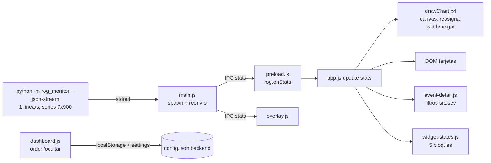

# 06 · Auditoría GUI / UX / gráficas (desktop Electron)

> **Nota del orquestador (Opus, revisión cruzada):** GUI-01..05 se confirmaron por separado: la captura del e2e (evidencia/e2e/e2e-smoke.png) muestra la tarjeta CPU sin "Uso"; `app.js:673-687` autoescala las series %; `alerts.py:86` `check(cpu, gpu, fan_list, cpu_watts)` no recibe RAM ni disco.

Repo: `~/MyFiles/Dev/Rog-Monitor`, rama `master`, HEAD `7d49333`. Solo lectura: no se editó el repo, no se lanzó la app Electron, no se usó sudo ni se tocó hardware.
Alcance: `desktop/renderer/*` (index.html, app.js, style.css, styles/*, i18n.js, power.js, disks.js, dashboard.js, event-detail.js, widget-states.js, cores.js y demás), `desktop/main.js`, `desktop/preload.js`, y el backend que alimenta el stream (`src/rog_monitor/app.py`, `alerts.py`, `cpu.py`, `sysinfo.py`, `config.py`) sólo como fuente de datos.

Etiquetas usadas: **OBSERVADO** (leí el código), **PROBADO** (ejecuté y vi el resultado), **NO PROBADO**, **HIPÓTESIS**.
Commits: hash corto de `git blame`. Los marcados "LOCAL" no están en `origin/master` (fbfee52).

---

## 1. Resumen ejecutivo

- Requisitos del propietario: **1 AUSENTE**, **2 PARCIAL**, **3 AUSENTE/PARCIAL**, **4 hecho como diagnóstico (5 duplicaciones)**, **5 PARCIAL** (sólo bloques, no gráficas), **6 PARCIAL**, **7 PARCIAL** (clasificación existe, filtros por núcleo/RAM no).
- Hallazgo más grave en gráficas: las series en % **no tienen dominio 0..100**; el eje se autoescala al máximo de la ventana. PROBADO: RAM constante al 30 % dibuja eje `0..30`; swap 60-62 % dibuja eje `0..65`. Esto hace engañosa la lectura de RAM y swap.
- La tarjeta CPU **no muestra uso %**, aunque el backend lo emite (`cpu.py:199`).
- Los chips de filtro de eventos **RAM** y **Disco** nunca reciben eventos (ningún productor los emite). El filtro por núcleo no existe.
- `node --test desktop/test` pasa (21/21), pero **sólo ejecuta 21 de 46 tests**: `index.js` sólo carga `priv.test.js`. No corren charts, contract, escape, bench ni smart.
- Accesibilidad: gráficas sin texto alternativo ni teclado, 13 de 16 modales sin Escape, sin focus trap, segmentos sin `aria-pressed`.
- No encontré hallazgos P0 (arranque, datos o seguridad) en el alcance de la UI.

---

## 2. Verificaciones ejecutadas

| Comando | Resultado | Etiqueta |
|---|---|---|
| `cd ~/MyFiles/Dev/Rog-Monitor && node --test desktop/test` | `# tests 21 / # pass 21 / # fail 0` (sólo priv.test.js; ver GUI-20) | PROBADO |
| `node --test desktop/test/*.test.js` (suplementario) | `# tests 46 / # pass 46 / # fail 0` | PROBADO |
| `node scripts/validate-i18n.mjs` | `✓ i18n OK — 1009 claves × 8 idiomas; 262 refs en index.html; 11 comandos.` exit 0 | PROBADO |
| `node scripts/contrast-check.mjs` | `384/384 pass; 0 fail` (sólo pares de tokens de tema; no cubre trazos de gráficas ni texto de canvas) | PROBADO |
| Probe de `chartRange` (función copiada a scratchpad, no al repo) | RAM 30 %×4 → `{lo:0,hi:30}`; RAM 45–47 → `{0,50}`; CPU 3–8 → `{0,10}`; swap 60–62 → `{0,65}` | PROBADO |
| `grep -n "#[0-9a-fA-F]\{3,6\}" desktop/renderer/app.js \| wc -l` | `17` (ver GUI-12 para el desglose real) | PROBADO |

Node: v22.22.3. Validador i18n: `scripts/validate-i18n.mjs` sólo carga los módulos en un VM con DOM falso, no escribe nada.

---

## 3. Inventario

### 3.1 Bloques (`data-block`), 11 en total

Fuente: `index.html:101-400`; orden por defecto en `dashboard.js:201-213`.

| Bloque | Columna | index.html | Contenido | Estados (widget-states.js) |
|---|---|---|---|---|
| CPU | izq | 102-140 | bignum temp °C + 9 tiles (Máx, Mín, Package, >90 °C, GHz, Watts, Throttle, EPP, Uptime). Sin uso % | sí (`BLOCK_IDS` widget-states.js:22) |
| GPU | izq | 142-172 | bignum temp °C + 6 tiles (Uso %, Watts, VRAM, MHz, VRAM MHz, Modo). Nota "dGPU apagada" (`gpu-off-note`) | sí |
| Ventiladores | izq | 174-189 | `#fans` (SVG + RPM + %). Clic abre `fan-modal` | sí |
| Iluminación (Aura) | izq | 191-250 | modos Aura, color, velocidad, brillo, perfiles, música | no |
| Historial | der | 254-263 | 4 canvas fijos (`chart-cpu`, `chart-power`, `chart-gpu`, `chart-gpu-power`), toggle `hist-mode` | no |
| Benchmarks y sesión | der | 265-278 | botones CPU 45 s, GPU 45 s, sesión de juego, historial de benchmarks | no |
| Sistema | der | 280-306 | medidor RAM (barra + "x/y GiB"), medidor VRAM, Red, Carga (load avg), Batería %, Perfil ASUS | sí |
| Batería | der | 308-349 | Carga %, Estado, Watts, Salud, Ciclos, límite de carga (input 20–100 + APLICAR), energía actual/diseño | no |
| Discos | der | 351-355 | `#disks-live` (renderizado por disks.js) | no |
| Eventos | der, inferior | 357-367 | lista (`#events`, máx 240 px), chips de filtro (JS), EXPORTAR, texto de ayuda de throttling | no |
| Procesos | der, inferior | 369-400 | top 5 con orden por columna, VER TODOS, NÚCLEOS, clic para cerrar | sí |

Posición de Eventos: está en la mitad izquierda del `.split` inferior de la columna derecha (`index.html:355-357`, `style.css:1164`). **No** es la esquina inferior derecha de la ventana.

### 3.2 Topbar y menús (`index.html:23-100`)

- Píldora de estado: lámpara térmica (31), etiqueta térmica (32), fuente de energía (34).
- Segmentos: perfil PPD AHORRO / BALANCED / PERFORMANCE (40-47); GPU iGPU / HYBRID / dGPU (49-56).
- Menú HERRAMIENTAS: PODER, ALERTAS, OVERLAY, DIAGNÓSTICO (63-66).
- CONFIG (68-72). SISTEMA: MANTENIMIENTO, REPORTAR ERROR, SALIR (73-78). AYUDA: VER TUTORIAL, ROADMAP, COMANDOS DEL SISTEMA (82-86).
- Idioma 🌐 (89), colapsar barra (92). Botón TABLERO inyectado por JS (`dashboard.js:764-778`).
- Banner de cambio de GPU pendiente (96-99).
- Total: 4 menús desplegables + 2 segmentos + 3 botones sueltos + TABLERO.

### 3.3 Modales (16)

Definidos en `index.html` (15): confirm (411), lang (428), roadmap (437), ram (447), vram (464), allprocs (477), event-detail (502), fan (510), config (581), overlay (624), alerts (681), maintenance (711), benchmark (736), power (756), wizard (813). Todos con `role="dialog" aria-modal="true" aria-labelledby`.
Creado por JS (1): `dashboard-modal` (`dashboard.js`, `buildConfigPanel`), sin `role` ni `aria-*`.
Los módulos diagnostics, game-session, cores y bench-detail crean sus propios overlays.

### 3.4 Estados

- Widget: loading (skeleton shimmer), ok, empty (dGPU apagada, sin datos), error (chip "BACKEND CAÍDO"), stale (>3 s sin stats, `widget-states.js:154`). Cubren 5 de 11 bloques.
- Estados de lámpara térmica: cold / normal / hot / critical (`app.js` LAMP_STATES).
- Pendiente de GPU: banner (`pending-banner`).
- Eventos: "sin eventos" (`events.none`), filtros vacíos muestran "sin eventos".

### 3.5 Temas

- **12 temas** (`app.js:383-397`: magma, nebula, oceano, glaciar, reactor, grafito, neon, atardecer, neon-nights, cyberpunk, aurora, alba).
- **2 modos** cada uno (oscuro, claro) = 24 combinaciones en `style.css:40-202`, más overlays neón en `styles/neon.css` (24 bloques más).
- Selector de modo: Claro / Oscuro / Sistema (`index.html:588-592`, `app.js:2390-2395`).
- Tokens semánticos: `styles/tokens.css` (32 variables).

### 3.6 i18n

- 8 idiomas: es, en, fr, it, pt, zh, ja, ko (`i18n.js`, `event-detail.js:20-29`).
- 1009 claves × 8 idiomas, 262 `data-i18n` en index.html, 11 comandos de transparencia (validador, PROBADO).
- Frases fijas sin i18n: `title="Toggle nav bar"` y `aria-label="Toggle nav"` (index.html:92), `>90°C` (index.html:127), `HYBRID`, `Normal`, `A++` (index.html:51, 597, 599) (GUI-24).

### 3.7 Accesibilidad

- Foco visible global: `styles/a11y.css:13-16` (anillo `:focus-visible`).
- `prefers-reduced-motion`: `styles/a11y.css:30-38` y en otros 5 archivos.
- ARIA: 48 atributos `aria-*` y 19 `role=` en index.html. `aria-pressed` sólo en chips de eventos (`event-detail.js:247,251`).
- Escape: 3 modales lo manejan (confirm `app.js:107`, allprocs `app.js:3947`, event-detail `event-detail.js`); el resto de modales no (ver GUI-15).
- Foco al abrir: sólo confirm (`app.js:120`). Sin focus trap ni restauración de foco.
- `#toast` sin `aria-live` (index.html:408).

### 3.8 Escalado

- Ctrl +/−/0 (`app.js:2278-2285`) con `webFrame`, nivel en -3..4 (`preload.js` zoom).
- Config A−, Normal, A+, A++ (`index.html:595-600`) → niveles -0.5, 0, 0.5, 1.
- Persistencia de nivel en `localStorage.zoomLevel` y en settings (`app.js:458`, `app.js:508-509`).
- Media queries: 1100, 900, 760, 720, 560, 520 px (style.css:599, 611, 666, 832, 1026, 1141, 1165, 1323, 1339, 1392).

### 3.9 Persistencia (localStorage)

| Clave | Quién | Dónde |
|---|---|---|
| `theme`, `mode` | app.js | 403-404, 476-477, 505-506, 2381, 2393 |
| `zoomLevel` | app.js, preload.js | 458, 509, 2265, preload |
| `lang` | i18n.js, overlay.js | i18n.js |
| `histMode` | app.js | 646-650 |
| `navCollapsed` | app.js | 2090-2093 |
| `dgpuName` | app.js | 1732-1744 |
| `overlayPrefs` | app.js | 3482-3490 |
| `auraDraft` | app.js | 944-956 |
| `benchmarkHistory` (legado, lectura), `benchmarkHistoryV2` | app.js | 355-358, 1654-1660 |
| `dashboardLayout`, `dashboardLayout.colsResetV2`, `dashboardEditMode` | dashboard.js | 188-189, 251, 233-243, 265-297 |
| `rog.eventFilters` | event-detail.js | 192, 200-213 |
| `gs_cost_per_kwh`, `gs_cost_cop_per_kwh` | game-session.js | 924-925 |
| `rogPowerKwhPrice` | power.js | 1144 |
| `wizardDone` | wizard.js | — |
| `fanMax` (sólo se borra, legado) | app.js | 2793 |

Total: 19 claves activas. Además existe un segundo almacén: `window.rog.saveSettings` → `rog_monitor.settings` (config.json del backend) para tema, modo, zoom, layout y ajustes de i18n (`app.js:405-520`, `main.js:929-935`).

### 3.10 Costo de render

- **Transporte**: el backend emite una línea JSON por segundo (`main.js:151`, `--json-stream --interval 1`). `payload["series"]` incluye las 7 series completas de hasta 900 puntos cada una (`app.py:153`, `config.py:18`).
- **Reenvío**: `main.js:171-172` envía `stats` a la ventana principal y al overlay.
- **Render**: `update()` se llama en cada stats (`app.js:2234`), en cada cambio de tema (`app.js:2370-2395`) y en cada `resize` sin debounce (`app.js:2258`).
- **Gráficas**: canvas 2D, altura fija 130 px (`style.css:1094`). Cada dibujo reasigna `canvas.width/height` (`app.js:708-716`), lo que limpia y realoca el buffer. Se dibuja 4 veces por segundo y además en cada `mousemove` sin throttle (`app.js:840-852`). No hay `requestAnimationFrame` en las gráficas (sólo en bench-detail y game-session).
- **Búfer**: `CHART_MAX_POINTS = 1200` (`app.js:667`); el número de puntos mostrados es `max(60, w/4)` (`app.js:669-670`), es decir, la ventana temporal depende del ancho.
- **Timers**: `setInterval` 1 s en widget-states (`widget-states.js:170`); refresco de procesos cada 3 s sólo con el modal abierto (`app.js:3931`); `setInterval` 1 s en game-session.
- **Mitigaciones presentes**: firma de eventos para no tocar el DOM si no cambian (`app.js:1993-1995`); `#fans` sólo hace `innerHTML` al cambiar el número de ventiladores (`app.js:884-887`); gráficas no se dibujan con la ventana oculta (`app.js:1940`).

---

## 4. Flujo de datos (diagrama)

---

## 5. Verificación de requisitos del propietario

| # | Requisito | Estado | Evidencia (archivo:línea) |
|---|---|---|---|
| 1 | CPU muestra USAGE % directamente, como GPU, sin quitar temperatura | **AUSENTE** (temperatura sí se mantiene) | Temperatura en bignum `index.html:122`. Tiles sin uso: `index.html:123-133`. `app.js:1861-1870` no escribe `cpu.usage`. El dato existe en el backend (`cpu.py:199`, `"usage"`). GPU sí tiene "Uso" en tile (`index.html:164`, `app.js:1888`). |
| 2 | RAM: gráfica en GiB reales, eje 0..RAM total, modo % opcional bien etiquetado | **PARCIAL** | GiB sólo como texto del medidor: `index.html:296`, `app.js:1951`. Gráfica RAM sólo en %: `app.js:636`, `i18n.js:115` ("RAM · Uso %"). No hay serie en GiB (`sysinfo.py:461` lo calcula y no se usa). El % no aparece como número en la tarjeta, sólo en la barra (`app.js:1952`). Eje autoescalado, no 0..total (GUI-04). Modo % sí es opcional (`index.html:256`, `app.js:2231`). |
| 3 | SWAP: GiB y %, con escala correcta | **AUSENTE** (GiB) / **PARCIAL** (% oculto) | Swap sólo en el canvas del modo usage: `app.js:637`, `index.html:260`, `i18n.js:116`. No hay medidor ni tile de swap en Sistema. `swap_used_gb` (`sysinfo.py:466`) no se consume en el renderer (grep sin resultados). Escala: autoescalada (`app.js:684-686`, PROBADO). |
| 4 | Duplicación History vs System | **HECHO como diagnóstico** (5 duplicaciones confirmadas) | Ver tabla 5.1. |
| 5 | Agregar/quitar/reordenar gráficas inferiores y guardar preferencias | **PARCIAL** | Bloques sí: `dashboard.js:188-214` (orden por defecto), `233-243` (modo edición), `265-297` (persistencia en settings + localStorage), `354-356` (arrastre sólo con ratón). Gráficas del Historial no: los 4 canvas están fijos (`index.html:258-261`) y `HIST_MODES` no es configurable (`app.js:627-639`). |
| 6 | Legibilidad, jerarquía, colores, contraste, labels, unidades | **PARCIAL** | Contraste de tokens OK (384/384, PROBADO). Inconsistencias en GUI-10, GUI-11, GUI-12, GUI-13. |
| 7 | Panel de eventos: clasificación (telemetry/alert/action), filtros, filtro por núcleo/RAM | **PARCIAL** | Tipo existe en el backend (`alerts.py:78-81`, `app.py:188,223`) y en el DOM como `data-type` (`event-detail.js:319-320`), pero no se muestra ni se filtra. Filtros src/sev combinables (`event-detail.js:190-191`, `232-240`). RAM y Disco son chips sin productor. No hay filtro por núcleo. |

### 5.1 Duplicación entre History y System (y tarjetas)

| Métrica | Historial | Sistema / tarjetas | Tipo |
|---|---|---|---|
| Temperatura CPU | `chart-cpu` (`index.html:258`, temp) | bignum CPU (`index.html:122`) y lámpara (`index.html:31`) | duplicada |
| Potencia CPU | `chart-power` (`index.html:259`) | tile Watts (`index.html:129`) | duplicada |
| Temperatura GPU | `chart-gpu` (`index.html:260`) | bignum GPU (`index.html:162`) | duplicada |
| Potencia GPU | `chart-gpu-power` (`index.html:261`) | tile Watts (`index.html:165`) | duplicada |
| RAM % | `chart-power` en modo usage (`app.js:636`) | medidor RAM barra (`index.html:296`, `app.js:1952`) | duplicada |
| VRAM | ninguna | medidor VRAM (`index.html:297`) y tile VRAM (`index.html:166`) | duplicada dentro de la misma app |
| Batería % | ninguna | Sistema "Batería" (`index.html:302`, `app.js:1968`), Batería "Carga" (`index.html:313`, `app.js:1967-1970`), topbar título (`app.js:1979-1982`) | triplicada |
| Estado AC/batería | ninguna | topbar (`index.html:34`) y Batería "Estado" (`index.html:317`) | duplicada |
| Throttling | ninguna | tile Throttle CPU (`index.html:130`), Eventos (`index.html:357`) | informativa |

### 5.2 Eventos: detalle

- Clasificación backend: `alerts.py:78` (default `telemetry`), `alerts.py:59` (`alert`), `app.py:188` y `app.py:223` (`action`, sólo desde atajos de teclado de la TUI).
- Telemetry nunca se emite (todos los `log()` de producción pasan `etype`), **OBSERVADO**.
- Las acciones de escritorio (`set-profile` `main.js:358`, `set-gpu-mode`) no registran evento, **OBSERVADO**. Por tanto el tipo `action` no llega al panel desde la app Electron.
- Categorías emitidas: `thermal`, `throttle`, `fan`, `power` (`alerts.py:94-132`). `KNOWN_KEYS` de la UI incluye `battery` y `disk` (`event-detail.js:189`), que no se emiten.
- Fuentes emitidas: cpu, gpu, fan, power (`alerts.py:94,101,115,125,132`). Los chips `ram` y `disk` (`event-detail.js:190`, `i18n event-detail.js:23-24`) nunca coinciden.
- El panel muestra las últimas 30 de hasta 60 (`app.js:1992`, `alerts.py:21`).
- Lógica de filtros: AND entre ejes, OR dentro de cada eje (`event-detail.js:237-239`).

---

## 6. Hallazgos (formato del brief)

Estado: `verificado` = leído y reproducido por comando; `parcial` = leído, falta evidencia de ejecución; `no verificado` = no reproducido.

| ID | Sev | Estado | Componente | Archivo:línea | Commit(s) | Evidencia/comando | Resultado | Impacto | Recomendación | Prueba de aceptación |
|---|---|---|---|---|---|---|---|---|---|---|
| GUI-01 | P1 | verificado | Tarjeta CPU | desktop/renderer/index.html:122-133; desktop/renderer/app.js:1861-1870 | 228218c (tarjeta), 44f1706 (dato `usage`, LOCAL) | OBSERVADO: `grep -rn "cpu.usage\|cpu-util" desktop/renderer` sin resultados; `src/rog_monitor/cpu.py:199` emite `usage` | La tarjeta CPU no muestra % de uso. Sólo temperatura y tiles. | Req. 1 incumplido; el dato llega al renderer y no se pinta. | Añadir tile "Uso %" como GPU (index.html:164), dejando el bignum de temperatura. | Con `usage=50` en el stream, `#cpu-util` muestra "50%" y `#cpu-temp` sigue visible (captura por CDP, orquestador). |
| GUI-02 | P1 | verificado | Gráfica RAM | desktop/renderer/app.js:636, 684-686; index.html:296; i18n.js:115 | acaa388 (LOCAL) | OBSERVADO: serie `ram_used` = `ram_percent` (`app.py:109`); PROBADO: sin serie GiB | No hay gráfica RAM en GiB; eje en %; % sin número en la tarjeta. | Req. 2 no cumplido. Comparar RAM con el total físico es imposible. | Serie `ram_used_gb` (sysinfo.py:461) con dominio `0..ram_total_gb`; mostrar % numérico junto al medidor. | Con 31.3 GiB totales, eje superior = 31.3 y valor en hover en GiB. |
| GUI-03 | P1 | verificado | Swap | desktop/renderer/app.js:637; index.html:260; i18n.js:116; src/rog_monitor/sysinfo.py:466-469 | acaa388 (LOCAL) | OBSERVADO: no hay medidor ni tile de swap; `swap_used_gb` no se lee en desktop (grep) | Swap sólo como curva % oculta tras el toggle. | Req. 3 AUSENTE en GiB; nadie ve swap sin cambiar de modo. | Medidor "Swap X/Y GiB · %" en Sistema; "sin swap" si total=0. | Con swap total>0 el medidor aparece; con total=0 muestra "sin swap" (no "0 %"). |
| GUI-04 | P1 | verificado | Escala de % en gráficas | desktop/renderer/app.js:673-687 (684-686) | acaa388, ed7151f (LOCAL) | PROBADO: `chartRange` con `fromZero`: RAM 30 %×4 → hi=30; swap 60-62 → hi=65; RAM 45-47 → hi=50 | El dominio de series % depende del máximo de la ventana. Una RAM estable al 30 % llena la gráfica. | Lectura engañosa; req. 3 "escala correcta" no cumplido; CPU/RAM/swap no comparables. | Dominio fijo 0..100 para series %, 0..total para GiB. Eliminar autoescala en `usage`. | `chartRange([30,30,30],true)` devuelve `{lo:0,hi:100}`; test unitario en charts.test.js (que hoy no corre, GUI-20). |
| GUI-05 | P1 | verificado | Eventos, filtros RAM/Disco/núcleo | desktop/renderer/event-detail.js:189-190, 285, 288-290; src/rog_monitor/alerts.py:94,101,115,125,132 | 0765fd5 (LOCAL) | OBSERVADO: sólo se emiten source cpu/gpu/fan/power; no hay categoría disk ni source ram | Chips "RAM" y "Disco" siempre dejan la lista vacía. No hay filtro por núcleo. | Filtro engañoso (P1 por definición del brief). | Emitir eventos con source ram/disk desde los productores o retirar los chips; añadir filtro por núcleo si se pide. | Forzar un evento de RAM en el productor y verificar que el chip RAM lo lista. |
| GUI-06 | P2 | verificado | Clasificación de eventos | desktop/renderer/event-detail.js:319-320; src/rog_monitor/alerts.py:78-81; src/rog_monitor/app.py:188,223; desktop/main.js:358 | 0765fd5 (LOCAL) | OBSERVADO: `telemetry` nunca se emite; `action` sólo en teclas TUI; `set-profile` no registra evento | El campo `type` existe pero el usuario no lo ve ni lo filtra. Las acciones de escritorio no quedan en el log. | Clasificación prometida en el plan no llega a la UI. | Chip de tipo (alert / action) con filtro; registrar acciones de escritorio desde main.js o retirar `telemetry`. | Cambiar un perfil PPD desde la UI y ver una entrada `action` en `#events`. |
| GUI-07 | P2 | verificado | Duplicación History/System/tarjetas | index.html:122,129,162,165,297,302,313,34; app.js:1861-1870, 1888-1892, 1951-1952, 1968-1980 | 228218c, acaa388 | OBSERVADO: tabla 5.1 | 5 métricas duplicadas dentro de la app y 1 triplicada (batería). | Ruido visual, carga cognitiva, y riesgo de que se desincronicen. | Un solo lugar por métrica: tarjetas = valor instantáneo; Historial = tendencia. Quitar tiles repetidos (ver sección 8). | Cada métrica aparece como valor instantáneo en una sola tarjeta. |
| GUI-08 | P2 | verificado | Layout/tablero | desktop/renderer/dashboard.js:354-356, 495-530, 466-476; index.html:258-261; app.js:627-639 | c392eba, 4f7651c | OBSERVADO: reordenar sólo bloques; gráficas del Historial fijas | Req. 5 parcial: no se puede agregar/quitar/reordenar gráficas individuales. | El usuario no puede ocultar la gráfica que no le sirve. | Configuración por gráfica (checkbox por serie) con orden persistido en `dashboard_layout`. | Desmarcar "GPU · Power" y que no aparezca tras recargar. |
| GUI-09 | P2 | verificado | Layout: teclado | desktop/renderer/dashboard.js:354-356, 516-530 | c392eba | OBSERVADO: reordenar sólo con HTML5 drag (mousedown → draggable); sin teclas | Un usuario de teclado no puede reordenar ni ocultar fuera del modal (hide sólo en modo edición, 361-379). | Accesibilidad (WCAG 2.1.1). | Botones "subir/bajar" con teclado en cada bloque del modal TABLERO. | Tab + Enter sobre "subir" mueve el bloque sin ratón. |
| GUI-10 | P2 | verificado | Unidades y labels | index.html:127 (">90°C"), :165 (Watts), :301 ("Carga"), :313 ("Carga"); app.js:1864-1866 ("°"), 1868 (GHz), 1889 (W sin unidad), 1890 (MHz en label); app.js:771-772 (ejes sin unidad); i18n.js:165, 110-118 | 228218c, 737d6fc, acaa388 | OBSERVADO | (a) "Carga" significa % de batería en un bloque y load average en otro. (b) Máx/Mín en "°" y temperatura principal en "°C". (c) Watts sin unidad en el valor (la unidad está en el label). (d) CPU en GHz, GPU en MHz. (e) Ejes sin unidad y valor final sin unidad. (f) El toggle "Uso CPU/RAM" no nombra el swap. | Confusión al leer. | Formateador único `fmtValue(v, unit, digits)` y etiquetas "Carga (batería)" / "Carga (sistema)". Unidad en el valor. | Captura: todas las cifras de la tarjeta llevan unidad visible. |
| GUI-11 | P2 | verificado | Color de series | app.js:629-638 | acaa388, 126f741 | OBSERVADO: swap = `--okstate` (verde), CPU temp y CPU uso = `--cold`, RAM y potencia CPU = `--accent`, GPU potencia = `--hot` | El verde ("ok") representa swap, que alto es malo. Dos series distintas comparten color. | Lectura semántica invertida; no hay leyenda. | Tabla fija serie→color por familia (térmica, potencia, uso, memoria) y leyenda cuando hay más de una serie. | Swap alto no se ve verde; cada serie tiene color distinto en el mismo modo. |
| GUI-12 | P2 | verificado | Colores fuera de tokens | app.js:1339-1347, 1523; style.css (88 hex); styles/neon.css (42 hex); styles/extras.css (6); index.html (2); styles/tokens.css:23 (inventario 268 en neon.css) | 834ce4f, c392eba | `grep -n "#[0-9a-fA-F]\{3,6\}" app.js \| wc -l` = 17. Desglose: 12 son datos de THEMES (385-396), 1 es entidad HTML `&#10005;` (1490, falso positivo), 4 son fallbacks reales (1339, 1340, 1347, 1523). | Fallbacks hardcoded no siguen el tema si falta la variable. Neon duplica el hex del tema con alfa. | Bajo: sólo afecta al tema si una variable falta. | Quitar fallbacks (la variable siempre existe) y derivar glows con `color-mix()` o tokens. | `grep` sin resultados fuera de THEMES. |
| GUI-13 | P2 | verificado | Tipografía | styles/*.css, style.css; app.js:768-783 (canvas) | 834ce4f, 228218c | OBSERVADO: 61 declaraciones `font-size` distintas (mezcla px 9.5–16, rem 0.66–0.8, em 0.8); canvas con 11 px y 13 px monospace fijos | Escala tipográfica sin tokens. Texto de 9.5 px y 10.5 px en medidores. | Jerarquía débil; difícil de mantener. | Escala de 5 tamaños en tokens.css (p. ej. 11 / 12 / 14 / 18 / 28). | Conteo de `font-size` distintos ≤ 6 en CSS. |
| GUI-14 | P2 | verificado | Gráficas: accesibilidad | index.html:258-261; app.js:840-862; style.css:1094, 1274 | 737d6fc, 228218c | OBSERVADO: canvas sin `role`, `aria-label` ni texto alternativo; `<label>` sin `for`; hover sólo con ratón; no hay acceso por teclado ni táctil | Usuarios de lector de pantalla o teclado no obtienen el valor. | WCAG 1.1.1 y 2.1.1. | `role="img"` + `aria-label` con último valor y unidad; `tabindex` + flechas para recorrer muestras. | Lector de pantalla anuncia "CPU temperatura 67 °C" en el canvas. |
| GUI-15 | P2 | verificado | Modales | desktop/renderer/app.js:107, 120, 3947; event-detail.js (Escape); dashboard.js (buildConfigPanel) | 28fe08e, c392eba | OBSERVADO: 13 de 16 modales sin Escape (lang, roadmap, ram, vram, fan, config, overlay, alerts, maintenance, benchmark, power, wizard, dashboard); sin focus trap; sin restaurar foco; dashboard-modal sin `role` | Teclado queda atrapado o pierde el foco. | WCAG 2.4.3 y 2.1.2. | Manejador genérico de Escape + trap + restauración de foco en un helper único. | Escape cierra cada modal; Tab no sale del modal abierto. |
| GUI-16 | P2 | verificado | Controles sin semántica | index.html:40-56, 588-599 (segmentos), 174 (fans-block); app.js:3338; index.html:256 (toggle dentro de h2); dashboard.js:354 | 228218c, 737d6fc | OBSERVADO: segmentos sólo con clase `active`, sin `aria-pressed`/`aria-selected`; `fans-block` es `<article>` clicable sin `role`/`tabindex`; el toggle de historial está dentro de un `<h2>` | Estado activo no se anuncia; el bloque de ventiladores no es alcanzable por teclado. | WCAG 4.1.2 y 2.1.1. | `aria-pressed` en segmentos; `role="button" tabindex="0"` en fans-block; mover el toggle fuera del h2. | Tab alcanza fans-block; lector anuncia "perfil BALANCED, seleccionado". |
| GUI-17 | P3 | verificado | Notificaciones | index.html:408; app.js:605-616 | 228218c | OBSERVADO: `#toast` sin `aria-live`; `role="status"` sólo en fan-dirty-banner (index.html:530) | Mensajes de estado no se anuncian. | Accesibilidad menor. | `role="status" aria-live="polite"` en `#toast`. | Un toast nuevo es anunciado por lector. |
| GUI-18 | P2 | HIPÓTESIS (no medido) | Costo de render | main.js:171-172; app.py:153; config.py:18; app.js:708-716, 840-852, 2258, 1940 | acaa388, ed7151f (LOCAL) | OBSERVADO: serie completa en cada stats a 2 ventanas; canvas reasigna tamaño en cada dibujo y en cada mousemove; resize sin debounce. HIPÓTESIS: payload ≈ 40 KB/s (7 series × 900 × ~6 caracteres) | Posibles caídas de fps y trabajo innecesario con la ventana en primer plano. | Rendimiento; no afecta datos. | Enviar sólo la muestra nueva y mantener el buffer en el renderer; reutilizar canvas (`width` sólo al cambiar); `requestAnimationFrame` para hover; debounce de resize. | Medir con DevTools Performance en 60 s: ≤ 1 pintado por frame y sin reasignaciones por mousemove. NO PROBADO. |
| GUI-19 | P2 | verificado | Persistencia | desktop/renderer/dashboard.js:265-297 (289: `catch` vacío); app.js:2381-2393, 405-520; main.js:929-935 | c392eba, 28fe08e, 126f741 | OBSERVADO: dos almacenes (localStorage y config.json del backend) para tema, modo, zoom y layout; `saveLayout` escribe ambos y el error de backend se traga | Preferencias pueden divergir; si falla el backend, el usuario no lo sabe. | Fuente de verdad dividida. | Una sola fuente (backend) con fallback de solo lectura en localStorage, y un aviso si falla el guardado. | Cambiar tema con el backend caído muestra aviso; tras reinicio el tema es el último elegido. |
| GUI-20 | P2 | verificado | Suite de tests | desktop/test/index.js:3; desktop/test/*.test.js | 228218c, 0765fd5 | PROBADO: `node --test desktop/test` → 21 tests; `node --test desktop/test/*.test.js` → 46 tests, 46 pass. Los 25 no ejecutados están en charts (7), smart (8), contract (4), escape (3), bench (3) | El comando oficial reporta verde sin correr charts ni contract. | Cobertura engañosa: el test de `chartRange` (GUI-04) nunca corre. | Hacer que `index.js` requiera todos los `*.test.js` o cambiar el comando a `node --test desktop/test/*.test.js`. | `node --test desktop/test` reporta 46 tests. |
| GUI-21 | P2 | verificado | Panel Eventos: alcance y posición | index.html:355-367; style.css:1164, 1167; app.js:1992 | 6c4a92f, 0765fd5 | OBSERVADO: la lista muestra 30 de 60; ocupa la mitad izquierda del split inferior derecho | Se pierden eventos antiguos sin indicación; el usuario no sabe que hay más. | Lectura incompleta. | Contador "30 de 60" y "ver todos" o scroll. | Con 60 eventos el panel muestra "30 de 60". |
| GUI-22 | P3 | verificado | Gráficas: ventana y etiquetas | app.js:669-670, 769-772; style.css:1390 (grid2), app.js:638 | 737d6fc, 834ce4f | OBSERVADO: ventana = max(60, w/4) muestras (depende del ancho); "hace N min" con `round(len/60)`; con modo usage el 4º canvas queda oculto y la rejilla 2×2 deja un hueco | Etiqueta temporal imprecisa (65 s → "hace 1 min"). Hueco visual en modo usage. | Menor. | Ventana fija (p. ej. 15 min) y etiqueta en segundos/minutos exactos. Ocupar el hueco con una 4ª serie. | Ventana fija y etiqueta coherente al redimensionar. |
| GUI-23 | P3 | verificado | Estados de widget | desktop/renderer/widget-states.js:22 | dc7604d | OBSERVADO: `BLOCK_IDS` = 5 bloques; Aura, Historial, Benchmarks, Batería, Discos, Eventos sin loading/empty/error | Sin backend, algunos bloques muestran datos viejos sin indicador. | Menor; no verificado en ejecución. | Extender `BLOCK_IDS` o un estado "stale" común. | Con backend caído, Batería muestra "BACKEND CAÍDO". NO PROBADO. |
| GUI-24 | P3 | verificado | Textos no traducidos | index.html:51, 92, 127, 597, 599 | 228218c | OBSERVADO: `title="Toggle nav bar"` y `aria-label="Toggle nav"` en inglés fijo; ">90°C", "HYBRID", "Normal", "A++" sin `data-i18n` | Mezcla de idiomas en la misma barra. | Menor. | Pasar por `data-i18n` y añadir a validate-i18n. | `validate-i18n.mjs` falla si queda texto literal. |
| GUI-25 | P2 | verificado | Topbar: densidad de controles | index.html:23-100; dashboard.js:764-778 | 228218c, c392eba | OBSERVADO: 4 menús desplegables, 2 segmentos, 3 botones sueltos, TABLERO, idioma, colapsar = 13 controles de primer nivel | Jerarquía plana; acciones de riesgo (SALIR, MANTENIMIENTO) junto a acciones de uso diario. | Carga visual; difícil de escanear. | Agrupar en 3 menús (Ver, Herramientas, Ayuda) y mover SALIR/MANTENIMIENTO a un menú de sistema. | Topbar con ≤ 7 controles de primer nivel. |
| GUI-26 | P3 | verificado | Ubicación del panel de eventos | index.html:355-357; style.css:1164 | 228218c | OBSERVADO: no es la esquina inferior derecha de la ventana | Discrepancia con la descripción del propietario. | Menor. | Documentar la posición real o moverlo a la columna derecha completa. | — |

Verificaciones positivas (no son hallazgos):
- `validate-i18n.mjs`: 1009 claves × 8 idiomas, 262 refs, 11 comandos, exit 0 (PROBADO).
- `contrast-check.mjs`: 384/384 pares de tokens (PROBADO).
- Los filtros de eventos son combinables (AND entre ejes, OR dentro) (`event-detail.js:237-239`, OBSERVADO).
- Se evita re-render de eventos y de ventiladores cuando no cambian (`app.js:1993-1995`, `884-887`).

---

## 7. Propuesta de sistema de diseño (no implementada)

Principio: una métrica = un valor = una unidad = un lugar.

- **Tokens de color por familia de datos**, no por posición:
  - Térmica: `--temp` (cálida), con niveles ya existentes `--lvl-*`.
  - Potencia: `--power`.
  - Uso / carga: `--use`.
  - Memoria: `--mem` (RAM y swap, con swap distinguible por patrón de línea, no por verde).
  - Estado (ok/aviso/crítico): sólo para estados, nunca para series.
- **Escala tipográfica de 5 pasos** en `tokens.css`: 11 (etiquetas uppercase), 12 (datos secundarios), 14 (cuerpo), 18 (subtítulos), 28 (valor principal). Eliminar los 61 `font-size` literales.
- **Espaciado de 4 px**: 4 / 8 / 12 / 16 / 24.
- **Formateador único** `fmtValue(value, unit, digits)`: unidad siempre en el valor (`67 °C`, `12.4 W`, `3.2 GHz`, `1200 MHz`, `15.3/31.3 GiB`, `42 %`). Las etiquetas describen, no llevan la unidad.
- **Especificación de gráficas**:
  - Series %: dominio fijo `0..100`.
  - Memoria en GiB: dominio `0..total`.
  - Potencia: `0..max` con máximo configurable.
  - Temperatura: rango de alarma visible en el eje.
  - Ticks con unidad; último valor con unidad; leyenda si hay más de una serie.
  - Ventana temporal fija; etiqueta en minutos exactos.
- **Componentes únicos**: Métrica (valor + unidad + etiqueta), Medidor (barra + texto), Tarjeta de gráfica, Fila de evento, Chip de filtro, Modal. Un solo componente por patrón, no variantes por bloque.
- **Accesibilidad como requisito del sistema**: `aria-pressed` en segmentos, Escape y trap en todos los modales, `role="img"` con texto en canvas, `aria-live` en toast, todo control alcanzable por teclado.

---

## 8. Simplificación propuesta (por prioridad)

**P1 (corregir lo engañoso o incumplido)**
1. Añadir "Uso %" en la tarjeta CPU, igual que GPU, sin quitar la temperatura (GUI-01).
2. Dominio fijo 0..100 para todas las series % y 0..total para RAM en GiB (GUI-02, GUI-04).
3. Medidor de swap con GiB y % en Sistema (GUI-03).
4. Retirar o cablear los chips RAM y Disco de eventos; no mostrar filtros que nunca coinciden (GUI-05).

**P2 (quitar ruido y duplicados)**
5. Quitar de Sistema el medidor VRAM y el tile VRAM de GPU: dejar uno (GUI-07).
6. Batería: una sola lectura de % (topbar o Batería), no tres (GUI-07).
7. Quitar Watts duplicados de tarjetas o de Historial; decidir si la tarjeta es instantánea y el historial tendencia (GUI-07).
8. Modo de historial con nombre claro ("Temperatura y potencia" / "Uso: CPU, RAM, swap") y leyenda (GUI-10, GUI-11).
9. Un formateador de unidades y etiquetas sin colisión ("Carga" → "Batería %" y "Carga sistema") (GUI-10).
10. Topbar: 3 menús (Ver / Herramientas / Ayuda) + sistema, y SALIR/MANTENIMIENTO aislados (GUI-25).
11. Accesibilidad mínima: `aria-pressed`, teclado en fans-block, Escape y trap en modales, texto alternativo de canvas (GUI-14, GUI-15, GUI-16).

**P3 (pulido)**
12. Reducir tipografía a 5 tamaños y eliminar hex fuera de tokens (GUI-12, GUI-13).
13. Ventana temporal fija y ocupar el hueco del 4º canvas (GUI-22).
14. Toast con `aria-live`; textos fijos a i18n (GUI-17, GUI-24).
15. Arreglar la suite: `node --test desktop/test` debe correr los 46 tests (GUI-20).

---

## 9. Lo que no pude verificar

- No lancé la app Electron (instrucción del orquestador). Todo lo de render, fps y pintado es NO PROBADO (GUI-18).
- No medí el tamaño real del payload por segundo; 40 KB/s es HIPÓTESIS.
- El comportamiento visual de los temas (12 × 2) se infiere del CSS; no se hizo captura.
- No revisé en detalle roadmap.js (2518 líneas), bench-detail.js, game-session.js, diagnostics.js ni power.js más allá de inventario y búsqueda de patrones (Escape, keydown, colores, storage).
- No se comprobó que el lector de pantalla anuncie los controles (sólo revisión de atributos).
- El estado de widgets con backend caído en bloques sin cobertura (GUI-23) no se reprodujo.
- No medí contraste de trazos de gráficas ni del texto de canvas; `contrast-check.mjs` sólo cubre pares de tokens.
