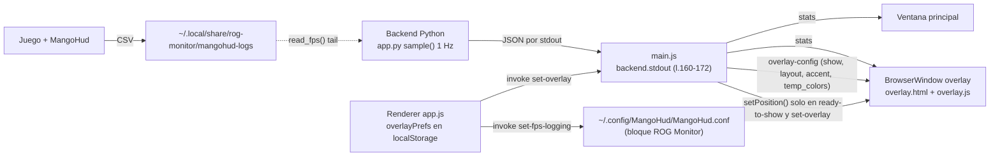

# 07 · Auditoría del overlay de juegos (ROG Monitor)

Fecha: 2026-10-10 · Auditor: agente Haiku (solo lectura)
Repo: ~/MyFiles/Dev/Rog-Monitor · HEAD 7d49333 · árbol de trabajo limpio (`git status --short` vacío)
Base remota: origin/master fbfee52 (el código del overlay ya existe en la base; commits locales posteriores lo han tocado, p. ej. 60910be, 2701aaa).

Leyendas de etiquetas: **OBSERVADO** (leí el código) · **PROBADO** (ejecuté y vi resultado) · **NO PROBADO** · **HIPÓTESIS**.
No se lanzó la app. No se tocó el repo. No se usó sudo ni systemctl.

---

## 0. Resumen ejecutivo

- El overlay existe y es coherente en código: ventana aparte, `frame:false`, `transparent`, `alwaysOnTop`, `focusable:false`, `setIgnoreMouseEvents(true)` (click-through), opt-in por defecto.
- **Nada del overlay tiene prueba automatizada** (OVL-03). La única prueba real que hice es del parser de FPS (`fps.py`), que pasa.
- **No hay flags de Ozone/Wayland** en el repo. El comportamiento real en KDE/Bazzite (X11 vs Wayland nativo) no está verificado. El checkpoint CP-7.04 lo marca como riesgo y PENDIENTE_HARDWARE (OVL-01).
- La app en el changelog interno (roadmap) afirma "(KDE/Wayland)" como entregado sin prueba (OVL-02).
- Funcionalmente faltan: orden de métricas, RAM, uso de CPU %, tamaño libre, perfiles, preview, restaurar defaults, atajos globales y reacción a cambios de monitor (sección 3).
- Persistencia solo en `localStorage` del renderer: no entra en exportar/importar config (OVL-09).

Diagrama del flujo de datos actual:



---

## 1. Inventario del código del overlay

### 1.1 Archivos con referencias (`git grep -c -i overlay -- desktop/ src/`)

| Archivo | Refs | Rol en el overlay |
|---|---|---|
| desktop/main.js | 69 | Ventana, posición, IPC `set-overlay`/`list-displays`, FPS logging, ciclo de vida |
| desktop/renderer/app.js | 55 | Modal OVERLAY, persistencia `overlayPrefs`, envío de config |
| desktop/renderer/index.html | 43 | Botón OVERLAY (l.62) y modal (l.624-677) |
| desktop/renderer/overlay.js | 10 | Render de stats y config en la ventana overlay |
| desktop/renderer/overlay.html | 2 (+CSS) | Layout, estilos, IDs de filas |
| desktop/preload.js | 2 | Puente `window.rog` (l.12, 14, 65-68) |
| src/rog_monitor/fps.py | 1 | Lectura FPS desde CSV de MangoHud |
| src/rog_monitor/app.py | 1 | `"fps": read_fps()` (l.136) |
| desktop/renderer/roadmap.js | 56 | Texto de changelog (no es lógica) |
| i18n.js, styles/*.css, otros | resto | Textos y estilos |

Nota: `git grep -n -i overlay -- desktop/ src/` no encuentra referencias en `desktop/test/` ni en `tests/` salvo `contract` y TUI (ver OVL-03).

### 1.2 BrowserWindow del overlay (desktop/main.js)

| Opción | Valor | Línea | Comentario |
|---|---|---|---|
| width/height | `overlaySize()` 540×58 (fila) o 232×150 (cuadro) | 1400-1407 | Tamaño fijo, no configurable |
| frame | false | 1411 | OBSERVADO |
| transparent | true | 1412 | Requiere compositor (HIPÓTESIS en X11 sin compositor) |
| backgroundColor | `#00000000` | 1421 | |
| resizable / movable | false / false | 1413-1414 | Movable false: no se puede arrastrar |
| minimizable / maximizable | false / false | 1415-1416 | |
| skipTaskbar | true | 1417 | |
| focusable | false | 1418 | No roba foco (NO PROBADO en Linux) |
| hasShadow | false | 1419 | |
| alwaysOnTop | true, nivel `'screen-saver'` | 1420, 1429 | El nivel es un concepto de macOS/Windows según la documentación de Electron (no consultada aquí) → HIPÓTESIS de que en Linux no aporta nada (OVL-05) |
| visibleOnAllWorkspaces | true, `visibleOnFullScreen: true` | 1430 | `visibleOnFullScreen` documentado como macOS → HIPÓTESIS (OVL-05) |
| click-through | `setIgnoreMouseEvents(true)` sin `forward` | 1431 | OBSERVADO; no permite interactuar |
| type | no especificado | 1408-1427 | Tipo de ventana por defecto del WM (OVL-16) |
| preload | `preload.js`, contextIsolation true, nodeIntegration false | 1422-1426 | Correcto |
| Carga | `renderer/overlay.html` | 1432 | |
| Posición inicial | `ready-to-show` → `positionOverlay()` + `pushOverlayConfig()` | 1433-1436 | |
| Cierre | `closed` → `overlay = null` | 1437 | El cierre de la ventana principal también cierra el overlay (1548-1551) y al salir (1593) |

### 1.3 Posicionamiento y monitores

| Función | Línea | Qué hace |
|---|---|---|
| `displayList()` | 1362-1369 | Lista `screen.getAllDisplays()` con label `Monitor N (WxH) · principal` |
| `pickDisplay(id)` | 1371-1374 | Busca por id; si no existe, cae al primario en silencio |
| `positionOverlay()` | 1376-1397 | Usa `workArea` (respeta paneles), margen `OVERLAY_MARGIN=18` (l.1360), 7 esquinas/centros; `setPosition` en l.1396 |
| `applyOverlay()` | 1455-1465 | Crea, muestra (`showInactive`) o cierra; llama `updateBackendPower()` |
| `set-overlay` | 1469-1485 | Normaliza config y aplica; si cambia layout hace `setBounds` |
| `list-displays` | 1467 | Devuelve displays y `overlayCfg` actual |
| `overlayCfg` | 80, 85 | Estado en memoria; defaults `enabled:false`, `corner:'top-center'`, `layout:'row'` |
| `lastTempLimits` | 88, 170, 1450 | Umbrales de color recibidos del backend |

No hay listeners de `display-added`, `display-removed` ni `display-metrics-changed` (`git grep` vacío) → OVL-06.

### 1.4 Renderer del overlay (desktop/renderer/overlay.html + overlay.js)

- `overlay.html`: título `ROG Overlay` (l.6); CSP `default-src 'self'; style-src 'unsafe-inline'` (l.5); `html, body` transparentes (l.23-28); tarjeta `.card` con `background: var(--bg)` y `backdrop-filter: blur(6px)` (l.37-43); modo fila `body.layout-row` (l.163-187). Filas en orden fijo: FPS (l.201, oculta por defecto), CPU (l.208), GPU (l.216), Ventiladores (l.224).
- `overlay.js`:
  - Defaults de visibilidad `show = {cpu,gpu,fans}` (l.60) y `applyShow()` (l.69-76).
  - `render(stats)` (l.79-170): temperatura CPU = `cpu.avg` o `cpu.package` (l.90-95); W CPU con `rapl_available` (l.100-103); FPS con `stats.fps` (l.105-115); GPU `gpu.active` temp/W/util (l.118-131); ventiladores con firma para no recrear chips (l.133-162).
  - Umbrales de color (l.18-25, 83): prioridad `tempLimits` > `stats.limits` > defaults fijos.
  - Textos i18n propios (l.28-46), idioma de `localStorage.lang`, por defecto `es`.
  - Sin `setInterval` ni `requestAnimationFrame`: solo repinta al llegar `stats` (1 Hz).
  - Entradas: `onStats` (l.187-191), `onOverlayConfig` (l.193-203). No escucha `backend-down` (OVL-04).

### 1.5 Controles de usuario (desktop/renderer/app.js + index.html)

- Botón `OVERLAY` en el menú TOOLS: index.html:62. Modal: index.html:624-677.
- Controles: "Mostrar overlay" (index.html:629-631), formato fila/cuadro (633-638), monitor (639-641), posición con 7 opciones (642-652), CPU/GPU/Ventiladores (654-665), FPS del juego = logging MangoHud (666-669).
- Lógica: app.js:3480-3575. Carga prefs (3482-3487), guarda en `localStorage['overlayPrefs']` (3489-3491), `pushOverlay()` (3493-3498) envía todo a `set-overlay` y refresca `accent` (3495). Handlers 3532-3558. Restaura al arrancar si estaba activo (3572-3575).
- Nota: el texto de ayuda dice "Para esconderlo durante una captura, desactiva «Mostrar overlay»" (index.html:676). El overlay no tiene exclusión de captura (`setContentProtection` no aparece en el repo).

### 1.6 IPC y puente

- `preload.js:12` expone `window.rog`. Suscripciones: `onOverlayConfig` (l.14). Invocaciones: `listDisplays` (l.65), `setOverlay` (l.66), `getFpsLogging` (l.67), `setFpsLogging` (l.68).
- Canales main: `list-displays` (main.js:1467), `set-overlay` (1469), `get-fps-logging` (725), `set-fps-logging` (731). Envío a overlay: `stats` (main.js:172), `overlay-config` (1444).
- Validación de entrada: `set-overlay` no valida tipos ni rangos (1471-1478): acepta cualquier `corner`/`layout` y `show` arbitrario. `corner` desconocido cae a `top-center` (1395). Riesgo bajo porque el origen es el propio renderer.

### 1.7 Atajos globales

- `git grep -n globalShortcut` → **vacío**. No hay atajo para mostrar/ocultar el overlay. Estado: **ausente**.

### 1.8 Configuración y persistencia

| Dato | Dónde vive | Línea | Sobrevive reinicio | Entra en export/import |
|---|---|---|---|---|
| `enabled`, `displayId`, `corner`, `show`, `layout`, `accent` | `localStorage['overlayPrefs']` del renderer | app.js:3482-3490 | Sí (almacenamiento de Electron) | **No** (CONFIG_FILES = fan-curves.json, aura.json, config.json, main.js:760) |
| Estado activo en proceso | `overlayCfg` en memoria | main.js:85 | No (se recalcula al arrancar el renderer) | No |
| Umbrales de color | `lastTempLimits` en memoria | main.js:88 | No | No |
| Config FPS logging | `~/.config/MangoHud/MangoHud.conf` (bloque marcado) | main.js:712-753 | Sí | Fuera de la app |
| Logs CSV de FPS | `~/.local/share/rog-monitor/mangohud-logs` | main.js:713, fps.py:18 | Sí | No; no hay rotación ni limpieza (git grep) |

Escrituras a `config.json` por `writeAppConfig` (main.js:131-137) no se usan para el overlay.

### 1.9 Métricas disponibles vs mostradas

| Métrica | Disponible en backend | Mostrada en overlay | Fuente |
|---|---|---|---|
| FPS | Sí (`fps`, app.py:136) | Sí, si hay CSV fresco (overlay.js:105-115) | fps.py |
| CPU temperatura (promedio núcleos) | Sí (`cpu.avg`, `cpu.package`) | Sí | overlay.js:90-95 |
| CPU vatios | Sí (`cpu_watts`, app.py:122) | Sí | overlay.js:100-103 |
| CPU uso % | Sí (`cpu.usage`, app.py:108; serie cpu_usage) | **No** | — |
| RAM % | Sí (`sys.ram_percent`, app.py:109) | **No** | — |
| RAM GiB | No confirmado en stats del overlay | **No** | — |
| GPU temp / W / util % | Sí (`gpu.active`) | Sí | overlay.js:118-131 |
| Ventiladores RPM (+% si hay cap) | Sí (`fans`) | Sí | overlay.js:133-162 |
| Perfil ASUS | Sí (`asus_profile`, app.py:124) | Sí (cabecera) | overlay.js:86-87 |

### 1.10 FPS: de dónde viene

- No hay FPS medidos por la app. Solo MangoHud dentro del juego escribe CSV (fps.py:1-8).
- `read_fps()` (fps.py:85-90): busca `output_folder=` en MangoHud.conf (primera coincidencia, fps.py:23-33); si no hay, usa la carpeta por defecto; toma el CSV más reciente con mtime ≤5 s (fps.py:19, 36-49); lee la última fila con columna `fps` (fps.py:52-82).
- `set-fps-logging` (main.js:731-753) añade un bloque al FINAL del conf con `output_folder`, `autostart_log=1`, `log_interval=500`.
- Hay un checkbox "FPS del juego" en el modal (index.html:666-669) que activa el logging global de MangoHud para todos los juegos.

### 1.11 Perfiles

- No hay perfiles de overlay (presets). Solo existe "perfil" como nombre del perfil ASUS en la cabecera (overlay.js:86-87).

### 1.12 DPI / escala

- No hay código de `scaleFactor`, `getScaleFactor` ni `setZoomFactor` para el overlay (grep vacío en desktop/ y src/). Los tamaños son DIP fijos (main.js:1400-1404). Comportamiento con escala fraccional NO PROBADO.

### 1.13 Tests existentes relacionados

- `desktop/test/contract.test.js:29` y `tests/test_contract.py:30,47-49`: solo comprueban que la clave `fps` existe y su tipo `num|null`. No prueban la ventana ni el render.
- `tests/test_tui_render.py:95`: `fps=None` en render TUI. No es el overlay de escritorio.
- `scripts/e2e-smoke.mjs` (CP-8.04, CI en `.github/workflows/ci.yml:76-94`): lanza Electron bajo xvfb, pero **no menciona el overlay** (grep vacío en scripts/).
- Ningún test llama a `read_fps` directamente, salvo la sonda de esta auditoría (sección 5).

### 1.14 Historial de commits (OBSERVADO con `git blame`)

| Bloque | Commit(s) | Fecha | Asunto |
|---|---|---|---|
| Creación de `createOverlay` (main.js) | 03dda5a | 2026-06-10 | v8.2.0 "overlay de juegos" |
| Layout fila/cuadro, colores por nivel, bloque IPC | f2b44c6, 1bffdec, 8e0a41c, 3167e38 | 2026-06-17..20 | v12, v15, v16 |
| Prefs AVG/FPS, export/import config, `set-fps-logging`, `fps.py` | ed3d883 | 2026-06-11 | v8.3.0 |
| Texto roadmap "(KDE/Wayland)" | 2face904 | 2026-06-23 | v17.0.0 roadmap multilingüe |
| Guardas localStorage y limits | 60910be | — | "guard localStorage, overlay limits" |
| Reanudar backend tras minimizar (afecta overlay) | 2701aaa | — | "resume backend after minimize" |

Los checkpoints CP-7.01-04 están en `docs/agent-work/` (git-ignorado). Solo los uso como contexto, no como evidencia.

---

## 2. Compatibilidad Wayland / X11

### 2.1 Qué flags usa main.js

- `git grep -n -i "ozone\|enable-features\|appendSwitch\|ELECTRON_OZONE" -- . ':!docs'` → sin resultados.
- `desktop/start.sh:20` solo añade `--class=rog-monitor --name=rog-monitor`. Ningún `--ozone-platform`.
- main.js:102-105 fija `app.setName` y `app.setDesktopName('rog-monitor.desktop')`; no afecta a Ozone.
- `src/rog_monitor/power_control.py:127-128` detecta Wayland por `WAYLAND_DISPLAY` / `XDG_SESSION_TYPE` (solo para control de energía).

Consecuencia: **el backend gráfico de Electron (X11/XWayland o Wayland nativo) queda al valor por defecto de Electron** (`desktop/package.json` declara `electron ^42.5.0`). Cuál es ese valor por defecto en Electron 42 no lo verifiqué: no ejecuté la app ni consulté la documentación de esa versión. El checkpoint CP-7.04 afirma "Electron 42 corre Wayland nativo en esta sesión KDE", pero sin prueba. → **NO PROBADO / HIPÓTESIS** (OVL-01).

### 2.2 setPosition en Wayland

- `positionOverlay()` usa `overlay.setPosition` (main.js:1396).
- HIPÓTESIS (protocolo xdg-shell): un cliente Wayland nativo no puede fijar su posición absoluta; el compositor decide. Por tanto `setPosition` no tendría efecto en Wayland nativo.
- Bajo XWayland (ventana X11), `setPosition` normalmente sí se respeta. **NO PROBADO** en este equipo.

### 2.3 alwaysOnTop en Wayland

- xdg-shell no tiene un "siempre encima" para clientes. Con KWin hay que usar una regla de ventana ("Mantener encima") o un script de KWin. → HIPÓTESIS: `setAlwaysOnTop(true,'screen-saver')` no garantiza nada en Wayland nativo.
- Bajo XWayland: `_NET_WM_STATE_ABOVE` lo gestiona KWin. Juegos a pantalla completa (Proton/XWayland) y gamescope pueden quedar por encima del overlay. HIPÓTESIS, no probado.

### 2.4 Tabla de soporte por compositor (estado real: nada probado en Bazzite)

| Capacidad | X11 nativo | XWayland bajo KWin (Plasma) | Wayland nativo (KWin) | Estado |
|---|---|---|---|---|
| Ventana sin marco y transparente | Requiere compositor | Probable | Probable | NO PROBADO |
| Click-through (`setIgnoreMouseEvents`) | Esperado | Esperado | Esperado | NO PROBADO |
| No robar foco (`focusable:false`) | Depende WM | Depende WM | Depende WM | NO PROBADO |
| Posición por esquina (`setPosition`) | Esperado | Esperado (HIPÓTESIS) | Ignorado (HIPÓTESIS) | NO PROBADO |
| Encima de ventanas normales | Depende WM | Regla KWin "Mantener encima" | Regla KWin; sin protocolo | NO PROBADO |
| Encima de juego a pantalla completa | Depende WM | HIPÓTESIS: no garantizado | HIPÓTESIS: no garantizado | NO PROBADO |
| Ocultar de la barra de tareas (`skipTaskbar`) | Esperado | Esperado | Esperado | NO PROBADO |
| Varios escritorios virtuales | Esperado | Esperado | Esperado | NO PROBADO |
| Multi-monitor vía `workArea` | Esperado | HIPÓTESIS (depende de posición) | HIPÓTESIS (no se puede posicionar) | NO PROBADO |
| Escala fraccional (DPI) | Desconocido | Desconocido | Desconocido | NO PROBADO |

**Qué sí está soportado por evidencia:** nada del comportamiento visual. Lo que hay es código y un checkpoint de intenciones.

**Mitigaciones que el checkpoint propone (no aplicadas, CP-7.04):**
1. Lanzar la app con `--ozone-platform=x11` cuando el overlay está activo. Coste: toda la app pasa a XWayland.
2. Regla de ventana de KWin (posición y "mantener encima") para la ventana "ROG Overlay" (overlay.html:6). Como el proceso comparte `--class=rog-monitor`, la regla debería casar por título y no por clase (HIPÓTESIS).
3. Recomendar el HUD de MangoHud para FPS dentro del juego (ya es el modelo actual de FPS).

**Lo que no pude verificar:** qué backend usa Electron 42 en esta sesión; si `setPosition` surte efecto; si el overlay aparece encima de un juego a pantalla completa; si la transparencia funciona sin compositor; si el click-through deja pasar el foco.

---

## 3. Tabla de capacidades

Estados: **implementado + test** / **implementado no probado** / **ausente**.

| Capacidad | Estado | Archivo:línea | Notas |
|---|---|---|---|
| Abrir / cerrar | implementado no probado | main.js:1455-1465; app.js:3532-3536; index.html:629-631 | Toggle opt-in. Sin test. |
| Mover (arrastrar) | ausente (por diseño) | main.js:1414 (`movable:false`) | Click-through impide arrastrar; posición solo por esquina |
| Redimensionar (libre) | ausente | main.js:1413 (`resizable:false`), 1400-1404 | Solo 2 tamaños fijos (fila/cuadro) |
| Tamaño seleccionable (S/M/L) | ausente | — | Solo fila/cuadro |
| Anclar a esquina | implementado no probado | main.js:1376-1397; index.html:642-651 | 7 posiciones; falta centro-izquierda/derecha; sin test |
| Transparencia | implementado no probado | main.js:1412, 1421; overlay.html:23-28, 37-43 | Requiere compositor |
| Click-through | implementado no probado | main.js:1431 | Sin `forward`; no hay interacción |
| Siempre encima | implementado no probado (riesgo Wayland) | main.js:1420, 1429 | Nivel `screen-saver` posiblemente ignorado en Linux (OVL-05) |
| Selección: CPU temperatura | implementado no probado | overlay.js:90-95; index.html:654-657 | Atado al toggle "CPU" (temp + W) |
| Selección: CPU vatios | implementado no probado | overlay.js:100-103 | Atado al toggle "CPU" |
| Selección: CPU uso % | ausente en overlay | (backend: app.py:108) | Dato existe, no se muestra |
| Selección: RAM % | ausente en overlay | (backend: app.py:109) | Dato existe, no se muestra |
| Selección: RAM GiB | ausente | — | |
| Selección: GPU temp / W / util | implementado no probado | overlay.js:118-131; index.html:658-661 | Un solo toggle para las tres |
| Selección: FPS | implementado parcial | fps.py:52-90; overlay.js:105-115; overlay.html:201; index.html:666-669 | Parser PROBADO (sección 5). Juego real NO PROBADO. Sin toggle propio en `show` (OVL-14) |
| Selección: ventiladores RPM | implementado no probado | overlay.js:133-162; index.html:662-665 | |
| Selección: perfil ASUS | ausente como métrica | overlay.js:86-87 | Siempre en cabecera |
| Orden de métricas | ausente | overlay.html:201-224 | Orden fijo FPS, CPU, GPU, Ventiladores |
| Perfiles de overlay | ausente | — | |
| Colores por nivel | implementado no probado | overlay.js:18-25, 83; main.js:1450 | Umbrales del dashboard |
| Persistencia de preferencias | implementado no probado | app.js:3482-3490; main.js:85 | Solo localStorage (OVL-09) |
| Restaurar al arrancar | implementado no probado | app.js:3572-3575 | Solo si `enabled` |
| Exportar / importar overlay | ausente | main.js:760 (CONFIG_FILES) | OVL-09 |
| Multi-monitor: elegir monitor | implementado no probado | main.js:1362-1374; app.js:3502-3511; index.html:639-641 | Por id de Electron (OVL-07) |
| Multi-monitor: reacción a cambios | ausente | — | Sin listeners de display (OVL-06) |
| DPI / escala | ausente | — | Sin código ni test (OVL-15) |
| Atajo global mostrar/ocultar | ausente | (globalShortcut: sin resultados) | |
| Vista previa | ausente | — | |
| Restaurar valores por defecto | ausente | — | |
| Comportamiento con backend caído | ausente | overlay.js:187-203 | Muestra valores viejos (OVL-04) |
| Consumo en reposo (pausa backend) | implementado no probado | main.js:207-209, 229; watchdog 232-250 | Overlay activo mantiene backend vivo (intencional) |
| Tests automatizados del overlay | ausente | (ver 1.13) | OVL-03 |

---

## 4. Diseño SIN IMPLEMENTAR: editor simple de overlay

Objetivo: que Marshall pueda activar el overlay, elegir métricas, ordenarlas, fijar tamaño y posición, ver una vista previa y volver a los valores por defecto. Nada de esto está implementado; es una propuesta.

### 4.1 Mockup (ASCII)

```
+--------------------------------------------------------------------+
| OVERLAY PARA JUEGOS                                           [x]  |
+--------------------------------------------------------------------+
| [x] Mostrar overlay                                                |
|                                                                    |
| Monitor   [ Monitor 1 (2560x1600) principal          v ]           |
| Posición  +-------+-------+-------+                                |
|           | TL    | TC  * | TR    |   * = seleccionada             |
|           +-------+-------+-------+   margen [ 18 ] px             |
|           | ML    | MC    | MR    |                                |
|           +-------+-------+-------+                                |
|           | BL    | BC    | BR    |                                |
|           +-------+-------+-------+                                |
| Formato   (o) Fila    ( ) Cuadro     Escala [ 1.00 ] (0.75-1.50)   |
|                                                                    |
| Métricas (arrastra o usa ↑ ↓ para ordenar)                         |
|   ≡ [x] FPS (MangoHud)                                             |
|   ≡ [x] CPU temperatura + W                                        |
|   ≡ [x] GPU temperatura, W, %                                      |
|   ≡ [x] Ventiladores RPM                                           |
|   ≡ [ ] CPU uso %                                                  |
|   ≡ [ ] RAM %                                                      |
|   ≡ [ ] Perfil ASUS                                                |
|                                                                    |
| VISTA PREVIA (datos de ejemplo, no el monitor real)                |
| +----------------------------------------------------------------+ |
| | FPS 144 | CPU 61 45W | GPU 58 90W 37% | FANS CPU 2400        | |
| +----------------------------------------------------------------+ |
|                                                                    |
| [ Restaurar valores por defecto ]                 [ Cerrar ]       |
+--------------------------------------------------------------------+
```

### 4.2 Modelo de datos JSON (propuesta, versión 1)

Guardado en `config.json` bajo la clave `overlay` (vía `writeAppConfig`, main.js:131) y añadido a la exportación. Migración desde `localStorage['overlayPrefs']` una sola vez.

```json
{
  "overlay": {
    "schema": 1,
    "enabled": false,
    "display": {
      "id": null,
      "fallback": "primary",
      "label": "Monitor 1 (2560x1600)"
    },
    "anchor": "top-center",
    "margin": 18,
    "layout": "row",
    "scale": 1.0,
    "accent": "theme",
    "metrics": [
      { "id": "fps",       "enabled": true },
      { "id": "cpu_temp",  "enabled": true },
      { "id": "cpu_watts", "enabled": true },
      { "id": "gpu_temp",  "enabled": true },
      { "id": "gpu_power", "enabled": true },
      { "id": "gpu_util",  "enabled": true },
      { "id": "fans",      "enabled": true },
      { "id": "cpu_usage", "enabled": false },
      { "id": "ram_pct",   "enabled": false },
      { "id": "profile",   "enabled": false }
    ]
  }
}
```

Reglas de validación:
- `anchor`: uno de 9 valores (`top|middle|bottom` × `left|center|right`). Valor desconocido → `top-center`.
- `margin`: entero 0..200. `scale`: 0.75..1.50. `layout`: `row` o `box`.
- `metrics`: solo ids conocidos; se descartan los desconocidos; se conserva el orden del array; los ausentes se añaden al final con `enabled:false`.
- `display.id` inexistente → `fallback` y aviso en UI; no se borra el id guardado.

Mapeo de ids a datos del backend:

| id | Campo de stats |
|---|---|
| fps | `fps` |
| cpu_temp | `cpu.avg` (o `cpu.package`) |
| cpu_watts | `cpu_watts` (si `rapl_available`) |
| cpu_usage | `cpu.usage` |
| gpu_temp / gpu_power / gpu_util | `gpu.active.temp` / `.power` / `.util` |
| fans | `fans[]` |
| ram_pct | `sys.ram_percent` |
| profile | `asus_profile` |

Migración desde `overlayPrefs` (app.js:3482-3487): `show.cpu` → `cpu_temp` + `cpu_watts`; `show.gpu` → `gpu_*`; `show.fans` → `fans`; `corner` → `anchor` (`center` → `middle-center`); `layout`, `displayId` → `display.id`, `enabled`.

### 4.3 Superficie IPC propuesta

- `overlay:get` → config normalizada + `DEFAULTS` + lista de monitores.
- `overlay:set` (parche) → valida, guarda en config, aplica; devuelve config normalizada.
- `overlay:reset` → vuelve a `DEFAULTS` (una sola fuente de verdad en main.js).
- Vista previa: el modal carga `overlay.html` en un `<iframe>` con stats de ejemplo por `postMessage`, sin crear un BrowserWindow real.

### 4.4 Criterios de aceptación

| ID | Criterio | Prueba |
|---|---|---|
| AC-01 | Activar/desactivar crea/destruye la ventana en menos de 500 ms; desactivado = sin ventana | e2e smoke: `set-overlay` y contar BrowserWindow |
| AC-02 | Solo se pintan las métricas `enabled`, en el orden del array | Unit test del render o del normalizador |
| AC-03 | Mover una métrica arriba/abajo cambia el orden en la vista previa y en el overlay en menos de 1 s | Unit test de permutación + prueba manual |
| AC-04 | `scale` se fuerza a 0.75..1.50 y `margin` a 0..200 antes de guardar | Unit test de clamp |
| AC-05 | Cada una de las 9 anclas cae dentro de `workArea` con el margen indicado | Unit test de `positionFor(anchor, workArea, size)` con workArea simulado |
| AC-06 | Monitor inexistente → cae al primario y muestra aviso; el id guardado no se borra | Unit test + prueba con monitor desconectado (OVL-06/07) |
| AC-07 | Desconectar el monitor con overlay activo lo reubica sin reiniciar | Prueba manual en KDE (OVL-06) |
| AC-08 | La vista previa refleja cambios en menos de 200 ms y no crea ventanas | Prueba manual + ausencia de BrowserWindow extra |
| AC-09 | "Restaurar valores por defecto" deja el JSON igual a `DEFAULTS` | Unit test de igualdad |
| AC-10 | El overlay se guarda en `config.json`, entra en exportar y en importar | Prueba: exportar, borrar, importar, comparar (OVL-09) |
| AC-11 | Preferencias antiguas de `localStorage` se migran una sola vez | Unit test con fixture de `overlayPrefs` |
| AC-12 | JSON corrupto o `localStorage` corrupto → defaults sin romper el arranque | Test con valor `{` (OVL-10) |
| AC-13 | Click-through y no-foco se mantienen (regresión) | Revisión de `main.js` + prueba manual |
| AC-14 | Con backend caído, el overlay muestra "--" o estado de reconexión en menos de 2 s | Matar backend en prueba manual (OVL-04) |
| AC-15 | En KDE Plasma (Bazzite) con juego a pantalla completa: posición, encima y click-through verificados y anotados en CP-8.10 | Prueba visual de Marshall; si falla, la UI muestra la limitación |

Fuera de alcance: arrastrar el overlay (rompe click-through), overclock/undervolt desde el overlay, FPS medidos por la app (solo MangoHud).

---

## 5. Hallazgos (formato del brief, prefijo OVL-)

Severidad: P0 arranque/datos/seguridad · P1 función principal rota o engañosa · P2 deuda/UX importante · P3 menor.

| ID | Severidad | Estado | Componente | Archivo:línea | Commit(s) | Evidencia/comando | Resultado | Impacto | Recomendación | Prueba de aceptación |
|---|---|---|---|---|---|---|---|---|---|---|
| OVL-01 | P1 | no verificado | Compatibilidad Wayland | desktop/start.sh:20; desktop/main.js:102-105 | — (sin commit de flags) | `git grep -n -i ozone -- . ':!docs'` vacío; `git grep -n appendSwitch` vacío; CP-7.04 (solo contexto) | No hay flags Ozone. Backend real de Electron 42 en KDE sin verificar. CP-7.04 lo marca PENDIENTE_HARDWARE | Posición, "encima" y click-through pueden no funcionar en la sesión real del usuario | Registrar sesión y backend real en CP-8.10; decidir si forzar `--ozone-platform=x11` solo con overlay activo | Juego a pantalla completa en KDE: overlay en la esquina elegida, encima, click-through; sesión y backend anotados |
| OVL-02 | P1 | verificado (texto) / no verificado (veracidad) | Changelog interno | desktop/renderer/roadmap.js:539 (es), 540 (en) | 2face904 (2026-06-23) | `git blame -L 539,539 desktop/renderer/roadmap.js` | La app dice "Overlay siempre encima, transparente, click-through y sin robar foco (KDE/Wayland)" como entregado. CP-7.01-04 dice PARCIAL / PENDIENTE_HARDWARE | Informa al usuario de una compatibilidad no probada | Quitar "(KDE/Wayland)" o cambiar a "X11 probado; Wayland pendiente" hasta tener CP-8.10 | El texto del roadmap coincide con el resultado de CP-8.10 |
| OVL-03 | P1 | verificado | Tests | desktop/test/*; tests/*; scripts/e2e-smoke.mjs; main.js:1406-1438 | — | `git grep -i overlay -- desktop/test tests scripts` solo contract/TUI; ninguno ejerce la ventana | No hay prueba de creación, posición, normalización de `set-overlay` ni render de `overlay.js` | Regresiones silenciosas en el overlay | Extraer funciones puras (`overlaySize`, `positionFor`, normalizador de `set-overlay`) y probarlas con `node --test`; añadir paso e2e que active el overlay | `node --test desktop/test` incluye overlay y pasa; e2e smoke confirma una ventana overlay |
| OVL-04 | P2 | verificado | Renderer overlay | desktop/renderer/overlay.js:187-203; desktop/main.js:181-190 | — | `git grep -n backend-down -- desktop/` solo llega a `win` (main.js:186) | Si el backend cae, el overlay sigue mostrando los últimos valores sin aviso (el backend reintenta a los 3 s) | Cifras viejas parecen actuales durante un fallo | Enviar `backend-down` y `backend-reconnecting` también al overlay; pintar "--" | Matar el backend con overlay activo: en menos de 2 s aparecen "--" o estado de reconexión |
| OVL-05 | P2 | no verificado | Ventana overlay | desktop/main.js:1429-1430 | 03dda5a | Documentación de Electron (no consultada en esta sesión): `level` y `visibleOnFullScreen` son opciones de macOS/Windows | La garantía "encima de juegos" depende del WM, no de la app | Expectativa del usuario no cubierta en Linux | Tratar "siempre encima" como intención; probar reglas de KWin y `type` en la sesión real | Captura de juego a pantalla completa con overlay encima (CP-8.10) |
| OVL-06 | P2 | verificado (código) / no probado (efecto) | Multi-monitor | desktop/main.js:1376-1397, 1433-1436, 1455-1458; sin listeners de display | 03dda5a | `git grep -n "display-removed\|display-metrics-changed\|display-added" -- desktop/ src/` vacío | Solo se recoloca en `ready-to-show` y en `set-overlay`. Desconectar o cambiar la escala deja coordenadas viejas | Overlay fuera de pantalla o en monitor incorrecto | Escuchar `display-added`, `display-removed` y `display-metrics-changed` y llamar `positionOverlay()` | Desconectar el monitor elegido con overlay activo: el overlay pasa al principal y el selector se actualiza |
| OVL-07 | P2 | no verificado | Multi-monitor | desktop/main.js:1364-1374; desktop/renderer/app.js:3507-3510 | 03dda5a | Lectura del código; no se probó con 2 monitores | `displayId` es el id de Electron; el label "Monitor N" depende del orden de `getAllDisplays()`. Si falta, cae al primario en silencio | Id o índice pueden no ser estables entre sesiones (HIPÓTESIS); el usuario no sabe que se usó otro monitor | Guardar identidad estable (bounds + etiqueta) y mostrar aviso de fallback | Reinicio con el mismo monitor conectado: mismo monitor. Monitor ausente: aviso visible |
| OVL-08 | P2 | no verificado | FPS / MangoHud | desktop/main.js:736-744; src/rog_monitor/fps.py:23-33 | ed3d883 | Lectura: el bloque se añade al final (`output_folder=` nuevo) y `_configured_log_dir` devuelve la PRIMERA coincidencia | Si el usuario ya tenía `output_folder`, la app puede leer una carpeta distinta a la que escribe MangoHud (depende de cómo MangoHud resuelva claves duplicadas, no verificado) | FPS vacíos sin explicación | Reemplazar el `output_folder` existente en vez de añadir uno nuevo, o leer la última coincidencia si esa es la efectiva | Con MangoHud.conf que ya tiene `output_folder` distinto: activar logging, jugar un minuto, `read_fps()` devuelve valores |
| OVL-09 | P2 | verificado | Persistencia | desktop/renderer/app.js:3482-3490; desktop/main.js:85, 131-137, 760 | 03dda5a, f2b44c6 | `CONFIG_FILES` = fan-curves.json, aura.json, config.json (main.js:760) | Preferencias del overlay solo en `localStorage` del renderer. No entran en exportar/importar ni en config.json | No se respaldan ni migran; se pierden si se borra el perfil de Electron | Guardar en config.json (clave `overlay`) con `writeAppConfig` y añadir a exportación | Exportar, borrar el perfil de Electron, importar: el overlay queda igual |
| OVL-10 | P2 | verificado | Renderer | desktop/renderer/app.js:3482 | 03dda5a | `JSON.parse(localStorage.getItem('overlayPrefs') || 'null')` sin try/catch. Otras lecturas sí usan try (app.js:442) | Un valor corrupto lanza en el nivel superior de app.js y corta la inicialización del renderer | Riesgo bajo (el valor lo escribe la app), pero el fallo es total | Envolver en try/catch y caer a defaults | Poner `overlayPrefs` = `{` en localStorage: la app arranca con defaults |
| OVL-11 | P2 | verificado | Funcionalidad | desktop/renderer/overlay.html:201-224; desktop/renderer/overlay.js:60; desktop/main.js:1400-1404 | 03dda5a, 3167e38 | Lectura del código; backend con `cpu.usage` (app.py:108) y `sys.ram_percent` (app.py:109) | Sin RAM ni uso de CPU en el overlay; orden fijo; tamaño solo fila/cuadro | El "editor" pedido no tiene datos que mostrar hoy | Implementar el diseño de la sección 4 | Criterios AC-01..AC-15 de la sección 4.4 |
| OVL-12 | P3 | verificado | Tema | desktop/renderer/app.js:2381 (cambio de tema); app.js:3493-3498 y 3535-3574 (únicos `pushOverlay`) | 4f7651c7 (tema, app.js:2381); 03dda5a (pushOverlay) | `git grep -n pushOverlay -- desktop/renderer/app.js` | El acento (`accent`) no se actualiza al cambiar de tema hasta el próximo cambio de preferencia o reinicio | Color del overlay desfasado con el tema | Llamar `pushOverlay()` tras cambiar tema | Cambiar tema con overlay activo: el color cambia en menos de 1 s |
| OVL-13 | P3 | verificado (código) + PROBADO (parser) | Backend FPS | src/rog_monitor/fps.py:61 | ed3d883 | `head = path.open().read(2048)` sin cerrar; se llama en cada tick (app.py:136). Sonda de esta auditoría (sección 6): fresco=58.4, obsoleto=None, solo cabecera=None, basura al final=71.2, sin conf=None | Parser correcto. Fuga de descriptor de archivo cada segundo hasta el GC | Ruido de ResourceWarning; desgaste menor | `with path.open() as fh:` | Ejecutar `read_fps()` 1000 veces sin ResourceWarning |
| OVL-14 | P2 | verificado | UX / FPS | desktop/renderer/overlay.js:105-115; desktop/renderer/index.html:666-669; desktop/main.js:731-752 | ed3d883 | Lectura: la fila FPS aparece si `stats.fps != null`, sin toggle en `show` | Ocultar FPS en el overlay obliga a desactivar el logging de MangoHud para todos los juegos | Control engañoso: "FPS del juego" sirve para dos cosas distintas | Añadir `show.fps` independiente del logging | Logging activo + `show.fps` desactivado: fila FPS oculta |
| OVL-15 | P3 | no verificado | DPI | desktop/main.js:1400-1404 (tamaños DIP fijos); sin `scaleFactor` en el repo | — | `git grep -n -i "scaleFactor\|setZoomFactor" -- desktop/ src/` vacío | Sin tratamiento ni prueba de escala fraccional | Tamaño visual distinto según escala | Probar con 125 % y 150 % en KDE; si hace falta, escalar con el factor del monitor | Overlay de tamaño proporcional en 100 %, 125 % y 150 % |
| OVL-16 | P3 | no verificado | Ventana overlay | desktop/main.js:1408-1427 | 03dda5a | Opciones `movable`, `minimizable`, `maximizable`, `focusable` sin `type` | HIPÓTESIS: algunas opciones no tienen efecto en Linux; el tipo de ventana por defecto puede afectar al foco y a la barra de tareas | Comportamiento distinto al esperado | Probar en KDE/X11 y ajustar (p. ej. `type`) | El overlay no se arrastra ni roba foco al hacer clic |

Hallazgos verificados y OK (sin ID): click-through por defecto (main.js:1431), opt-in (main.js:85, 1469-1485), contexto aislado (main.js:1422-1426), repintado solo al llegar stats (overlay.js sin timers), firma de chips de ventiladores (overlay.js:139), pausa del backend con overlay activo coherente (main.js:207-209, 229).

---

## 6. Evidencia ejecutada (sin lanzar la app)

| Comando | Resultado |
|---|---|
| `git status --short` | vacío (árbol limpio) |
| `git grep -c -i overlay -- desktop/ src/` | conteos de la sección 1.1 |
| `git grep -n -i "ozone\|appendSwitch\|enable-features\|ELECTRON_OZONE"` | sin resultados |
| `git grep -n globalShortcut` | sin resultados |
| `git grep -n "display-removed\|display-metrics-changed\|display-added"` | sin resultados |
| `git grep -n -i "scaleFactor\|setZoomFactor"` | sin resultados |
| `node --check` sobre desktop/main.js, preload.js, renderer/overlay.js, renderer/app.js | OK (sintaxis) |
| `python3 -B -c "ast.parse(...fps.py)"` | OK (sintaxis; sin escribir caché) |
| Sonda `read_fps()` con HOME temporal y `python3 -I -B` (script en scratchpad, fuera del repo) | **PROBADO**: fresco → `58.4`; CSV obsoleto (mtime -60 s) → `None`; solo cabecera → `None`; última fila basura → `71.2`; sin MangoHud.conf y carpeta vacía → `None` |
| `git log origin/master..HEAD -- <archivos overlay>` | 16 commits locales tocan archivos del overlay |

No ejecuté: la app, Electron, MangoHud real, juegos, multi-monitor, escala fraccional, ni `node --test`/unittest sobre el overlay (no hay pruebas).

---

## 7. Qué no pude verificar

1. Backend gráfico real de Electron 42 en la sesión KDE de Bazzite (X11/XWayland/Wayland).
2. Si `setPosition`, `alwaysOnTop` y `visibleOnFullScreen` surten efecto en Linux/KDE y sobre juegos a pantalla completa.
3. Transparencia, click-through y no-foco en el compositor real.
4. Multi-monitor: estabilidad de `displayId` entre sesiones y comportamiento al desconectar.
5. DPI / escala fraccional.
6. Semántica de claves duplicadas `output_folder` en MangoHud (OVL-08).
7. FPS en un juego real con MangoHud (solo probé el parser con CSV sintéticos).
8. Contenido exacto de los checkpoints como evidencia: CP-7.01-04 es git-ignorado y su SHA base (96e99d8) y líneas (main.js:1390-1421) ya no coinciden con HEAD; las usé solo como contexto.
