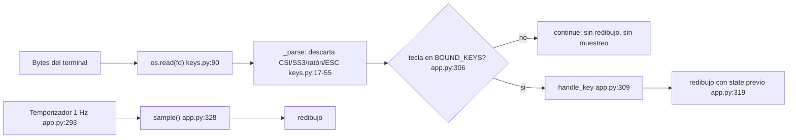

# 08 - Auditoría TUI (ROG Monitor)

> **Nota del orquestador (Opus, revisión cruzada):** El síntoma "galería" no se reproduce (PROBADO en pty). TUI-02 (94 % de CPU con stdin no TTY) se confirmó leyendo el código: `keys.py:94-96` devuelve None sin esperar y `app.py:305-307` hace `continue` sin dormir.

Fecha: 2026-10-10
Repo: ~/MyFiles/Dev/Rog-Monitor, rama master, HEAD 7d49333 (sin push).
Commits auditados: 4a65b87 `fix(tui): drop mouse/escape input and stop resampling on keypress` y a34df01 `feat(tui): Phase 4 ...`.
Alcance: solo lectura del repo. El repo queda sin cambios (`git status` limpio). Los scripts de prueba viven en /tmp/claude-1000/tui-audit/, fuera del repo. No se tocó sysfs, ventiladores, GPU ni perfiles de energía, y no se pulsaron `p` ni `g`.

## Veredicto corto

- El síntoma reportado (clic, rueda o tecla no asignada que "descuadra" la TUI) **no se reproduce** tras 4a65b87. PROBADO: 63 eventos basura en 0.5 s produjeron 0 muestras, 0 cuadros y 0 bytes de salida (TUI-01).
- Lo que sí aparece: la TUI consume ~94 % de un núcleo cuando stdin no es un TTY (TUI-02, PROBADO).
- La tecla `p` bloquea la UI hasta 5 s mientras corre `busctl` (TUI-03, verificado en código, no ejecutado).
- La cobertura de tests de entrada es buena en lo que cubre, pero su cota de muestras es laxa y faltan escenarios reales (secciones 2 y 3).

## 1. Cómo se lee y procesa la entrada (OBSERVADO)

- **Lectura**: `os.read` sobre el descriptor, no `sys.stdin.read`. `KeyReader._read` usa `select.select` y luego `os.read(self.fd, 1024)` (src/rog_monitor/keys.py:85-92). En todo el paquete no hay `sys.stdin.read`; solo se usa `sys.stdin.fileno()` para obtener el fd (keys.py:66).
- **Descarte de secuencias**: `_parse` (keys.py:17-55) solo conserva ASCII imprimible (0x20-0x7E). Descarta el ratón X10 `ESC [ M` + 3 bytes (keys.py:36-40), CSI completo `ESC [ ...` con parámetros, intermedios y byte final (keys.py:41-46; cubre SGR `ESC [ < ... M/m` y teclas de función `ESC [ 15 ~`), SS3 `ESC O x` (keys.py:47-50), Alt+tecla (keys.py:53-54) y ESC solitario (keys.py:30-31, y en `get` keys.py:104-106). Las secuencias partidas entre lecturas se reensamblan hasta 3 veces con espera de 50 ms (keys.py:100-109).
- **Ratón**: no se activa. keys.py:71-74 documenta que el tracking (`?1000h`/`?1006h`) está desactivado a propósito (CP-4.02). Ninguna cadena de activación existe en src/ (grep `1000h` solo aparece en ese comentario).
- **Teclas con acción**: `BOUND_KEYS = frozenset("qhvtpgef")` (app.py:32). En el bucle (app.py:305-307) cualquier tecla fuera de ese conjunto, y cualquier `None` (sin tecla), hace `continue` sin redibujar ni muestrear.
- **Sample en tecla**: NO. Tras `handle_key` se actualiza solo el estado de presentación (theme, overlays, filtro, mensaje) y se redibuja con `ui.build` (app.py:314-320). El comentario de app.py:312-313 lo explica. Solo el tick del temporizador llama a `self.sample()` (app.py:328).
- **Temporizador**: el `deadline` del ciclo se fija al inicio del ciclo (app.py:293), así que las teclas no lo reinician. Refresco: un muestreo y un redibujo por intervalo (config, 1.0 s por defecto).
- **Restauración del terminal**: `KeyReader.__enter__` guarda termios y pone `tty.setcbreak` (keys.py:64-75); `__exit__` restaura con `TCSADRAIN` (keys.py:79-83). El `with` envuelve a `Live(screen=True)` (app.py:285-290), así que `Live` restaura la pantalla alternativa. No hay `atexit`. Las señales se manejan así: SIGTERM y SIGHUP lanzan `KeyboardInterrupt` (app.py:275-282), que atraviesa el `with` y se captura en app.py:340. Ctrl-C funciona porque `setcbreak` deja ISIG activo (OBSERVADO, no probado por pty).
- **SIGWINCH**: `_on_resize` solo activa `self._resized` (app.py:267-273). El bucle redibuja con el ancho nuevo al inicio de cada iteración interna (app.py:296-304). `console.width` se consulta en cada redibujo, y el test de resize lo confirma.
- **Terminal pequeña**: `MIN_COLS, MIN_ROWS = 60, 20` (ui.py:492). Si es menor, `build` devuelve solo un aviso centrado (ui.py:498-500).
- **Datos ausentes**: `_fmt` produce `N/A (motivo)` cuando recibe `na` (ui.py:71-77). Los paneles usan `t("na_sensor")` y similares (ui.py:114-128, 143-144, 173-174, 183-184, 204-207, 236). Hay huecos, detallados en TUI-06.
- **SMART en TUI**: `smart_line` (ui.py:303-330) lee solo la caché `disk["smart"]` y `disk["smart_cached"]`. Esos datos los produce `sysinfo.py:441-445` con `smart_info` (sysinfo.py:258-265), que lee el fichero de caché (sysinfo.py:185-187, 205-230) sin root. Sin clave `smart` no dibuja nada (ui.py:307-308). Commit c4bb0d6.



## 2. Ejecución de los tests de TUI (PROBADO)

Nota: `tests/test_tui_pty.py` no existe. Los archivos reales son `tests/test_tui_input.py` (parser + pty), `tests/test_tui_render.py` (render, tamaños, N/A, i18n) y `tests/test_ui_events.py`.

Comando:
```
cd ~/MyFiles/Dev/Rog-Monitor && PYTHONPATH=src PYTHONDONTWRITEBYTECODE=1 timeout 300 python3 -m unittest -v tests.test_tui_input tests.test_tui_render tests.test_ui_events
```
Resumen real: **Ran 18 tests in 17.993s, OK** (rc=0; tiempo de pared 18.1 s).

Nota sobre el entorno: un primer intento con HOME temporal falló con `ModuleNotFoundError: rich` porque `rich` está en el site de usuario. Ese intento no cuenta. Los resultados de arriba corresponden al HOME real, con las rutas XDG de las pruebas en directorios temporales.

Resultados por test: los 18 pasan.
- KeyReaderParser: test_only_real_keys_survive, test_sequence_split_across_reads (ok, ok)
- TuiPty: test_escape_closes_help, test_noise_does_not_resample_and_exit_is_clean, test_sigterm_restores_terminal, test_sigwinch_resize_redraws_and_survives (ok x4)
- BuildSizes: 4 tests, I18nKeys: 2 tests, MissingEverything: 3 tests (ok)
- EventsPanelTest: 2 tests (ok)

## 3. Qué cubren realmente los tests (OBSERVADO en el código, resultados PROBADOS arriba)

| Escenario | Cubierto por | Aserción real | Evaluación |
|---|---|---|---|
| Clic SGR y clic derecho | test_tui_input.py:25-27, 115 (pty), 67 (parser) | Parser: lista exacta `["x"]*30 + ["\x1b","q"]` (línea 76). Pty: no se comprueba la ausencia de redibujos por clic, solo el conteo global | Buena en parser. En pty indirecta |
| Rueda SGR y flechas de la rueda | test_tui_input.py:26, 29, 115 | Igual que arriba | Buena en parser |
| Teclas basura (x, z, F5) | test_tui_input.py:67, 115 | Igual; `x1;` en pty | Buena en parser |
| Esc solitario | test_tui_input.py:69, 219-235 | Tecla `\x1b` al final; Esc cierra la ayuda | Buena |
| Sequence partida entre lecturas | test_tui_input.py:81-91 | `a`, `b` exactos | Buena |
| Resize (SIGWINCH) | test_tui_input.py:197-217 | 40x120 -> 30x80 -> 15x50 -> 40x120; comprueba texto y que el proceso sigue vivo | Buena, pero solo 3 saltos separados por 1 s |
| Terminal pequeña | test_tui_render.py:56-66 (solo render) | Aviso con (40,40), (80,10), (59,20), (60,19), (34,3); (60,20) sin aviso | Solo render; no hay pty |
| Ctrl-C | ninguno | — | No cubierto |
| q | test_tui_input.py:119, 186 | código 0 | Cubierto |
| Sample no extra por tecla | test_tui_input.py:99-141 | `calls <= elapsed/1.0 + 3` | **Cota laxa**: tolera ~2 muestras de sobra (TUI-04) |
| Restauración de pantalla | test_tui_input.py:140, 171 | `\x1b[?1049l` en la salida | Cubierto. No comprueba termios |
| Sin ratón activado | test_tui_input.py:141 | solo `?1000h` | Cota débil: no mira 1002/1003/1006 (TUI-04) |
| N/A con motivo | test_tui_render.py:102-116 | claves i18n presentes; "None"/"null" ausentes | Buena |
| Esquema de teclas en ayuda | test_tui_render.py:131-138 | ayuda y `keys_pairs` = BOUND_KEYS | Buena |

Escenarios NO cubiertos por el repo:

| Escenario | Estado en el repo | Estado de esta auditoría |
|---|---|---|
| Drag | N/A: con el ratón desactivado no llegan reportes de movimiento. Solo se parsean por la rama CSI genérica | No probado; no aplica |
| Resize rápido repetido | Solo 3 saltos separados por 1 s | PROBADO por mí: 12 saltos cada 150 ms, la TUI sigue viva y sale con 0 (pty_check_f) |
| Terminal 20x5 | No hay test pty ni render exacto a 20x5 | PROBADO por mí: muestra el aviso "too small", sigue viva, sale con 0, restaura pantalla |
| Sin sensores (hwmon, RAPL, batería ausentes) | Solo render con `None` (MissingEverything), no lecturas reales ausentes | NO PROBADO end-to-end |
| Sin NVIDIA | Todas las pruebas pty usan `--no-gpu`; no hay prueba de `nvidia-smi` ausente con GPU activa | NO PROBADO |
| stdin no TTY | Ninguno | PROBADO: CPU 94.3 % (TUI-02) |
| Ctrl-C (SIGINT) y SIGHUP por pty | Ninguno (solo SIGTERM) | No probado |
| Teclas g, p, e, t, f, v; `q` con overlay abierto | Ninguno por pty | No probado. `p` y `g` tocan el sistema, así que no se ejecutaron |

## 4. Pruebas propias con pty (PROBADO)

Scripts en /tmp/claude-1000/tui-audit/ (pty_check.py, pty_check_c.py, pty_check_e.py, pty_check_f.py, launcher.py). Ninguno dentro del repo. XDG_CONFIG/DATA/CACHE apuntan a un directorio temporal. Flags: `--no-gpu`, intervalo por defecto.

**A. TTY 80x24: clic, rueda, z, x, F5, luego q** (pty_check.py). Resultado:
- Sale con código **0** tras `q` (el proceso seguía vivo tras la entrada basura: `junk_alive: True`).
- Restaura: `\x1b[?25h`, `\x1b[?1049l` y `Saliendo…` en la salida final. `termios` del pty antes y después: **idéntico**.
- Ningún `?1000h`, `?1002h`, `?1003h` ni `?1006h` en la salida.

**B. stdin = /dev/null (sin TTY), 3 s medidos** (pty_check.py): **CPU del proceso 94.3 %**, proceso vivo. SIGTERM: sale con código 0 tras restaurar. Causa: keys.py:95-96 devuelve `None` sin esperar cuando `fd` es None, y app.py:305-307 hace `continue` sin dormir, así que el bucle interno gira hasta el deadline de 1 s.

**C. Conteo de muestras y cuadros por ventana** (pty_check_c.py, con launcher.py que cuenta llamadas a `App.sample`):
- Idle 2 s: 1 muestra (+ tick), 1 cuadro.
- Basura 2 s (z, x, F5, clic, rueda): 2 muestras por ticks, 2 cuadros. Consistente con solo el temporizador.
- Tecla ligada `h` (ayuda on) en 1 s: 1 muestra, 2 cuadros: 1 tick + 1 redibujo de la tecla, sin muestra extra.
- Total: 8 muestras en ~8.5 s, consistente con 1 Hz.
- Salida 0 tras `q`.

**E. Ráfaga de 63 eventos basura en ~0.5 s** (pty_check_e.py): **samples+=0, cuadros=0, bytes=0**. Es la prueba decisiva de que la entrada basura no muestrea ni redibuja.

**F. 20x5 y resize rápido** (pty_check_f.py):
- 20x5 muestra el aviso "too small"; sigue viva.
- 12 resizes con SIGWINCH cada 150 ms: sigue viva.
- `q`: sale con 0 y restaura la pantalla alternativa.

Nota: las ventanas de 2 s no separan una muestra extra de la fase del temporizador. La prueba E sí lo hace, porque 63 eventos de muestreo por tecla darían ~63 muestras.

## 5. Prueba manual reproducible para Marshall

Requisito: terminal sin tmux, de 80x24 o mayor, sin modificar nada del sistema.

1. Abre una terminal limpia y ve a la copia de trabajo: `cd ~/MyFiles/Dev/Rog-Monitor`.
2. Lanza la TUI sin GPU: `PYTHONPATH=src python3 -m rog_monitor --no-gpu`.
3. Espera 60 s con la interfaz visible. No toques nada.
4. Durante 20 s, haz clic con el ratón en varios sitios de la ventana (unos 50 clics), gira la rueda (unas 50 muescas), y pulsa `z`, `x`, `F5` y flechas. Esperado: el panel no salta, no aparecen caracteres como `z`, `<`, `;` ni números en pantalla, y las gráficas avanzan a ritmo constante de 1 paso por segundo.
5. Pulsa `h`: aparece la ayuda. Pulsa `Esc`: vuelve el panel normal. Pulsa `v`, luego `Esc`.
6. Espera hasta que pasen 80 s desde el inicio y pulsa `e`. Aparece la ruta de exportación. Abre la carpeta indicada y cuenta las filas del CSV principal (`wc -l rog-monitor-*.csv`). Esperado: unas 80 filas (±3), no cientos. Este es el criterio directo de "no remuestrear por tecla". Nota: `e` crea archivos en `~/.local/share/rog-monitor/exports/`; puedes borrarlos después.
7. Pulsa `q`. Esperado: vuelve el prompt, la terminal responde a lo que escribas (por ejemplo `echo hola`), el cursor es visible y el texto anterior de la terminal sigue en el historial. Fallo si el prompt no escribe bien o el cursor se queda oculto.
8. (Opcional, comparación con el estado previo) Desde otra copia, no desde la de trabajo, `git worktree add /tmp/rog-prev 4a65b87^` y repite el paso 4. Esperado: el estado previo sí descuadra y añade muestras. Sin este paso no hay línea base manual.
9. (Opcional, consumo) Con `PYTHONPATH=src python3 -m rog_monitor --no-gpu < /dev/null` y otra terminal, observa `top` durante 10 s. Hallazgo esperado: ~90 % de CPU (TUI-02).

## 6. Hallazgos (formato del brief)

| ID | Severidad | Estado | Componente | Archivo:línea | Commit(s) | Evidencia/comando | Resultado | Impacto | Recomendación | Prueba de aceptación |
|---|---|---|---|---|---|---|---|---|---|---|
| TUI-01 | P1 (ya corregido) | verificado | Entrada y muestreo por tecla | keys.py:17-55, 90; app.py:305-320 | 4a65b87 | pty_check_e.py: 63 eventos basura, samples+=0, cuadros=0, bytes=0 | El síntoma reportado no se reproduce | Ninguno hoy | Mantener; reforzar cota de test (TUI-04) | Prueba E sin muestras ni cuadros; passing en `test_noise_*` |
| TUI-02 | P2 | verificado (código) y PROBADO (CPU) | Bucle de entrada sin TTY | keys.py:95-96; app.py:305-307 | 1d2e7d7 (get/fd None), 4a65b87 (bucle) | pty_check.py escenario B: stdin=/dev/null, 3 s, CPU 94.3 % | Un núcleo al 100 % en modo no interactivo | Gasto de CPU y batería si se lanza sin TTY (cron, nohup, `< /dev/null`). No afecta a los datos | Dormir (`time.sleep(timeout)` o `select` sin fd) cuando `fd` es None | Con stdin=/dev/null, CPU < 5 % en 3 s |
| TUI-03 | P2 | verificado (código); NO PROBADO | Acciones síncronas en el hilo de UI | actions.py:22-32 (`busctl`, timeout 5 s), actions.py:52-90 (`export_history`); app.py:184-193 | 1d2e7d7 | Lectura. No se ejecutó `p` (cambia el perfil de energía) | Con `p`, el dashboard se congela hasta 5 s; `e` escribe ficheros en el hilo principal | UI bloqueada durante la acción | Mover `p` a worker thread como `g` (app.py:196-226) | Con busctl simulado lento, el dashboard sigue redibujando |
| TUI-04 | P2 | verificado | Tests de muestreo y ratón | tests/test_tui_input.py:138-141 | 4a65b87 | Lectura del test | Cota `calls <= elapsed/1.0 + 3` tolera ~2 muestras extra. Solo se busca `?1000h`, no 1002/1003/1006 | Un regreso con 1-2 muestras extra por ráfaga pasaría el test | Cota exacta (ticks esperados + 1); buscar los 4 modos de ratón | Test que falla si se añade muestreo por tecla en una ráfaga de 10 eventos |
| TUI-05 | P2 | verificado | Cobertura de tests | tests/test_tui_input.py (todo) | 4a65b87 | Tabla de la sección 3 | Sin pruebas de: stdin no TTY, SIGINT, SIGHUP, g/p/e/t/f/v, `q` con overlay | Regresiones de salida y teclas sin detectar | Añadir tests pty para esos casos | Tests nuevos en `tests/test_tui_input.py` verdes en CI |
| TUI-06 | P3 | verificado | Datos ausentes sin motivo | ui.py:133 (modelo), 156 (uso GPU), 163 (reloj), 168-170 (VRAM), 228-233 (salud, ciclos), 481 (estado térmico) | a34df01 (N/A con motivo), c4bb0d6 | Lectura | Filas que desaparecen sin "N/A (motivo)" o con N/A sin motivo; incumple la convención del commit a34df01 | Hueco mudo en la UI | Mostrar `N/A (motivo)` en esas filas | Render con `None` muestra "N/A (" en cada fila afectada |
| TUI-07 | P3 | verificado (PROBADO por mí) | Terminal 20x5 y resize rápido | ui.py:492-500; app.py:267-304 | a34df01, 48bde60 | pty_check_f.py | Correcto: aviso en 20x5, 12 resizes sin caída, salida 0 | Sin cobertura automatizada en el repo | Añadir esos dos casos a `tests/test_tui_input.py` | Test pty con 20x5 y 12 resizes |
| TUI-08 | P3 | verificado (PROBADO) | Restauración del terminal | keys.py:79-83; app.py:275-282, 284-346 | 4a65b87, 48bde60 | pty_check.py escenario A; test_sigterm_restores_terminal | Correcto: código 0, `?1049l`, `?25h`, termios idéntico | Ninguno | Mantener | Escenario A verde |
| TUI-09 | P3 | parcial | SMART en la TUI | ui.py:303-330, 375-378; sysinfo.py:185-265, 441-445 | c4bb0d6 | Lectura del código; sin caché real en la prueba | Lee solo la caché, sin root. Sin clave `smart` no dibuja. NO PROBADO con caché real | — | Prueba e2e con `smart.json` de fixture | Línea SMART visible con caché de fixture |
| TUI-10 | P3 | no verificado | Datos ausentes reales | ui.py:125-128, 149-174 | a34df01 | Todas las pruebas pty usan `--no-gpu`; no hay hwmon ausente real | Sin prueba de sensores ni NVIDIA ausentes en ejecución real | Regresiones en equipos sin esos sensores | Prueba pty con `--no-gpu` ausente y sin sensores simulados | — |
| TUI-11 | P3 | HIPÓTESIS | Excepciones fuera del try | keys.py:87 (`select` sin try) | 1d2e7d7 | Lectura | Un fd inválido podría lanzar fuera del try y salir con traceback después de restaurar el terminal. No reproducido | Salida con traceback, terminal restaurado | Envolver `select` en el mismo try que `os.read` | Prueba con fd cerrado |
| TUI-12 | P3 | verificado | Umbral de tiempo de render | tests/test_tui_render.py:78-84 | — | Lectura | `< 250 ms` por render; puede fallar con carga alta | Test inestable en CI lento | Relajar o marcar como lento | — |

## No verificado / limitaciones

- No pude probar con sensores realmente ausentes ni con `nvidia-smi` ausente (TUI-10).
- No ejecuté `p` ni `g` (tocan energía y GPU). Su bloqueo (TUI-03) es hallazgo de código.
- SMART en la TUI no se probó con caché real (TUI-09).
- Las ventanas de 2 s no separan muestras extra de la fase del temporizador. La prueba E (63 eventos en 0.5 s) sí es concluyente.
- Ctrl-C real (SIGINT por pty) no se probó: solo SIGTERM en los tests del repo y SIGTERM en mi harness B.
