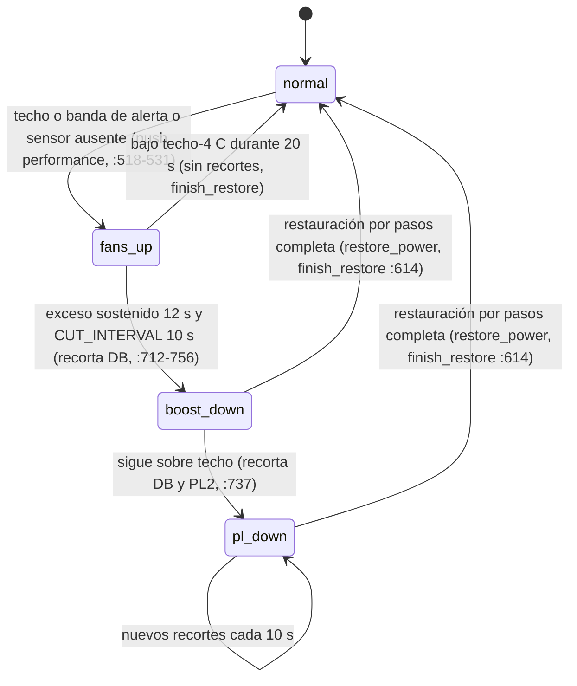
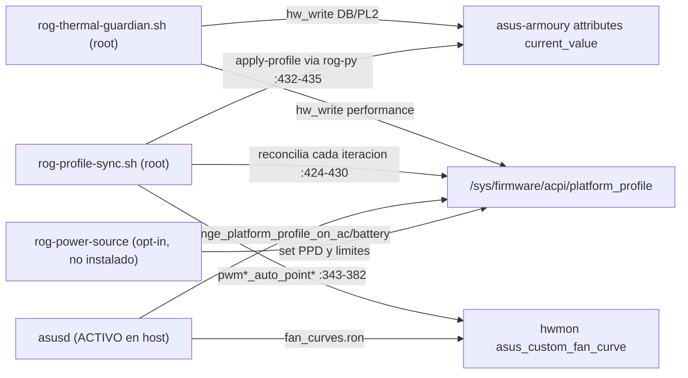

# 09 - Guardián térmico 2.0 y escrituras de hardware (auditoría post-90)

Repo: `~/MyFiles/Dev/Rog-Monitor`, HEAD `7d49333` (master local, sin push).
Commit de referencia del Guardián 2.0: `74fc4ff` (2026-10-10). Versión anterior: `48bde60` (V14).
Alcance: solo lectura del repo y del host. No se ejecutó ningún instalador, safe-mode, rog-ctl ni script con sudo/pkexec. No se escribió en /sys ni en systemd.

Etiquetas usadas: OBSERVADO (leí el código), PROBADO (ejecuté y vi el resultado), NO PROBADO, HIPÓTESIS.

---

## 1. Resumen ejecutivo

- El bug documentado en CP-6.01 (H3, mapeo ABI de `throttle_thermal_policy`) **está corregido**: el Guardián 2.0 ya no escribe ese atributo (ver sección 6).
- El Guardián sigue **sin ser confiable en el host real**. Motivos principales, todos observados en código y con evidencia de host:
  1. Hay tres controladores de `platform_profile` y curvas de ventilador que se pisan: el Guardián, `rog-profile-sync.sh` y `asusd` (este último **activo** en el host y configurado con cambio de perfil por AC/batería y curvas propias).
  2. Si la lectura de límites de perfil falla durante un recorte de potencia, el Guardián da el episodio por terminado sin restaurar PL2/Dynamic Boost y sin dejar rastro en el journal.
  3. El registro de decisiones dice `boost` aunque la escritura de `platform_profile` haya fallado.
- Estado en el host ahora mismo: `rog-thermal-guardian.service` **disabled / inactive**. Los ventiladores los gobierna `rog-profile-sync` (enabled / active) junto con `asusd` (active). El Guardián no protege nada en este equipo en este momento.
- Tests: 21/21 en Python (guardián + validación de poder) y 21/21 en `desktop/test/priv.test.js`, todos PROBADO. Son simulación con árbol sysfs falso y temperaturas guionizadas; ninguno toca hardware real ni verifica la interacción con `rog-profile-sync` o `asusd`.

---

## 2. Objetivo y filosofía (OBSERVADO)

Fuente: cabecera de `scripts/rog-thermal-guardian.sh:2-11`.

1. CPU/GPU por encima del techo: subir ventiladores primero (`platform_profile=performance`).
2. Si el exceso es sostenido (`ROG_THERMAL_OVER_GRACE`, 12 s): recortar `nv_dynamic_boost` y, si hace falta, `ppt_pl2_sppt` (PL2).
3. Al enfriar: restaurar gradualmente, con margen y retención, y nunca por encima del objetivo del perfil activo.
4. Falla-segura: si falta un sensor, subir ventiladores y **no** cambiar potencia por falta de dato (`scripts/rog-thermal-guardian.sh:28-33`).

El servicio tiene además una simulación (`ROG_THERMAL_DRY=1`) que registra `[SIM] would write ...` sin escribir (ADR-0005). Verificado en código: toda escritura de hardware pasa por `hw_write()` (`scripts/rog-thermal-guardian.sh:196-208`). Las únicas otras escrituras son el JSON de estado en el home del usuario (`:450-453`) y el marcador en `/run` (`:488-506`), que no son hardware. ADR-0005 se cumple.

---

## 3. Rutas sysfs y escrituras exactas (OBSERVADO)

| Ruta (sysfs/proc/run) | Valor escrito | Dónde (ruta:línea) | Condición |
| --- | --- | --- | --- |
| `/sys/firmware/acpi/platform_profile` | `performance` | `scripts/rog-thermal-guardian.sh:528` (push_fans) | Primera vez que hay techo, banda de alerta o sensor ausente |
| `/sys/firmware/acpi/platform_profile` | perfil original (`balanced`/`quiet`) | `:538` (unboost_fans) | Solo si el valor actual sigue siendo `performance` y el original no lo era |
| `/sys/firmware/acpi/platform_profile` | `quiet/balanced/performance` | `:469` (set_fan_aggression) | Solo con `ROG_THERMAL_MODULATE_LOAD=1` (default OFF, `:97`) |
| `/sys/class/firmware-attributes/asus-armoury/attributes/nv_dynamic_boost/current_value` | `cur - DB_STEP` (2 W), piso `min_value` | `:730` (do_cut) | Exceso sostenido, intervalo de corte cumplido |
| `/sys/class/firmware-attributes/asus-armoury/attributes/nv_dynamic_boost/current_value` | hacia el techo, paso DB_STEP | `:594` (restore_power) | Margen y retención cumplidos |
| `/sys/class/firmware-attributes/asus-armoury/attributes/ppt_pl2_sppt/current_value` | `cur - PL2_STEP` (5 W), piso `min_value` | `:740` (do_cut) | Solo si DB ya se tocó (`boost-down`/`pl-down`) o DB no puede bajar más (`:737`) |
| `/sys/class/firmware-attributes/asus-armoury/attributes/ppt_pl2_sppt/current_value` | hacia el techo, paso PL2_STEP | `:603` (restore_power) | Igual que restauración |

Rutas de **lectura**: `.../attributes/<attr>/{min_value,max_value,current_value}` (`:217-231`), `/sys/class/hwmon/hwmon*/name` y `temp*_input` (`:254-299`), `/proc/stat` (`:321-341`), `nvidia-smi` con `timeout 3` (`:245`), `/sys/firmware/acpi/platform_profile` (`:190-194`).

Rutas de **estado** (no hardware): `$HOME/.local/share/rog-monitor/thermal-guardian-state.json` vía `write_guardian_state` (`:411-456`, dirs en `:443`); marcador `/run/rog-monitor/guardian-precut` (`:152`, `:488-506`).

Ningún escritor del Guardián toca `throttle_thermal_policy` (ver sección 6).

Atributos vivos en el host (lectura, OBSERVADO): `ppt_pl2_sppt` current 175, default 175, min 28, max 175; `nv_dynamic_boost` current 25, default 25, min 5, max 25; `platform_profile` = `performance` con choices `quiet balanced performance`.

---

## 4. Máquina de estados (OBSERVADO)

Estados: `normal`, `fans-up`, `boost-down`, `pl-down` (`scripts/rog-thermal-guardian.sh:355`).

Notas de la máquina:

- `OVER_SINCE` (gracia) no se reinicia dentro de la banda de alerta; caduca tras `BAND_MEMORY` = max(30, 3·gracia) = 36 s sin tocar el techo (`:794`, `:140`).
- Modo `gaming` (`ROG_THERMAL_MODE=gaming`): nunca recorta; solo sube ventiladores (`:788-791`).
- Sensor ausente: ambos → ventiladores arriba y `hold` (`:765-771`); uno → ventiladores arriba y `hold`, sin recorte ni restauración (`:821-828`).
- La restauración exige ambos sensores y margen RESTORE_MARGIN (`:833`), retención RESTORE_HOLD (`:839`) y CUT_INTERVAL entre pasos (`:843`).

### 4.1 Umbrales por defecto (OBSERVADO, calculados desde `scripts/rog-thermal-guardian.sh:90-140` y `systemd/rog-thermal-guardian.service:18-29`)

| Parámetro | Valor | Origen |
| --- | --- | --- |
| Techo CPU | 92 °C (rango 70-100) | `:91`, `:134-135`, unidad `:18` |
| Techo GPU | 83 °C (rango 70-87) | `:92`, `:136-137`, unidad `:19` |
| Alerta CPU / GPU | 89 °C / 80 °C (techo - 3) | `:138-139` (WARN_DELTA `:94`) |
| Gracia antes de recortar | 12 s | `:100`, unidad `:22` |
| Memoria de banda | 36 s | `:140` |
| Intervalo entre recortes/restauraciones | 10 s | `:103`, unidad `:23` |
| Paso DB / PL2 | 2 W / 5 W | `:101-102`, unidad `:24-25` |
| Margen de restauración | 4 °C (CPU ≤ 88, GPU ≤ 79) | `:104` |
| Retención antes de restaurar | 20 s | `:105`, unidad `:26` |
| Intervalo del bucle | 2 s | `:93`, unidad `:20` |
| Plausibilidad de sensor | 20..110 °C | `:236-239` |
| Modulación por carga | OFF | `:97`, unidad `:21` |

Histéresis real: subir a alerta es inmediato; bajar exige 4 °C de margen y 20 s de retención; no hay histéresis de tiempo en la banda 88-89 °C salvo esa diferencia de 1 °C. Confirmado por lectura.

### 4.2 Diagrama de escritura y conflicto con otros controladores

---

## 5. Logs de decisiones (OBSERVADO)

- Una línea por decisión con `decide()` (`scripts/rog-thermal-guardian.sh:377-401`): `decision=<cut|restore|hold|boost|unboost> reason=... cpu=... gpu=... ceiling=../.. pl2=..->.. db=..->.. sim=0|1`. Los `hold` repetidos con el mismo motivo se omiten (`:379-381`).
- Destino: stderr → journald (`journalctl -u rog-thermal-guardian.service`).
- JSON de estado con `last_decision` y `history` (últimas 20) (`:390-398`, `:411-456`). Lo lee `src/rog_monitor/fans.py:314-345`.
- Limitación: `decide boost` se emite aunque la escritura haya fallado (ver GRD-04).

---

## 6. Verificación del bug CP-6.01 (H3) - CORREGIDO

CP-6.01 (`docs/agent-work/checkpoints/CP-6.01.md:207`, `:278`) describe que el Guardián escribía `throttle_thermal_policy` con `performance -> 2` (SILENCIO) en `scripts/rog-thermal-guardian.sh:358`.

Estado actual, verificado:

- Código actual: `scripts/rog-thermal-guardian.sh:461-466` documenta explícitamente que `throttle_thermal_policy` ya no se escribe ("NO se escribe throttle_thermal_policy... lo opuesto a lo que escribía el guardián v13"). Línea de cabecera `:24`: "throttle_thermal_policy YA NO se escribe".
- `grep -rn "thermal_policy"` sobre todo el repo (excluyendo node_modules y agent-work): solo aparece en comentarios y en `CHANGELOG.md:31`. No hay ninguna escritura.
- Versión anterior (PROBADO por `git show`): en `48bde60`, `scripts/rog-thermal-guardian.sh:136` define `THROTTLE_POLICY=".../asus-nb-wmi/throttle_thermal_policy"` y `:353` contiene `performance) want=2 ;;`. Esa es la escritura invertida que describía CP-6.01.
- Corrección introducida en `74fc4ff` (blame de `:461-469` = `74fc4ffa`).
- Evidencia viva (lectura): con `platform_profile=performance`, `throttle_thermal_policy=1`. Coincide con ABI 1=overboost, que es lo que CP-6.01 ya había observado. Es coherente con la hipótesis de que el driver sincroniza ambos atributos, pero la sincronización en sí no fue probada.

Veredicto: **corregido** (verificado). Queda HIPÓTESIS sobre la sincronización del driver y sin prueba de que `performance` en `platform_profile` produzca el mismo efecto térmico que el antiguo `throttle=2` era pensado para dar.

---

## 7. Permisos, rollback y restauración ante crash (OBSERVADO)

Permisos:

- `systemd/rog-thermal-guardian.service:40-41`: `User=root`, `Group=root`. El script se ejecuta desde `/usr/local/libexec/rog-monitor/rog-thermal-guardian.sh` (`:11`), copia root:root que coincide byte a byte con el repo (`cmp` = SAME, PROBADO en host).
- Endurecimiento: `NoNewPrivileges=yes`, `ProtectSystem=full`, `PrivateTmp=yes` (`:50-52`). No hay `ProtectHome` a propósito (`:53-55`).
- `RuntimeDirectory=rog-monitor`, `RuntimeDirectoryMode=0755`, `RuntimeDirectoryPreserve=yes` (`:32-34`): el marcador sobrevive al reinicio del servicio, no a un reinicio de máquina.
- Estado JSON: se usa `rm -f` + `set -C` (noclobber) para no seguir un symlink plantado (`:446-452`) y se rechazan directorios symlink (`:447`).

Rollback y restauración:

- `persist_marker` antes de tocar nada (`push_fans`, `:527`; `do_cut`, `:714-718`). Contiene perfil original, DB y PL2 previos, si se empujó el perfil y si hubo recorte (`:494-496`).
- `startup_recover` al arrancar (`:856-893`): si hay marcador y está frío, restaura al objetivo del perfil; si está caliente, adopta el estado y restaura por pasos.
- `cleanup` en EXIT (`:898-915`), con `trap 'exit 0' SIGTERM SIGINT SIGHUP` (`:925-926`): en parada normal restaura al objetivo (salto, no rampa).
- SIGKILL no pasa por `cleanup`; lo cubre el marcador (`:488-506`). Esto está probado por `tests/test_guardian_sim.py` (SIGKILL a mitad de recorte, ver sección 9).
- Límite: el objetivo de restauración se calcula con `rog-py.sh ... profile-limits` (`:555-576`). Si esa lectura falla, ver GRD-03.
- Límite no cubierto: apagado abrupto sin SIGTERM sin marcador en tmpfs tras reinicio (GRD-06).

---

## 8. Dependencias externas que el Guardián invoca (OBSERVADO)

| Dependencia | Uso | Ruta:línea | Falla si... |
| --- | --- | --- | --- |
| `nvidia-smi` (timeout 3 s) | temperatura GPU en cada ciclo | `:243-250`, invocado por `:933` | no existe: cae a hwmon nvidia (`:252-268`) |
| `/usr/local/libexec/rog-monitor/rog-py.sh` | `profile-limits` (solo lectura) | `:153`, `:559-560` | no existe o devuelve vacío: ver GRD-03 |
| `/proc/stat` | carga (solo modulación) | `:321-341` | no legible: carga "alta" (`:653-656`) |
| `nvidia-smi` en `read_gpu_load` | carga GPU | `:343-350` | solo si modulación ON |

---

## 9. Qué prueban los tests (PROBADO)

Comandos ejecutados (con `HOME` en scratchpad y `PYTHONPATH=src`):

- `python3 -m unittest -v tests.test_guardian_sim tests.test_power_validation`: **Ran 21 tests, OK** (29 s).
  - `test_guardian_sim`: `test_dry_run_changes_nothing`, `test_full_scenario` (rampa, cortes, restauración, sensor ausente, SIGKILL y recuperación), `test_gaming_cap_only_when_active`, `test_profile_change_is_not_overwritten`, `test_profile_limits_read_only`.
  - `test_power_validation`: validación de rangos, lote con un valor malo, validación de curvas de `rog-profile-sync`, FIFO/symlink/tamaño.
- `node --test test/priv.test.js` (dentro de `desktop/`): **21 pass, 0 fail**.

Tipo de simulación (OBSERVADO en `tests/test_guardian_sim.py:1-10`, `:37-107`):

- No usa mocks de funciones. Ejecuta `scripts/rog-thermal-guardian.sh` como proceso bash real, como usuario normal, con `ROG_SYSFS_ROOT` apuntando a un árbol temporal, `ROG_THERMAL_FAKE_TEMPS` con temperaturas escritas por el test, y `ROG_PY_LAUNCHER` apuntando a un script falso (`:23-33`).
- `test_power_validation` sí usa `mock.patch` sobre `subprocess.run` y `os.environ` (`:38`, `:94-107`). Verifica los argumentos enviados, no el comportamiento del script root.
- Nada de esto toca `/sys` real. Nada prueba la presencia de `asusd`, de `rog-profile-sync`, de PPD (tuned-ppd) ni de firmware real.

Ojo: ejecutar `test_guardian_sim` lanzó el script del Guardián dentro de un árbol temporal como usuario normal. Lo pediste explícitamente; no hubo escritura fuera de `/tmp/...`.

---

## 10. Hallazgos

Formato: ID | Severidad | Estado | Componente | Archivo:línea | Commit(s) | Evidencia/comando | Resultado | Impacto | Recomendación | Prueba de aceptación.

| ID | Severidad | Estado | Componente | Archivo:línea | Commit(s) | Evidencia/comando | Resultado | Impacto | Recomendación | Prueba de aceptación |
| --- | --- | --- | --- | --- | --- | --- | --- | --- | --- | --- |
| GRD-01 | P1 | parcial | Ventiladores: Guardián vs rog-profile-sync | `scripts/rog-thermal-guardian.sh:518-531`; `scripts/rog-profile-sync.sh:416-430`, `:480-489` | `74fc4ff`; `48bde60` | Lectura de ambos scripts; `busctl ... ActiveProfile` = `performance`, `platform_profile` = `performance` (host, hoy consistentes) | OBSERVADO: `rog-profile-sync` reescribe `platform_profile` al valor de PPD en cada iteración (≤30 s o por señal PPD). El Guardián empuja `performance` una sola vez (`FAN_PROFILE_PUSHED`, `:520`) y no lo repite. HIPÓTESIS: si tuned-ppd refleja `platform_profile` en `ActiveProfile`, el empuje se propaga a PPD y `rog-profile-sync` aplica los límites de performance (`:432-435`), pisando los recortes. Ninguna de las dos variantes se probó. | El boost de ventiladores del Guardián puede durar hasta 30 s o revertirse en silencio; los recortes de PL2 pueden anularse. Afecta al núcleo de la función. | Un único dueño de `platform_profile`: que `rog-profile-sync` respete un flag de "fans-up" publicado por el Guardián, o que el Guardián sea el único que escribe ese atributo mientras `guardian_state != normal`. Registrar la reconciliación en el journal. | Test con PPD falso (shim de `busctl` en PATH) en `balanced` y `platform_profile` fake: tras `push_fans`, `platform_profile` debe seguir en `performance` durante al menos 35 s; tras restaurar, vuelve a `balanced`. |
| GRD-02 | P1 | verificado | Controlador asusd (activo) | `/etc/asusd/asusd.ron:8-11`; `/etc/asusd/fan_curves.ron`; `scripts/enable-asusd.sh:121-122`, `:130-136` | `48bde60`, `824be80`, `531ec9e` | `systemctl is-active asusd` = active; lectura de `/etc/asusd/asusd.ron` | OBSERVADO: `change_platform_profile_on_ac: true` (Performance) y `change_platform_profile_on_battery: true` (Quiet), más curvas propias en `fan_curves.ron`. El "Aura only" de `enable-asusd.sh:130-136` no existe en disco (`/etc/profile.d/rog-aura-only.sh` ausente) y ningún script lee `ROG_AURA_ONLY` (grep). Detalle en INS-02. | Tercer controlador de perfil y curvas, fuera del control del Guardián y de `rog-profile-sync`. | Desactivar en asusd el control de perfil y de curvas (o no habilitar asusd), y que `enable-asusd.sh` valide esa configuración antes de habilitar. | Con asusd activo, enchufar/desenchufar AC no modifica `platform_profile` ni `pwm*_auto_point*`. |
| GRD-03 | P1 | verificado (código); NO PROBADO | Restauración de potencia | `scripts/rog-thermal-guardian.sh:555-576`, `:581-611`, `:614-625`, `:847-849` | `74fc4ff` | Lectura: si `profile-limits` no devuelve nada y el perfil cambió (`unchanged=0`), `CEIL_DB`/`CEIL_PL2` quedan vacíos; `restore_power` (`:590`, `:599`) no hace nada y devuelve 0; `finish_restore` (`:614`) borra marcador y pone `POWER_CUT=0` | OBSERVADO: el episodio termina sin restaurar DB/PL2, sin `decide restore` ni aviso. Silencioso. Condición: fallo del lanzador (`rog-py.sh` roto, `python3` cambiado, paquete ausente) durante un recorte con cambio de perfil. | Límites de potencia bajos hasta reinicio o hasta que el usuario actúe, sin ningún registro. Engañoso. | Si `POWER_CUT=1` y no hay techo, no finalizar el episodio: conservar marcador, reintentar y registrar `decision=restore-blocked`. Como último recurso, usar PRE_DB/PRE_PL2 del marcador. | Fake launcher que sale con 1 tras un corte con cambio de perfil: el marcador debe seguir existiendo y el journal debe contener `restore-blocked`. |
| GRD-04 | P2 | verificado (código) | Registro de decisiones | `scripts/rog-thermal-guardian.sh:526-529` | `74fc4ff` | Lectura: `FAN_PROFILE_PUSHED=true` (`:526`) y `hw_write ... || true` (`:528`) antes de `decide boost` (`:529`) | OBSERVADO: `decide boost` se emite aunque la escritura falle (p. ej. si el perfil `performance` no está en `platform_profile_choices`). El estado queda marcado como empujado y `unboost_fans` no tendrá nada que revertir correctamente. | Journal engañoso; el estado interno no coincide con el hardware. | Solo marcar `FAN_PROFILE_PUSHED=true` y decidir `boost` si `hw_write` devuelve 0 y la lectura de vuelta coincide. | Fake `platform_profile` de solo lectura: el journal debe decir `boost-failed`, no `boost`. |
| GRD-05 | P2 | NO PROBADO | Lectura de potencia actual | `scripts/rog-thermal-guardian.sh:217-231`, `:727-741`, `:590-607` | `74fc4ff` | Lectura: `read_sysfs_int` devuelve "" si el valor no es entero (`:182-188`); `get_pl2_range` sustituye por `175` (`:230`) y `get_db_range` por `25` (`:222`); `do_cut` calcula `pl_cur - PL2_STEP` desde ese valor | HIPÓTESIS con base en código: si `current_value` existe pero no es un entero legible, un "recorte" escribe 170 W en PL2 aunque el valor real fuera menor, es decir, sube la potencia. | Subida de potencia en un recorte por dato corrupto. Probabilidad baja. | Si `current_value` no es legible, no escribir nada y registrar `sensor-power-unreadable`. Eliminar los valores por defecto en los caminos de escritura. | Árbol fake con `ppt_pl2_sppt/current_value` = `garbage`: cero escrituras en PL2 y DB. |
| GRD-06 | P2 | HIPÓTESIS | Persistencia tras apagado | `systemd/rog-thermal-guardian.service:30-34`; `scripts/rog-thermal-guardian.sh:152`, `:488-506` | `74fc4ff` | Razonamiento: el marcador está en `/run` (tmpfs). Un apagado abrupto sin SIGTERM tras un recorte no deja marcador; no se sabe si el firmware conserva `current_value` tras reinicio | Si el firmware conserva el recorte, la potencia queda baja tras reiniciar sin que nadie lo sepa. | Potencia limitada tras reinicio. Depende del firmware. | Guardar un marcador persistente en `/var/lib/rog-monitor` (root) con limpieza al restaurar; y en arranque comparar `current_value` con los objetivos del perfil. Verificar primero si el firmware persiste el valor. | Prueba manual en host: recortar, apagar sin parar el servicio, reiniciar, leer `current_value`. Documentar el resultado. |
| GRD-07 | P2 | HIPÓTESIS | Sensores de temperatura | `scripts/rog-thermal-guardian.sh:274-299` (acpitz `:283`), `:241-272`, `:933` | `74fc4ff` | Lectura: `read_cpu_temp` toma el máximo de todos los hwmon `coretemp|k10temp|zenpower|cpu_thermal|acpitz`. `read_gpu_temp` llama a `nvidia-smi` en cada ciclo (cada 2 s) | Una zona ACPI (`acpitz`) con lectura alta dispara recortes sin que la CPU esté caliente. Además, `nvidia-smi` cada 2 s puede impedir que la dGPU entre en suspensión (no medido; el repo ya tiene un "dGPU sleep guard" en `c6b15a6`). | Falsos positivos y consumo de la dGPU. | Elegir la sonda CPU por etiqueta (`Package id 0`/`Tctl`) y excluir `acpitz` del máximo. Leer la GPU con NVML sin root (`src/rog_monitor/gpu_clocks.py:166`, `read_telemetry`) en lugar de `nvidia-smi` en cada ciclo. | Fake hwmon con `acpitz=99` y `coretemp=60`: `cpu=` en el journal debe ser 60. Medir el estado de la dGPU durante 5 min con y sin el Guardián (manual). |
| GRD-08 | P2 | verificado (código) | Escrituras privilegiadas fuera de priv.js | `src/rog_monitor/power_control.py:499-525`, `:554`, `:511`; `desktop/main.js:1691-1692` | `74fc4ff`, `858023a`, `531ec9e` | Lectura: `set-power-control` ejecuta `python -m rog_monitor.power_control apply`, que lanza `pkexec apply-power-control.sh` y `pkexec apply-gpu-clocks.sh`. Solo comprueba `is_file()`. `reset-power-control` sí usa `runPriv` (`main.js:1713`) | OBSERVADO: la ruta de escritura de potencia no verifica VERSION, dueño root ni allowlist de `priv.js` (`desktop/priv.js:58-61`, `:80-89`), que ADR-0001 exige "antes de cada llamada privilegiada". | Dos caminos privilegiados con controles distintos. El ADR no describe el real. | Enrutar `set-power-control` por `runPriv` + `powerArgs` (ya existe en `desktop/priv.js:130-139`) o aplicar la misma verificación en Python. | Test: con `resolveHelper` que devuelva `needsInstall`, `set-power-control` no debe ejecutar `pkexec`. |
| GRD-09 | P2 | verificado (código); timeout HIPÓTESIS | Atomicidad de escritura de potencia | `src/rog_monitor/power_control.py:504-584`; `scripts/apply-power-control.sh:107-116`; `:517` (timeout=10) | `74fc4ff`, `b7aa214` | Lectura: escribe attrs (PL1/PL2/DB/temp) y luego los offsets GPU; si el segundo paso falla, el primero ya está aplicado y devuelve `ok:false`. `apply-power-control.sh` escribe clave a clave sin rollback | Estado mixto de potencia tras un error. HIPÓTESIS: `subprocess.run(timeout=10)` mata `pkexec` si el usuario tarda en escribir la contraseña, y la UI muestra error aunque luego se aplique. | Potencia inconsistente tras un fallo parcial. | Leer valores previos, aplicar, verificar con lectura de vuelta y revertir si falla. Subir el timeout o avisar al usuario de que está esperando la contraseña. | Fake `apply-gpu-clocks.sh` que falla: tras `apply`, las attrs deben volver a sus valores previos o el resultado debe marcar `partial`. |
| GRD-10 | P2 | verificado (docs + valores vivos) | Recuperación documentada | `docs/RECOVERY.md:84-99` (`:91-94`) | `74fc4ff`, `824be80` | Lectura de `default_value`: `ppt_pl2_sppt`=175 (= max), `nv_dynamic_boost`=25 (= max) | El "Bad power limit" restaura defaults de firmware, que aquí son el máximo. Contradice la regla del Guardián de no subir nunca por encima del objetivo del perfil (`:545-551`). Se recomienda como "universal fix" para calor. | Una recuperación ante sobrecalentamiento sube la potencia al máximo. | Documentar un paso que use el objetivo del perfil (`profile-limits`) en lugar de `default_value`. | Revisión de docs; prueba manual en host de que el paso produce el objetivo del perfil. |
| GRD-11 | P2 | verificado | Cobertura de tests | `tests/test_guardian_sim.py` (todo el archivo); `tests/test_power_validation.py:94-107` | `217b69a`, `74fc4ff` | Ejecución: 21/21 OK, lista en sección 9 | Los tests no cubren: conflicto con `rog-profile-sync` o `asusd`; fallo de `hw_write` (GRD-04); lanzador caído durante un corte (GRD-03); `current_value` ilegible (GRD-05); acpitz (GRD-07); regresión de throttle (CP-6.01); sysfs de root real; reinicio sin SIGTERM (GRD-06) | Las pruebas verdes dan falsa confianza sobre la interacción con el resto del sistema. | Añadir los contratos de la sección 11. | Ver sección 11. |
| GRD-12 | P3 | verificado | Estado para la UI y XDG | `scripts/rog-thermal-guardian.sh:443`; `src/rog_monitor/fans.py:35`; `src/rog_monitor/config.py:12`; `desktop/main.js:1752` | `74fc4ff` | Lectura: el Guardián escribe en `$SR/var/home/*/.local/share/rog-monitor` y `/home/*` (todos los homes con esa carpeta), ignorando `XDG_DATA_HOME`. `fans.py` lee `DATA_DIR` (respeta XDG). En simulación (`DRY=1`) sin `ROG_THERMAL_STATE_DIR` sobrescribe el estado real con `dry:1` | Con `XDG_DATA_HOME` distinto la UI muestra "desconocido". En simulación se pisa el estado real. | Inconsistencia de rutas y pisado de estado. | Pasar la ruta de estado por el entorno desde la unidad/override (`ROG_THERMAL_STATE_DIR`) y en simulación escribir en otro archivo. | Test con `XDG_DATA_HOME` fake: `fans.guardian_status()` debe leer el JSON que escribe el Guardián. |
| GRD-13 | P3 | verificado | Flags y comentarios obsoletos | `scripts/rog-thermal-guardian.sh:114`, `:138`; `src/rog_monitor/fans.py:51`; `desktop/main.js:893`, `:1313` | `74fc4ff`, `c392eba` | Lectura: `--warn` se usa como temperatura absoluta y no como desfase; `fans.py:51` habla de "el otro repo"; `main.js:893` menciona "fan-benchmark / set-thermal-guardian" | Confusión para quien opera el servicio. | Renombrar o documentar el flag y limpiar comentarios. | Revisión. |
| GRD-14 | P3 | verificado | Política de rangos | `scripts/apply-power-control.sh:54-59`, `:102`; `scripts/apply-gpu-clocks.sh:77`, `:82`; `src/rog_monitor/power_control.py:229`; `src/rog_monitor/gpu_clocks.py:288-302` | `531ec9e`, `77bf246` | Lectura | Python rechaza fuera de rango (y lo prueba `test_out_of_range_is_refused_not_clamped`), mientras los scripts root recortan en silencio. Doble criterio. | Valores distintos a los pedidos sin aviso al usuario. | Unificar: rechazar en Python y en el script (no recortar). | Test: `apply-gpu-clocks.sh set --core 5000` debe fallar, no escribir 1000. |

---

## 11. Qué falta para que el Guardián sea confiable, y diseño de pruebas con fakes y contratos

### 11.1 Requisitos (orden de prioridad)

1. Un solo dueño de `platform_profile` y de las curvas, durante un episodio de guardián (GRD-01, GRD-02).
2. Ningún "éxito" en el journal sin lectura de vuelta (GRD-04, GRD-09).
3. Restauración que no pueda terminar en silencio (GRD-03).
4. Lectura de sensores sin falsos positivos y sin despertar la dGPU (GRD-05, GRD-07).
5. Estado persistente tras apagado abrupto, o al menos documentado (GRD-06).
6. Una sola ruta privilegiada para escritura de potencia (GRD-08).

### 11.2 Contratos a fijar (para que tests y código hablen el mismo idioma)

| Contrato | Formato | Quién lo usa |
| --- | --- | --- |
| Línea de decisión (journal) | `decision=(cut\|restore\|hold\|boost\|unboost\|restore-blocked\|boost-failed) reason=<str> cpu=<int\|-> gpu=<int\|-> ceiling=<int>/<int> pl2=<int\|->-><int\|-> db=<int\|->-><int\|-> sim=(0\|1)` | tests del journal; soporte |
| JSON de estado | `mode, reason, updated, guardian_mode, configured_mode, aggression, thermal_state, cooldown_remaining, interventions, cpu_ceiling, gpu_ceiling, cpu_temp, gpu_temp, dry, last_decision, history[]` (los campos que lee `fans.py:314-345`) | `fans.py`, UI, `rog-profile-sync.sh:264-274` |
| Salida de `profile-limits` | `pl2=<int> dynamic_boost=<int>` o salida vacía con código 1 | Guardián (`:559-569`) |
| Marcador pre-recorte | `ts, profile, db, pl2, pushed, cut` | `startup_recover` (`:862-877`) |
| Atributos sysfs | `current_value/min_value/max_value/default_value`, enteros | todos los escritores |

### 11.3 Harness propuesto (fakes)

- **Árbol sysfs falso** (ya existe con `ROG_SYSFS_ROOT`): añadir `platform_profile`, `platform_profile_choices`, `hwmon/hwmon*/{name,temp*_input}` y `pwm*_auto_point*`.
- **PPD falso**: script `busctl` en un PATH de prueba que responda `get-property ... ActiveProfile` y `wait` (con timeout corto), y que registre `set-property` como evento.
- **nvidia-smi falso** en PATH con temperatura y utilización controlables.
- **Lanzador falso** ya existente (`ROG_PY_LAUNCHER`), con modo "falla" para GRD-03.
- **Inyección de fallos**: archivo de solo lectura para `platform_profile` (GRD-04), `current_value` con contenido `garbage` (GRD-05), lanzador que sale con 1 (GRD-03).
- **Reloj**: intervalos de décimas de segundo como ya hace el test; anotar que los tiempos reales (12 s, 20 s, 30 s) requieren una variable de tiempo o un modo `--fast`.

### 11.4 Pruebas propuestas

| Test | Fake | Aserción |
| --- | --- | --- |
| T-GRD-01 Coexistencia con sync | PPD = balanced + sync real o simulado en bucle | `platform_profile` se mantiene en `performance` durante todo el episodio (o el test falla y documenta el conflicto) |
| T-GRD-02 asusd presente | `asusd.ron` con `change_platform_profile_on_ac: true` (fake) | el Guardián debe negarse a arrancar o avisar |
| T-GRD-03 Lanzador caído en el corte | launcher `exit 1` tras cortar y cambiar perfil | marcador presente; `decision=restore-blocked`; nunca `finish` silencioso |
| T-GRD-04 Escritura rechazada | `platform_profile` de solo lectura | `decision=boost-failed`; sin `pushed=1` |
| T-GRD-05 current_value ilegible | `garbage` en PL2/DB | cero escrituras de potencia |
| T-GRD-06 Reinicio sin SIGTERM | matar con SIGKILL y reiniciar con el marcador | recuperación al arrancar (ya cubierto); caso sin marcador: documentado |
| T-GRD-07 Sonda acpitz | hwmon con `acpitz=99` | `cpu=` del journal no toma acpitz |
| T-GRD-08 Ruta privilegiada | `needsInstall` | `set-power-control` no ejecuta pkexec |
| T-GRD-09 Parcial | fake `apply-gpu-clocks.sh` falla | resultado `partial` o rollback |
| T-GRD-10 Regresión throttle | árbol fake con `throttle_thermal_policy` | el Guardián no lo escribe nunca (`inotify` o comparación antes/después) |
| T-GRD-11 Contrato JSON | estado real de una simulación | `fans.guardian_status()` lee todos los campos sin error |
| T-GRD-12 Modo gaming | `ROG_THERMAL_MODE=gaming` | nunca escribe DB/PL2 con temperatura por encima del techo |

### 11.5 Prueba en host (manual, no ejecutada aquí)

Solo con aprobación explícita y ventana de mantenimiento:

1. Con `asusd` deshabilitado y `rog-profile-sync` activo, activar el Guardián en simulación y comprobar el journal.
2. Activar sin simulación con carga controlada, registrar `platform_profile`, `ActiveProfile` y las temperaturas cada 2 s durante 5 minutos.
3. Repetir con PPD en `performance` y en `balanced` (GRD-01).

---

## 12. Lo que no pude verificar

- Si tuned-ppd sincroniza `ActiveProfile` con `platform_profile` (GRD-01). Requiere escritura en sysfs o inspección del código de tuned-ppd, ninguna de las dos permitida en esta auditoría.
- Si el firmware conserva `current_value` tras reinicio (GRD-06).
- Impacto real de `nvidia-smi` en el estado de suspensión de la dGPU (GRD-07).
- Comportamiento real de `pkexec` con timeout de 10 s (GRD-09).
- Ningún test ni lectura en hardware ASUS real con el Guardián activo.
