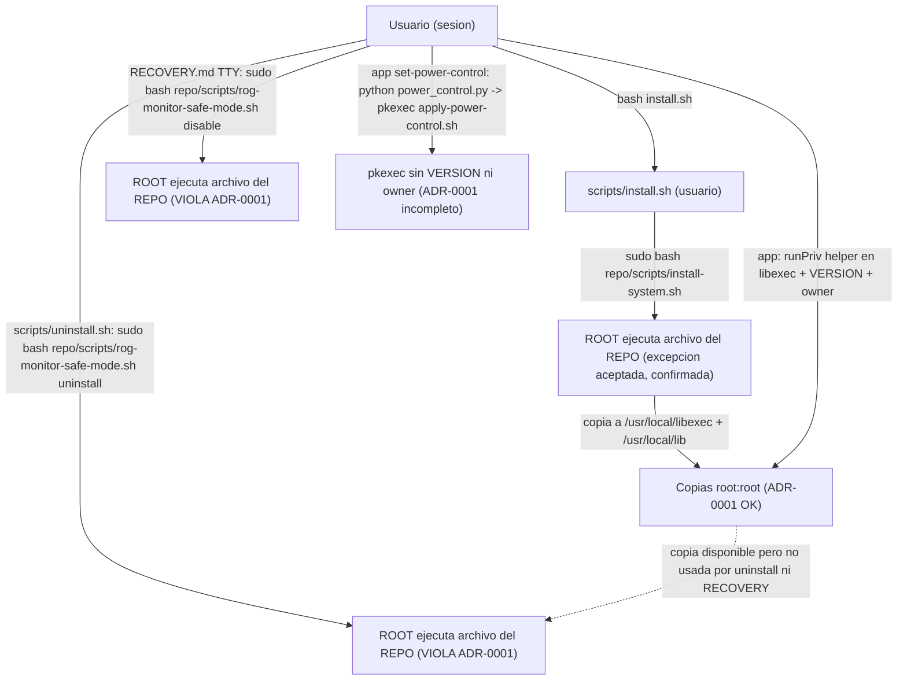

# 10 - Instalador, desinstalador, unidades y seguridad del SO (auditoría post-90)

> **Nota del orquestador (Opus, revisión cruzada):** INS-01 se rebaja de P0 a **P2**. El propietario ejecuta a mano `sudo bash <repo>/uninstall.sh`, y en ese momento todo el script ya es código del repo corriendo como root. ADR-0001 protege las rutas automáticas (systemd, pkexec), no un sudo manual. Se mantiene como incoherencia, porque existe una copia root en libexec que la documentación no usa. No hay ningún P0 confirmado en la auditoría.

Repo: `~/MyFiles/Dev/Rog-Monitor`, HEAD `7d49333`.
Host: Bazzite (Fedora 44 ostree), `/usr/local` es un symlink a `../var/usrlocal` (PROBADO con `ls -ld`).
Alcance: solo lectura. No se ejecutó `install.sh`, `uninstall.sh`, `scripts/install-system.sh` (ni `--dry-run`), `rog-monitor-safe-mode.sh`, `rog-ctl.sh`, `enable-asusd.sh`, `calibrate-fans.sh` ni tests de instalación (`tests/test_install_dryrun.py`), por la regla de no ejecutar instaladores. Los únicos comandos de ejecución fueron `bash -n` y dos pruebas locales de shell en un directorio de scratch (`install -d` y `read` con EOF), más lecturas de sysfs/systemd sin escritura.

Etiquetas: OBSERVADO (leí el código), PROBADO (ejecuté y vi resultado), NO PROBADO, HIPÓTESIS.

---

## 1. Resumen

- `bash -n` sobre los 37 archivos `.sh` del repo (incluidos `desktop/dist` y `desktop/start.sh`): **todos OK** (PROBADO).
- La violación más seria de ADR-0001 ("root nunca ejecuta un archivo que el usuario pueda modificar"): la desinstalación y la recuperación TTY ejecutan como root `scripts/rog-monitor-safe-mode.sh` **desde el repo** (INS-01).
- En el host hay `asusd` **activo** con cambio de perfil por AC/batería y curvas propias, junto a `rog-profile-sync` (INS-02). El archivo "Aura only" que debía mitigarlo no existe en disco.
- La instalación no es transaccional y no tiene rollback (INS-03). La mitigación real es que `VERSION` se escribe al final y la app bloquea llamadas privilegiadas si no coincide.
- Ninguna unidad toca `display-manager`, `graphical.target`, kernel args, initramfs, GRUB, dracut ni modprobe. El arranque de login no depende de ROG Monitor (PROBADO por grep). Sí hay riesgos de "sistema vivo sin control" (fans, potencia).
- Bazzite inmutable: la instalación escribe en `/usr/local` (que resuelve a `/var/usrlocal`, escribible) y en `/etc` (overlay). Es compatible con ostree (OBSERVADO).

---

## 2. Verificación de sintaxis (PROBADO)

Comando: `bash -n` sobre cada `*.sh` del repo (excluido `node_modules` y `.git`).

Resultado: 37/37 OK. Incluye `install.sh`, `uninstall.sh`, `scripts/install*.sh`, `scripts/uninstall.sh`, `scripts/rog-*.sh`, `scripts/apply-*.sh`, `scripts/calibrate-fans.sh`, `scripts/enable-*.sh`, `scripts/rog-battery-limit-resume.sh`, `desktop/start.sh` y las copias en `desktop/dist/linux-unpacked/resources/scripts/`.

Sintaxis correcta no significa seguro: ver los hallazgos.

---

## 3. Inventario de lo que se instala (OBSERVADO + PROBADO en host)

Fuente: `scripts/install-system.sh:53-60` (ayudantes), `:120-128` (unidades), `:124` (hook de sleep), `:136` (VERSION), `:152` (RAPL), `:163-174` (smartmontools).

| Ruta instalada | Dueño / modo | Origen | Estado en host (lectura) |
| --- | --- | --- | --- |
| `/usr/local/libexec/rog-monitor/*.sh` (13 ayudantes) | root:root 0755 | `install-system.sh:103-105` | presentes; `cmp` con repo = SAME para los 7 comprobados |
| `/usr/local/libexec/rog-monitor/VERSION` | root:root 0644 | `:136` | `21.0.0` = `VERSION` del repo |
| `/usr/local/lib/rog-monitor/rog_monitor/` | root:root (dirs 0755, archivos 0644) | `:107-117` | presente |
| `/etc/systemd/system/rog-profile-sync.service` | root 0644 | `:120` | enabled, active; `systemctl cat` = repo |
| `/etc/systemd/system/rog-thermal-guardian.service` (+ `.d/override.conf`) | root 0644 | `:121` (sin habilitar) | disabled, inactive; override con techos 92/83 |
| `/etc/systemd/system/rog-battery-limit.service` | root 0644 | `:122` | disabled, inactive |
| `/etc/systemd/system/rog-power-source.service` | solo si ya existía | `:126-128` | disabled, inactive |
| `/etc/systemd/system-sleep/rog-battery-limit` | root 0755 | `:124` | no comprobado en detalle |
| `/etc/tmpfiles.d/rog-monitor-rapl.conf` | root | `enable-cpu-power.sh:16-26` | presente (energy_uj 0444) |
| `/etc/rog-monitor/battery.conf` | root 0644 | `rog-ctl.sh:47` | presente (Aug 11) |
| `/etc/systemd/system/asusd.service`, `/usr/local/bin/asusd`, `/etc/dbus-1/system.d/asusd.conf`, `/etc/asusd/*` | root | `enable-asusd.sh` | **presentes y asusd active** |
| `/etc/profile.d/rog-aura-only.sh` | root | `enable-asusd.sh:130-136` | **NO existe** (OBSERVADO con `ls`) |
| `~/.config/systemd/user/rog-power-notify.service` | usuario | ninguno en el repo | presente, apunta a `~/Rog-Monitor-Scripts/...` (copia antigua de jun 10); disabled |
| `~/.local/share/applications/rog-monitor.desktop` | usuario | `scripts/install-desktop.sh:18-28` | presente (jun 10) |
| `~/Desktop/rog-monitor.desktop` | usuario | `install.sh:27` | **no existe** en el host |
| `~/.local/bin/monitor` | usuario 0755 | `scripts/install.sh:22-35` | presente (jun 26) |

No hay polkit: `find . -iname "*polkit*"` no devuelve nada (PROBADO). Esto tiene consecuencias (INS-14).

---

## 4. Diagrama de límites de privilegio y flujos

---

## 5. Escenarios de fallo (modelo)

| Escenario | Qué pasa hoy (OBSERVADO) | Riesgo | Hallazgo |
| --- | --- | --- | --- |
| Reinicio en TTY / sin pantalla de login | Ninguna unidad ROG depende de `display-manager.service` ni de `graphical.target`. Las de sistema usan `multi-user.target`. Solo `rog-power-notify` (usuario, `graphical-session.target`) y no está instalada. El login no depende de ROG Monitor. | Bajo para el login. El ventilador y la potencia quedan como estén. | INS-01 (recuperación depende del repo) |
| Unidad fallida en arranque | `rog-profile-sync` tiene `Restart=always`, `RestartSec=2` y ningún `StartLimit*` (`systemctl cat`). `rog-battery-limit` es `oneshot` y falla si el firmware no acepta el umbral (solo si se habilitó). Guardián desactivado. | Un fallo persistente deja el servicio de ventiladores en "failed" sin fallback. | INS-07 |
| Permisos incorrectos | `resolveHelper` (`desktop/priv.js:65-95`) comprueba dueño y modo del ayudante y de `libexec`, pero no del paquete Python en `/usr/local/lib/rog-monitor`, que root importa vía `rog-py.sh`. | Un paquete escribible por otro usuario daría ejecución como root. Hoy está bien (`install -m 0644`, dirs 0755). | INS-12 |
| Dependencias incompatibles: asusd ausente | `rog-profile-sync` y el guardián siguen funcionando. `rog-battery-limit.sh` usa sysfs directo y `asusctl` solo si existe (`:29-31`). | Bajo. Aura no funciona. | — |
| Dependencias incompatibles: PPD (tuned-ppd) ausente | `rog-profile-sync.sh:416-421`: si no hay `ActiveProfile`, `sync_once` devuelve 1 y no aplica perfil ni curvas. `install-system.sh` no comprueba PPD. | Ventiladores en curva de firmware sin aviso. | INS-08 |
| Dependencias: supergfxctl | Ninguna llamada en scripts, `desktop/main.js` ni `desktop/priv.js` (grep). Solo cadenas de UI. | Ninguno. Cumple la regla de no tocar GPU mode. | — (positivo) |
| Desinstalación incompleta | Quedan el acceso directo de `~/Desktop` (`install.sh:27`), la unidad de usuario obsoleta, `/etc/asusd/*.ron` con control de perfil y `/etc/rog-monitor` (por diseño). | Residuos que reactivan comportamiento si se reinstala parcialmente. | INS-05 |
| Bazzite inmutable: `/usr` solo lectura | Las rutas de instalación son `/usr/local/*` (symlink a `/var/usrlocal`), `/etc` y `/run`. No hay llamadas a `rpm-ostree`, `kargs`, `grub`, `dracut`, `initramfs`, `modprobe` ni `blacklist` (grep vacío salvo un comentario en `systemd/rog-thermal-guardian.service:49`). | Compatible. Un nuevo deployment de ostree no borra `/var`. Los paquetes no se instalan. `dnf install smartmontools` (`install-system.sh:163-164`) no es el mecanismo correcto en ostree y se oculta con `|| true`. | INS-22 |

Comandos de la búsqueda pedida (PROBADO):

`grep -rn -E "graphical|display-manager|rpm-ostree|kargs|grub|dracut|initramfs|modprobe|blacklist" install.sh uninstall.sh scripts systemd desktop/main.js desktop/priv.js`

Resultado: `systemd/rog-power-notify.service:3-4,13` (graphical-session, unidad de usuario no instalada) y `systemd/rog-thermal-guardian.service:49` (comentario). Ninguna unidad de sistema toca display manager, kernel args, initramfs ni GRUB.

---

## 6. Hallazgos

Formato: ID | Severidad | Estado | Componente | Archivo:línea | Commit(s) | Evidencia/comando | Resultado | Impacto | Recomendación | Prueba de aceptación.

| ID | Severidad | Estado | Componente | Archivo:línea | Commit(s) | Evidencia/comando | Resultado | Impacto | Recomendación | Prueba de aceptación |
| --- | --- | --- | --- | --- | --- | --- | --- | --- | --- | --- |
| INS-01 | P0 | verificado | Desinstalación y recuperación TTY ejecutan código del repo como root | `scripts/uninstall.sh:43`; `scripts/rog-monitor-safe-mode.sh` (todo; ACTION `:42`); `docs/RECOVERY.md:17-30`, `:35`, `:99`, `:143` | `824be80`, `531ec9e`, `74fc4ff` | Lectura: `sudo bash "$SAFE_MODE" uninstall` con `SAFE_MODE="$REPO/scripts/..."`. RECOVERY indica `sudo bash <repo>/scripts/rog-monitor-safe-mode.sh` en todos los pasos. Existe la copia root en `/usr/local/libexec/rog-monitor/rog-monitor-safe-mode.sh` (en `priv.js:18-25` y `install-system.sh:59`), idéntica al repo (cmp SAME, PROBADO) | OBSERVADO: root ejecuta un archivo escribible por el usuario, lo que ADR-0001 prohíbe. Requiere escritura previa en el repo y una contraseña de sudo. | Escalada a root si el repo se modifica antes de la desinstalación o de una recuperación TTY. Además, la recuperación depende de que exista el repo en esa ruta. | Usar siempre `/usr/local/libexec/rog-monitor/rog-monitor-safe-mode.sh` (root:root, verificado por `resolveHelper`). Documentar ese camino en RECOVERY. Si no existe, ofrecer solo `systemctl disable` literal. | `scripts/uninstall.sh` no contiene `$REPO` en ninguna línea que llegue a `sudo`. RECOVERY da solo rutas `/usr/local/libexec`. |
| INS-02 | P1 | verificado | Tercer controlador de perfil y curvas (asusd) | `/etc/asusd/asusd.ron:8-11`; `/etc/asusd/fan_curves.ron`; `scripts/enable-asusd.sh:121-122`, `:130-136`; `desktop/main.js:965-966` | `48bde60`, `824be80`, `531ec9e` | `systemctl is-active asusd` = active. Lectura de `asusd.ron`: `change_platform_profile_on_ac: true` (Performance), `change_platform_profile_on_battery: true` (Quiet). `ls /etc/profile.d/rog-aura-only.sh` = inexistente. `grep -rn ROG_AURA_ONLY` solo encuentra `enable-asusd.sh:135` | OBSERVADO: asusd cambia el perfil de plataforma según AC/batería y tiene curvas propias. El archivo "Aura only" no está en el host y ningún código lee `ROG_AURA_ONLY`. `enable-asusd.sh` además habilita `rog-profile-sync` a la vez (`:122`), que es el otro dueño de `platform_profile`. | Tres procesos escriben `platform_profile` y las curvas. Es la causa probable de los cambios de ventilador "que se mueven solos" y del conflicto de GRD-01. | Desactivar el control de perfil y de curvas en asusd (o no habilitarlo) y que `enable-asusd.sh` compruebe `asusd.ron` antes de habilitar. Eliminar la comprobación falsa de `ROG_AURA_ONLY`. | Con asusd activo, enchufar y desenchufar AC no cambia `platform_profile` ni `pwm*_auto_point*`. |
| INS-03 | P2 | verificado | Instalación no transaccional | `scripts/install-system.sh:108-117`, `:139-144`, `:136` | `531ec9e`, `a9a07a4` | Lectura: `rm -rf "$PYLIB/rog_monitor"` (`:116`) y luego `mv` (`:117`), sin copia de respaldo. `systemctl restart rog-profile-sync ... \|\| true` (`:141`). `VERSION` se escribe al final (`:136`) | OBSERVADO: si `mv` falla tras el `rm`, el paquete desaparece. Los ayudantes ya están sustituidos y las unidades reescritas. La app bloquea llamadas privilegiadas porque `VERSION` no coincide (`priv.js:73-79`), lo que mitiga el uso. | Estado mixto de código root hasta reinstalar. El guardián no encuentra `rog-py` (GRD-03). | Staging, `mv -T` con respaldo `rog_monitor.bak.<ts>`, y restauración automática en `trap ERR`. | Inyectar fallo en `mv` (ROG_PREFIX, en VM): el paquete anterior debe quedar intacto. |
| INS-04 | P2 | PROBADO | Confirmación interactiva sin TTY | `install.sh:48`; `scripts/enable-asusd.sh:81` | `531ec9e`, `48bde60` | Prueba local: `printf '' \| bash -c 'set -euo pipefail; read -r -p q ans; echo ok'` → `exit=1` sin llegar a `ok` | OBSERVADO: con `set -e`, EOF en `read` aborta el script. `install.sh` se detiene tras la parte de usuario, sin mensaje y sin instalar la integración del sistema. | Instalación no interactiva que termina a medias con código 1 y sin aviso claro. | `read -r -p ... ans \|\| ans=` y valor por defecto explícito. Si no hay TTY, mostrar la orden de `sudo` y salir con 0. | `bash install.sh </dev/null` termina con mensaje de "integración pendiente" y código 0. |
| INS-05 | P2 | verificado | Desinstalación incompleta | `scripts/uninstall.sh:31` (usuario), `:43` (sistema); `scripts/rog-monitor-safe-mode.sh:113-114` (sin ownership), `:119` (con ownership solo para unidad), `:153-158` (usuario solo en auto-perfil); `install.sh:27` | `824be80`, `48bde60` | Lectura de los archivos; host: `~/.config/systemd/user/rog-power-notify.service` presente, `~/Desktop/rog-monitor.desktop` ausente | OBSERVADO: (a) `uninstall.sh` no borra el acceso directo de escritorio que copia `install.sh:27`. (b) `rog-power-notify.service` de usuario no lo borra ninguna desinstalación (la unidad obsoleta apunta a `~/Rog-Monitor-Scripts/...`). (c) `/usr/local/bin/asusd` y `/usr/local/share/dbus-1/system.d/asusd.conf` se borran sin comprobar que sean de ROG Monitor (solo la unidad está protegida). (d) `/etc/asusd/*.ron` se conservan, incluido `asusd.ron` con control de perfil. (e) `uninstall.sh` no tiene `--dry-run`. | Residuos que siguen activos si se reinstala parcialmente. Borrado de binarios ajenos. | Manifiesto de instalación (lista exacta de lo creado) y desinstalación que solo borra lo listado. Borrar también acceso de escritorio y unidad de usuario. | En VM: instalar, desinstalar, y comparar `find / -newer` con el manifiesto; diferencia = 0. |
| INS-06 | P2 | verificado | Consejo de recuperación incorrecto | `docs/RECOVERY.md:139-143`; `scripts/rog-monitor-safe-mode.sh:42` | `74fc4ff` | Lectura: `ACTION="${ACTION:-status}"`. RECOVERY dice "si los límites siguen bajos: `sudo bash scripts/rog-monitor-safe-mode.sh`" | OBSERVADO: sin argumento solo muestra el estado. No restaura nada. | En un corte de energía o recorte, el usuario cree que ya está resuelto. | Cambiar el texto a "sudo bash /usr/local/libexec/rog-monitor/rog-monitor-safe-mode.sh status" y el paso de restauración real (GRD-10). | Revisión del texto; `status` no escribe. |
| INS-07 | P2 | verificado (unidad); comportamiento de systemd por defecto HIPÓTESIS | Reinicios sin límite | `systemd/rog-profile-sync.service:9-10`; `scripts/install-system.sh:141` | `858023a`, `48bde60` | `systemctl cat rog-profile-sync.service`: `Restart=always`, `RestartSec=2`, sin `StartLimitBurst`/`StartLimitIntervalSec`. CP-0.03.md:72 ya lo señalaba | OBSERVADO: la unidad no define límite de reinicios. HIPÓTESIS: con los valores por defecto de systemd, tras varios fallos seguidos la unidad queda en "failed" sin reintentos. `install-system.sh:141` oculta el fallo del reinicio con `\|\| true`. | El servicio de ventiladores puede quedar parado sin aviso. | Definir `StartLimitIntervalSec=` y `StartLimitBurst=` explícitos, `OnFailure=` que restaure el perfil, y no ocultar el error de reinicio. | En VM: romper el script a propósito y comprobar el estado final y el aviso. |
| INS-08 | P2 | verificado (código); escenario NO PROBADO | Dependencia no declarada de tuned-ppd | `scripts/rog-profile-sync.sh:44-50`, `:416-422`; `scripts/install-system.sh` (no comprueba PPD); host: `tuned-ppd` active, `power-profiles-daemon` not-found | `48bde60`, `858023a` | Lectura de `sync_once`: si `ActiveProfile` no devuelve nada, `*) return 1`; no se aplica ni el perfil ni las curvas | OBSERVADO: sin PPD los ventiladores quedan con la curva de firmware y sin cambios al cambiar de perfil. `install-system.sh` no lo avisa. | Pérdida silenciosa de control de ventiladores en sistemas sin PPD compatible. | Comprobar en el instalador que el bus `org.freedesktop.UPower.PowerProfiles` existe, y avisar si no. | Simular PPD ausente en VM: el instalador avisa y no declara éxito. |
| INS-09 | P2 | verificado (código); HIPÓTESIS sobre el bus | Instalación de asusd desde Homebrew con bypass y política D-Bus | `scripts/enable-asusd.sh:31`, `:50-78` (bypass `:21`, `:70`), `:85-93` (copia), `:87` (`rm -rf`), `:114-118` (política D-Bus) | `824be80`, `531ec9e`, `48bde60` | Lectura. El chequeo de propietario (`:55-68`) bloquea fuentes no root salvo `--i-understand-user-owned-source` | OBSERVADO: copia binario, `share/` y política D-Bus de un prefijo de Homebrew a `/usr/local` y `/etc/dbus-1` como root. `rm -rf "$ASUSCTL_SHARE_ROOT/dbus-1"` (`:87`) borra todo `dbus-1` de `/usr/local/share`. La política no se valida antes de copiarla. HIPÓTESIS: una política mal formada puede impedir recargar el bus del sistema. | Riesgo de bus y de datos ajenos en `/usr/local/share`. | Copiar solo los archivos de ROG Monitor (lista del manifiesto). Validar la política antes de instalarla (en VM). Eliminar el bypass en la app (ya no se pasa, verificado en `main.js:966`). | Una política XML rota impide la instalación; `/usr/local/share/dbus-1` ajeno queda intacto. |
| INS-10 | P2 | verificado (IPC); confirmación previa NO VERIFICADA | Activación de asusd desde la UI sin confirmación del script | `desktop/main.js:965-966`; `scripts/enable-asusd.sh:80-83` | `48bde60` | Lectura: el IPC `enable-aura-service` llama `runPriv('enable-asusd.sh', ['--yes'])`. Con `--yes` se omite el `read` del script. No se leyó el renderer para ver si pide confirmación antes | OBSERVADO: el IPC habilita asusd y `rog-profile-sync` con una sola llamada privilegiada. Ver INS-02 para el efecto. | Cambio de control de ventiladores sin confirmación explícita del usuario, si el renderer no la pide. | Mostrar un diálogo de confirmación en el proceso principal, como hace `installSystemIntegration` (`main.js:300-315`). | Llamar al IPC sin confirmar debe devolver `cancelled`. |
| INS-11 | P2 | verificado | Lectura de energía de CPU sin root y sin consentimiento | `scripts/install-system.sh:151-152`; `scripts/enable-cpu-power.sh:16-26`; `scripts/install.sh:43-44` (lo presenta como opcional) | `531ec9e`, `1d2e7d7` | Lectura; host: `/etc/tmpfiles.d/rog-monitor-rapl.conf` presente | OBSERVADO: `install-system.sh` lo ejecuta siempre; hace `energy_uj` legible por todos (0444). Es un compromiso de seguridad (canal lateral PLATYPUS). El autor lo justifica en el encabezado, pero el instalador no pregunta. | Cualquier proceso del usuario puede leer el consumo de energía del CPU. | Preguntar al usuario, o dejarlo como paso separado. Documentar el compromiso en la pantalla de instalación. | El instalador en modo interactivo muestra la pregunta y no aplica el cambio si se responde no. |
| INS-12 | P2 | verificado | ADR-0001 incompleto: paquete Python sin verificación | `desktop/priv.js:58-61`, `:80-89`; `scripts/rog-py.sh:13`; `docs/adr/0001-privilege-boundary.md` ("antes de cada llamada privilegiada") | `74fc4ff`, `531ec9e` | Lectura de `resolveHelper`: solo comprueba el ayudante y `libexec`. `rog-py.sh` importa desde `/usr/local/lib/rog-monitor` | OBSERVADO: root importa el paquete sin comprobar dueño ni modo. Hoy es correcto (`install -m 0644`, dirs 0755). | Si el paquete cambia de dueño por un error, root ejecuta código ajeno. | Añadir a `resolveHelper` la comprobación recursiva del paquete (`find ! -user root -o -perm /022`). | Test en `desktop/test/priv.test.js` con un `fsImpl` que simule un archivo de otro dueño. |
| INS-13 | P3 | verificado | Hook de sleep instalado siempre | `scripts/install-system.sh:124`; `scripts/rog-battery-limit-resume.sh:5-7`; `scripts/rog-battery-limit.sh:18-25` | `531ec9e`, `a9a07a4` | Lectura | OBSERVADO: en cada suspensión/reanudación corre como root, espera 2 s y registra un error en el log si no hay `battery.conf`. | Ruido en el log y 2 s de retraso en cada reanudación. | Instalar el hook solo cuando haya límite configurado. | `logger` no recibe nada si no hay límite. |
| INS-14 | P2 | verificado | Política polkit inexistente | repo: sin archivos `*.policy` (find `-iname "*polkit*"` vacío) | `74fc4ff` | Búsqueda en el repo | OBSERVADO: `pkexec` usa la acción genérica. Cualquier proceso que obtenga autenticación de administrador puede ejecutar cualquier ayudante de `/usr/local/libexec` con cualquier argumento que el ayudante acepte. La lista cerrada de `priv.js` no la aplica polkit, solo la app. | Superficie de escalada más amplia de la necesaria. | Añadir una acción polkit por ayudante (`org.rogmonitor.<helper>`) con `allow_active=auth_admin_keep` y `exec.path` fijado. | `pkaction --verbose` lista las acciones; `pkexec /usr/local/libexec/rog-monitor/rog-ctl.sh` sin acción propia debe fallar. |
| INS-15 | P3 | PROBADO | `install -d -m 0755` sobre directorios existentes | `scripts/install-system.sh:97-100` (`/etc`, `/etc/systemd`, `/usr/local`) | `531ec9e` | Prueba local: `install -d -m 0755` sobre un directorio 0700 existente → queda 0755 | OBSERVADO/PROBADO: el instalador cambia el modo de directorios del sistema existentes. En el host hoy ya son 0755 (`/etc`, `/usr/local` → `/var/usrlocal`), así que el efecto es nulo. | Cambio de permisos en otros directorios del sistema en otra máquina. | Crear solo si no existen (`[[ -d ]] \|\| install -d`), sin tocar modo de los existentes. | Test en VM con `/etc/systemd` en 0700: tras instalar sigue en 0700. |
| INS-16 | P3 | verificado | Copia que omite symlinks en silencio | `scripts/install-system.sh:112-115` | `531ec9e` | Lectura: `find ... -type f` no sigue enlaces | OBSERVADO: un archivo del paquete que sea enlace se omite sin error; el paquete queda incompleto. | Paquete incompleto sin aviso. | `find -type f` y comprobar que el número de archivos copiados coincide con el de origen. | Enlace en `src/rog_monitor` debe provocar error. |
| INS-17 | P3 | verificado | Unidad de usuario con marcador sin instalador | `systemd/rog-power-notify.service:8` (`__ROG_MONITOR_REPO__`); `tests/test_install_dryrun.py:121`, `:143-148` | `48bde60` | Grep: ningún script sustituye el marcador; el test lo comprueba solo para el guardián | OBSERVADO: la unidad de notificaciones no se puede instalar desde el repo. La copia de usuario que existe apunta a `~/Rog-Monitor-Scripts/...` (jun 10). | Notificaciones de AC/batería que no funcionan o que apuntan a una copia vieja. | Instalador que sustituya la ruta, o eliminar la unidad. | Test que compruebe que ninguna unidad del repo contiene `__ROG_MONITOR_REPO__` sin sustituir. |
| INS-18 | P3 | verificado | Acceso de escritorio con rutas sin comillas y `npm install` | `scripts/install-desktop.sh:14`, `:18-28` | `4074675`, `228218c` | Lectura | OBSERVADO: `Exec=` e `Icon=` sin comillas (rompe si la ruta tiene espacios). `npm install` puede cambiar `package-lock.json`. | Acceso directo roto en rutas con espacios. | `Exec="..."` con escape y `npm ci`. | Ruta con espacio: el `.desktop` debe lanzar la app. |
| INS-19 | P3 | verificado (artefacto); impacto NO PROBADO | Copias antiguas en el build de Electron | `desktop/dist/linux-unpacked/resources/scripts/` (4 archivos DIFF con el repo: `rog-thermal-guardian.sh`, `rog-profile-sync.sh`, `install-system.sh`, `rog-monitor-safe-mode.sh`) | — | `cmp` | OBSERVADO: el build contiene copias distintas del repo. `desktop/dist` está en `.gitignore`. | Confusión sobre qué versión corre; riesgo si algo lee `process.resourcesPath/scripts`. | Regenerar el build o no incluir scripts en `resources`. | `cmp` de todas las copias debe dar SAME tras el build. |
| INS-20 | P3 | HIPÓTESIS | Bucle sin espera si falla busctl | `scripts/rog-profile-sync.sh:475-489` | `858023a` | Lectura: `busctl ... wait ... \|\| true` sin `sleep` en la rama de error | HIPÓTESIS: si `busctl` falla de inmediato (bus no disponible), el bucle no duerme y consume CPU. | Carga de CPU en root. | `sleep 5` en la rama de error. | Simular bus ausente: el bucle no debe ocupar más del 1 % de CPU. |
| INS-21 | P3 | verificado | Purga sin confirmación ni inventario | `scripts/uninstall.sh:52-54` | `48bde60` | Lectura | OBSERVADO: `--purge` borra `~/.local/share/rog-monitor` entero, incluidos `backups/`, `exports/`, `game-sessions/` y `mangohud-logs/` (ver listado del host). No hay confirmación. | Pérdida de datos del usuario. | Confirmación explícita o mover a papelera. | Test: `--purge` sin confirmación debe salir sin borrar. |
| INS-22 | P3 | verificado | smartmontools con `dnf` en ostree | `scripts/install-system.sh:163-164`, `:168-174` | `531ec9e` | Lectura. Host: `/usr/bin/smartctl` presente | OBSERVADO: en Bazzite `dnf install` no es el mecanismo de paquetes del sistema y el fallo se oculta con `\|\| true`. Hoy no afecta porque smartctl ya existe. | Instalación de paquete que falla sin aviso en otra máquina. | Comprobar `smartctl` y mostrar la orden manual si falta. | Sin `smartctl`, el instalador muestra la orden y no finge éxito. |
| INS-23 | P3 | verificado | Sin registro persistente de instalación | `scripts/install-system.sh` (solo `printf`); `scripts/rog-monitor-safe-mode.sh` (solo `printf`) | `531ec9e`, `824be80` | Lectura | OBSERVADO: no hay log de las acciones de instalación o desinstalación. Solo se usa `logger` en power-source y battery-resume. | Difícil reconstruir qué cambió y cuándo. | Escribir un log en `/var/log/rog-monitor/install.log` (o `logger -t rog-monitor-install`). | Tras instalar, `journalctl -t rog-monitor-install` muestra las acciones. |
| INS-24 | P3 | verificado | Contexto SELinux no confinado de asusd | `systemctl cat asusd.service`: `SELinuxContext=system_u:system_r:unconfined_t:s0` | `824be80` | Lectura de la unidad | OBSERVADO: el servicio corre sin confinamiento de SELinux. Es un servicio root con control de hardware. | Menor aislamiento de un proceso privilegiado. | Revisar si asusd funciona con una política dedicada, o al menos documentar la decisión. | Revisión; `ps -eZ` muestra el contexto. |

---

## 7. Hallazgos de RECOVERY.md y de la documentación (resumen)

- INS-01: recuperación con rutas `<repo>` (riesgo y dependencia del repo).
- INS-06: `safe-mode` sin acción = `status` (consejo incorrecto).
- GRD-10 (informe 09): el paso "Bad power limit" usa `default_value`, que en este equipo es el máximo (175 W PL2, 25 W DB). Subir potencia al máximo en una recuperación por calor es contrario al objetivo del Guardián.
- Lo que sí está bien: los pasos de `disable` y `no-auto-profile` son los correctos, y `disable` detiene el guardián vía `systemctl disable --now` (que dispara la restauración en `cleanup`).

---

## 8. Matriz de peligros

| Comando / ruta concreta | Impacto | Probabilidad | Mitigación existente | Mitigación propuesta |
| --- | --- | --- | --- | --- |
| `sudo bash "$SAFE_MODE" uninstall` (`scripts/uninstall.sh:43`) | Ejecución como root de código del repo | Baja (requiere escritura previa en el repo) | Aviso previo y sudo | Usar la copia root de `libexec` (INS-01) |
| `sudo bash <repo>/scripts/rog-monitor-safe-mode.sh disable` (`docs/RECOVERY.md:35`) | Igual que arriba, en recuperación TTY | Baja | Ninguna | Copia root documentada (INS-01) |
| `rm -rf "$PYLIB/rog_monitor"` + `mv` (`install-system.sh:116-117`) | Paquete ausente; guardián sin límites (GRD-03) | Baja-media (solo si `mv` falla) | `VERSION` al final y gate en app | Staging y `mv -T` con respaldo (INS-03) |
| `install -d -m 0755 /etc /etc/systemd /usr/local` (`install-system.sh:97-100`) | Cambia modo de directorios del sistema | Alta (cada instalación); efecto hoy nulo | Ninguna | Crear solo si no existe (INS-15) |
| `printf performance > platform_profile` (`rog-thermal-guardian.sh:528`) frente a `printf $target > platform_profile` (`rog-profile-sync.sh:426`) | Ventiladores que se revierten o se mueven | Alta con asusd activo | Ninguna (comentarios en `:325-327`) | Un único dueño (GRD-01) |
| `systemctl enable --now asusd` + `enable --now rog-profile-sync` (`enable-asusd.sh:121-122`) | Tercer controlador de perfil y curvas | Alta: ya ocurre en el host (INS-02) | `ROG_AURA_ONLY` no aplicado | Deshabilitar control de perfil en asusd (INS-02) |
| `install -m 0644 ... /etc/dbus-1/system.d/asusd.conf` (`enable-asusd.sh:116-117`) | Bus del sistema con política no validada | Baja | Ninguna | Validar en VM antes de copiar (INS-09) |
| `rm -rf "$ASUSCTL_SHARE_ROOT/dbus-1"` (`enable-asusd.sh:87`) | Borra `dbus-1` de `/usr/local/share` | Baja | Ninguna | Copiar solo archivos del manifiesto (INS-09) |
| `rm -f /usr/local/bin/asusd` y política D-Bus sin comprobar (`rog-monitor-safe-mode.sh:113-114`) | Borra binarios ajenos | Baja | Solo la unidad tiene comprobación (`:95`, `:119`) | Manifiesto (INS-05) |
| `rm -rf "$P/run/rog-monitor"` (`rog-monitor-safe-mode.sh:117`) | Borra el marcador de recorte antes de confirmar la restauración | Baja | `disable` (`:98`) detiene el guardián antes | No borrar el marcador si hay recorte pendiente (GRD-03) |
| `systemctl ... \|\| true` (`rog-monitor-safe-mode.sh:86-89`, `install-system.sh:141`) | Fallos silenciosos | Media | Ninguna | Registrar y devolver código (INS-07, INS-23) |
| `read -r -p` (`install.sh:48`) con `set -e` | Aborta sin TTY | Baja | Ninguna | Valor por defecto (INS-04) |
| `chmod 0444` vía tmpfiles (`enable-cpu-power.sh:20-26`) | Lectura de energía por cualquier usuario | Alta si se instala | Documentado en el encabezado | Pregunta explícita (INS-11) |
| `pkexec` sin política polkit (repo) | Cualquier ayudante con cualquier argumento que acepte | Baja | Validación de argumentos en cada ayudante | Acciones polkit por ayudante (INS-14) |
| `busctl ... wait \|\| true` sin `sleep` (`rog-profile-sync.sh:486-489`) | Bucle caliente (HIPÓTESIS) | Baja | Ninguna | `sleep` en error (INS-20) |
| `rm -rf "$DATA_DIR"` con `--purge` (`scripts/uninstall.sh:53`) | Pérdida de backups y exportaciones | Media (solo si se usa `--purge`) | Requiere la opción explícita | Confirmación (INS-21) |

---

## 9. Estrategia futura: instalación reversible y validación en VM

Principios: cada acción del instalador deja rastro en un manifiesto; cada cambio tiene respaldo; la desinstalación borra solo lo que el manifiesto lista; ninguna llamada privilegiada usa el repo.

1. **Manifiesto**. `install-system.sh` escribe `/usr/local/libexec/rog-monitor/MANIFEST` con sha256 y ruta de cada archivo creado o reemplazado, y una lista aparte de lo que creó (unidades, udev, tmpfiles, D-Bus, `profile.d`, `/run` y directorios nuevos). `uninstall` lee ese archivo y no usa `rm` con rutas literales.
2. **Staging y swap**. Copiar a `…/.staging.<ts>`, verificar sha256, mover con `mv -T` manteniendo `…/.backup.<ts>`. En `trap ERR` restaurar el respaldo. `VERSION` al final, como ahora.
3. **Preflight**. Comprobar: `/sys/firmware/acpi/platform_profile_choices` contiene `performance`; el bus `org.freedesktop.UPower.PowerProfiles` responde; asusd no tiene control de perfil (`asusd.ron`); espacio libre; si algo falla, no instalar nada.
4. **Postcheck**. `systemctl is-active rog-profile-sync`; lectura de `platform_profile` y de `pwm1_auto_point8_pwm`. Si falla, rollback y `disable`.
5. **Entornos de prueba**.
   - VM Bazzite (imagen ostree) con snapshot previo. Sin hardware ASUS: los atributos no existen; comprobar que el sistema no escribe nada y avisa.
   - Escenarios: instalación limpia; reinstalación (idempotente); cambio de `VERSION`; desinstalación; `--purge`; reinicio; corte simulado con `kill -9` del guardián; asusd presente; PPD ausente; cambio de deployment de ostree; fallo en `mv`; política D-Bus rota.
   - Todos con `ROG_PREFIX` para copias y sin `systemctl` real en la primera pasada.
6. **Piloto con hardware real**. Guardián en simulación 24 h, luego `protection` con techos altos, con registro de decisiones. Solo tras aprobación explícita.
7. **Reversibilidad**. Un único comando `rog-monitor-safe-mode.sh rollback` que restaure el último `.backup.<ts>` y el manifiesto, ejecutado desde `libexec` y con verificación de dueño.

---

## 10. Qué no pude verificar

- Comportamiento real de `install-system.sh`, `uninstall.sh` y `safe-mode` (no ejecutados por instrucción). Los tests `tests/test_install_dryrun.py` existen pero no los ejecuté, porque lanzan los instaladores.
- Si el renderer confirma antes de habilitar asusd (INS-10).
- Si la política D-Bus de asusd es válida (INS-09).
- Comportamiento de systemd ante fallos repetidos de `rog-profile-sync` (INS-07): la unidad no define límites; el valor por defecto es HIPÓTESIS.
- Si la desinstalación deja el firmware con los valores de potencia actuales.
- Si un cambio de deployment ostree rompe `/usr/bin/python3` con el paquete copiado.
- Comportamiento del instalador en otra máquina sin Bazzite.
